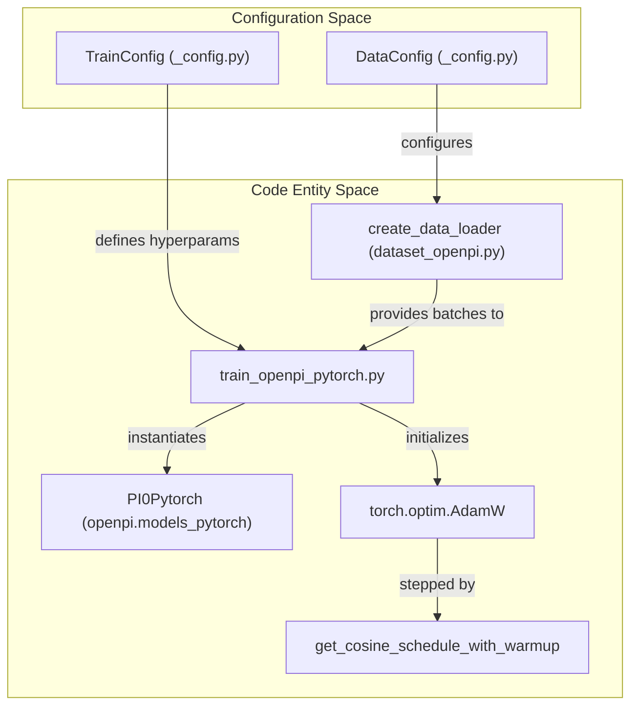
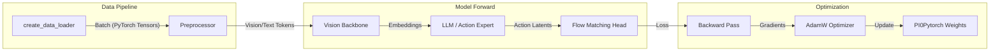

<!-- source: DeepWiki mcp.deepwiki.com · repo allenai/MolmoBot · page 3.2 Pi0 Training · fetched 2026-10-26 -->

# Pi0 Training

Relevant source files

The following files were used as context for generating this wiki page:

- [MolmoBot-Pi0/molmobot_pi0/train_openpi_pytorch.py](MolmoBot-Pi0/molmobot_pi0/train_openpi_pytorch.py)
- [MolmoBot-Pi0/molmobot_pi0/utils.py](MolmoBot-Pi0/molmobot_pi0/utils.py)
- [MolmoBot-Pi0/scripts/convert_jax_model_to_pytorch.py](MolmoBot-Pi0/scripts/convert_jax_model_to_pytorch.py)

The `MolmoBot-Pi0` training pipeline is a PyTorch-based implementation designed to fine-tune Physical Intelligence’s Pi0 and Pi0.5 Vision-Language-Action (VLA) models. While the original Pi0 implementation relies on JAX, this repository provides a full PyTorch training loop (`train_openpi_pytorch.py`) with support for Multi-GPU Distributed Data Parallel (DDP) training, gradient checkpointing, and seamless integration with the DROID-format datasets used across MolmoBot.

## Training Entrypoint and DDP Setup

The primary entrypoint for training is `train_openpi_pytorch.py` [MolmoBot-Pi0/molmobot_pi0/train_openpi_pytorch.py:1-24](). It initializes the distributed environment using `torch.distributed` and sets up the device mapping for multi-node or multi-GPU execution.

### Distributed Lifecycle
1.  **`setup_ddp()`**: Initializes the process group using the `nccl` backend (for GPUs) and configures the local rank and device [MolmoBot-Pi0/molmobot_pi0/train_openpi_pytorch.py:109-124]().
2.  **`set_seed()`**: Ensures deterministic behavior across replicas by offsetting the seed with the `local_rank` [MolmoBot-Pi0/molmobot_pi0/train_openpi_pytorch.py:133-138]().
3.  **`cleanup_ddp()`**: Synchronizes processes via a barrier before destroying the process group at the end of training [MolmoBot-Pi0/molmobot_pi0/train_openpi_pytorch.py:127-130]().

**Sources:** [MolmoBot-Pi0/molmobot_pi0/train_openpi_pytorch.py]()

## Model Construction and Weight Loading

The trainer utilizes the `PI0Pytorch` model class. Weights can be loaded from two primary sources: original PaliGemma checkpoints or custom training checkpoints.

### Weight Loading Strategies
*   **`PaliGemmaWeightLoader`**: Used when starting from a base PaliGemma model. It maps standard vision-language weights into the `PI0Pytorch` architecture.
*   **`CheckpointWeightLoader`**: Used for resuming training or loading a previously fine-tuned Pi0 model. It handles the mapping of the action-expert heads and flow-matching layers.

### Training Configuration Flow
The following diagram bridges the configuration classes to the training execution entities.

**Training Entity Map**

**Sources:** [MolmoBot-Pi0/molmobot_pi0/train_openpi_pytorch.py:45-55](), [MolmoBot-Pi0/molmobot_pi0/train_openpi_pytorch.py:140-144]()

## Training Loop Implementation

The training loop manages the forward pass, loss computation (typically flow-matching loss for actions), and optimization steps.

### Key Components
*   **Gradient Checkpointing**: To reduce memory consumption during the fine-tuning of large backbones, gradient checkpointing is supported [MolmoBot-Pi0/molmobot_pi0/train_openpi_pytorch.py:202-210]().
*   **Optimizer & Schedule**: Uses `AdamW` with a cosine learning rate schedule including a warmup phase.
*   **Atomic Checkpointing**: Checkpoints are saved using `safetensors`. To prevent corruption during crashes, the trainer writes to a temporary directory (`tmp_...`) and performs an atomic rename to the final step directory once the write is complete [MolmoBot-Pi0/molmobot_pi0/train_openpi_pytorch.py:179-199]().
*   **WandB Integration**: Tracks loss, learning rate, and experiment metadata. If running on Beaker, it automatically captures the experiment URL [MolmoBot-Pi0/molmobot_pi0/train_openpi_pytorch.py:79-107]().

### Data Flow Diagram
This diagram illustrates the flow from raw data to the optimized model parameters.

**Pi0 Data Flow**

**Sources:** [MolmoBot-Pi0/molmobot_pi0/train_openpi_pytorch.py:140-144](), [MolmoBot-Pi0/molmobot_pi0/train_openpi_pytorch.py:146-162]()

## JAX-to-PyTorch Conversion

Since many pre-trained Pi0 weights are released in JAX format (Flax/Orbax), the repository includes a conversion utility: `convert_jax_model_to_pytorch.py`.

### Conversion Process
1.  **Load JAX Checkpoint**: Uses `orbax.checkpoint` to load the JAX parameters [scripts/convert_jax_model_to_pytorch.py:20-22]().
2.  **Slice and Map**: The function `slice_paligemma_state_dict` performs the heavy lifting of remapping JAX's hierarchical kernel/bias structure to PyTorch's `nn.Linear` and `nn.Conv2d` weight formats [scripts/convert_jax_model_to_pytorch.py:35-134]().
3.  **Transpose Kernels**: JAX typically uses `(H, W, In, Out)` for convolutions, which are transposed to PyTorch's `(Out, In, H, W)` [scripts/convert_jax_model_to_pytorch.py:42]().
4.  **Save Safetensors**: The resulting state dict is saved as a `.safetensors` file, which is then compatible with the `PI0Pytorch` model and the `train_openpi_pytorch.py` script.

**Sources:** [MolmoBot-Pi0/scripts/convert_jax_model_to_pytorch.py]()

## Utilities

*   **`TimeLogger`**: Provides `CPUTimeLogger` and `GPUTimeLogger` (using `torch.cuda.Event`) for precise profiling of the training loop bottlenecks [MolmoBot-Pi0/molmobot_pi0/utils.py:29-68]().
*   **`Checkpointer`**: A helper class that manages the saving and loading of `.pth` files, supporting "latest-only" modes or step-based versioning [MolmoBot-Pi0/molmobot_pi0/utils.py:76-116]().
*   **`gather_info`**: Aggregates metrics across DDP ranks for synchronized logging to WandB [MolmoBot-Pi0/molmobot_pi0/utils.py:184-194]().

**Sources:** [MolmoBot-Pi0/molmobot_pi0/utils.py]()

---

