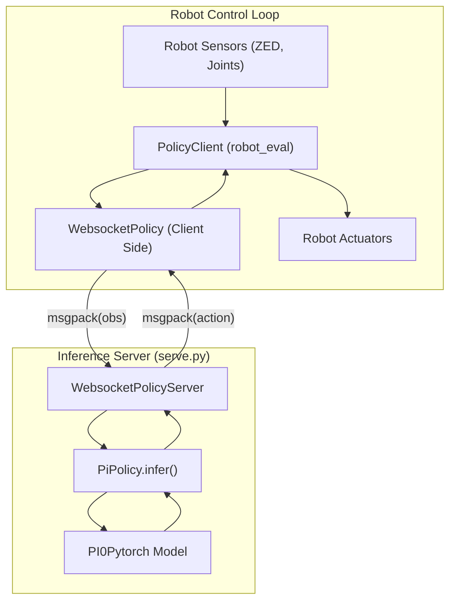

<!-- source: DeepWiki mcp.deepwiki.com · repo allenai/MolmoBot · page 3.3 Pi0 Evaluation & Policy Serving · fetched 2026-10-26 -->

# Pi0 Evaluation & Policy Serving

<details>
<summary>Relevant source files</summary>

The following files were used as context for generating this wiki page:

- [MolmoBot-Pi0/config/eval/eval.yaml](MolmoBot-Pi0/config/eval/eval.yaml)
- [MolmoBot-Pi0/config/eval/policy/cameras/real.yaml](MolmoBot-Pi0/config/eval/policy/cameras/real.yaml)
- [MolmoBot-Pi0/config/eval/policy/cameras/sim_exo_random.yaml](MolmoBot-Pi0/config/eval/policy/cameras/sim_exo_random.yaml)
- [MolmoBot-Pi0/config/eval/policy/cameras/sim_exo_shoulder.yaml](MolmoBot-Pi0/config/eval/policy/cameras/sim_exo_shoulder.yaml)
- [MolmoBot-Pi0/config/eval/policy/empty.yaml](MolmoBot-Pi0/config/eval/policy/empty.yaml)
- [MolmoBot-Pi0/config/eval/policy/paligemma.yaml](MolmoBot-Pi0/config/eval/policy/paligemma.yaml)
- [MolmoBot-Pi0/config/eval/policy/pi.yaml](MolmoBot-Pi0/config/eval/policy/pi.yaml)
- [MolmoBot-Pi0/molmobot_pi0/eval/eval.py](MolmoBot-Pi0/molmobot_pi0/eval/eval.py)
- [MolmoBot-Pi0/molmobot_pi0/eval/policies/pi.py](MolmoBot-Pi0/molmobot_pi0/eval/policies/pi.py)
- [MolmoBot-Pi0/molmobot_pi0/eval/policies/stateful.py](MolmoBot-Pi0/molmobot_pi0/eval/policies/stateful.py)
- [MolmoBot-Pi0/molmobot_pi0/eval/policies/websocket.py](MolmoBot-Pi0/molmobot_pi0/eval/policies/websocket.py)
- [MolmoBot-Pi0/molmobot_pi0/eval/real/serve.py](MolmoBot-Pi0/molmobot_pi0/eval/real/serve.py)
- [MolmoBot-Pi0/molmobot_pi0/eval/real/utils.py](MolmoBot-Pi0/molmobot_pi0/eval/real/utils.py)
- [MolmoBot-Pi0/molmobot_pi0/eval/utils.py](MolmoBot-Pi0/molmobot_pi0/eval/utils.py)

</details>


This page documents the evaluation infrastructure and deployment mechanisms for the MolmoBot-Pi0 project. It covers the simulation evaluation pipeline integrated with `MolmoSpaces`, the policy abstractions used for inference, and the WebSocket-based serving architecture for real-robot deployment.

## Evaluation Pipeline & Configuration

The evaluation system is built around `MolmoSpaces`, a simulation and evaluation harness. The primary entry point for running evaluations is `eval.py`, which utilizes Hydra for configuration management.

### Configuration (eval.yaml)
The evaluation behavior is governed by `eval.yaml`. It defines parameters for the simulation environment, the number of parallel workers, and the success criteria for episodes.

| Parameter | Description |
| :--- | :--- |
| `num_workers` | Number of parallel simulation processes [MolmoBot-Pi0/config/eval/eval.yaml:5](). |
| `n_videos` | Number of evaluation videos to log to Weights & Biases [MolmoBot-Pi0/config/eval/eval.yaml:7](). |
| `horizon` | Maximum episode duration in seconds [MolmoBot-Pi0/config/eval/eval.yaml:8](). |
| `min_success_duration` | Time in seconds the success condition must hold to count as a success [MolmoBot-Pi0/config/eval/eval.yaml:9](). |

### Simulation Runner (eval.py)
The `eval.py` script executes the evaluation loop. It configures the MuJoCo EGL rendering device based on the local rank for distributed runs [MolmoBot-Pi0/molmobot_pi0/eval/eval.py:4-5]() and invokes `run_evaluation` from `molmo_spaces` [MolmoBot-Pi0/molmobot_pi0/eval/eval.py:65-74]().

Key features of the evaluation runner:
*   **Success Filtering**: It filters out "spurious" successes by ensuring the success flag is consistent over a sliding window defined by `min_success_duration` [MolmoBot-Pi0/molmobot_pi0/eval/eval.py:117-123]().
*   **Metrics Collection**: Calculates evaluation throughput, time-to-success, and task progress based on position error [MolmoBot-Pi0/molmobot_pi0/eval/eval.py:80-83, 138-140]().
*   **Video Logging**: Selects a distribution of successful and failed episodes to upload as videos for visual inspection [MolmoBot-Pi0/molmobot_pi0/eval/eval.py:170-182]().

**Sources:** [MolmoBot-Pi0/config/eval/eval.yaml:1-16](), [MolmoBot-Pi0/molmobot_pi0/eval/eval.py:1-163]()

---

## Policy Implementations

MolmoBot-Pi0 uses a hierarchical policy structure to handle state management and different communication protocols.

### Policy Class Hierarchy
The system defines several policy types to bridge the gap between model inference and environment interaction.

*   **`StatefulPolicy`**: An abstract base class defining `get_state()` and `set_state()` for handling policies with internal buffers or temporal dependencies [MolmoBot-Pi0/molmobot_pi0/eval/policies/stateful.py:7-14]().
*   **`PiPolicy`**: The core implementation for Pi0 models. it manages model loading (JAX or PyTorch), action buffering, and image preprocessing [MolmoBot-Pi0/molmobot_pi0/eval/policies/pi.py:38-49]().
*   **`WebsocketPolicy`**: A client-side policy that forwards observations to a remote `WebsocketPolicyServer` and receives actions, allowing the model to run on a separate GPU-equipped machine [MolmoBot-Pi0/molmobot_pi0/eval/policies/websocket.py:16-21]().

### Action Handling in PiPolicy
`PiPolicy` supports action chunking via an internal `actions_buffer`. If the buffer has remaining actions, the policy returns the next cached action instead of triggering a new model inference pass [MolmoBot-Pi0/molmobot_pi0/eval/policies/pi.py:156-157, 185-188]().

**Sources:** [MolmoBot-Pi0/molmobot_pi0/eval/policies/pi.py:38-188](), [MolmoBot-Pi0/molmobot_pi0/eval/policies/stateful.py:7-14](), [MolmoBot-Pi0/molmobot_pi0/eval/policies/websocket.py:16-126]()

---

## Real-Robot Serving Architecture

For real-robot deployment, the policy is served via a WebSocket server. This decouples the high-frequency robot control loop from the heavy VLA model inference.

### Serving Entrypoint (serve.py)
The `serve.py` script initializes the `WebsocketPolicyServer`. It can load multiple policy instances across available GPUs to increase throughput [MolmoBot-Pi0/molmobot_pi0/eval/real/serve.py:76-86]().

The server uses `load_pi` to instantiate either `PiJointVelPolicy` or `PiJointPosPolicy` based on the configuration [MolmoBot-Pi0/molmobot_pi0/eval/real/serve.py:49-54]().

### Data Flow: Robot to Policy Server
The following diagram illustrates how observations flow from the robot sensors to the model and back as actions.

**Policy Serving Data Flow**

**Sources:** [MolmoBot-Pi0/molmobot_pi0/eval/real/serve.py:1-98](), [MolmoBot-Pi0/molmobot_pi0/eval/policies/websocket.py:70-118]()

---

## Camera Configurations

The evaluation and serving pipelines use YAML files to map environment-specific camera names to the standard input keys expected by the Pi0 model (`observation/exterior_image_1_left` and `observation/wrist_image_left`).

| Config File | Exterior Camera Source | Wrist Camera Source |
| :--- | :--- | :--- |
| `real.yaml` | `observation/exterior_image_1_left` | `observation/wrist_image_left` |
| `sim_exo_random.yaml` | `randomized_zed2_analogue_1` | `wrist_camera_zed_mini` |
| `sim_exo_shoulder.yaml` | `droid_shoulder_light_randomization` | `wrist_camera_zed_mini` |

**Sources:** [MolmoBot-Pi0/config/eval/policy/cameras/real.yaml:1-2](), [MolmoBot-Pi0/config/eval/policy/cameras/sim_exo_random.yaml:1-2](), [MolmoBot-Pi0/config/eval/policy/cameras/sim_exo_shoulder.yaml:1-2]()

---

## Technical Entities & Code Mapping

The following diagram maps high-level evaluation concepts to their specific class and file implementations.

**Evaluation Entity Mapping**
```mermaid
classDiagram
    class "Evaluation Runner" as EvalRunner {
        eval.py
        run_evaluation()
    }
    class "Policy Server" as Server {
        serve.py
        WebsocketPolicyServer
    }
    class "Policy Implementation" as Policy {
        pi.py
        PiPolicy
        PiJointVelPolicy
    }
    class "State Management" as State {
        stateful.py
        StatefulPolicy
        PiPolicyState
    }

    EvalRunner --> Policy : uses
    Server --> Policy : hosts
    Policy --|> State : implements
    Policy --> "openpi.models" : wraps
```
**Sources:** [MolmoBot-Pi0/molmobot_pi0/eval/eval.py:31](), [MolmoBot-Pi0/molmobot_pi0/eval/real/serve.py:12](), [MolmoBot-Pi0/molmobot_pi0/eval/policies/pi.py:38](), [MolmoBot-Pi0/molmobot_pi0/eval/policies/stateful.py:7]()

---

