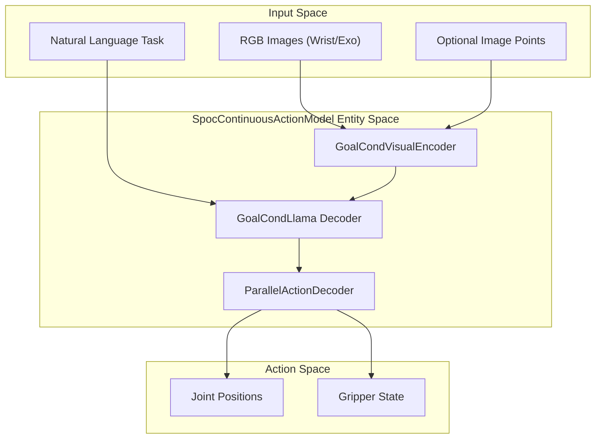
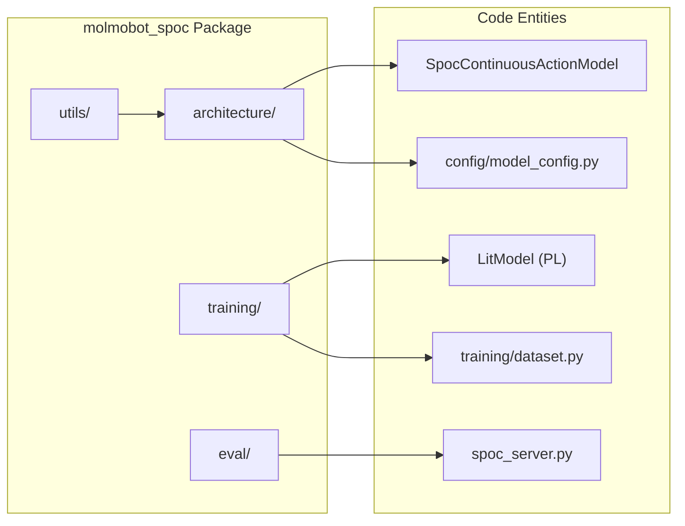

<!-- source: DeepWiki mcp.deepwiki.com · repo allenai/MolmoBot · page 4 MolmoBot-SPOC: Lightweight Goal-Conditioned Policy · fetched 2026-10-26 -->

# MolmoBot-SPOC: Lightweight Goal-Conditioned Policy

Relevant source files

The following files were used as context for generating this wiki page:

- [MolmoBot-SPOC/README.md](MolmoBot-SPOC/README.md)
- [MolmoBot-SPOC/__init__.py](MolmoBot-SPOC/__init__.py)
- [MolmoBot-SPOC/pyproject.toml](MolmoBot-SPOC/pyproject.toml)

MolmoBot-SPOC is a sub-project within the MolmoBot repository focused on providing a lightweight, goal-conditioned transformer policy for robotic manipulation [MolmoBot-SPOC/README.md:3-5](). Unlike the heavy VLM-based MolmoBot, SPOC utilizes a compact architecture consisting of a SigLIP vision encoder and a Llama-based transformer decoder to map RGB observations and natural language instructions into continuous robot actions [MolmoBot-SPOC/README.md:5-5]().

The project supports multiple robot platforms, including the **Franka Panda** (using the DROID dataset format) and the **RBY1** mobile manipulator [MolmoBot-SPOC/README.md:32-42](). It is designed for efficiency, supporting real-time inference via a WebSocket-based policy server [MolmoBot-SPOC/README.md:84-107]().

### System Overview

The SPOC pipeline integrates vision, language, and proprioception to perform tasks such as "pick and place" or "open the door" [MolmoBot-SPOC/README.md:93-95](). The following diagram illustrates the high-level flow from observation to execution.

**SPOC Data and Control Flow**

Sources: [MolmoBot-SPOC/README.md:3-5](), [MolmoBot-SPOC/pyproject.toml:9-21]()

---

### [SPOC Model Architecture](#4.1)

The core of the policy is the `SpocContinuousActionModel`. It leverages a `GoalCondVisualEncoder` (built on `open_clip_torch` SigLIP) to process multi-view camera inputs and a `GoalCondLlama` transformer to fuse these features with language embeddings [MolmoBot-SPOC/pyproject.toml:10-11](). The model outputs actions through a `ParallelActionDecoder` using a binned continuous action space or quantile-based representations.

For a deep dive into the neural network components, including cross-attention mechanisms, Rotary Positional Embeddings (RoPE), and the `LinearActorHead`, see the [SPOC Model Architecture](#4.1) child page.

Sources: [MolmoBot-SPOC/pyproject.toml:10-11](), [MolmoBot-SPOC/README.md:46-46]()

---

### [SPOC Configuration System](#4.2)

SPOC utilizes a centralized `config_registry.py` pattern to manage various model architectures and training hyperparameters. Configurations are partitioned into:
*   **Model Configs**: `SpocGoalCondLlamaModelConfig` defines the transformer layers, heads, and action space parameters [MolmoBot-SPOC/README.md:46-46]().
*   **Training Configs**: Specialized classes like `SPOCRBY1RigidManipTrainingConfig` and `SPOCDroidPickPlaceTrainingConfig` define dataset paths, batch sizes, and robot-specific constants [MolmoBot-SPOC/README.md:35-42]().

For details on the registry pattern and defining custom configurations, see the [SPOC Configuration System](#4.2) child page.

Sources: [MolmoBot-SPOC/README.md:27-27](), [MolmoBot-SPOC/README.md:45-49]()

---

### [SPOC Training Pipeline](#4.3)

The training infrastructure is built on **PyTorch Lightning** [MolmoBot-SPOC/pyproject.toml:12](). Key components include:
*   **Data Loading**: The `SPOCDataModule` and `training/dataset.py` handle HDF5 trajectory files with support for phase-aware upsampling to balance tasks [MolmoBot-SPOC/README.md:50-50]().
*   **Optimization**: Training tracks metrics such as token accuracy and L1 error, logging results to Weights & Biases [MolmoBot-SPOC/README.md:52-52]().

For details on the `LitModel` implementation, loss computation, and normalization statistics, see the [SPOC Training Pipeline](#4.3) child page.

Sources: [MolmoBot-SPOC/README.md:27-27](), [MolmoBot-SPOC/README.md:50-52]()

---

### [SPOC Evaluation & Policy Server](#4.4)

SPOC supports both simulation and real-world evaluation:
*   **Simulation**: Uses `molmo_spaces` and MuJoCo to benchmark policies against JSON-defined tasks [MolmoBot-SPOC/README.md:56-62]().
*   **Real-World**: The `spoc_server.py` runs a WebSocket server that communicates with robot clients using `msgpack` [MolmoBot-SPOC/README.md:87-107]().
*   **Policy Logic**: The `SPOCModelPolicy` handles the transformation of raw observations into model inputs and the post-processing of network outputs into executable robot commands.

For details on the WebSocket protocol, image warping, and evaluation configs (e.g., `RBY1ArticulatedManipEvalConfig`), see the [SPOC Evaluation & Policy Server](#4.4) child page.

Sources: [MolmoBot-SPOC/README.md:59-60](), [MolmoBot-SPOC/README.md:87-90](), [MolmoBot-SPOC/pyproject.toml:15-16]()

---

### Code Entity Map

The following diagram maps the logical components of the SPOC sub-project to their corresponding locations in the `molmobot_spoc` package.

**Package Structure and Entity Mapping**

Sources: [MolmoBot-SPOC/pyproject.toml:29-40](), [MolmoBot-SPOC/README.md:35-50]()

---

