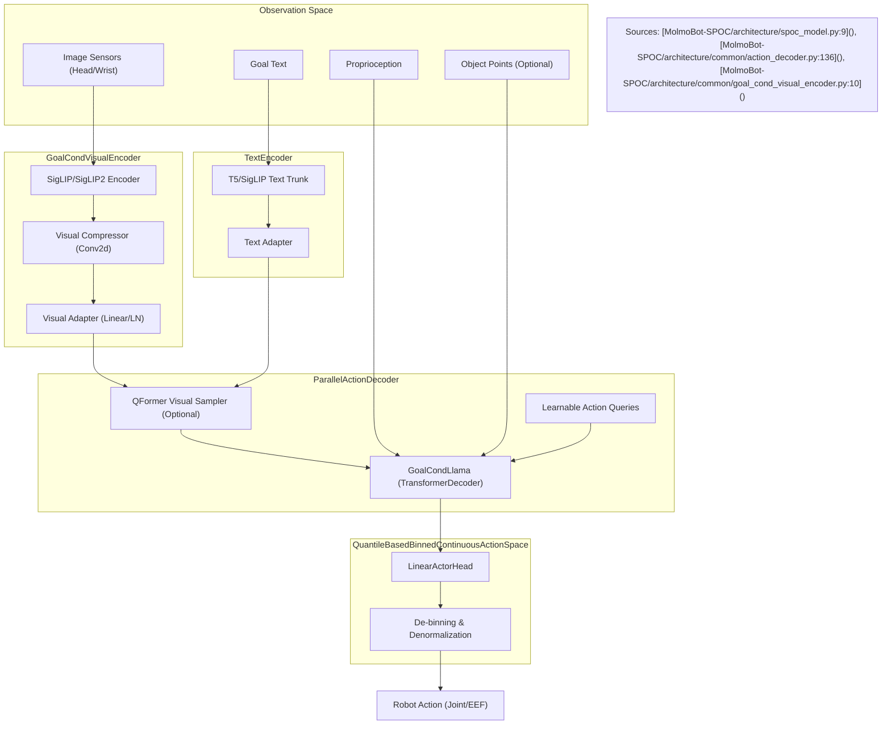

<!-- source: DeepWiki mcp.deepwiki.com · repo allenai/MolmoBot · page 4.1 SPOC Model Architecture · fetched 2026-10-26 -->

# SPOC Model Architecture

<details>
<summary>Relevant source files</summary>

The following files were used as context for generating this wiki page:

- [MolmoBot-SPOC/architecture/__init__.py](MolmoBot-SPOC/architecture/__init__.py)
- [MolmoBot-SPOC/architecture/action_spaces/__init__.py](MolmoBot-SPOC/architecture/action_spaces/__init__.py)
- [MolmoBot-SPOC/architecture/action_spaces/abstract.py](MolmoBot-SPOC/architecture/action_spaces/abstract.py)
- [MolmoBot-SPOC/architecture/action_spaces/binned_continuous.py](MolmoBot-SPOC/architecture/action_spaces/binned_continuous.py)
- [MolmoBot-SPOC/architecture/action_spaces/quantile_based_binned_continuous.py](MolmoBot-SPOC/architecture/action_spaces/quantile_based_binned_continuous.py)
- [MolmoBot-SPOC/architecture/common/__init__.py](MolmoBot-SPOC/architecture/common/__init__.py)
- [MolmoBot-SPOC/architecture/common/action_decoder.py](MolmoBot-SPOC/architecture/common/action_decoder.py)
- [MolmoBot-SPOC/architecture/common/goal_cond_llama.py](MolmoBot-SPOC/architecture/common/goal_cond_llama.py)
- [MolmoBot-SPOC/architecture/common/goal_cond_visual_encoder.py](MolmoBot-SPOC/architecture/common/goal_cond_visual_encoder.py)
- [MolmoBot-SPOC/architecture/common/image_encoder.py](MolmoBot-SPOC/architecture/common/image_encoder.py)
- [MolmoBot-SPOC/architecture/common/preprocessors.py](MolmoBot-SPOC/architecture/common/preprocessors.py)
- [MolmoBot-SPOC/architecture/common/text_encoder.py](MolmoBot-SPOC/architecture/common/text_encoder.py)
- [MolmoBot-SPOC/architecture/common/utils.py](MolmoBot-SPOC/architecture/common/utils.py)
- [MolmoBot-SPOC/architecture/spoc_model.py](MolmoBot-SPOC/architecture/spoc_model.py)

</details>


The SPOC (Stochastic Policy with Objective-Conditioned actions) architecture is a lightweight, transformer-based policy designed for goal-conditioned robot manipulation. Unlike the larger MolmoBot models, SPOC utilizes a compact transformer decoder to process multi-modal observations and predict discretized continuous actions.

## System Overview

The core of the SPOC architecture is the `SpocContinuousActionModel` [MolmoBot-SPOC/architecture/spoc_model.py:9](), which integrates a visual encoder, a text encoder, and a parallel action decoder. The model is designed to be flexible across different robot platforms (Franka, RB-Y1) and task types by swapping configuration packages in the `REGISTERED_MODELS` registry [MolmoBot-SPOC/architecture/__init__.py:11-154]().

### Data Flow: From Observation to Action

The following diagram illustrates the flow of data through the SPOC neural network components.

**SPOC Inference Pipeline**


## Component Details

### 1. Visual & Text Encoding
SPOC uses pre-trained vision-language backbones to extract features.
*   **Image Encoder:** Supports `SigLIP` and `SigLIP2` variants (e.g., `google/siglip2-base-patch16-256`) [MolmoBot-SPOC/architecture/common/image_encoder.py:127-161]().
*   **GoalCondVisualEncoder:** Processes raw features from the image encoder. It uses a `visual_compressor` (CNN) to spatially compress tokens and a `visual_adapter` to project them to the transformer's hidden dimension [MolmoBot-SPOC/architecture/common/goal_cond_visual_encoder.py:18-28]().
*   **Text Encoder:** Wraps `T5` or `SigLIP` text trunks to encode natural language goals [MolmoBot-SPOC/architecture/common/text_encoder.py:70-98]().

### 2. Parallel Action Decoder
The `ParallelActionDecoder` [MolmoBot-SPOC/architecture/common/action_decoder.py:136]() is the central processing unit.
*   **Learnable Queries:** Instead of using observation tokens as decoder inputs, it uses a fixed set of learnable `action_queries` [MolmoBot-SPOC/architecture/common/action_decoder.py:171]().
*   **Cross-Attention:** The queries attend to visual and proprioceptive features via the `GoalCondLlamaDecoder` [MolmoBot-SPOC/architecture/common/action_decoder.py:160]().
*   **QFormer Visual Sampler:** An optional component that uses learnable query tokens to cross-attend to visual features, sampling a fixed number of tokens (e.g., 32) to prevent attention dilution in the main transformer [MolmoBot-SPOC/architecture/common/action_decoder.py:17-135]().

### 3. GoalCondLlama (Transformer Decoder)
The transformer backbone is a modified Llama architecture [MolmoBot-SPOC/architecture/common/goal_cond_llama.py:11]().
*   **RoPE:** Uses Rotary Positional Embeddings for spatial/temporal awareness [MolmoBot-SPOC/architecture/common/goal_cond_llama.py:131-160]().
*   **GQA:** Supports Grouped-Query Attention for efficient inference [MolmoBot-SPOC/architecture/common/goal_cond_llama.py:175-198]().
*   **KV Cache:** Implements key-value caching to speed up autoregressive action generation [MolmoBot-SPOC/architecture/common/goal_cond_llama.py:231-255]().

## Action Space Abstractions

SPOC treats continuous robot actions as a sequence of discrete tokens.

### Binned Continuous Action Space
The `BinnedContinuousActionSpace` [MolmoBot-SPOC/architecture/action_spaces/binned_continuous.py:22]() discretizes actions into `num_bins` (default 256).
1.  **Normalization:** Actions are normalized to a `[-1, 1]` range using dataset min/max stats [MolmoBot-SPOC/architecture/action_spaces/binned_continuous.py:69-91]().
2.  **Tokenization:** Each dimension of an action chunk is mapped to a bin index [MolmoBot-SPOC/architecture/action_spaces/binned_continuous.py:113-129]().
3.  **Flattening:** The resulting sequence length is `chunk_size * action_dim` [MolmoBot-SPOC/architecture/action_spaces/binned_continuous.py:52]().

### Quantile-Based Binning
The `QuantileBasedBinnedContinuousActionSpace` [MolmoBot-SPOC/architecture/action_spaces/quantile_based_binned_continuous.py:12]() improves upon uniform binning by placing bin edges based on the actual distribution of the training data.
*   **Ghost Bins:** It implements a `_get_vocab_mask` to handle "ghost bins" (zero-width bins caused by data concentration), ensuring the model only predicts valid indices [MolmoBot-SPOC/architecture/action_spaces/quantile_based_binned_continuous.py:47-94]().

**Action Space Mapping**
```mermaid
classDiagram
    class AbstractActionSpace {
        <<interface>>
        +get_action()
    }
    class BinnedContinuousActionSpace {
        +int num_bins
        +int action_dim
        +normalize_actions()
        +tokenize_actions()
        +decode_actions()
    }
    class QuantileBasedBinnedContinuousActionSpace {
        +Tensor bin_edges_per_dim
        +_get_vocab_mask()
        +_value_to_bin()
    }

    AbstractActionSpace <|-- BinnedContinuousActionSpace
    BinnedContinuousActionSpace <|-- QuantileBasedBinnedContinuousActionSpace

    Sources["Sources: [MolmoBot-SPOC/architecture/action_spaces/abstract.py:5](), [MolmoBot-SPOC/architecture/action_spaces/binned_continuous.py:22](), [MolmoBot-SPOC/architecture/action_spaces/quantile_based_binned_continuous.py:12]()"]
```

## Model Registration & Build
Models are instantiated via `SPOCModelPackage.build_model` [MolmoBot-SPOC/architecture/__init__.py:20](). This method dynamically injects the `action_space` into the model configuration before initializing the `SpocContinuousActionModel`.

| Model Name | Robot | Observation Sensors | Action Space |
| :--- | :--- | :--- | :--- |
| `SpocLlamaModelWBinnedActionRBY1ArticulatedManipXXL` | RB-Y1 | head, wrist_l, wrist_r, goal, proprio, points | Quantile-Binned |
| `SpocLlamaModelWBinnedActionFrankaPickPlaceXXL` | Franka | shoulder, wrist, goal, proprio | Quantile-Binned |

**Sources:**
* `MolmoBot-SPOC/architecture/__init__.py:11-154`
* `MolmoBot-SPOC/architecture/spoc_model.py:9-100`
* `MolmoBot-SPOC/architecture/common/action_decoder.py:136-250`
* `MolmoBot-SPOC/architecture/common/goal_cond_visual_encoder.py:10-59`
* `MolmoBot-SPOC/architecture/action_spaces/binned_continuous.py:22-181`
* `MolmoBot-SPOC/architecture/action_spaces/quantile_based_binned_continuous.py:12-154`

---

