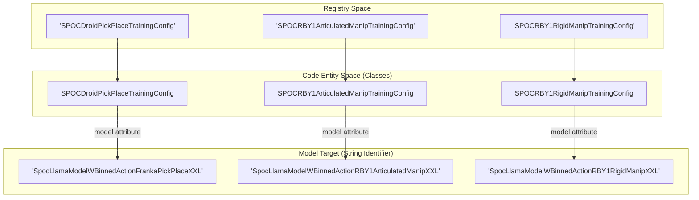
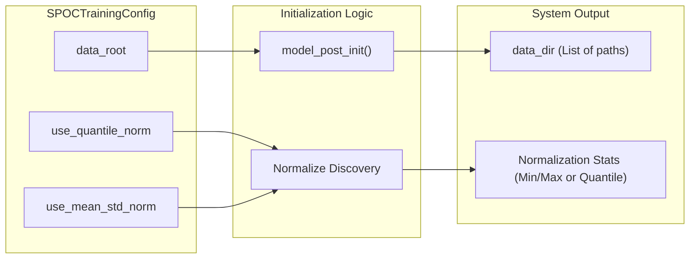

<!-- source: DeepWiki mcp.deepwiki.com · repo allenai/MolmoBot · page 4.2 SPOC Configuration System · fetched 2026-10-26 -->

# SPOC Configuration System

Relevant source files

The following files were used as context for generating this wiki page:

- [MolmoBot-SPOC/architecture/config/__init__.py](MolmoBot-SPOC/architecture/config/__init__.py)
- [MolmoBot-SPOC/architecture/config/model_config.py](MolmoBot-SPOC/architecture/config/model_config.py)
- [MolmoBot-SPOC/architecture/config/preproc_config.py](MolmoBot-SPOC/architecture/config/preproc_config.py)
- [MolmoBot-SPOC/training/config/__init__.py](MolmoBot-SPOC/training/config/__init__.py)
- [MolmoBot-SPOC/training/config/fr3_spoc_training_config.py](MolmoBot-SPOC/training/config/fr3_spoc_training_config.py)
- [MolmoBot-SPOC/training/config/rby1_spoc_training_config.py](MolmoBot-SPOC/training/config/rby1_spoc_training_config.py)
- [MolmoBot-SPOC/training/config/spoc_training_config.py](MolmoBot-SPOC/training/config/spoc_training_config.py)
- [MolmoBot-SPOC/utils/config_registry.py](MolmoBot-SPOC/utils/config_registry.py)
- [MolmoBot-SPOC/utils/constants/__init__.py](MolmoBot-SPOC/utils/constants/__init__.py)
- [MolmoBot-SPOC/utils/constants/camera_constants.py](MolmoBot-SPOC/utils/constants/camera_constants.py)
- [MolmoBot-SPOC/utils/constants/prompt_templates.py](MolmoBot-SPOC/utils/constants/prompt_templates.py)
- [MolmoBot-SPOC/utils/constants/sensor_constants.py](MolmoBot-SPOC/utils/constants/sensor_constants.py)

The SPOC (Stochastic Policy for Observation-Conditioned control) configuration system manages the parameters for model architecture, data preprocessing, and training routines. It utilizes a registry pattern to decouple high-level experiment definitions from the underlying implementation details of the Transformer-based policy.

## Config Registry Pattern

The system uses a global registry to manage training configurations, allowing the training entry point to resolve configuration classes by string identifiers.

*   **`_TRAINING_CONFIG_REGISTRY`**: A global dictionary that maps string names to `BaseModel` (Pydantic) classes [MolmoBot-SPOC/utils/config_registry.py:8-8]().
*   **`register_training_config(name)`**: A decorator used to add a configuration class to the registry [MolmoBot-SPOC/utils/config_registry.py:11-29]().
*   **`get_training_config_class(name)`**: Retrieves a registered class for instantiation [MolmoBot-SPOC/utils/config_registry.py:32-40]().

### Configuration Entity Mapping
The following diagram illustrates how high-level configuration names in the registry map to specific implementation classes and their associated model targets.

**Registry to Implementation Mapping**

Sources: [MolmoBot-SPOC/utils/config_registry.py:8-40](), [MolmoBot-SPOC/training/config/fr3_spoc_training_config.py:11-13](), [MolmoBot-SPOC/training/config/rby1_spoc_training_config.py:13-15](), [MolmoBot-SPOC/training/config/rby1_spoc_training_config.py:58-59]()

---

## Model & Preprocessing Configs

The model configuration is hierarchical, separating the visual encoder, action decoder, and preprocessing requirements.

### SpocModelConfig
The base class `SpocModelConfig` defines the relationship between observations and the architecture components.

*   **Observation Resolution**: It identifies which UUIDs are visual vs. goal-based using `is_a_visual_features` and `is_a_goal_features` [MolmoBot-SPOC/architecture/config/model_config.py:141-147]().
*   **Action Space**: Holds `action_space_cls`, which is instantiated during model building [MolmoBot-SPOC/architecture/config/model_config.py:94-95]().
*   **QFormer Sampling**: Configuration for sampling a fixed number of visual tokens (e.g., `qformer_num_query: 32`) if `use_qformer_sampling` is enabled [MolmoBot-SPOC/architecture/config/model_config.py:67-70]().

### SpocGoalCondLlamaModelConfig
Extends the base config specifically for the Llama-based transformer architecture. It defines:
*   **Hyperparameters**: `batch_size`, `max_seq_len`, `dropout`, and `use_rms_norm` [MolmoBot-SPOC/architecture/config/model_config.py:186-191]().
*   **Decoder Settings**: Generates a `GoalCondLlamaActionDecoderConfig` which encapsulates the underlying `GoalCondLlamaConfig` (ModelArgs) [MolmoBot-SPOC/architecture/config/model_config.py:73-85]().

### PreprocessorConfig
The `PreprocessorConfig` and its derivative `SigLipPreprocessorConfig` define the input pipeline:
*   **Image Resolution**: Defaults to 224x384 for standard encoders but 256x256 for SigLIP [MolmoBot-SPOC/architecture/config/preproc_config.py:10-10](), [MolmoBot-SPOC/architecture/config/preproc_config.py:37-37]().
*   **Encoders**: Specifies the `IMAGE_ENCODER` (e.g., `SigLIP2BaseNoPool`) and `TEXT_ENCODER` (e.g., `SigLIPBase`) [MolmoBot-SPOC/architecture/config/preproc_config.py:42-43]().
*   **Warping**: Flags for `warp_images` and `warp_points` determine if geometric transformations are applied during preprocessing [MolmoBot-SPOC/architecture/config/preproc_config.py:23-24]().

Sources: [MolmoBot-SPOC/architecture/config/model_config.py:89-197](), [MolmoBot-SPOC/architecture/config/preproc_config.py:8-44]()

---

## Training Configurations

Training configs inherit from `SPOCTrainingConfig`, which defines common Lightning parameters like `max_epochs`, `lr`, and `precision` [MolmoBot-SPOC/training/config/spoc_training_config.py:9-61]().

### Robot-Specific Training Configs

| Feature | Franka (FR3) Pick & Place | RBY1 Articulated Manip | RBY1 Rigid Manip |
| :--- | :--- | :--- | :--- |
| **Config Class** | `SPOCDroidPickPlaceTrainingConfig` | `SPOCRBY1ArticulatedManipTrainingConfig` | `SPOCRBY1RigidManipTrainingConfig` |
| **Data Root** | `droid_pick_place_data` | `rby1_articulated_data` | `rby1_rigid_data` |
| **Tasks** | pick, pick_and_place, etc. | open, door_open | pick, pick_and_place |
| **Upsampling** | N/A | `GRASP_HANDLE`: 200% | `grasp`: 200% |
| **Prompt Rand** | `True` | `False` | `False` |

### Data Flow and Normalization
The `SPOCTrainingConfig` handles the logic for dataset discovery and action normalization.

**Configuration Data Flow**

Sources: [MolmoBot-SPOC/training/config/spoc_training_config.py:63-76](), [MolmoBot-SPOC/training/config/fr3_spoc_training_config.py:11-54](), [MolmoBot-SPOC/training/config/rby1_spoc_training_config.py:13-96]()

---

## Constants and Templates

### Camera & Sensor Constants
The system defines standard resolutions and warping logic for various camera types used across Franka and RBY1 platforms.
*   **Resolutions**: Defines `ORIGINAL_INTEL_W/H` (1280x720) and target `MODEL_43_WIDTH/HEIGHT` (320x240) [MolmoBot-SPOC/utils/constants/camera_constants.py:3-23]().
*   **Warping Logic**: `CAMERAS_TO_WARP` includes `head_camera` and `exo_camera_2` [MolmoBot-SPOC/utils/constants/camera_constants.py:25-28]().
*   **Sensor Classification**: Utilities like `is_a_visual_sensor` and `is_a_goal_features` distinguish between raw image inputs and conditioning signals (like bboxes or text) [MolmoBot-SPOC/utils/constants/sensor_constants.py:106-142]().

### Prompt Templates
Language conditioning is managed via `DEFAULT_PROMPT_TEMPLATES`. Prompts are organized into "groups" to ensure diverse sampling during training [MolmoBot-SPOC/utils/constants/prompt_templates.py:9-162]().

*   **Task Types**: Templates are defined for `pick_and_place`, `pick_and_place_next_to`, and `pick`.
*   **Placeholders**: Templates use `{pickup_name}` and `{place_name}` which are populated by the data loader [MolmoBot-SPOC/utils/constants/prompt_templates.py:13-15]().
*   **Variations**: Includes formal commands ("Pick up..."), casual ("Put..."), and request-style ("Can you move...") [MolmoBot-SPOC/utils/constants/prompt_templates.py:11-57]().

Sources: [MolmoBot-SPOC/utils/constants/camera_constants.py:1-43](), [MolmoBot-SPOC/utils/constants/sensor_constants.py:1-173](), [MolmoBot-SPOC/utils/constants/prompt_templates.py:1-171]()

---

