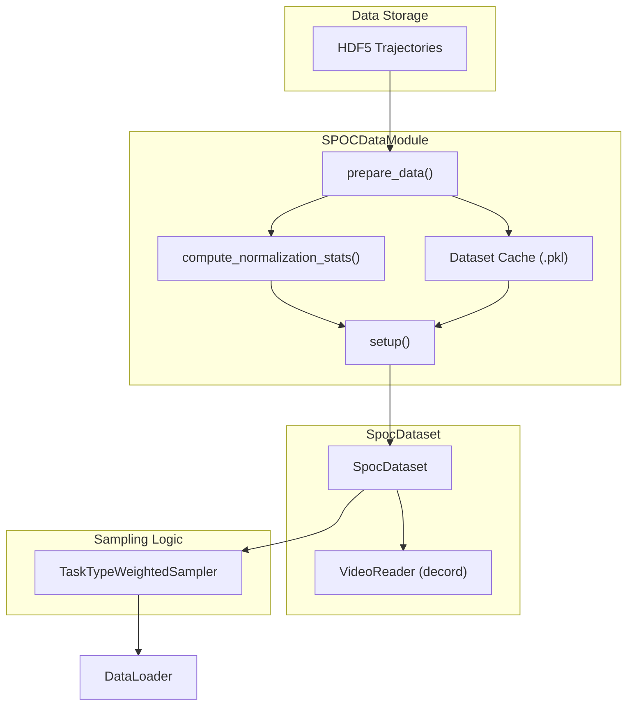

<!-- source: DeepWiki mcp.deepwiki.com · repo allenai/MolmoBot · page 4.3 SPOC Training Pipeline · fetched 2026-10-26 -->

# SPOC Training Pipeline

<details>
<summary>Relevant source files</summary>

The following files were used as context for generating this wiki page:

- [MolmoBot-SPOC/training/__init__.py](MolmoBot-SPOC/training/__init__.py)
- [MolmoBot-SPOC/training/dataset.py](MolmoBot-SPOC/training/dataset.py)
- [MolmoBot-SPOC/training/train_spoc_pl.py](MolmoBot-SPOC/training/train_spoc_pl.py)
- [MolmoBot-SPOC/utils/dataset_utils.py](MolmoBot-SPOC/utils/dataset_utils.py)
- [MolmoBot-SPOC/utils/logger_utils.py](MolmoBot-SPOC/utils/logger_utils.py)
- [MolmoBot-SPOC/utils/sampler_utils.py](MolmoBot-SPOC/utils/sampler_utils.py)
- [MolmoBot-SPOC/utils/string_utils.py](MolmoBot-SPOC/utils/string_utils.py)
- [MolmoBot-SPOC/utils/train_utils.py](MolmoBot-SPOC/utils/train_utils.py)

</details>


The SPOC training pipeline is built on **PyTorch Lightning**, providing a structured and scalable framework for training lightweight, goal-conditioned transformer policies. It manages the end-to-end lifecycle of the model, including dataset caching, normalization statistics computation, multi-task sampling, and distributed training with Weights & Biases (W&B) integration.

## System Overview

The pipeline is centered around two primary classes: `SPOCDataModule`, which handles data loading and preprocessing, and `LitModel`, which encapsulates the model architecture, loss computation, and optimization logic.

### Training Data Flow

The diagram below illustrates the flow from raw HDF5 trajectory files to the training loop.

**Data Preparation and Loading Flow**

**Sources:** [MolmoBot-SPOC/training/train_spoc_pl.py:88-144](), [MolmoBot-SPOC/training/dataset.py:32-156]()

## Data Management: SPOCDataModule

The `SPOCDataModule` manages the complexities of robot trajectory data, including the computation of normalization statistics and the creation of a persistent cache to speed up training restarts.

### Normalization Statistics
Before training begins, the pipeline computes statistics across the entire dataset to normalize continuous actions and proprioception. It supports three modes:
1.  **Min/Max:** Standard linear scaling [MolmoBot-SPOC/training/dataset.py:156-162]().
2.  **Mean/Std:** Gaussian normalization [MolmoBot-SPOC/training/dataset.py:158-160]().
3.  **Quantile-based:** Uses dataset quantiles (e.g., 1st and 99th) to define boundaries, mitigating the impact of outliers [MolmoBot-SPOC/training/dataset.py:161-162]().

If `QuantileBasedBinnedContinuousActionSpace` is used, the module also computes `quantile_bin_edges` to discretize the action space into balanced bins [MolmoBot-SPOC/training/train_spoc_pl.py:163-169]().

### TaskTypeWeightedSampler
To handle large-scale multi-task data, the pipeline uses a custom `TaskTypeWeightedSampler`. This sampler addresses the `torch.multinomial` limit (2^24 samples) by using a two-stage sampling process:
1.  **Stage 1:** Pick a task type based on provided weights [MolmoBot-SPOC/utils/sampler_utils.py:110-116]().
2.  **Stage 2:** Uniformly sample an index from within that task type's pool [MolmoBot-SPOC/utils/sampler_utils.py:118-134]().

**Sources:** [MolmoBot-SPOC/training/train_spoc_pl.py:88-175](), [MolmoBot-SPOC/utils/sampler_utils.py:11-138]()

## Training Logic: LitModel

The `LitModel` class bridges the PyTorch Lightning `LightningModule` with the SPOC architecture.

### Loss Computation and Masking
The model computes loss primarily through the `action_space.loss()` function. A critical component is the **Vocab Masking** applied during loss calculation. The pipeline uses `is_pad` masks to ensure that padding tokens (inserted to align variable-length trajectories or chunks) do not contribute to the gradient [MolmoBot-SPOC/training/train_spoc_pl.py:383-392]().

### Metric Tracking
The pipeline tracks several key performance indicators (KPIs) during training and validation:
*   **Token Accuracy:** Measures how often the discretized action tokens match the ground truth [MolmoBot-SPOC/training/train_spoc_pl.py:394-405]().
*   **L1 Error:** The mean absolute error between predicted continuous actions and ground truth [MolmoBot-SPOC/training/train_spoc_pl.py:407-414]().
*   **F1 Score:** Specifically used for the `done` action classification [MolmoBot-SPOC/training/train_spoc_pl.py:416-421]().

**Sources:** [MolmoBot-SPOC/training/train_spoc_pl.py:270-430]()

## Implementation Mapping

The following diagram maps high-level training concepts to the specific classes and methods implemented in the codebase.

**Training Implementation Map**
```mermaid
classDiagram
    class "PyTorch Lightning" {
        +Trainer
        +LightningModule
        +LightningDataModule
    }

    class LitModel {
        +training_step()
        +validation_step()
        +configure_optimizers()
        -model: SpocContinuousActionModel
    }

    class SPOCDataModule {
        +prepare_data()
        +setup()
        +train_dataloader()
    }

    class SpocDataset {
        +__getitem__()
        +get_action_normalization_stats()
    }

    class TaskTypeWeightedSampler {
        +__iter__()
        -task_type_probs: np.ndarray
    }

    "PyTorch Lightning" <|-- LitModel
    "PyTorch Lightning" <|-- SPOCDataModule
    SPOCDataModule --> SpocDataset
    SPOCDataModule --> TaskTypeWeightedSampler
    LitModel --> "ActionSpace" : loss()
```
**Sources:** [MolmoBot-SPOC/training/train_spoc_pl.py:88-270](), [MolmoBot-SPOC/utils/sampler_utils.py:11-20](), [MolmoBot-SPOC/training/dataset.py:1210-1220]()

## Execution and Configuration

### Training Entrypoint
Training is launched via `train_spoc_pl.py`. The script requires a `training_config_cls` argument, which points to a registered configuration class (e.g., `Fr3SpocTrainingConfig`) [MolmoBot-SPOC/training/train_spoc_pl.py:73-85]().

### DDP and Logging
*   **DDP Strategy:** The pipeline defaults to the `ddp` strategy for multi-GPU training, ensuring that `TaskTypeWeightedSampler` correctly partitions data across ranks using `set_epoch` [MolmoBot-SPOC/utils/sampler_utils.py:145-148]().
*   **W&B Logging:** All metrics, including learning rate, losses, and action accuracies, are logged to Weights & Biases.
*   **Checkpointing:** The `Trainer` is configured to save checkpoints based on validation loss. Resumption is handled by passing the checkpoint path to `trainer.fit(model, datamodule, ckpt_path=...)`.

### Checkpoint Loading Utilities
The pipeline includes robust utilities in `train_utils.py` for loading weights from both `.ckpt` (Lightning) and `.safetensors` formats, with support for prefix stripping (e.g., removing the `model.` prefix) [MolmoBot-SPOC/utils/train_utils.py:4-48]().

**Sources:** [MolmoBot-SPOC/training/train_spoc_pl.py:530-650](), [MolmoBot-SPOC/utils/train_utils.py:49-94]()

---

