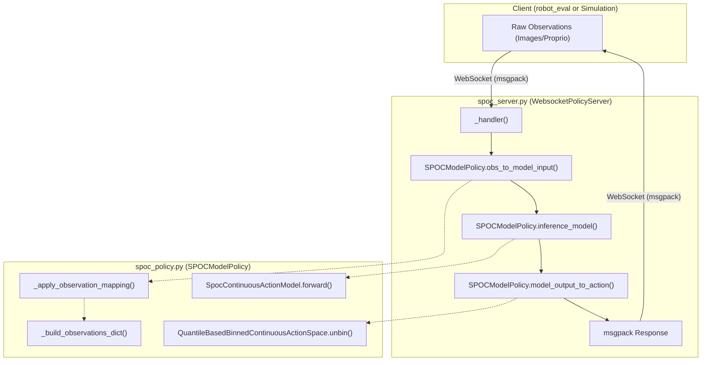
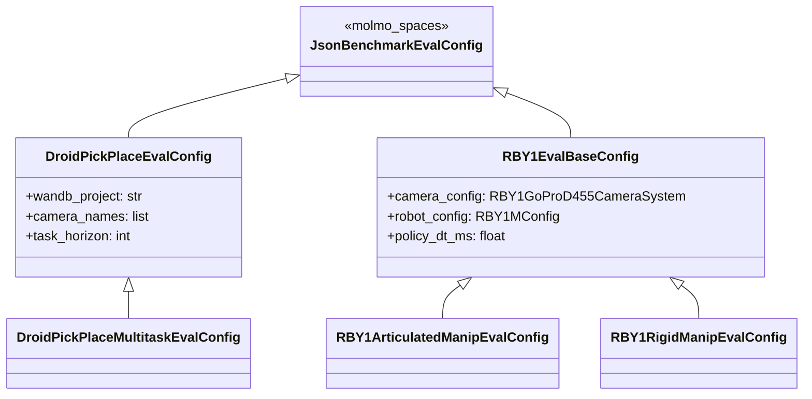

<!-- source: DeepWiki mcp.deepwiki.com · repo allenai/MolmoBot · page 4.4 SPOC Evaluation & Policy Server · fetched 2026-10-26 -->

# SPOC Evaluation & Policy Server

<details>
<summary>Relevant source files</summary>

The following files were used as context for generating this wiki page:

- [MolmoBot-SPOC/eval/__init__.py](MolmoBot-SPOC/eval/__init__.py)
- [MolmoBot-SPOC/eval/config/franka_eval_config.py](MolmoBot-SPOC/eval/config/franka_eval_config.py)
- [MolmoBot-SPOC/eval/config/rby1_eval_config.py](MolmoBot-SPOC/eval/config/rby1_eval_config.py)
- [MolmoBot-SPOC/eval/config/spoc_policy_configs.py](MolmoBot-SPOC/eval/config/spoc_policy_configs.py)
- [MolmoBot-SPOC/eval/spoc_policy.py](MolmoBot-SPOC/eval/spoc_policy.py)
- [MolmoBot-SPOC/eval/spoc_server.py](MolmoBot-SPOC/eval/spoc_server.py)
- [MolmoBot-SPOC/utils/image_warping_utils.py](MolmoBot-SPOC/utils/image_warping_utils.py)
- [MolmoBot-SPOC/utils/qformer_attention_viz.py](MolmoBot-SPOC/utils/qformer_attention_viz.py)
- [MolmoBot-SPOC/utils/transformation_util.py](MolmoBot-SPOC/utils/transformation_util.py)

</details>


This page documents the evaluation infrastructure and serving mechanisms for the MolmoBot-SPOC project. It covers the WebSocket-based policy server, the inference policy implementation, and the configuration systems for different robot platforms (Franka and RBY1).

## System Architecture

The SPOC evaluation system follows a client-server architecture. A `WebsocketPolicyServer` hosts the trained model and exposes an inference API. Evaluation scripts or real-robot controllers act as clients, sending observations and receiving predicted actions via a msgpack-encoded protocol.

### Logic Flow: Observation to Action

The following diagram illustrates the data flow from a raw observation received by the server to the final action returned to the client.

**SPOC Inference Pipeline**

**Sources:** [MolmoBot-SPOC/eval/spoc_server.py:81-107](), [MolmoBot-SPOC/eval/spoc_policy.py:174-210]()

---

## WebSocket Policy Server (`spoc_server.py`)

The `WebsocketPolicyServer` is a standalone script used to serve SPOC models for real-time inference. It utilizes `websockets` for communication and `msgpack-numpy` for efficient serialization of numerical data [MolmoBot-SPOC/eval/spoc_server.py:13-15]().

### Key Components
- **`WebsocketPolicyServer`**: Manages the lifecycle of the server, including model preparation and the request-response loop [MolmoBot-SPOC/eval/spoc_server.py:35-52]().
- **`_handler`**: The core async loop that receives observations, triggers the policy's inference methods, and measures timing for preprocessing, inference, and postprocessing [MolmoBot-SPOC/eval/spoc_server.py:74-119]().
- **Health Check**: Implements a `/healthz` endpoint for monitoring [MolmoBot-SPOC/eval/spoc_server.py:121-127]().

### Execution
The server is launched via the command line, requiring an evaluation configuration name from the `EVAL_CONFIG_REGISTRY` [MolmoBot-SPOC/eval/spoc_server.py:140-165]().
```bash
python spoc_server.py --config RBY1ArticulatedManipEvalConfig --port 8000
```

**Sources:** [MolmoBot-SPOC/eval/spoc_server.py:1-184]()

---

## SPOC Model Policy (`spoc_policy.py`)

The `SPOCModelPolicy` class bridges the `molmo_spaces` evaluation harness and the SPOC neural network architecture. It inherits from `InferencePolicy` [MolmoBot-SPOC/eval/spoc_policy.py:38-39]().

### Core Methods
- **`prepare_model()`**: Loads the model weights from either HuggingFace (via `snapshot_download`) or Weights & Biases artifacts [MolmoBot-SPOC/eval/spoc_policy.py:62-84]().
- **`obs_to_model_input(obs)`**: Prepares the raw observation dictionary for the model. This includes applying `observation_mapping` to align sensor names and formatting the text goal [MolmoBot-SPOC/eval/spoc_policy.py:174-191]().
- **`inference_model(model_input)`**: Executes the model's forward pass. It handles batching and moves data to the correct device [MolmoBot-SPOC/eval/spoc_policy.py:212-225]().
- **`model_output_to_action(model_output)`**: Converts the model's binned action predictions back into continuous values using the `QuantileBasedBinnedContinuousActionSpace` [MolmoBot-SPOC/eval/spoc_policy.py:227-245]().

### Model Loading
The policy supports two loading paths:
1. **HuggingFace**: Uses `_load_model_from_hf`, reading `preprocessor_config.json` and `model.safetensors` [MolmoBot-SPOC/eval/spoc_policy.py:85-120]().
2. **W&B**: Uses `_load_model_from_wandb` to download specific run artifacts [MolmoBot-SPOC/eval/spoc_policy.py:122-172]().

**Sources:** [MolmoBot-SPOC/eval/spoc_policy.py:38-250]()

---

## Evaluation Configurations

Evaluation is driven by Pydantic-based configuration classes that define the robot, cameras, and policy parameters.

### Configuration Hierarchy


### Robot Specifics
- **Franka (DROID)**: Uses `SPOCDroidPickPlacePolicyConfig` which maps standard camera names (e.g., `exo_camera_1`) to the model's expected names (e.g., `droid_shoulder_light_randomization`) [MolmoBot-SPOC/eval/config/spoc_policy_configs.py:132-159]().
- **RBY1**: Configures complex action specs for the mobile base, torso, dual arms (7-DOF), and dual grippers [MolmoBot-SPOC/eval/config/spoc_policy_configs.py:69-76]().

**Sources:** [MolmoBot-SPOC/eval/config/franka_eval_config.py:14-49](), [MolmoBot-SPOC/eval/config/rby1_eval_config.py:16-69](), [MolmoBot-SPOC/eval/config/spoc_policy_configs.py:1-159]()

---

## Utilities

### Image Warping (`image_warping_utils.py`)
SPOC uses GPU-accelerated image warping to simulate fisheye distortion and perform randomized crops during training/eval [MolmoBot-SPOC/utils/image_warping_utils.py:175-185]().
- **`warp_image_gpu`**: Uses `torch.nn.functional.grid_sample` to apply distortion grids [MolmoBot-SPOC/utils/image_warping_utils.py:209-211]().
- **`calc_camera_intrinsics`**: Computes the `K` matrix from FOV and resolution [MolmoBot-SPOC/utils/image_warping_utils.py:79-87]().

### QFormer Attention Visualization (`qformer_attention_viz.py`)
Provides tools to interpret which parts of the image the model is attending to.
- **`extract_qformer_attention_weights`**: Manually computes cross-attention between query tokens and visual features by extracting weights from the QFormer decoder layers [MolmoBot-SPOC/utils/qformer_attention_viz.py:13-28]().
- **`create_attention_heatmap`**: Maps the averaged attention weights back to the spatial dimensions of the original image [MolmoBot-SPOC/utils/qformer_attention_viz.py:123-142]().

**Sources:** [MolmoBot-SPOC/utils/image_warping_utils.py:1-228](), [MolmoBot-SPOC/utils/qformer_attention_viz.py:1-120](), [MolmoBot-SPOC/utils/transformation_util.py:133-153]()

---

