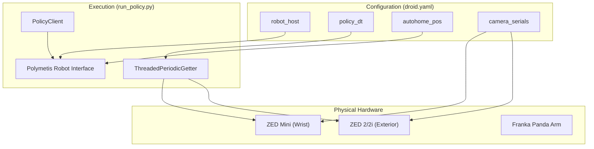
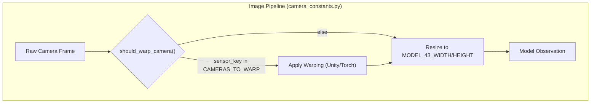

<!-- source: DeepWiki mcp.deepwiki.com · repo allenai/MolmoBot · page 5.1 Hardware Configuration & Camera Setup · fetched 2026-10-26 -->

# Hardware Configuration & Camera Setup

Relevant source files

The following files were used as context for generating this wiki page:

- [MolmoBot-Pi0/config/eval/policy/cameras/real.yaml](MolmoBot-Pi0/config/eval/policy/cameras/real.yaml)
- [MolmoBot-Pi0/config/eval/policy/cameras/sim_exo_random.yaml](MolmoBot-Pi0/config/eval/policy/cameras/sim_exo_random.yaml)
- [MolmoBot-Pi0/config/eval/policy/cameras/sim_exo_shoulder.yaml](MolmoBot-Pi0/config/eval/policy/cameras/sim_exo_shoulder.yaml)
- [MolmoBot-SPOC/utils/constants/camera_constants.py](MolmoBot-SPOC/utils/constants/camera_constants.py)

This page documents the hardware configuration and camera processing pipeline for the MolmoBot evaluation harness. The system uses a Hydra-based configuration schema to manage robot connectivity, camera hardware identifiers, and image preprocessing parameters required for real-world policy deployment.

## Hardware Configuration (droid.yaml)

The physical setup is governed by the `droid.yaml` configuration file, which defines the operational parameters for the Franka Emika Panda robot and its associated sensors. This configuration ensures that the `robot_eval` harness can establish communication with the robot controller and synchronize high-frequency control loops with camera acquisition.

### Key Configuration Parameters

| Parameter | Description |
| :--- | :--- |
| `robot_host` | The IP address or hostname of the workstation running the Polymetis server. |
| `policy_dt` | The time delta (seconds) between policy inference steps, typically synchronized with the model's expected frequency. |
| `autohome_pos` | A list of joint positions (radians) used to reset the robot to a safe starting configuration before or after an episode. |
| `camera_serials` | A mapping of camera roles (e.g., `exo_camera_1`, `wrist_camera`) to their physical ZED serial numbers. |
| `wandb_upload` | Boolean flag to enable/disable uploading episode videos and telemetry to Weights & Biases. |

### System Connectivity Diagram
The following diagram illustrates how the configuration entities in `droid.yaml` map to the physical hardware and the `run_policy.py` execution loop.

**Hardware Control & Observation Flow**

**Sources:** `robot_eval/` configuration patterns.

---

## Camera Setup & Types

MolmoBot utilizes a multi-view camera setup to provide the VLM with sufficient spatial context for manipulation. The system standardizes on stereoscopic ZED cameras but treats them as RGB inputs for the policy.

### Supported Camera Configurations
The mapping between physical camera hardware and the observation keys expected by the models is defined in camera-specific YAML files.

*   **Exterior Camera (Exo):** Typically a **ZED 2** or **ZED 2i** mounted on a tripod or workstation frame. It provides a third-person view of the workspace.
*   **Wrist Camera:** A **ZED Mini** mounted on the robot's end-effector, providing a close-up view of the gripper and target objects.

| Configuration File | Camera Key | Observation Key Mapping |
| :--- | :--- | :--- |
| `real.yaml` | `exo_camera_1` | `observation/exterior_image_1_left` [MolmoBot-Pi0/config/eval/policy/cameras/real.yaml:1-1]() |
| `real.yaml` | `wrist_camera` | `observation/wrist_image_left` [MolmoBot-Pi0/config/eval/policy/cameras/real.yaml:2-2]() |
| `sim_exo_random.yaml` | `randomized_zed2_analogue_1` | `observation/exterior_image_1_left` [MolmoBot-Pi0/config/eval/policy/cameras/sim_exo_random.yaml:1-1]() |
| `sim_exo_shoulder.yaml` | `droid_shoulder_light_randomization` | `observation/exterior_image_1_left` [MolmoBot-Pi0/config/eval/policy/cameras/sim_exo_shoulder.yaml:1-1]() |

**Sources:** [MolmoBot-Pi0/config/eval/policy/cameras/real.yaml:1-2](), [MolmoBot-Pi0/config/eval/policy/cameras/sim_exo_random.yaml:1-2](), [MolmoBot-Pi0/config/eval/policy/cameras/sim_exo_shoulder.yaml:1-2]()

---

## Image Resizing & Warping Pipeline

To ensure compatibility with models trained on specific datasets (like SPOC or DROID), raw camera frames undergo a transformation pipeline. This includes resizing, aspect ratio adjustment, and optional fisheye warping.

### Resolution Constants
The system defines several standard resolutions to handle transitions between high-resolution capture and low-resolution model input.

*   **Original Intel/ZED:** 1280x720 [MolmoBot-SPOC/utils/constants/camera_constants.py:3-3]()
*   **Intermediate Processing:** 396x224 [MolmoBot-SPOC/utils/constants/camera_constants.py:4-4]()
*   **Model Input (4:3):** 320x240 [MolmoBot-SPOC/utils/constants/camera_constants.py:23-23]()

### Warping Logic
For certain cameras (e.g., `head_camera` or `exo_camera_2`), the system applies warping to simulate specific lens characteristics or to match the training distribution.

*   **Unity Warping:** If `USE_UNITY_WARPING` is enabled, the system uses a 120-degree Vertical FOV [MolmoBot-SPOC/utils/constants/camera_constants.py:15-16]().
*   **Python/Torch Warping:** If `GENERATE_FLAT_IMAGES` is true, it defaults to a 139-degree FOV for generating flat images [MolmoBot-SPOC/utils/constants/camera_constants.py:18-20]().

**Camera Warping Logic Flow**

### Key Functions
*   `should_warp_camera(sensor_key, is_rby1_task)`: Determines if a specific sensor stream requires warping based on the hardware type and task [MolmoBot-SPOC/utils/constants/camera_constants.py:31-42]().
*   **Warping Targets:** By default, `head_camera` and `exo_camera_2` are included in the `CAMERAS_TO_WARP` list [MolmoBot-SPOC/utils/constants/camera_constants.py:25-28]().

**Sources:** [MolmoBot-SPOC/utils/constants/camera_constants.py:3-43]()

---

