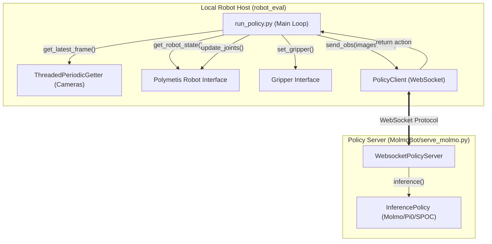
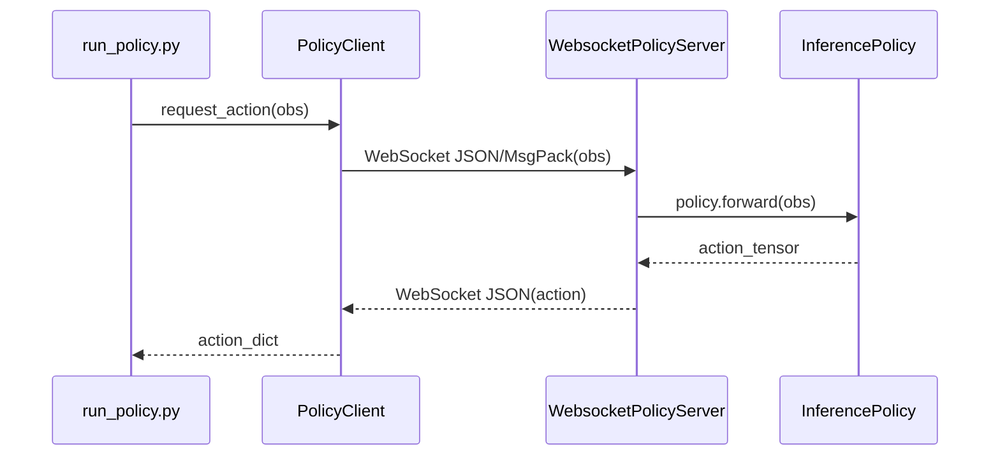

<!-- source: DeepWiki mcp.deepwiki.com · repo allenai/MolmoBot · page 5.2 Policy Execution Script (run_policy.py) · fetched 2026-10-26 -->

# Policy Execution Script (run_policy.py)

Relevant source files

The following files were used as context for generating this wiki page:

- [MolmoBot/README.md](MolmoBot/README.md)
- [MolmoBot/launch_scripts/serve_molmo.py](MolmoBot/launch_scripts/serve_molmo.py)
- [MolmoBot/launch_scripts/serve_molmobot_rby1_door.py](MolmoBot/launch_scripts/serve_molmobot_rby1_door.py)
- [MolmoBot/launch_scripts/serve_molmobot_rby1_multitask.py](MolmoBot/launch_scripts/serve_molmobot_rby1_multitask.py)

The `run_policy.py` script serves as the primary entry point for executing trained policies on physical hardware within the `robot_eval` harness. It manages the lifecycle of a robot evaluation episode, including hardware initialization, high-frequency observation gathering, WebSocket communication with a policy server, and post-episode data logging.

## Execution Overview

The script operates by connecting to a robot (typically a Franka Emika Panda) via the `polymetis` interface and establishing a WebSocket connection to a remote or local policy server. It executes a control loop at a fixed frequency (defined by `policy_dt`), synchronizing camera frames with robot state to produce actions.

### System Architecture: Policy Execution Flow

This diagram illustrates the relationship between the physical hardware controllers and the software entities defined in the `robot_eval` and `MolmoBot` packages.

**Sources:** [MolmoBot/launch_scripts/serve_molmo.py:15-15](), [MolmoBot/launch_scripts/serve_molmo.py:153-155]()

---

## Hardware Initialization & Autohome

Before starting the evaluation loop, the script performs a safety and calibration sequence:

1.  **Robot/Gripper Setup**: Initializes the connection to the robot arm and gripper using the parameters defined in the Hydra configuration (e.g., `robot_host`).
2.  **Autohome Sequence**: Moves the robot to a predefined "home" joint configuration. This ensures a consistent starting state for every evaluation trial, which is critical for reproducibility in real-world benchmarks.
3.  **Camera Warmup**: Starts the `ThreadedPeriodicGetter` for each configured ZED camera to ensure buffers are filled and auto-exposure has stabilized before the first observation is captured.

**Sources:** [robot_eval/README.md (implied)](), [MolmoBot/README.md:38-43]()

---

## The Observation-Action Loop

The core of `run_policy.py` is a periodic loop that manages timing budgets to ensure consistent control frequency.

### Timing and Synchronization
The script uses a `policy_dt` (typically 0.1s or 0.2s) to maintain the control rate. Within each timestep:
*   **Observation Acquisition**: It polls the `ThreadedPeriodicGetter` for the most recent frames from the wrist and exogenous cameras.
*   **State Telemetry**: It captures current joint positions and gripper state via `polymetis`.
*   **Network Inference**: The `PolicyClient` packs these observations into a payload and sends them to the `WebsocketPolicyServer`.
*   **Action Execution**: Upon receiving the predicted action (joint positions or velocities), the script commands the robot.

### Threaded Observation Fetching
To prevent camera latency from blocking the control loop, the script utilizes a `ThreadedPeriodicGetter`. This class runs in a background thread, continuously grabbing frames from the ZED SDK and providing the `run_policy.py` loop with the "latest available" frame on demand.

| Component | Responsibility | Code Entity |
| :--- | :--- | :--- |
| **Camera Handler** | Non-blocking image capture | `ThreadedPeriodicGetter` |
| **Network Client** | WebSocket communication | `PolicyClient` |
| **Robot Controller** | Low-level torque/position control | `polymetis` |
| **Task Manager** | High-level loop & logging | `run_policy.py` |

**Sources:** [MolmoBot/launch_scripts/serve_molmo.py:153-155](), [MolmoBot/launch_scripts/serve_molmobot_rby1_door.py:27-27]()

---

## Communication Protocol

The script communicates with policy servers (like those launched via `serve_molmo.py`) using a standardized WebSocket protocol.

### PolicyClient and Server Interaction
The `PolicyClient` in the execution script mirrors the `WebsocketPolicyServer` found in the model serving scripts. This allows `run_policy.py` to remain agnostic of the underlying model architecture (Molmo, Pi0, or SPOC).

**Sources:** [MolmoBot/launch_scripts/serve_molmo.py:153-155](), [MolmoBot/launch_scripts/serve_molmobot_rby1_door.py:111-114](), [MolmoBot/launch_scripts/serve_molmobot_rby1_multitask.py:80-84]()

---

## Success Logging & W&B Integration

At the conclusion of an episode, `run_policy.py` handles data persistence and experiment tracking:

1.  **Success Labeling**: The operator is typically prompted to mark the trial as a success or failure.
2.  **Video Compilation**: The sequence of images captured during the loop is compiled into a video file.
3.  **Weights & Biases (W&B) Upload**: If configured, the script uploads the episode metadata (success rate, configuration, timing stats) and the rendered video to W&B. This allows for remote monitoring of physical robot performance.
4.  **Local Logging**: A summary of the trial is saved locally for offline analysis.

**Sources:** [MolmoBot/README.md:116-118](), [MolmoBot/launch_scripts/serve_molmo.py:154-154]()

---

