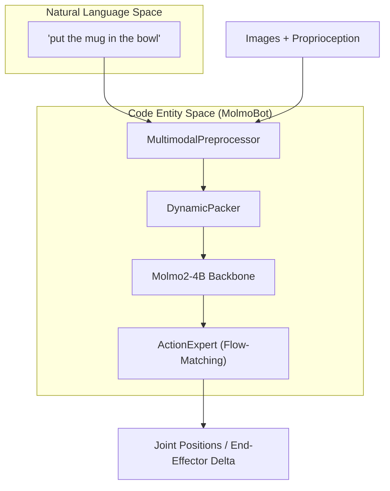
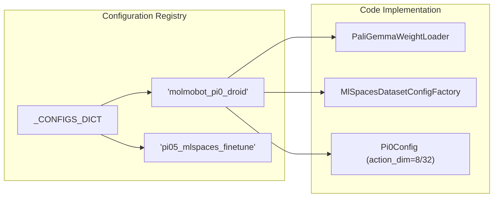
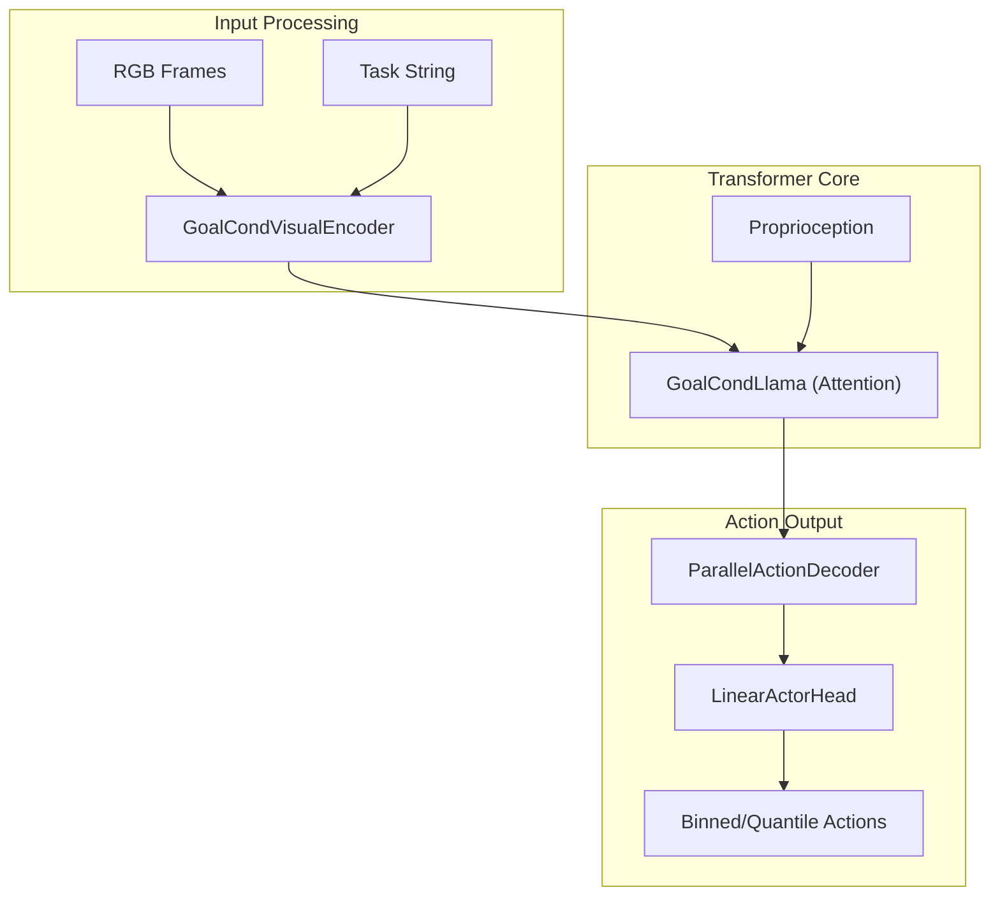

<!-- source: DeepWiki mcp.deepwiki.com · repo allenai/MolmoBot · page 6 Glossary · fetched 2026-10-26 -->

# Glossary

Relevant source files

The following files were used as context for generating this wiki page:

- [MolmoBot-Pi0/README.md](MolmoBot-Pi0/README.md)
- [MolmoBot-Pi0/config/eval/eval.yaml](MolmoBot-Pi0/config/eval/eval.yaml)
- [MolmoBot-Pi0/config/eval/policy/cameras/real.yaml](MolmoBot-Pi0/config/eval/policy/cameras/real.yaml)
- [MolmoBot-Pi0/molmobot_pi0/config_openpi.py](MolmoBot-Pi0/molmobot_pi0/config_openpi.py)
- [MolmoBot-Pi0/molmobot_pi0/train_openpi_pytorch.py](MolmoBot-Pi0/molmobot_pi0/train_openpi_pytorch.py)
- [MolmoBot-SPOC/README.md](MolmoBot-SPOC/README.md)
- [MolmoBot-SPOC/architecture/common/goal_cond_llama.py](MolmoBot-SPOC/architecture/common/goal_cond_llama.py)
- [MolmoBot-SPOC/architecture/spoc_model.py](MolmoBot-SPOC/architecture/spoc_model.py)
- [MolmoBot-SPOC/training/train_spoc_pl.py](MolmoBot-SPOC/training/train_spoc_pl.py)
- [MolmoBot/README.md](MolmoBot/README.md)
- [MolmoBot/olmo/config.py](MolmoBot/olmo/config.py)
- [MolmoBot/olmo/data/dynamic_packer.py](MolmoBot/olmo/data/dynamic_packer.py)

This glossary defines codebase-specific terms, abbreviations, and domain concepts used across the three MolmoBot sub-projects (**MolmoBot**, **MolmoBot-Pi0**, and **MolmoBot-SPOC**). It provides technical context and code pointers for onboarding engineers.

## Core Concepts

### Action Presets
Predefined configurations for robot action spaces (e.g., `franka_joint`). These determine the dimensionality and semantics of the model's output head during training and inference.
*   **Implementation**: Used in the launch script to set up the `ActionExpert` and flow-matching parameters [MolmoBot/launch_scripts/train_molmobot.py:114-114]().

### Camera Presets
Configurations defining which camera streams (e.g., `franka_one_random_then_wrist`) are used as input. These presets handle logic for randomized camera selection and multi-view fusion.
*   **Implementation**: Specified during training to configure the `MultimodalPreprocessor` [MolmoBot/launch_scripts/train_molmobot.py:115-115]().

### Flow-Matching Diffusion
A generative modeling technique used in the `ActionExpert` head of MolmoBot to predict continuous robot actions. It models the vector field that transforms noise into the action distribution.
*   **Implementation**: Configured via `num_flow_timestamps` in the training config [MolmoBot/launch_scripts/train_molmobot.py:131-131]().

### Sequence Packing (Dynamic Packer)
A performance optimization that packs multiple short robot trajectories into a single training sequence (up to a fixed `seq_len`) to minimize padding and maximize GPU throughput.
*   **Implementation**: `DynamicPacker` uses a vectorized 2D knapsack algorithm to optimize token and image constraints [MolmoBot/olmo/data/dynamic_packer.py:23-78]().

---

## MolmoBot Specifics (VLM Policy)

| Term | Definition | Code Pointer |
| :--- | :--- | :--- |
| **ActionExpert** | The specialized MLP head attached to the Molmo VLM for robot action prediction. | [MolmoBot/launch_scripts/train_molmobot.py:129-129]() |
| **MolmoSpaces** | The simulation environment (based on MuJoCo) used for zero-shot and fine-tuned evaluation. | [MolmoBot/launch_scripts/run_eval.py:61-61]() |
| **Subsegment IDs** | Metadata used during sequence packing to prevent tokens from one example attending to tokens from another example within the same sequence. | [MolmoBot/olmo/data/dynamic_packer.py:165-172]() |

### Data Flow: Observation to Action (MolmoBot)

The following diagram illustrates how raw sensor data is transformed into a robot action within the `olmo` package.

**Natural Language to Action Space Mapping**

**Sources**: [MolmoBot/olmo/data/dynamic_packer.py:137-173](), [MolmoBot/launch_scripts/train_molmobot.py:114-136]()

---

## MolmoBot-Pi0 Specifics (Pi0/Pi0.5)

| Term | Definition | Code Pointer |
| :--- | :--- | :--- |
| **Pi0Pytorch** | The PyTorch implementation of the Physical Intelligence Pi0 model, converted from JAX. | [MolmoBot-Pi0/molmobot_pi0/train_openpi_pytorch.py:46-46]() |
| **MlSpacesDatasetConfigFactory** | A factory class for creating dataset configurations compatible with the MolmoSpaces/DROID data format. | [MolmoBot-Pi0/molmobot_pi0/config_openpi.py:16-16]() |
| **PaliGemmaWeightLoader** | Utility for loading pretrained PaliGemma vision-language weights into the Pi0 backbone. | [MolmoBot-Pi0/molmobot_pi0/config_openpi.py:23-23]() |

### Pi0 Training Infrastructure
The Pi0 project utilizes a registry-based configuration system where `TrainConfig` objects define the model architecture and data loading strategy.

**Pi0 Model/Data Association**

**Sources**: [MolmoBot-Pi0/molmobot_pi0/config_openpi.py:9-73](), [MolmoBot-Pi0/molmobot_pi0/train_openpi_pytorch.py:45-50]()

---

## MolmoBot-SPOC Specifics (Lightweight Transformer)

| Term | Definition | Code Pointer |
| :--- | :--- | :--- |
| **GoalCondLlama** | A Llama-based transformer decoder modified for goal-conditioned manipulation (cross-attention to visual/text features). | [MolmoBot-SPOC/architecture/common/goal_cond_llama.py:175-178]() |
| **ParallelActionDecoder** | A module that decodes multiple action dimensions in parallel from the transformer latent space. | [MolmoBot-SPOC/architecture/spoc_model.py:50-51]() |
| **BinnedContinuousActionSpace** | An action space abstraction that discretizes continuous robot controls into bins for classification-based prediction. | [MolmoBot-SPOC/training/train_spoc_pl.py:26-28]() |

### SPOC Architecture Diagram
This diagram bridges the conceptual goal-conditioning with the specific classes in `molmobot_spoc.architecture`.

**SPOC Code Entity Space**

**Sources**: [MolmoBot-SPOC/architecture/spoc_model.py:17-63](), [MolmoBot-SPOC/architecture/common/goal_cond_llama.py:175-200]()

---

## Shared Abbreviations

*   **DDP**: Distributed Data Parallel. Used for multi-GPU training in Pi0 and SPOC [MolmoBot-Pi0/molmobot_pi0/train_openpi_pytorch.py:109-124]().
*   **FSDP**: Fully Sharded Data Parallel. Used in the main MolmoBot trainer for large-scale VLM fine-tuning.
*   **IL**: Imitation Learning. The primary training mode for all three projects [MolmoBot-SPOC/architecture/spoc_model.py:19-20]().
*   **RMSNorm**: Root Mean Square Layer Normalization. Used in the SPOC transformer backbone [MolmoBot-SPOC/architecture/common/goal_cond_llama.py:33-49]().
*   **RoPE**: Rotary Positional Embeddings. Used in the `GoalCondLlama` attention mechanism [MolmoBot-SPOC/architecture/common/goal_cond_llama.py:131-160]().