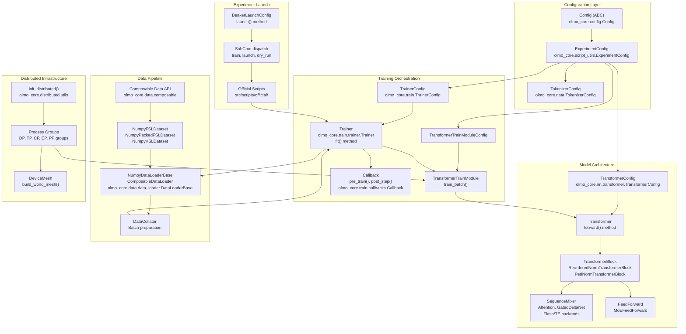
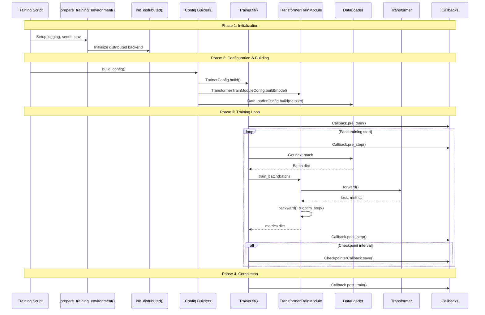

<!-- source: DeepWiki mcp.deepwiki.com · repo allenai/OLMo-core · page 1 Overview · fetched 2026-10-26 -->

# Overview

<details>
<summary>Relevant source files</summary>

The following files were used as context for generating this wiki page:

- [CHANGELOG.md](CHANGELOG.md)
- [README.md](README.md)
- [docs/source/overview/installation.rst](docs/source/overview/installation.rst)
- [docs/source/overview/introduction.rst](docs/source/overview/introduction.rst)
- [src/olmo_core/config.py](src/olmo_core/config.py)
- [src/olmo_core/data/mixes/OLMo-longmino-mix-0625.txt](src/olmo_core/data/mixes/OLMo-longmino-mix-0625.txt)
- [src/olmo_core/data/mixes/OLMo-longmino-mix-0925.txt](src/olmo_core/data/mixes/OLMo-longmino-mix-0925.txt)
- [src/olmo_core/internal/cookbook.py](src/olmo_core/internal/cookbook.py)
- [src/olmo_core/train/trainer.py](src/olmo_core/train/trainer.py)
- [src/olmo_core/version.py](src/olmo_core/version.py)
- [src/scripts/official/OLMo3/OLMo-3-1025-32B-long-context.py](src/scripts/official/OLMo3/OLMo-3-1025-32B-long-context.py)
- [src/scripts/official/OLMo3/OLMo-3-1025-7B-long-context.py](src/scripts/official/OLMo3/OLMo-3-1025-7B-long-context.py)
- [src/scripts/official/README.md](src/scripts/official/README.md)
- [src/scripts/train/README.md](src/scripts/train/README.md)
- [src/test/config_test.py](src/test/config_test.py)
- [src/test/conftest.py](src/test/conftest.py)

</details>


This document provides a high-level introduction to OLMo-core, explaining its purpose, architecture, and core components. It serves as an entry point for understanding the codebase organization and how the major systems interact.

For detailed installation instructions, see [Installation and Dependencies](#1.1). For information about the configuration system that underpins all components, see [Configuration System](#1.2).

## What is OLMo-core

OLMo-core is a Python framework designed for training large language models at scale. It provides the building blocks used to train the OLMo family of models, with a focus on distributed training efficiency, modularity, and reproducibility. The framework is built on PyTorch and includes support for multi-node training on GPU clusters with various parallelization strategies.

The current version is `2.5.0` as defined in [src/olmo_core/version.py:1-7]().

**Sources:** [README.md:1-61](), [src/olmo_core/version.py:1-7]()

## Design Philosophy

OLMo-core is structured around several key principles:

- **Configuration-driven**: All components use dataclass-based configurations that can be composed, validated, and serialized via the `Config` base class [src/olmo_core/config.py:55-71](). See [Configuration System](#1.2) for details.
- **Distributed-first**: Every major component considers multi-node, multi-GPU training from the ground up, with support for FSDP, tensor parallelism (TP), pipeline parallelism (PP), context parallelism (CP), and expert parallelism (EP).
- **Callback-based extensibility**: Training functionality like monitoring, evaluation, and checkpointing is implemented through a pluggable `Callback` system [src/olmo_core/train/trainer.py:58-65]().
- **Storage-agnostic I/O**: A unified API abstracts over local filesystems, S3, GCS, and WEKA storage backends [src/olmo_core/train/trainer.py:48-56]().
- **Modular data pipeline**: Dataset types (FSL, VSL, Packed), data mixing strategies, and data loaders can be mixed and matched based on training requirements [src/olmo_core/train/trainer.py:34]().

**Sources:** [CHANGELOG.md:25-75](), [docs/source/overview/introduction.rst:1-53](), [src/olmo_core/train/trainer.py:30-80]()

## System Architecture

The following diagram shows the major systems in OLMo-core and their relationships. This bridges high-level concepts to actual code entities:



**Sources:** [CHANGELOG.md:1-100](), [docs/source/overview/introduction.rst:9-53](), [src/olmo_core/train/trainer.py:99-156]()

## Core Components

The following table summarizes the major subsystems in OLMo-core and their purposes:

| Component | Purpose | Key Classes/Modules | Wiki Page |
|-----------|---------|---------------------|-----------|
| **Configuration** | Dataclass-based configuration system with validation | `Config`, `Registrable` | [Configuration System](#1.2) |
| **Model Architecture** | Transformer implementations with variants | `Transformer`, `TransformerBlock`, `MoETransformer` | [Model Architecture](#2) |
| **Training System** | Training loop orchestration and callbacks | `Trainer`, `TrainModule`, `Callback` | [Training System](#3) |
| **Distributed Training** | Multi-node/GPU coordination and parallelism | `init_distributed()`, `DeviceMesh` | [Distributed Training](#4) |
| **Data Pipeline** | Dataset loading and composable pipelines | `NumpyFSLDataset`, `ComposableDataLoader` | [Data Pipeline](#5) |
| **Optimization** | Optimizers and learning rate schedulers | `AdamW`, `Muon`, `Dion`, `CosWithWarmup` | [Optimization](#6) |
| **Experiment Management** | Job launching and configuration building | `BeakerLaunchConfig`, official scripts | [Experiment Management](#7) |
| **Inference** | Autoregressive text generation | `TransformerGenerationModule`, `chat` | [Inference and Generation](#8) |
| **Development** | Testing, CI/CD, and Docker images | `pytest`, `uv`, GitHub Actions | [Development and CI/CD](#9) |

**Sources:** [CHANGELOG.md:12-75](), [README.md:101-159](), [src/olmo_core/train/trainer.py:99-168]()

## Training Pipeline Flow

This diagram illustrates how the major components interact during a training run, showing the complete flow from script launch to training loop execution:



**Sources:** [docs/source/overview/introduction.rst:28-50](), [src/olmo_core/train/trainer.py:226-250](), [CHANGELOG.md:37-46]()

## Code Organization

The source code is organized under `src/olmo_core/` with the following structure:

```
src/olmo_core/
├── config.py                    # Base Config and Registrable classes
├── version.py                   # Version constants (currently v2.5.0)
├── io.py                        # Unified cloud-aware I/O API
├── nn/                          # Neural network modules
│   ├── transformer.py           # Transformer and Block implementations
│   ├── attention/               # Attention backends (Flash, TE, etc.)
│   ├── moe/                     # Mixture-of-experts components
│   └── hf/                      # HuggingFace integration
├── train/                       # Training system
│   ├── trainer.py               # Main Trainer class
│   ├── train_module.py          # TrainModule interface (v2.0.0 refactor)
│   └── callbacks/               # Monitoring, Eval, and Checkpointing
├── data/                        # Data pipeline
│   ├── numpy_dataset.py         # NPY-based dataset variants
│   ├── data_loader.py           # Distributed data loading
│   └── composable.py            # Composable data API (v2.5.0)
├── distributed/                 # Distributed infrastructure
│   ├── utils.py                 # Dist primitives (broadcast_object, etc.)
│   └── parallel/                # DP, TP, PP, CP, EP strategies
├── optim/                       # AdamW, Lion, Muon, Dion, and Schedulers
├── launch/                      # Experiment launch systems (Beaker, etc.)
└── generate/                    # Autoregressive generation and chat
```

**Sources:** [CHANGELOG.md:12-55](), [src/olmo_core/version.py:1-7](), [src/olmo_core/train/trainer.py:58-65]()

## Model Configurations

OLMo-core includes pre-configured model definitions. Key model configurations include:

| Model Family | Configuration Method | Notes |
|--------------|----------------------|-------|
| **OLMo-2** | `TransformerConfig.olmo2_32B()` | Standard architecture for 32B models [README.md:98]() |
| **OLMo-3** | `TransformerConfig.olmo3_7B()` | Updated architecture for 7B and 32B [README.md:99]() |
| **Gemma 3** | `TransformerConfig.gemma3_like()` | Support for Gemma 3 architecture [CHANGELOG.md:43]() |
| **Hybrid** | `TransformerConfig.block` | Supports per-layer block selection patterns [CHANGELOG.md:69]() |

**Sources:** [CHANGELOG.md:23-75](), [src/scripts/official/README.md:1-11](), [src/scripts/official/OLMo3/OLMo-3-1025-7B-long-context.py:46-51]()

## Versioning and Changes

OLMo-core follows semantic versioning. The current version is `2.5.0` [src/olmo_core/version.py:7]().

### Recent Major Changes (v2.0.0+)
- **v2.5.0**: Added `olmo_core.data.composable`, `PeriNormTransformerBlock`, support for Muon/Dion optimizers, and Ulysses context parallelism [CHANGELOG.md:23-75]().
- **v2.0.0**: Introduced the `TrainModule` abstraction to consolidate model and optimizer logic for complex parallelism [CHANGELOG.md:35]().

For detailed history, see [Versioning and Changelog](#1.3).

**Sources:** [CHANGELOG.md:1-104](), [src/olmo_core/version.py:1-7]()

---

