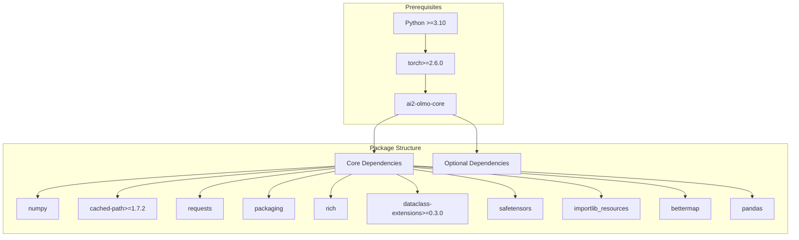
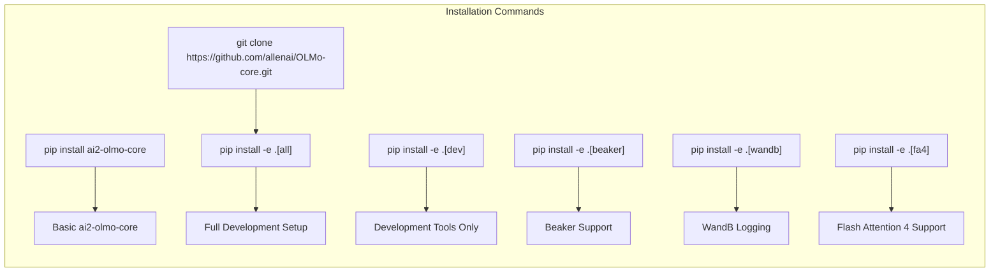
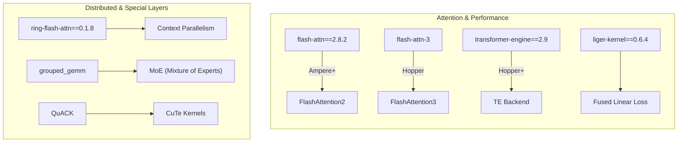

<!-- source: DeepWiki mcp.deepwiki.com · repo allenai/OLMo-core · page 1.1 Installation and Dependencies · fetched 2026-10-26 -->

# Installation and Dependencies

<details>
<summary>Relevant source files</summary>

The following files were used as context for generating this wiki page:

- [.github/workflows/docker.yml](.github/workflows/docker.yml)
- [.github/workflows/main.yml](.github/workflows/main.yml)
- [Makefile](Makefile)
- [README.md](README.md)
- [docs/source/overview/installation.rst](docs/source/overview/installation.rst)
- [docs/source/overview/introduction.rst](docs/source/overview/introduction.rst)
- [pyproject.toml](pyproject.toml)
- [src/Dockerfile](src/Dockerfile)
- [src/scripts/official/README.md](src/scripts/official/README.md)
- [src/scripts/train/README.md](src/scripts/train/README.md)

</details>


This page covers the installation process and dependency requirements for OLMo-core. It provides detailed instructions on how to set up your environment to use the OLMo-core library for large language model training and inference.

## Prerequisites

Before installing OLMo-core, you must install PyTorch according to the instructions specific to your operating system and hardware. OLMo-core is built on top of PyTorch and requires a compatible version (>= 2.6.0).

**Installation Prerequisites Flow**



Sources: [pyproject.toml:13-29]()

## Installation Methods

OLMo-core can be installed using different methods depending on your requirements.

### Installing from PyPI

For most users, installing from PyPI is the simplest approach:

```bash
pip install ai2-olmo-core
```

Sources: [docs/source/overview/installation.rst:7-9](), [README.md:43-47]()

### Installing from Source

For development or to access the latest features, it's recommended to install from source:

```bash
git clone https://github.com/allenai/OLMo-core.git
cd OLMo-core
pip install -e .[all]
```

The `[all]` suffix includes all optional dependencies. You can also specify specific dependency groups (see Optional Dependencies section).

**Installation Methods and Commands**



Sources: [pyproject.toml:36-70](), [README.md:36-41]()

## Core Dependencies

OLMo-core requires the following core dependencies:

| Dependency | Version Constraint | Purpose |
|------------|-------------------|---------|
| Python | >=3.10 | Base programming language |
| torch | >=2.6.0 | Deep learning framework |
| numpy | (none) | Numerical computations |
| cached-path | >=1.7.2 | Resource caching and file downloads |
| filelock | >=3.4,<4.0 | Process-safe file locking |
| dataclass-extensions | >=0.3.0 | Enhanced configuration classes |
| rich | (none) | Rich text formatting for CLI |
| safetensors | (none) | Safe tensor serialization |
| bettermap | (none) | Enhanced mapping utilities |
| pandas | (none) | Data manipulation and analysis |

Sources: [pyproject.toml:13-29]()

## Optional Dependencies

OLMo-core offers several optional dependency groups that enable additional functionality. These can be installed using the syntax `pip install ai2-olmo-core[group_name]`.

### Integration Dependencies

**`[beaker]`** - For launching experiments on Beaker clusters:
- Includes: `beaker-py>=2.5.4,<3.0`, `beaker-gantry>=3.4.3,<4.0`, `GitPython>=3.0,<4.0`, `google-cloud-compute`. [pyproject.toml:61]()
- Used by: `BeakerLaunchConfig` and the `olmo_core.launch.beaker` module. [docs/source/overview/introduction.rst:41-45]()

**`[eval]`** - For running evaluations:
- Includes: `ai2-olmo-eval==0.9.0`. [pyproject.toml:64]()
- Used by: Integration with the `olmo-eval` library for task evaluation.

**`[torchao]`** - For advanced optimization (Float8/MXFP8):
- Includes: `torchao==0.15.0`. [pyproject.toml:67]()
- Used for: Float8 training and quantization features. [docs/source/overview/installation.rst:15]()

**`[fa4]`** - Flash Attention 4 for Blackwell GPUs:
- Includes: `flash-attn-4>=4.0.0b4`. [pyproject.toml:65]()

**`[fla]`** - Flash Linear Attention:
- Includes: `flash-linear-attention==0.4.1`. [pyproject.toml:66]()

**`[dion]`** - Dion Optimizer support:
- Includes: `dion` from GitHub. [pyproject.toml:63]()

Sources: [pyproject.toml:61-70](), [docs/source/overview/installation.rst:11-17]()

### High-Performance Runtime Dependencies

These dependencies enable specific model features and performance optimizations. Many are pre-installed in the official Docker images.

**Hardware and Implementation Matrix**



Sources: [src/Dockerfile:51-95](), [README.md:49-56]()

## Docker Images

OLMo-core provides official Docker images containing a fully configured environment, including complex CUDA-compiled dependencies.

**Build Configuration** (from `Makefile` and `Dockerfile`):
- **CUDA Version**: `12.8.1` [Makefile:50]() (Builds for `12.8.1` and `12.9.1` in CI [.github/workflows/docker.yml:40]())
- **Python Version**: `3.12` [Makefile:52]()
- **PyTorch Version**: `2.10.0` [Makefile:53]()
- **Flash Attention**: `2.8.2` [Makefile:57]()
- **Transformer Engine**: `2.9` [Makefile:60]()
- **Liger Kernel**: `0.6.4` [Makefile:62]()

**Image Naming**:
- Image tag format: `tch{torch_version_short}cu{cuda_version_path}-{date}` [Makefile:74]()
- Example: `olmo-core:tch2100cu128-2025-01-01`

**Build Commands**:
```bash
# Build the release image locally
make docker-image

# Push to GitHub Container Registry
make ghcr-image

# Create a Beaker-compatible image
make beaker-image
```

Sources: [Makefile:71-118](), [src/Dockerfile:1-171](), [.github/workflows/docker.yml:29-50]()

## Platform and Hardware Requirements

OLMo-core is optimized for high-performance GPU clusters.

| Requirement | Implementation/Context | Purpose |
|-------------|----------------------|---------|
| **OS** | Linux (Primary), Darwin (ARM64 support in `uv`) | Training and Development [pyproject.toml:73-76]() |
| **Python** | >=3.10 | Runtime Environment [pyproject.toml:13]() |
| **CUDA** | 12.x (e.g., 12.8, 12.9) | GPU Acceleration [Makefile:50](), [.github/workflows/docker.yml:40]() |
| **GPU Arch** | SM 9.0 (Hopper), SM 10.0 (Blackwell) | Optimized Attention (FA3, FA4) [src/Dockerfile:55-59]() |
| **Drivers** | MLNX OFED 24.01+ | RDMA/InfiniBand for Distributed Training [src/Dockerfile:154-159]() |

Sources: [pyproject.toml:13-76](), [src/Dockerfile:150-160](), [Makefile:50-60]()

## Development Setup

For contributors, the repository includes a `Makefile` to standardize checks and environment management.

| Task | Command | Tools Used |
|------|---------|------------|
| **Formatting** | `make style` | `isort`, `black` [Makefile:21-26]() |
| **Linting** | `make lint-check` | `ruff` [Makefile:11-14]() |
| **Type Check** | `make type-check` | `mypy` [Makefile:16-19]() |
| **Tests** | `pytest src/test/` | `pytest` [.github/workflows/main.yml:39-48]() |
| **Build Docs** | `make docs` | `sphinx-autobuild` [Makefile:28-31]() |

Sources: [Makefile:1-31](), [pyproject.toml:92-179](), [.github/workflows/main.yml:27-102]()

---

