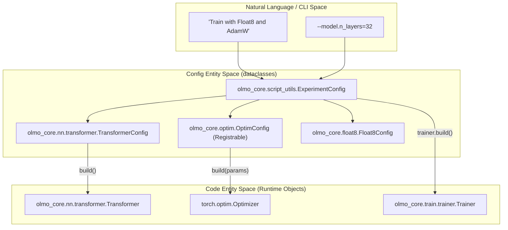
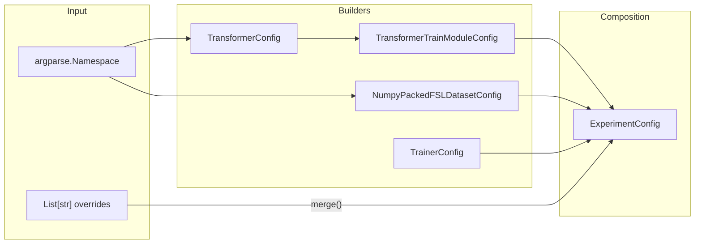

<!-- source: DeepWiki mcp.deepwiki.com · repo allenai/OLMo-core · page 1.2 Configuration System · fetched 2026-10-26 -->

# Configuration System

Relevant source files

The following files were used as context for generating this wiki page:

- [CHANGELOG.md](CHANGELOG.md)
- [src/olmo_core/config.py](src/olmo_core/config.py)
- [src/olmo_core/data/mixes/OLMo-longmino-mix-0625.txt](src/olmo_core/data/mixes/OLMo-longmino-mix-0625.txt)
- [src/olmo_core/data/mixes/OLMo-longmino-mix-0925.txt](src/olmo_core/data/mixes/OLMo-longmino-mix-0925.txt)
- [src/olmo_core/internal/cookbook.py](src/olmo_core/internal/cookbook.py)
- [src/olmo_core/train/trainer.py](src/olmo_core/train/trainer.py)
- [src/olmo_core/version.py](src/olmo_core/version.py)
- [src/scripts/official/OLMo3/OLMo-3-1025-32B-long-context.py](src/scripts/official/OLMo3/OLMo-3-1025-32B-long-context.py)
- [src/scripts/official/OLMo3/OLMo-3-1025-7B-long-context.py](src/scripts/official/OLMo3/OLMo-3-1025-7B-long-context.py)
- [src/test/config_test.py](src/test/config_test.py)
- [src/test/conftest.py](src/test/conftest.py)

The configuration system in OLMo-core provides a structured, composable approach to defining experiments. It enables reproducible training runs by capturing all hyperparameters and settings in serializable dataclass configurations that can be version-controlled, modified via CLI overrides, and transformed into runtime PyTorch modules through a builder pattern.

---

## Overview and Design Philosophy

The configuration system is built on three core principles:

1.  **Configuration-as-code**: Experiments are defined as typed Python dataclasses rather than static YAML files, allowing for programmatic generation of complex scaling laws.
2.  **Separation of concerns**: Configuration (what to build) is strictly separated from instantiation (how to build).
3.  **Composability**: Complex configurations are assembled from smaller, reusable component configs (e.g., `AttentionConfig` nested within `TransformerBlockConfig`).

Every major component in OLMo-core (models, trainers, data loaders, callbacks) follows this pattern:
*   A `*Config` dataclass captures all settings.
*   A `.build()` method (or equivalent factory function) constructs the runtime object.

**Sources:** [src/olmo_core/config.py:56-71](), [src/olmo_core/train/trainer.py:99-106]()

---

## The Config and Registrable Base Classes

The system relies on two primary base classes to manage data and polymorphism.

### Config Base Class
All configuration classes inherit from `olmo_core.config.Config` [src/olmo_core/config.py:56-71](). This class leverages `dataclass-extensions` to provide deep serialization and merging capabilities.

| Method | Purpose |
| :--- | :--- |
| `as_dict()` | Converts the config into a regular Python dictionary, with options to exclude private fields or include class names [src/olmo_core/config.py:84-151](). |
| `as_config_dict()` | A convenience wrapper for creating JSON-safe dictionaries suitable for checkpointing [src/olmo_core/config.py:153-165](). |
| `merge(dotlist)` | Merges the config with a "dotlist" of overrides (e.g., `model.d_model=1024`), creating a new object [src/olmo_core/config.py:197-230](). |
| `apply(func)` | Recursively applies a function to every nested config instance field [src/olmo_core/config.py:167-190](). |
| `validate()` | A hook for implementing custom validation logic after initialization [src/olmo_core/config.py:191-195](). |

### Registrable Base Class
OLMo-core re-exports `Registrable` from `dataclass-extensions` [src/olmo_core/config.py:35](). This enables the factory pattern:
1.  A base class (e.g., `OptimConfig`) inherits from `Registrable`.
2.  Subclasses (e.g., `SkipStepAdamWConfig`) register themselves with a name.
3.  The configuration can then use a "type" field in a dictionary to determine which subclass to instantiate during decoding.

**Sources:** [src/olmo_core/config.py:24-36](), [src/olmo_core/config.py:130-135]()

---

## Data Flow: From Config to Code

The following diagram illustrates how a high-level `ExperimentConfig` bridges the gap between natural language requirements (e.g., "Train a 7B model") and the underlying code entities.

**Diagram: Configuration to Entity Mapping**

**Sources:** [src/olmo_core/config.py:197-230](), [src/scripts/official/OLMo3/OLMo-3-1025-7B-long-context.py:139-146](), [src/olmo_core/train/trainer.py:99-106]()

---

## Dataclass-Extensions Usage

OLMo-core heavily utilizes the `dataclass-extensions` library for advanced serialization and type safety.

### Decoding and Type Coercion
The `decode` function [src/olmo_core/config.py:24]() is used to transform raw dictionaries (often from YAML or JSON) back into strongly-typed `Config` objects. This process handles:
*   **Recursive instantiation**: Nested dictionaries are converted into nested dataclasses.
*   **Type coercion**: String values like `"1e-4"` are coerced to `float`, and `"true"` to `bool`.
*   **Registrable lookup**: If a field expects a `Registrable` type, the `type` key in the dictionary is used to find the correct subclass.

### Custom Enums
The system provides `StrEnum` [src/olmo_core/config.py:39-50]() for string-based enumerations that are easily serializable and compatible across Python versions.

**Sources:** [src/olmo_core/config.py:24-50](), [src/olmo_core/config.py:122-151]()

---

## The Factory and Builder Pattern

Instantiation in OLMo-core follows a hierarchy. Official scripts often use a `build_config` orchestration pattern to assemble the final experiment.

### Build Orchestration
The `build_config` function (typically found in official training scripts) orchestrates the assembly of an experiment. It uses specialized builders for different sub-systems:

1.  **TransformerTrainModuleConfig**: Configures the model-optimizer interaction, including `float8_config` and `dp_config` [src/olmo_core/internal/cookbook.py:44-90]().
2.  **TrainerConfig**: Configures the training loop, including checkpoint paths and callback registration via `.with_callback()` [src/scripts/official/OLMo3/OLMo-3-1025-7B-long-context.py:96-137]().

**Diagram: Build Process Data Flow**

**Sources:** [src/olmo_core/internal/cookbook.py:44-90](), [src/scripts/official/OLMo3/OLMo-3-1025-7B-long-context.py:42-146]()

---

## Configuration Hierarchy and Serialization

The hierarchy is designed to be fully serializable to a single JSON/YAML file for every checkpoint.

| Component | Class Name | Role |
| :--- | :--- | :--- |
| **Experiment** | `ExperimentConfig` | Top-level container [src/scripts/official/OLMo3/OLMo-3-1025-7B-long-context.py:139](). |
| **Model** | `TransformerConfig` | Defines architecture (layers, d_model, etc.) [src/scripts/official/OLMo3/OLMo-3-1025-7B-long-context.py:46](). |
| **Training** | `TransformerTrainModuleConfig` | Pairs model with optimizer and scheduler [src/olmo_core/internal/cookbook.py:53](). |
| **Trainer** | `TrainerConfig` | Configures the training loop, duration, and callbacks [src/olmo_core/train/trainer.py:99](). |

### Serialization Logic
The `as_dict` method recursively traverses the dataclass [src/olmo_core/config.py:122-136](). It handles:
*   **Dataclasses**: Recurses into nested fields.
*   **Registrables**: Injects a `"type"` key based on the registered name [src/olmo_core/config.py:130-135]().
*   **Class Names**: Injects a `_CLASS_` key to ensure the exact Python class can be recovered [src/olmo_core/config.py:128-129]().

**Sources:** [src/olmo_core/config.py:73-77](), [src/olmo_core/config.py:122-151](), [src/olmo_core/train/trainer.py:99-106]()

---

