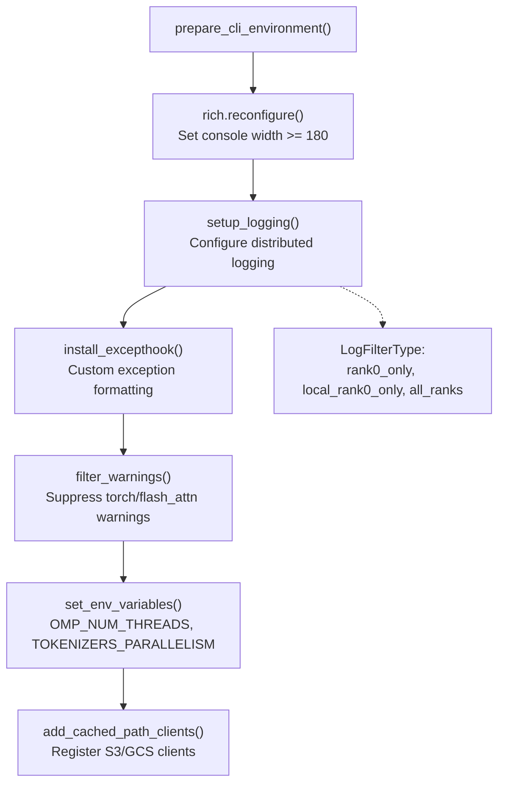
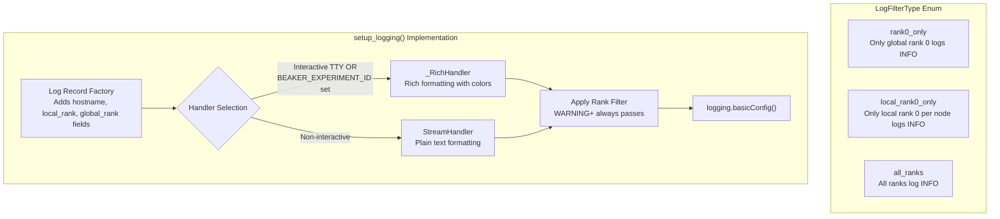
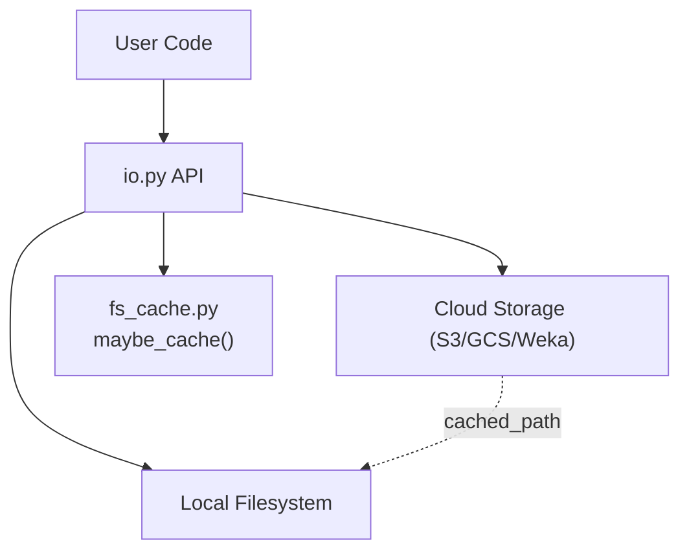
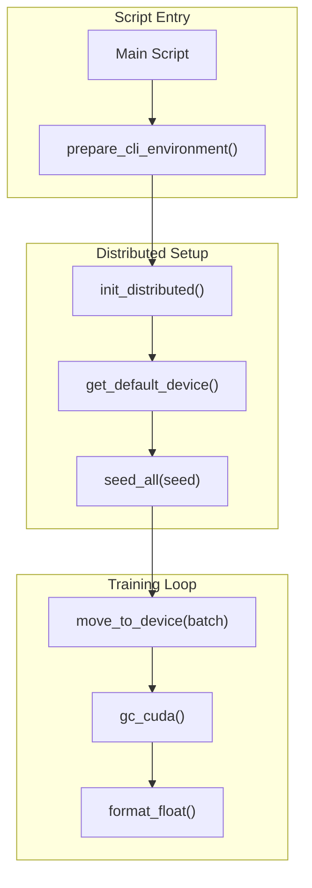

<!-- source: DeepWiki mcp.deepwiki.com · repo allenai/OLMo-core · page 10 Utilities and Helpers · fetched 2026-10-26 -->

# Utilities and Helpers

Relevant source files

The following files were used as context for generating this wiki page:

- [src/olmo_core/io.py](src/olmo_core/io.py)
- [src/olmo_core/utils.py](src/olmo_core/utils.py)
- [src/test/distributed/checkpoint_test.py](src/test/distributed/checkpoint_test.py)
- [src/test/io_test.py](src/test/io_test.py)
- [src/test/train/checkpoint_test.py](src/test/train/checkpoint_test.py)

This document covers the core utility functions and helpers used throughout OLMo-core. These are foundational functions that support higher-level systems but are not specific to any particular subsystem. The utilities are primarily located in `src/olmo_core/utils.py` [src/olmo_core/utils.py:1-37]().

For distributed-specific utilities like `init_distributed()` and `build_world_mesh()`, see [Distributed Training](#4) and its subsections. For I/O utilities like file operations and remote storage, see the `olmo_core.io` module [src/olmo_core/io.py:1-40]().

## Utility Categories

The utilities in OLMo-core fall into several categories:

| Category | Key Functions | Purpose |
|----------|--------------|---------|
| Environment Setup | `prepare_cli_environment()`, `set_env_var()` | Initialize runtime environment for scripts and training |
| Logging | `setup_logging()`, `LogFilterType`, `log_or_print()` | Configure distributed-aware logging with rank filtering |
| PyTorch Operations | `get_default_device()`, `move_to_device()`, `seed_all()`, `mark_dynamic()` | Device management and tensor operations |
| CUDA Utilities | `gc_cuda()`, `has_compute_capability()`, `cuda_sync_debug_mode()` | CUDA-specific functionality and memory management |
| I/O Operations | `normalize_path()`, `get_file_size()`, `upload()`, `copy_file()` | Unified API for local and remote (S3/GCS) files |
| Formatting | `format_float()`, `format_int()`, `format_timedelta()` | Human-readable formatting for metrics and logs |
| Threading | `threaded_generator()`, `wait_for()` | Thread management and synchronization |
| Tensor Inspection | `apply_to_tensors()`, `same_storage()`, `record_flops()` | Tensor introspection and analysis |

**Sources**: [src/olmo_core/utils.py:1-37](), [src/olmo_core/io.py:1-40]()

## Environment and Logging Setup

### CLI Environment Preparation

The `prepare_cli_environment()` function serves as the single entry point for initializing the runtime environment for OLMo-core scripts [src/olmo_core/utils.py:469-503]().

**Diagram: Environment Preparation Flow**

**Sources**: [src/olmo_core/utils.py:469-503]()

The function orchestrates several setup operations:

1. **Rich Console Configuration** - Sets console width to at least 180 characters for better table rendering [src/olmo_core/utils.py:498]().
2. **Logging Setup** - Configures distributed-aware logging with rank filtering [src/olmo_core/utils.py:499]().
3. **Exception Hook Installation** - Installs custom `sys.excepthook` for user-friendly error formatting [src/olmo_core/utils.py:500]().
4. **Warning Filters** - Suppresses common warnings from PyTorch, flash-attn, and torchvision [src/olmo_core/utils.py:501]().
5. **Environment Variables** - Sets `OMP_NUM_THREADS=8` and `TOKENIZERS_PARALLELISM=false` [src/olmo_core/utils.py:502]().
6. **I/O Clients** - Registers `cached_path` clients for S3, GCS, etc. [src/olmo_core/utils.py:503]().

For more details on environment configuration, see [Environment and Logging](#10.1).

### Distributed-Aware Logging

The logging system is designed for distributed training environments. The `LogFilterType` enum controls which ranks are allowed to emit INFO-level messages [src/olmo_core/utils.py:240-244]().

**Diagram: Logging Configuration System**

**Sources**: [src/olmo_core/utils.py:240-364](), [src/olmo_core/utils.py:506-571]()

## PyTorch and Device Utilities

### Device Management

The `get_default_device()` function determines the appropriate default device based on whether the environment is distributed (using `is_distributed()`) and what hardware is available (CUDA, MPS, or CPU) [src/olmo_core/utils.py:128-153]().

**Sources**: [src/olmo_core/utils.py:128-153](), [src/test/distributed/checkpoint_test.py:26]()

### Tensor Operations

*   **`move_to_device(o: T, device: torch.device, non_blocking: Optional[bool] = None) -> T`**: Recursively moves tensors or containers of tensors to the specified device. Handles dicts, lists, and tuples [src/olmo_core/utils.py:97-116]().
*   **`apply_to_tensors(fn, container: Any) -> None`**: Recursively applies a function to all tensors in a container, including dataclasses [src/olmo_core/utils.py:72-92]().
*   **`mark_dynamic(x: torch.Tensor, dim: Union[int, Sequence[int]], strict: bool = True)`**: Marks tensor dimensions as dynamic for `torch.compile()` [src/olmo_core/utils.py:118-126]().
*   **`seed_all(seed: int)`**: Seeds all RNG states including Python `random`, `numpy`, and `torch` (CPU and CUDA) [src/olmo_core/utils.py:162-178]().

**Sources**: [src/olmo_core/utils.py:72-126](), [src/olmo_core/utils.py:162-178]()

### CUDA Utilities

*   **`gc_cuda()`**: Runs Python garbage collection and empties the CUDA cache via `torch.cuda.empty_cache()` [src/olmo_core/utils.py:189-196]().
*   **`has_flash_attn() -> bool`**: Checks if the `flash_attn` package is available in the environment [src/olmo_core/utils.py:198-209]().
*   **`record_flops(...)`**: Counts FLOPs for a model using PyTorch's `FlopCounterMode` [src/olmo_core/utils.py:808-835]().

For more details, see [PyTorch and CUDA Utilities](#10.2).

## I/O and File System

The `olmo_core.io` module provides a unified API for interacting with local files and cloud storage (S3, GCS, Weka, R2) [src/olmo_core/io.py:38-40]().

**Diagram: Unified I/O Architecture**

**Sources**: [src/olmo_core/io.py:38-135](), [src/olmo_core/fs_cache.py:1-10]()

Key functions include:
*   **`normalize_path()`**: Strips trailing slashes and handles `file://` prefixes [src/olmo_core/io.py:42-48]().
*   **`get_file_size()`**: Returns size in bytes for local or remote files, with optional caching [src/olmo_core/io.py:107-135]().
*   **`upload()`**: Transfers local files to S3 or GCS [src/olmo_core/io.py:171-203]().
*   **`copy_file()`**: High-level copy between local/remote paths using `cached_path` [src/olmo_core/io.py:205-227]().
*   **`glob_directory()`**: Supports recursive globbing for both local and remote filesystems [src/olmo_core/io.py:277-319]().

For more details, see [I/O and File System](#10.3).

## Formatting and Math Utilities

OLMo-core provides several utilities for formatting numbers and time values for human-readable display:

*   **`format_float()`**: Formats floats with appropriate precision and suffixes (B, T, P, E) [src/olmo_core/utils.py:641-677]().
*   **`format_int()`**: Formats large integers with K, M, B suffixes [src/olmo_core/utils.py:679-691]().
*   **`format_timedelta()`**: Formats durations as "1d, 1h, 1m, 5s" [src/olmo_core/utils.py:693-714]().
*   **`capped_powers_of_2()`**: Decomposes an integer into powers of 2, capped at a maximum value [src/olmo_core/utils.py:629-639]().

**Sources**: [src/olmo_core/utils.py:619-714]()

## Integration with Training

The utilities integrate with the training system at multiple levels, from initial script setup to metric reporting and checkpointing.

**Diagram: Utility Integration in Training Pipeline**

**Sources**: [src/olmo_core/utils.py:469-503](), [src/test/train/checkpoint_test.py:15-41]()

---

