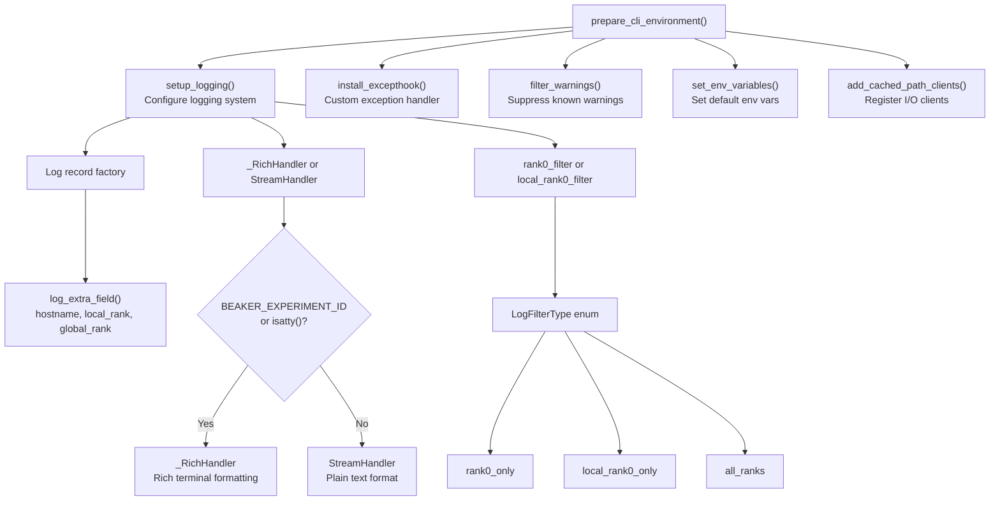
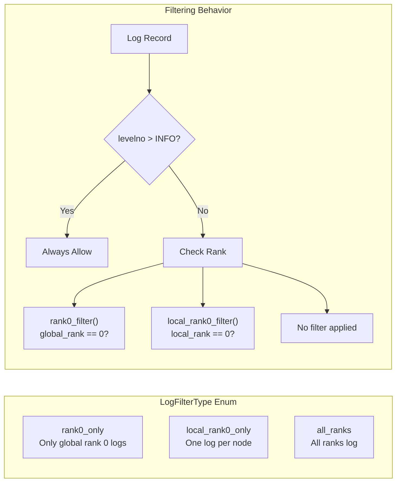
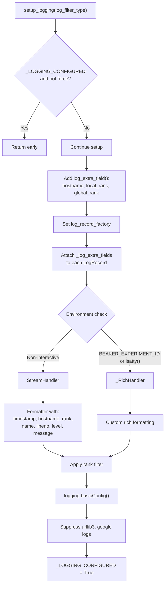
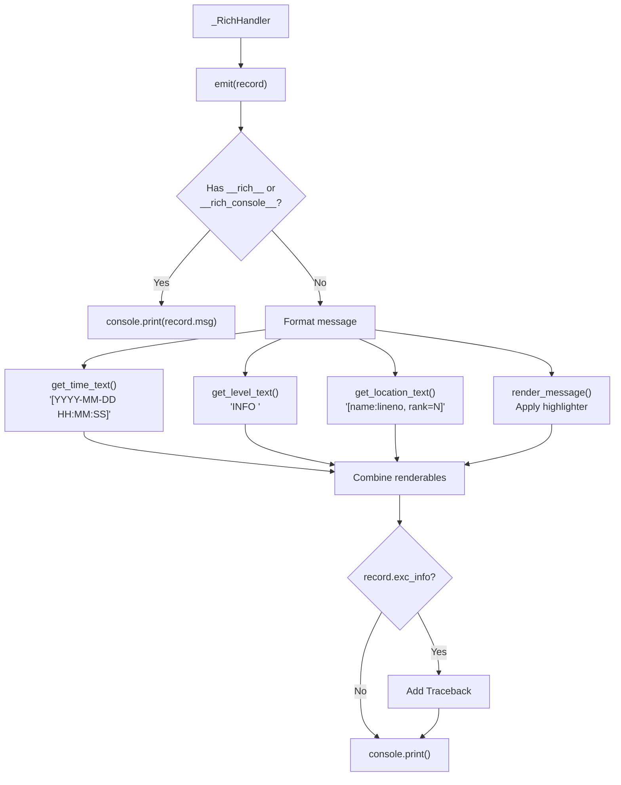
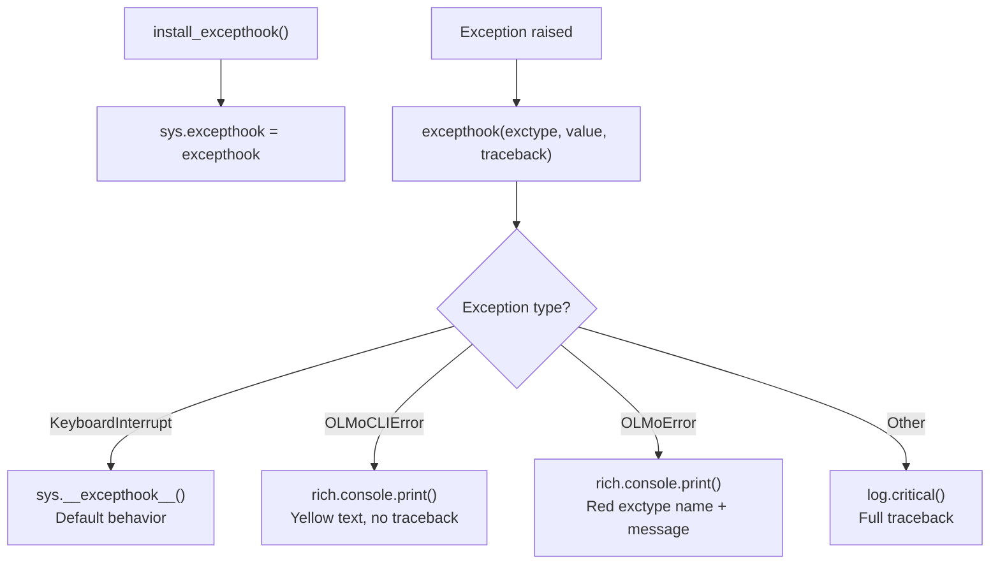
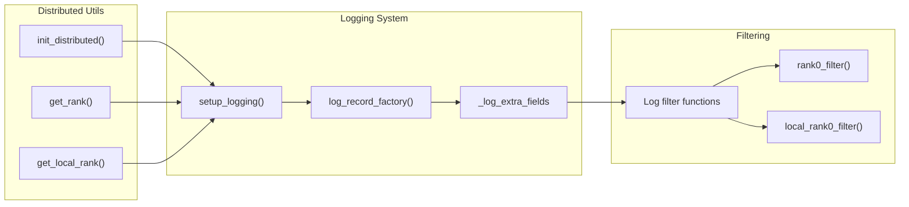

<!-- source: DeepWiki mcp.deepwiki.com · repo allenai/OLMo-core · page 10.1 Environment and Logging · fetched 2026-10-26 -->

# Environment and Logging

<details>
<summary>Relevant source files</summary>

The following files were used as context for generating this wiki page:

- [src/olmo_core/distributed/utils.py](src/olmo_core/distributed/utils.py)
- [src/olmo_core/model_ladder/utils.py](src/olmo_core/model_ladder/utils.py)
- [src/olmo_core/train/__init__.py](src/olmo_core/train/__init__.py)
- [src/olmo_core/train/callbacks/speed_monitor.py](src/olmo_core/train/callbacks/speed_monitor.py)
- [src/olmo_core/train/common.py](src/olmo_core/train/common.py)
- [src/olmo_core/train/utils.py](src/olmo_core/train/utils.py)
- [src/olmo_core/utils.py](src/olmo_core/utils.py)
- [src/test/distributed/checkpoint_test.py](src/test/distributed/checkpoint_test.py)
- [src/test/train/utils_test.py](src/test/train/utils_test.py)

</details>


This document describes the environment setup and logging infrastructure used throughout OLMo-core. This system provides a standardized way to configure the runtime environment for training scripts and CLIs, with special consideration for distributed training scenarios where multiple processes (ranks) are running simultaneously.

The environment and logging system handles:
- Rank-aware log filtering to prevent log spam from multiple processes.
- Rich terminal formatting with fallback to plain text for non-interactive environments.
- Custom exception handling with enhanced error reporting.
- Common environment variable configuration.
- Warning suppression for known third-party issues.

For distributed initialization and rank management, see [4.1 Distributed Initialization](). For I/O client setup, see [10.3 I/O and File System]().

## CLI Environment Preparation

The primary entry point for environment setup is `prepare_cli_environment()`, which should be called at the beginning of every script or CLI command, typically in the `if __name__ == "__main__":` block.



**Sources:** [src/olmo_core/utils.py:459-494]()

### Function Overview

The `prepare_cli_environment()` function accepts a single optional parameter:

| Parameter | Type | Default | Description |
|-----------|------|---------|-------------|
| `log_filter_type` | `LogFilterType` or `None` | `None` | Controls which ranks emit INFO-level logs. If `None`, reads from `LOG_FILTER_TYPE` env var, defaulting to `"rank0_only"`. |

**Sources:** [src/olmo_core/utils.py:459-494]()

## Logging System

### Log Filter Types

The `LogFilterType` enum controls which distributed training ranks are allowed to emit INFO and DEBUG level log messages. All ranks always emit WARNING and ERROR level messages.



**Sources:** [src/olmo_core/utils.py:232-251](), [src/olmo_core/utils.py:320-346]()

| Filter Type | Environment Variable | Behavior |
|-------------|---------------------|----------|
| `rank0_only` | `LOG_FILTER_TYPE=rank0_only` | Only global rank 0 emits INFO/DEBUG logs. |
| `local_rank0_only` | `LOG_FILTER_TYPE=local_rank0_only` | First rank on each node (local rank 0) emits INFO/DEBUG logs. |
| `all_ranks` | `LOG_FILTER_TYPE=all_ranks` | All ranks emit INFO/DEBUG logs (not recommended for large-scale training). |

**Sources:** [src/olmo_core/utils.py:232-251]()

### Logging Configuration

The `setup_logging()` function configures the Python logging system with rank-aware filtering and appropriate formatting. It ensures that even in distributed environments, log output is structured and readable.



**Sources:** [src/olmo_core/utils.py:272-354]()

### Log Record Extra Fields

The logging system supports adding extra fields to log records via `log_extra_field()`. These fields are stored in the global `_log_extra_fields` dictionary and are automatically attached to every `LogRecord` created by the custom record factory.

```python
# Example: Adding a custom field
log_extra_field("experiment_id", "exp-123")
log_extra_field("step", 1000)

# Removing a field
log_extra_field("experiment_id", None)
```

Default fields automatically added during `setup_logging()`:
- `hostname`: Socket hostname of the current machine.
- `local_rank`: Local rank within the node (from `get_local_rank()`).
- `global_rank`: Global rank across all nodes (from `get_rank()`).

**Sources:** [src/olmo_core/utils.py:35-37](), [src/olmo_core/utils.py:253-270](), [src/olmo_core/utils.py:291-303]()

### Rich Handler

The `_RichHandler` class provides rich terminal formatting for log messages when running in interactive environments or on Beaker. It uses the `rich` library to render structured output, including rank information and highlighted syntax.



**Sources:** [src/olmo_core/utils.py:496-561]()

## Exception Handling

The `install_excepthook()` function replaces Python's default exception handler with a custom handler that provides better formatting and special handling for OLMo-specific exceptions.



**Sources:** [src/olmo_core/utils.py:368-392]()

| Exception Type | Handling |
|---------------|----------|
| `KeyboardInterrupt` | Default Python behavior (exit gracefully). [src/olmo_core/utils.py:372-373]() |
| `OLMoCLIError` | Print yellow message without traceback. [src/olmo_core/utils.py:374-376]() |
| `OLMoError` | Print red error name and message without full traceback. [src/olmo_core/utils.py:377-380]() |
| Other exceptions | Log as critical with full traceback. [src/olmo_core/utils.py:381-383]() |

**Sources:** [src/olmo_core/utils.py:368-383]()

## Warning Filters

The `filter_warnings()` function suppresses common warnings from third-party libraries that would otherwise clutter the logs during training. This includes deprecation warnings from PyTorch and specific noise from distributed backends.

**Key Filters:**
- `torch.distributed`: Suppresses warnings about private function access in `_base`. [src/olmo_core/utils.py:401-405]()
- `torch.cuda`: Suppresses synchronization debug mode warnings. [src/olmo_core/utils.py:412-416]()
- `flash_attn`: Suppresses future warnings in layer normalization. [src/olmo_core/utils.py:431-435]()
- `urllib3`: Suppresses insecure request warnings. [src/olmo_core/utils.py:442-446]()

**Sources:** [src/olmo_core/utils.py:395-446]()

## Environment Variables

The `set_env_variables()` function sets default values for common environment variables if they are not already set.

| Environment Variable | Default Value | Purpose |
|---------------------|---------------|---------|
| `OMP_NUM_THREADS` | `"8"` | Control OpenMP thread count for CPU operations. [src/olmo_core/utils.py:452]() |
| `TOKENIZERS_PARALLELISM` | `"false"` | Disable parallelism in HuggingFace tokenizers to avoid deadlocks. [src/olmo_core/utils.py:456]() |

The `set_env_var()` helper function provides logging for environment variable changes and supports overriding existing values while optionally masking "secret" values. [src/olmo_core/utils.py:211-230]()

**Sources:** [src/olmo_core/utils.py:211-230](), [src/olmo_core/utils.py:448-457]()

### Thread Count Management

The `get_default_thread_count()` function determines the maximum number of threads allowed for CPU-bound operations. It checks the `OLMO_NUM_THREADS` environment variable before falling back to a CPU-count-based heuristic.

**Sources:** [src/olmo_core/utils.py:47-61]()

## Integration with Distributed Training

The logging system is tightly coupled with `olmo_core.distributed.utils` to ensure that logs from multi-node training are correctly attributed and filtered.



**Sources:** [src/olmo_core/utils.py:289-346](), [src/olmo_core/distributed/utils.py:30-147]()

The `global_rank` and `local_rank` fields attached to log records are used by filter functions to determine whether a particular rank should emit INFO-level logs, preventing log spam in multi-process training runs. [src/olmo_core/utils.py:320-334]()

**Sources:** [src/olmo_core/utils.py:320-334]()

---

