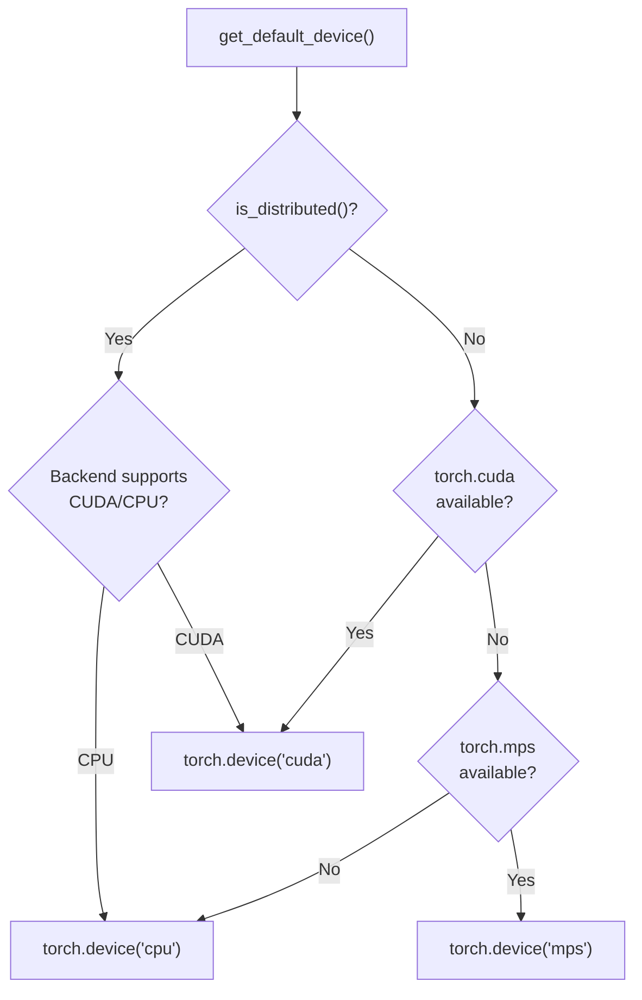
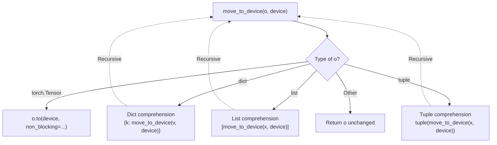
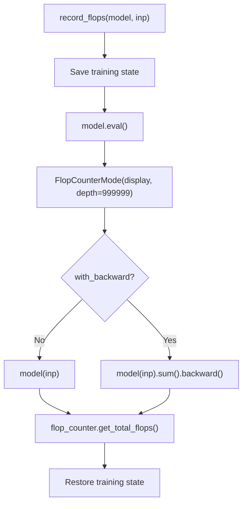

<!-- source: DeepWiki mcp.deepwiki.com · repo allenai/OLMo-core · page 10.2 PyTorch and CUDA Utilities · fetched 2026-10-26 -->

# PyTorch and CUDA Utilities

<details>
<summary>Relevant source files</summary>

The following files were used as context for generating this wiki page:

- [src/olmo_core/utils.py](src/olmo_core/utils.py)
- [src/test/distributed/checkpoint_test.py](src/test/distributed/checkpoint_test.py)
- [src/test/utils_test.py](src/test/utils_test.py)

</details>


This document covers low-level PyTorch and CUDA utility functions provided in [src/olmo_core/utils.py](). These utilities handle device management, tensor operations, random seeding, CUDA memory management, and model diagnostics.

## Overview

The utility functions in this module provide essential support for:

- **Device Management**: Automatic device selection and CUDA capability checking [src/olmo_core/utils.py:128-159]().
- **Tensor Operations**: Moving tensors between devices and applying functions recursively [src/olmo_core/utils.py:72-116]().
- **Random Number Generation**: Seeding all RNG states for reproducibility [src/olmo_core/utils.py:162-178]().
- **CUDA Resources**: Memory management, stream handling, and debug modes [src/olmo_core/utils.py:189-196](), [src/olmo_core/utils.py:738-753]().
- **Model Diagnostics**: FLOP counting for performance analysis [src/olmo_core/utils.py:808-835]().
- **Threaded Generators**: Efficient data fetching using background threads [src/olmo_core/utils.py:246-277]().

## Device Management

### Device Selection

The `get_default_device()` function automatically selects the appropriate compute device based on availability and distributed training configuration.

**Logic Flow for Device Selection**


The function checks distributed backend capabilities first, then falls back to local device availability [src/olmo_core/utils.py:128-153]().

| Priority | Condition | Device |
|----------|-----------|--------|
| 1 | Distributed + CUDA backend | `cuda` |
| 2 | Distributed + CPU backend | `cpu` |
| 3 | Local CUDA available | `cuda` |
| 4 | Local MPS available | `mps` |
| 5 | Fallback | `cpu` |

**Sources**: [src/olmo_core/utils.py:128-153]()

### Compute Capability and Flash Attention

The `has_compute_capability(major: int, minor: int)` function checks if the available CUDA device meets minimum requirements [src/olmo_core/utils.py:155-159](). This is often paired with `has_flash_attn()`, which verifies the presence of the `flash-attn` package [src/olmo_core/utils.py:198-209]().

## Tensor Manipulation

### Moving Tensors to Devices

The `move_to_device()` function recursively moves tensors or containers (lists, dicts, tuples) to a target device [src/olmo_core/utils.py:97-116]().

**Entity Mapping: move_to_device**


The function automatically determines whether to use non-blocking transfers: `non_blocking` defaults to `True` for CUDA devices and `False` for CPU/MPS [src/olmo_core/utils.py:104-105]().

**Sources**: [src/olmo_core/utils.py:97-116]()

### Applying Functions and Dynamic Shapes

- **`apply_to_tensors(fn, container)`**: Recursively applies `fn` to all tensors within a nested structure, including dataclasses and iterators [src/olmo_core/utils.py:72-92]().
- **`mark_dynamic(x, dim, strict)`**: Marks tensor dimensions as dynamic for `torch.compile()`, preventing over-specialization during graph capture [src/olmo_core/utils.py:118-126]().
- **`same_storage(x, y)`**: Checks if two tensors share the same underlying data pointer [src/olmo_core/utils.py:180-187]().

## Random Seeding and RNG State

### Comprehensive Seeding

The `seed_all()` function initializes the seed for Python's `random`, `numpy`, `torch` (CPU), and all CUDA devices to ensure training reproducibility [src/olmo_core/utils.py:162-178]().

## CUDA Memory and Debugging

### Garbage Collection

The `gc_cuda()` function triggers a standard Python `gc.collect()` followed by `torch.cuda.empty_cache()` to reclaim fragmented memory [src/olmo_core/utils.py:189-196](). This is frequently used to prevent OOMs during long training runs.

### Debugging Synchronizations

The `cuda_sync_debug_mode(level)` context manager allows developers to detect implicit CUDA synchronizations that hurt performance [src/olmo_core/utils.py:738-753]().
- **Level 1**: Warn on synchronization.
- **Level 2**: Error on synchronization.

**Sources**: [src/olmo_core/utils.py:738-753]()

## Model Diagnostics and Performance

### FLOP Counting

The `record_flops()` function measures the floating-point operations of a model forward (and optionally backward) pass using `FlopCounterMode` [src/olmo_core/utils.py:808-835]().

**Entity Mapping: record_flops**


**Sources**: [src/olmo_core/utils.py:808-835]()

## Data and Threading Helpers

### Threaded Generator

The `threaded_generator()` utility wraps an iterable to fetch items in a background thread, using a `Queue` to buffer results [src/olmo_core/utils.py:246-277](). This is essential for overlapping I/O-bound data loading with compute-bound training steps.

```python
for batch in threaded_generator(dataloader, max_prefetch=4):
    # Process batch while the next 4 are being loaded in the background
    train_step(batch)
```

**Sources**: [src/olmo_core/utils.py:246-277]()

### Data Type Helpers

- **`get_element_size(dtype)`**: Returns the size in bytes of a PyTorch data type [src/olmo_core/utils.py:755-760]().
- **`info_value_of_dtype(dtype)`**: Returns `finfo` or `iinfo` for the given type [src/olmo_core/utils.py:776-784]().
- **`min_value_of_dtype(dtype)`**: Returns the minimum representable value for a type [src/olmo_core/utils.py:786-793]().

**Sources**: [src/olmo_core/utils.py:755-793]()

---

