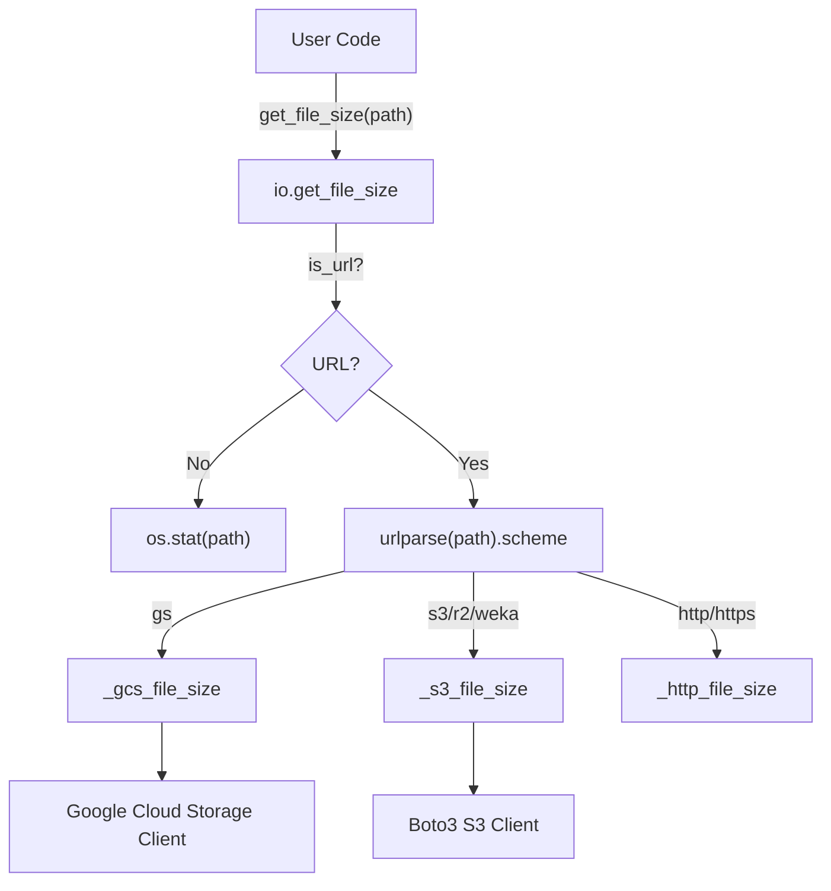
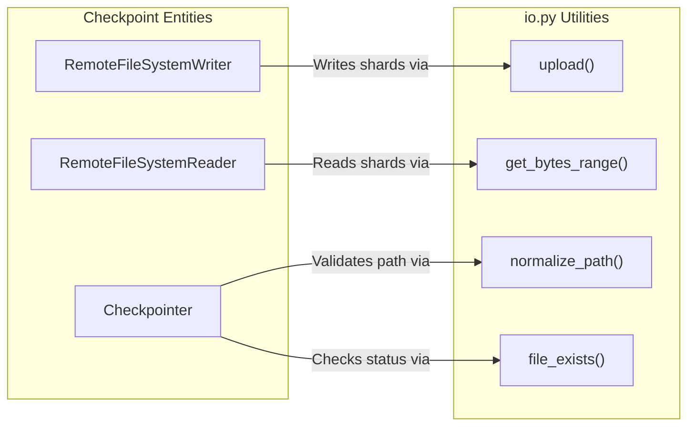

<!-- source: DeepWiki mcp.deepwiki.com · repo allenai/OLMo-core · page 10.3 I/O and File System · fetched 2026-10-26 -->

# I/O and File System

Relevant source files

The following files were used as context for generating this wiki page:

- [src/olmo_core/io.py](src/olmo_core/io.py)
- [src/test/fs_cache_test.py](src/test/fs_cache_test.py)
- [src/test/io_test.py](src/test/io_test.py)
- [src/test/train/checkpoint_test.py](src/test/train/checkpoint_test.py)

The `olmo_core.io` module provides a unified, cloud-aware interface for file operations across local filesystems and remote object stores (S3, GCS, R2, Weka). It abstracts the complexities of URI parsing, authentication, and range requests, allowing the rest of the OLMo-core library to treat remote paths similarly to local paths.

### Unified Path API

The module uses `PathOrStr` (a union of `str` and `pathlib.Path`) to handle file locations [src/olmo_core/io.py:26](). It provides utilities to normalize and manipulate these paths regardless of whether they are local or use a URL scheme.

| Function | Description |
| :--- | :--- |
| `normalize_path` | Standardizes paths by stripping trailing slashes and removing `file://` prefixes [src/olmo_core/io.py:42-48](). |
| `is_url` | Uses regex to determine if a path string is a URL (e.g., `s3://`, `gs://`) [src/olmo_core/io.py:96-103](). |
| `join_path` | Joins path components, correctly handling slashes for both local paths and URLs [src/olmo_core/io.py:51-64](). |
| `get_parent` | Retrieves the parent directory for both local files and remote objects [src/olmo_core/io.py:67-80](). |

**Sources:** [src/olmo_core/io.py:26-103]()

### Cloud-Aware Operations

`olmo_core.io` implements standard filesystem operations for remote backends. This is achieved by parsing the URI scheme and dispatching to internal helper functions like `_s3_file_size` or `_gcs_upload`.

#### Data Flow for Remote Operations
The following diagram illustrates how a generic call to `get_file_size` is routed to the appropriate cloud provider client.

**File Operation Dispatch Flow**

**Sources:** [src/olmo_core/io.py:107-134]()

#### Key Cloud Functions
*   **`get_bytes_range`**: Essential for distributed loading and partial downloads. It allows a process to fetch only a specific slice of a file (e.g., a specific shard of a model) using HTTP Range requests or cloud-native SDKs [src/olmo_core/io.py:137-169]().
*   **`upload`**: Handles uploading local files to S3/GCS, including support for `save_overwrite` flags [src/olmo_core/io.py:171-203]().
*   **`copy_file` / `copy_dir`**: Facilitates moving data between local and remote storage by utilizing `cached_path` for downloads and `upload` for remote writes [src/olmo_core/io.py:205-246]().
*   **`file_exists`**: Checks for the existence of a file or object. It is decorated with `maybe_cache` to speed up repeated checks on remote storage [src/olmo_core/io.py:277-285]().

**Sources:** [src/olmo_core/io.py:137-285]()

### Filesystem Caching (`fs_cache`)

To avoid redundant network calls and expensive metadata lookups (like file sizes or directory listings), OLMo-core implements a persistent filesystem cache.

The `maybe_cache` decorator is used to wrap functions. If the environment variable `OLMO_CORE_FS_CACHE_DIR` is set, the result of the function is pickled and stored on disk. Subsequent calls with the same arguments will load the result from the cache [src/olmo_core/fs_cache.py:23-44]().

**Caching Logic**
1.  **Key Generation**: Arguments are serialized to JSON and hashed using SHA256 to create a unique key [src/olmo_core/fs_cache.py:41-41](), [src/olmo_core/fs_cache.py:88-96]().
2.  **Concurrency**: Uses `FileLock` to ensure that multiple processes (common in distributed training) do not corrupt the cache during simultaneous writes [src/olmo_core/fs_cache.py:45-46]().
3.  **Persistence**: Results are stored as `.pkl` files in the directory specified by `OLMO_CORE_FS_CACHE_DIR` [src/olmo_core/fs_cache.py:44]().

**Sources:** [src/olmo_core/fs_cache.py:17-96](), [src/olmo_core/io.py:106-107](), [src/test/fs_cache_test.py:6-29]()

### Distributed Checkpointing Integration

The I/O module is the foundation for the distributed checkpointing system. It provides the low-level primitives used by higher-level checkpointing components.

**I/O to Distributed Checkpoint Mapping**

**Sources:** [src/olmo_core/io.py:42-285](), [src/olmo_core/train/checkpoint.py:11-12](), [src/test/train/checkpoint_test.py:9-11]()

### Cached Path Integration

OLMo-core leverages the `cached_path` library to handle the heavy lifting of downloading and localizing remote resources.

*   **`resource_path`**: This function is a high-level helper that checks a `local_cache` first. If the file is missing, it calls `cached_path` to download the file from the remote `folder` and return a local `Path` object [src/olmo_core/io.py:83-93]().
*   **S3Client Registration**: The module adds custom scheme clients to `cached_path` to support specific requirements for S3, R2, and Weka [src/olmo_core/io.py:22]().

**Sources:** [src/olmo_core/io.py:21-22](), [src/olmo_core/io.py:83-93]()

### Directory and Glob Utilities

The module provides deterministic directory listing and globbing, which is critical for ensuring all ranks in a distributed job see the same file order.

| Function | Purpose |
| :--- | :--- |
| `list_directory` | Lists files in a directory, supporting recursion and cloud URLs [src/olmo_core/io.py:302-315](). |
| `glob_directory` | Performs glob-based file matching across local and remote paths [src/olmo_core/io.py:339-354](). |
| `deterministic_glob_directory` | Wraps `glob_directory` and sorts the output to ensure consistency across distributed ranks [src/olmo_core/io.py:357-363](). |
| `dir_is_empty` | Checks if a local or remote directory contains any files [src/olmo_core/io.py:366-372](). |

**Sources:** [src/olmo_core/io.py:302-372](), [src/test/io_test.py:52-71]()

### Serialization Utilities

To facilitate the exchange of Python objects over distributed backends (like `torch.distributed`), `olmo_core.io` provides tensor-based serialization.

*   **`serialize_to_tensor`**: Pickles an object and converts the resulting bytes into a `torch.ByteTensor` [src/olmo_core/io.py:532-540]().
*   **`deserialize_from_tensor`**: Converts a `torch.ByteTensor` back into the original Python object [src/olmo_core/io.py:543-547]().

**Sources:** [src/olmo_core/io.py:532-547](), [src/test/io_test.py:18-20]()

---

