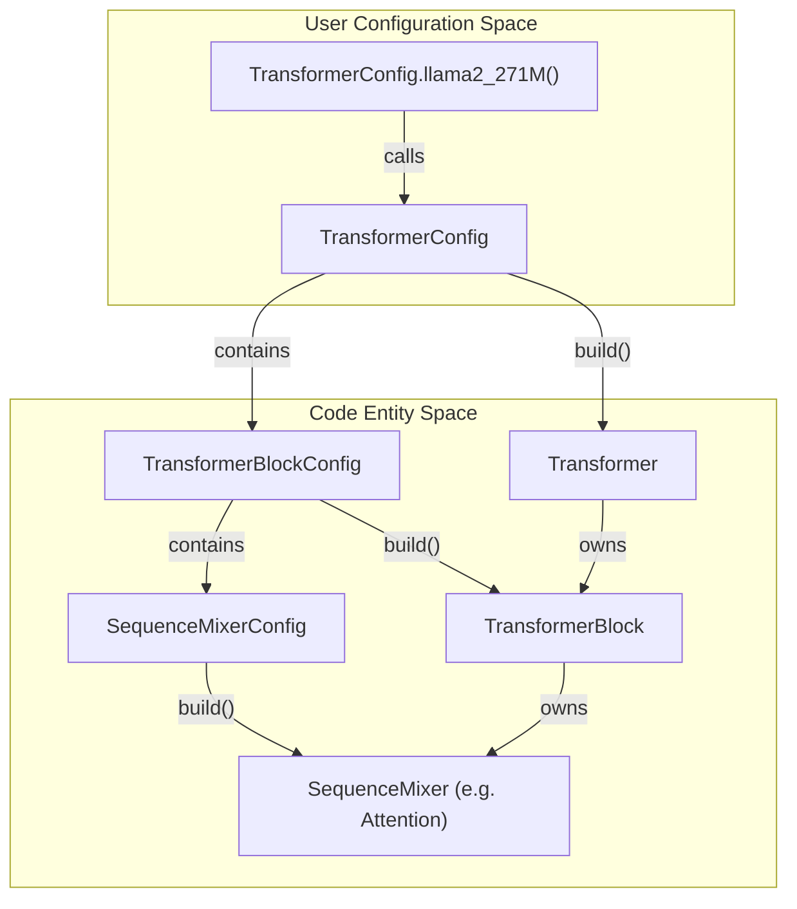
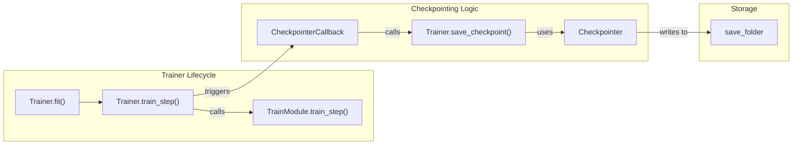

<!-- source: DeepWiki mcp.deepwiki.com · repo allenai/OLMo-core · page 11 Glossary · fetched 2026-10-26 -->

# Glossary

Relevant source files

The following files were used as context for generating this wiki page:

- [CHANGELOG.md](CHANGELOG.md)
- [docs/source/index.rst](docs/source/index.rst)
- [src/olmo_core/data/__init__.py](src/olmo_core/data/__init__.py)
- [src/olmo_core/data/data_loader.py](src/olmo_core/data/data_loader.py)
- [src/olmo_core/data/numpy_dataset.py](src/olmo_core/data/numpy_dataset.py)
- [src/olmo_core/distributed/parallel/__init__.py](src/olmo_core/distributed/parallel/__init__.py)
- [src/olmo_core/distributed/parallel/pipeline_parallel.py](src/olmo_core/distributed/parallel/pipeline_parallel.py)
- [src/olmo_core/distributed/utils.py](src/olmo_core/distributed/utils.py)
- [src/olmo_core/model_ladder/utils.py](src/olmo_core/model_ladder/utils.py)
- [src/olmo_core/nn/feed_forward.py](src/olmo_core/nn/feed_forward.py)
- [src/olmo_core/nn/transformer/__init__.py](src/olmo_core/nn/transformer/__init__.py)
- [src/olmo_core/nn/transformer/block.py](src/olmo_core/nn/transformer/block.py)
- [src/olmo_core/nn/transformer/config.py](src/olmo_core/nn/transformer/config.py)
- [src/olmo_core/nn/transformer/model.py](src/olmo_core/nn/transformer/model.py)
- [src/olmo_core/optim/adamw.py](src/olmo_core/optim/adamw.py)
- [src/olmo_core/optim/config.py](src/olmo_core/optim/config.py)
- [src/olmo_core/train/__init__.py](src/olmo_core/train/__init__.py)
- [src/olmo_core/train/callbacks/speed_monitor.py](src/olmo_core/train/callbacks/speed_monitor.py)
- [src/olmo_core/train/common.py](src/olmo_core/train/common.py)
- [src/olmo_core/train/trainer.py](src/olmo_core/train/trainer.py)
- [src/olmo_core/train/utils.py](src/olmo_core/train/utils.py)
- [src/olmo_core/version.py](src/olmo_core/version.py)
- [src/scripts/train/OLMoE2-large.py](src/scripts/train/OLMoE2-large.py)
- [src/test/conftest.py](src/test/conftest.py)
- [src/test/data/data_loader_test.py](src/test/data/data_loader_test.py)
- [src/test/nn/transformer/model_test.py](src/test/nn/transformer/model_test.py)
- [src/test/optim/adamw_test.py](src/test/optim/adamw_test.py)
- [src/test/optim/lion_test.py](src/test/optim/lion_test.py)
- [src/test/optim/skip_step_optimizer_test.py](src/test/optim/skip_step_optimizer_test.py)
- [src/test/train/utils_test.py](src/test/train/utils_test.py)

This page provides definitions and technical details for codebase-specific terms, jargon, and domain concepts used throughout OLMo-core.

## Core Training Concepts

### TrainModule
A `TrainModule` is a high-level abstraction introduced in v2.0.0 that encapsulates the model, the optimizer, and the logic for a single training step. It consolidates what were previously disparate components into a unified interface that the `Trainer` interacts with.
*   **Implementation**: Defined in [src/olmo_core/train/train_module.py]().
*   **Key Subclasses**: `TransformerTrainModule` for standard training [src/olmo_core/train/callbacks/speed_monitor.py:12-12]() and `TransformerPipelineTrainModule` for pipeline-parallel training.
*   **Data Flow**: The `Trainer` calls `TrainModule.train_step(batch)`, which handles the forward pass, backward pass, and optimizer updates [src/olmo_core/train/trainer.py:534-550]().

### Callback System
A lifecycle management system that allows injecting logic at specific points in the training loop (e.g., `pre_step`, `post_step`, `on_checkpoint_saved`).
*   **Implementation**: Base class `Callback` in [src/olmo_core/train/callbacks/callback.py]().
*   **Priority**: Callbacks have a `priority` attribute that determines execution order. For example, `SpeedMonitorCallback` has a priority of -2 [src/olmo_core/train/callbacks/speed_monitor.py:28-28]().
*   **Sources**: [src/olmo_core/train/trainer.py:153-156](), [src/olmo_core/train/callbacks/speed_monitor.py:18-28]().

### MFU (Model Flops Utilization)
A metric representing the efficiency of the training hardware. It is calculated as the ratio of actual achieved FLOPS to the theoretical peak FLOPS of the hardware (e.g., A100, H100, B200).
*   **Calculation**: Handled by `SpeedMonitorCallback` [src/olmo_core/train/callbacks/speed_monitor.py:163-188]().
*   **Peak Specs**: The framework includes peak TFLOPS for H100 (SXM/PCIe/NVL), B200, and A100 [src/olmo_core/train/callbacks/speed_monitor.py:100-113]().
*   **Sources**: [src/olmo_core/train/callbacks/speed_monitor.py:87-117]().

---

## Model Architecture Jargon

### SequenceMixer
A base class abstraction for layers that mix information across the sequence dimension. This includes both Attention mechanisms and recurrent layers like `GatedDeltaNet`.
*   **Implementation**: [src/olmo_core/nn/attention/base.py]().
*   **Usage**: The `TransformerBlock` owns a `self.attention` attribute which is typed as a `SequenceMixer` to support hybrid architectures [src/olmo_core/nn/transformer/block.py:128-133]().
*   **Sources**: [CHANGELOG.md:52-53](), [src/olmo_core/nn/transformer/model.py:44-45](), [src/olmo_core/nn/transformer/block.py:102-102]().

### RoPE (Rotary Position Embeddings)
A method for injecting positional information into the transformer by rotating the query and key vectors.
*   **Implementation**: Managed via `RoPEConfig` and `RoPEBuffers` [src/olmo_core/nn/transformer/model.py:51-51]().
*   **Sources**: [src/olmo_core/nn/transformer/config.py:28-28]().

### nGPT (Normalized Transformer)
A variant of the Transformer architecture where all weight matrices are constrained to have unit norm, and activations are normalized.
*   **Code Entity**: `NormalizedTransformer` [src/olmo_core/nn/transformer/model.py:72-72]().
*   **Behavior**: Uses `l2_normalize` on weights and provides a `normalize_matrices()` method [src/olmo_core/nn/transformer/model.py:47-47](), [src/test/nn/transformer/model_test.py:159-159]().
*   **Sources**: [src/olmo_core/nn/transformer/config.py:87-90](), [src/test/nn/transformer/model_test.py:97-117]().

---

## Data Pipeline Terms

### FSL (Fixed Sequence Length)
Refers to datasets where every instance is truncated or padded to exactly the same length.
*   **Code Entity**: `NumpyFSLDataset` [src/olmo_core/data/numpy_dataset.py:71-71]().
*   **Sources**: [src/olmo_core/data/numpy_dataset.py:125-142]().

### VSL (Variable Sequence Length)
Refers to datasets where instances can have different lengths, often used with a "curriculum" (e.g., `VSLGrowLinearCurriculum`) that increases length over time.
*   **Code Entity**: `NumpyVSLDataset` [src/olmo_core/data/numpy_dataset.py:81-81]().
*   **Sources**: [src/olmo_core/data/numpy_dataset.py:76-81]().

### Data Fingerprint
A SHA256 hash used to uniquely identify the contents and configuration of a dataset to ensure reproducibility and valid checkpoint resumption.
*   **Implementation**: `NumpyDatasetBase.fingerprint` [src/olmo_core/data/numpy_dataset.py:212-223]().
*   **Fields**: Includes `vocab_size`, `pad_token_id`, `paths`, and `file_sizes` [src/olmo_core/data/numpy_dataset.py:205-209]().

---

## Technical Architecture Diagrams

### From Configuration to Model Instance
This diagram bridges the "Natural Language Space" (user intent) to the "Code Entity Space" (actual classes).

**Sources**: [src/olmo_core/nn/transformer/config.py:150-216](), [src/olmo_core/nn/transformer/model.py:82-120](), [src/olmo_core/nn/transformer/block.py:128-133](), [src/test/nn/transformer/model_test.py:71-74]().

### Training Lifecycle and Checkpointing
This diagram illustrates the data flow between the `Trainer`, `TrainModule`, and the asynchronous `Checkpointer`.

**Sources**: [src/olmo_core/train/trainer.py:100-156](), [src/olmo_core/train/trainer.py:534-550](), [src/olmo_core/train/trainer.py:135-143]().

---

## Distributed Training Jargon

| Term | Definition | Code Pointer |
| :--- | :--- | :--- |
| **DP** | Data Parallelism: Splitting the batch across GPUs. | `dp_process_group` in [src/olmo_core/train/trainer.py:219-222]() |
| **TP** | Tensor Parallelism: Splitting individual layers/tensors across GPUs. | `_tp_enabled` in [src/olmo_core/nn/transformer/model.py:177-177]() |
| **PP** | Pipeline Parallelism: Splitting model layers across different stages. | `_pp_enabled` in [src/olmo_core/nn/transformer/model.py:170-170]() |
| **FSDP** | Fully Sharded Data Parallelism: Sharding parameters, gradients, and optimizer states. | `apply_fsdp()` in [src/olmo_core/nn/transformer/model.py:348-350]() |
| **CP** | Context Parallelism: Splitting the sequence dimension across GPUs using Ring or Ulysses styles. | `_cp_load_balancer` in [src/olmo_core/nn/transformer/model.py:176-176]() |

**Sources**: [src/olmo_core/nn/transformer/model.py:170-212](), [src/olmo_core/distributed/utils.py:30-45](), [src/olmo_core/nn/transformer/block.py:201-206]().