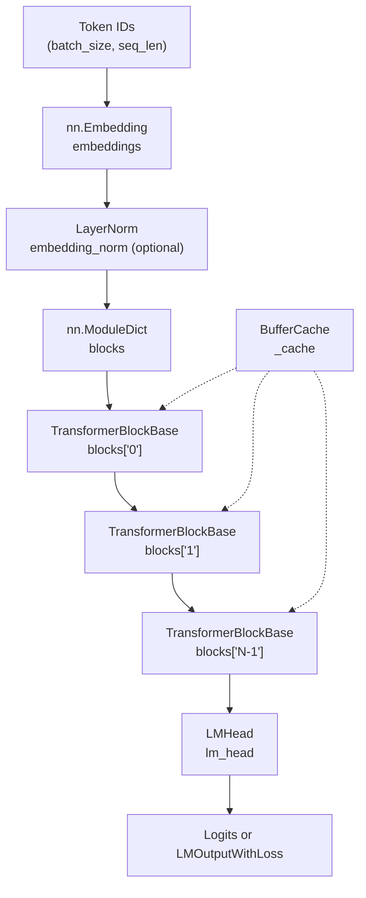
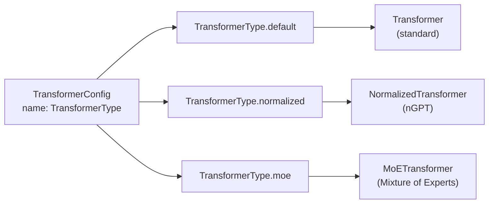
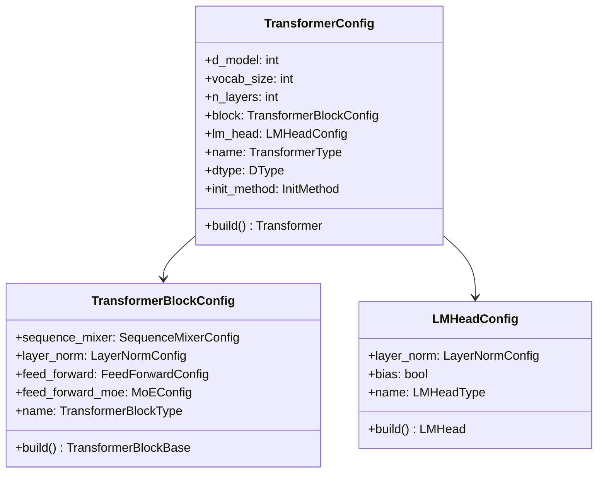
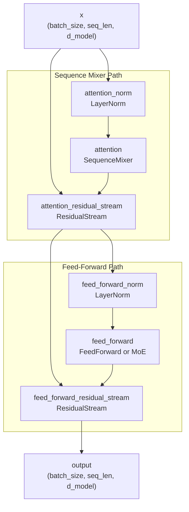

<!-- source: DeepWiki mcp.deepwiki.com · repo allenai/OLMo-core · page 2 Model Architecture · fetched 2026-10-26 -->

# Model Architecture

Relevant source files

The following files were used as context for generating this wiki page:

- [src/olmo_core/nn/attention/__init__.py](src/olmo_core/nn/attention/__init__.py)
- [src/olmo_core/nn/attention/backend.py](src/olmo_core/nn/attention/backend.py)
- [src/olmo_core/nn/attention/flash_attn_api.py](src/olmo_core/nn/attention/flash_attn_api.py)
- [src/olmo_core/nn/attention/kv_cache.py](src/olmo_core/nn/attention/kv_cache.py)
- [src/olmo_core/nn/feed_forward.py](src/olmo_core/nn/feed_forward.py)
- [src/olmo_core/nn/transformer/__init__.py](src/olmo_core/nn/transformer/__init__.py)
- [src/olmo_core/nn/transformer/block.py](src/olmo_core/nn/transformer/block.py)
- [src/olmo_core/nn/transformer/config.py](src/olmo_core/nn/transformer/config.py)
- [src/olmo_core/nn/transformer/model.py](src/olmo_core/nn/transformer/model.py)
- [src/olmo_core/testing/__init__.py](src/olmo_core/testing/__init__.py)
- [src/olmo_core/testing/utils.py](src/olmo_core/testing/utils.py)
- [src/scripts/train/OLMo3/OLMo-3-190M.py](src/scripts/train/OLMo3/OLMo-3-190M.py)
- [src/scripts/train/OLMoE2-large.py](src/scripts/train/OLMoE2-large.py)
- [src/test/nn/attention/attention_test.py](src/test/nn/attention/attention_test.py)
- [src/test/nn/transformer/model_test.py](src/test/nn/transformer/model_test.py)

This page provides an overview of the Transformer model architecture in OLMo-core, explaining its modular design and core components. The architecture is designed to be flexible, supporting multiple parallelism strategies, various attention mechanisms, Mixture-of-Experts (MoE), and hybrid recurrent architectures.

For details on specific components, see:
- [Transformer Models](#2.1) — Pre-configured architectures and model variants
- [Transformer Blocks](#2.2) — Block implementations and normalization strategies
- [Attention Mechanisms](#2.3) — Attention types, backends, and KV cache
- [Rotary Position Embeddings](#2.4) — RoPE implementations and scaling
- [Mixture of Experts](#2.5) — MoE architecture and routing
- [Model Initialization](#2.6) — Weight initialization strategies
- [Feed-Forward Networks](#2.7) — MLP and gated activation variants
- [Recurrent and Hybrid Architectures](#2.8) — GatedDeltaNet and non-attention mixers
- [HuggingFace Integration](#2.9) — Checkpoint conversion and interoperability

## Architecture Overview

The OLMo-core transformer architecture follows a "Llama-style" design with a modular, composable structure. The top-level model consists of token embeddings, an optional embedding normalization layer, a stack of transformer blocks, and a language model head.

### High-Level Structure

**Sources:** [src/olmo_core/nn/transformer/model.py:82-161]()

The `Transformer` class is the main model implementation, organized as:

| Component | Type | Description |
|-----------|------|-------------|
| `embeddings` | `nn.Embedding` | Token embeddings (vocab_size → d_model) |
| `embedding_norm`| `LayerNorm` | Optional normalization applied immediately after embeddings |
| `blocks` | `nn.ModuleDict` | Dictionary of transformer blocks indexed by string keys "0", "1", ..., "N-1" |
| `lm_head` | `LMHead` | Output projection and loss computation |
| `_cache` | `BufferCache` | Shared buffer cache for RoPE and other computed tensors |

**Sources:** [src/olmo_core/nn/transformer/model.py:121-169]()

### Model Variants

OLMo-core supports several transformer implementations through the `TransformerType` enum:

**Sources:** [src/olmo_core/nn/transformer/config.py:77-95](), [src/olmo_core/nn/transformer/model.py:82-120]()

Each variant extends the base `Transformer` class with specialized behavior:

- **`Transformer`** (default): Standard pre-normalization or post-normalization architecture [src/olmo_core/nn/transformer/model.py:82-84]().
- **`NormalizedTransformer`** (nGPT): Implements normalized gradient pretraining with L2-normalized weights and activations [src/olmo_core/nn/transformer/model.py:843-845]().
- **`MoETransformer`**: Extends the base with auxiliary metric tracking and load balancing loss support for Mixture of Experts [src/olmo_core/nn/transformer/model.py:922-924]().

## Configuration System

Models are built from configurations using a builder pattern. The `TransformerConfig` acts as the primary entry point, orchestrating the construction of blocks and the LM head.

**Sources:** [src/olmo_core/nn/transformer/config.py:149-216](), [src/olmo_core/nn/transformer/config.py:282-385]()

## Block Architecture

Transformer blocks are modular, allowing for different sequence mixers (e.g., Attention or GatedDeltaNet) and normalization strategies.

**Sources:** [src/olmo_core/nn/transformer/block.py:96-153]()

### Block Variants

OLMo-core provides multiple block implementations through `TransformerBlockType`:

| Block Type | Class | Description |
|------------|-------|-------------|
| `default` | `TransformerBlock` | Standard pre-norm Llama-style block [src/olmo_core/nn/transformer/block.py:96-107](). |
| `reordered_norm` | `ReorderedNormTransformerBlock` | Post-norm architecture used in OLMo2/3 [src/olmo_core/nn/transformer/block.py:246-248](). |
| `normalized` | `NormalizedTransformerBlock` | nGPT implementation with L2 normalization [src/olmo_core/nn/transformer/block.py:307-309](). |
| `moe` | `MoETransformerBlock` | Standard MoE block replacing dense MLP [src/olmo_core/nn/transformer/block.py:388-390](). |
| `moe_hybrid` | `MoEHybridTransformerBlock` | Parallel dense MLP and MoE block [src/olmo_core/nn/transformer/block.py:530-532](). |

**Sources:** [src/olmo_core/nn/transformer/config.py:98-147]()

## Pre-configured Models

`TransformerConfig` provides factory methods for well-known architectures. For details, see [Transformer Models](#2.1).

*   **OLMo2/3**: Uses `reordered_norm` blocks and QK normalization [src/olmo_core/nn/transformer/config.py:454-793]().
*   **Llama**: Compatible with Llama 2, Llama 3, and 3.1 architectures [src/olmo_core/nn/transformer/config.py:795-1125]().
*   **nGPT**: Normalized Gradient Pretraining variants [src/olmo_core/nn/transformer/config.py:1127-1167]().
*   **OLMoE**: Large-scale Mixture of Experts configurations [src/scripts/train/OLMoE2-large.py:30-48]().

## Model Initialization

Weight initialization is handled by the `InitMethod` enum, supporting strategies like `normal`, `llama`, `llama_depth`, and `fan_in`.

| Method | Behavior |
|--------|----------|
| `normal` | Truncated normal distribution with std 0.02 [src/olmo_core/nn/transformer/init.py:47-51](). |
| `llama` | Depth-scaled initialization for output layers [src/olmo_core/nn/transformer/init.py:58-62](). |
| `fan_in` | Variance-preserving initialization adapted to layer dimensions [src/olmo_core/nn/transformer/init.py:70-77](). |

For details, see [Model Initialization](#2.6).

## Distributed Training Support

The model architecture natively supports various parallelism strategies applied through the `Transformer` class:

*   **Tensor Parallelism (TP)**: Shards weights and activations across a `DeviceMesh` [src/olmo_core/nn/transformer/model.py:586-630]().
*   **Pipeline Parallelism (PP)**: Partitions blocks across different stages [src/olmo_core/nn/transformer/model.py:530-584]().
*   **Context Parallelism (CP)**: Shards the sequence dimension using Ring or Ulysses styles [src/olmo_core/nn/transformer/model.py:632-658]().
*   **Expert Parallelism (EP)**: Shards MoE experts across GPUs [src/olmo_core/nn/transformer/model.py:792-832]().
*   **FSDP**: Fully Sharded Data Parallelism for scaling to massive parameter counts [src/olmo_core/nn/transformer/model.py:717-790]().

For details, see [Distributed Training](#4).

---

