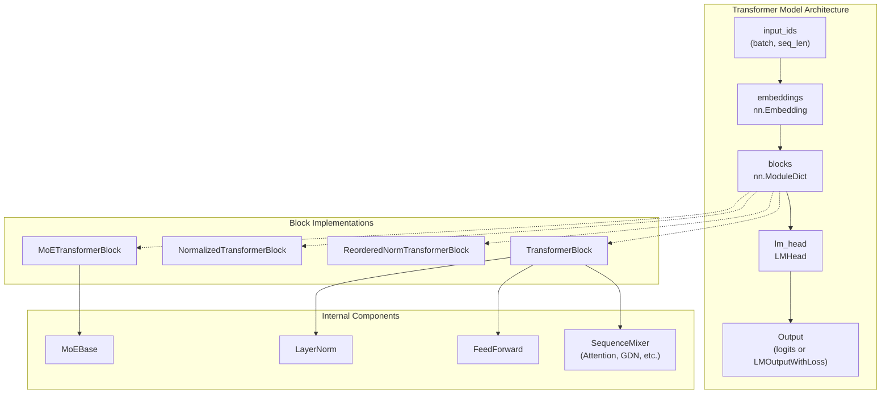
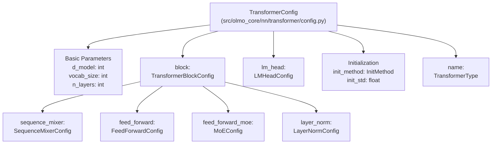

<!-- source: DeepWiki mcp.deepwiki.com · repo allenai/OLMo-core · page 2.1 Transformer Models · fetched 2026-10-26 -->

# Transformer Models

Relevant source files

The following files were used as context for generating this wiki page:

- [src/olmo_core/nn/attention/recurrent.py](src/olmo_core/nn/attention/recurrent.py)
- [src/olmo_core/nn/feed_forward.py](src/olmo_core/nn/feed_forward.py)
- [src/olmo_core/nn/transformer/__init__.py](src/olmo_core/nn/transformer/__init__.py)
- [src/olmo_core/nn/transformer/block.py](src/olmo_core/nn/transformer/block.py)
- [src/olmo_core/nn/transformer/config.py](src/olmo_core/nn/transformer/config.py)
- [src/olmo_core/nn/transformer/init.py](src/olmo_core/nn/transformer/init.py)
- [src/olmo_core/nn/transformer/model.py](src/olmo_core/nn/transformer/model.py)
- [src/olmo_core/script_utils.py](src/olmo_core/script_utils.py)
- [src/olmo_core/train/callbacks/stability_monitor.py](src/olmo_core/train/callbacks/stability_monitor.py)
- [src/scripts/train/OLMoE2-large.py](src/scripts/train/OLMoE2-large.py)
- [src/test/nn/attention/recurrent_test.py](src/test/nn/attention/recurrent_test.py)
- [src/test/nn/transformer/model_test.py](src/test/nn/transformer/model_test.py)

This document describes the transformer model implementations in OLMo-core, including the core `Transformer` class, configuration system, and model variants. For information about individual transformer blocks (attention, feed-forward layers), see **2.2 Transformer Blocks**. For attention mechanisms specifically, see **2.3 Attention Mechanisms**. For MoE-specific details, see **2.5 Mixture of Experts**.

## Purpose and Scope

The transformer models form the core neural network architecture for language modeling in OLMo-core. This page covers:

- The three main model types: `Transformer` (standard), `NormalizedTransformer` (nGPT), and `MoETransformer` (Mixture-of-Experts).
- Model configuration using `TransformerConfig` and pre-built configurations.
- Model architecture and component composition.
- Weight initialization strategies via `InitMethod`.
- Parallelization methods (TP, PP, CP, EP, FSDP).

## Model Architecture Overview

All transformer models in OLMo-core follow a three-part structure: **embeddings → transformer blocks → LM head**. The models differ primarily in their block implementations and normalization strategies.

### Natural Language to Code Entity Space: Architecture
The following diagram maps high-level architectural concepts to the specific classes and attributes found in `src/olmo_core/nn/transformer/model.py`.

**Sources:** [src/olmo_core/nn/transformer/model.py:82-161](), [src/olmo_core/nn/transformer/config.py:149-238](), [src/olmo_core/nn/attention/base.py:20-61]()

## Transformer Model Types

OLMo-core provides three main transformer implementations, selected via the `TransformerType` enum in `src/olmo_core/nn/transformer/config.py`:

| Type | Class | Description | Use Case |
|------|-------|-------------|----------|
| `default` | `Transformer` | Standard Llama-style architecture | General pre-training and fine-tuning |
| `normalized` | `NormalizedTransformer` | nGPT with L2-normalized weights and activations | Research into normalized architectures |
| `moe` | `MoETransformer` | Sparse mixture-of-experts | Efficient scaling with conditional computation |

**Sources:** [src/olmo_core/nn/transformer/config.py:77-97](), [src/olmo_core/nn/transformer/model.py:82-1054]()

### Transformer (Standard)

The `Transformer` class implements a standard decoder-only transformer architecture. It consists of token embeddings, a stack of transformer blocks, and a language model head [src/olmo_core/nn/transformer/model.py:82-161]().

**Key features:**
- Pre-LayerNorm or post-LayerNorm ordering (via block type) [src/olmo_core/nn/transformer/config.py:98-148]().
- Flexible `SequenceMixer` support, allowing for Attention or recurrent variants like `GatedDeltaNet` [src/olmo_core/nn/transformer/block.py:128-133]().
- Optional SwiGLU or GeGLU feed-forward activation [src/olmo_core/nn/feed_forward.py:29-51]().

**Sources:** [src/olmo_core/nn/transformer/model.py:82-536](), [src/olmo_core/nn/transformer/block.py:128-133]()

### NormalizedTransformer (nGPT)

The `NormalizedTransformer` implements the nGPT architecture, which normalizes weight matrices and activations to unit L2 norm [src/olmo_core/nn/transformer/model.py:858-860]().

**Key differences:**
- Weight matrices are L2-normalized via `normalize_matrices()` [src/olmo_core/nn/transformer/model.py:910-936]().
- Uses `NormalizedTransformerBlock` which applies L2 normalization to inputs of the sequence mixer and feed-forward layers [src/olmo_core/nn/transformer/config.py:123-126]().
- Initialization follows `InitMethod.normalized` [src/olmo_core/nn/transformer/init.py:53-56]().

**Sources:** [src/olmo_core/nn/transformer/model.py:858-936](), [src/test/nn/transformer/model_test.py:97-117]()

### MoETransformer (Mixture-of-Experts)

The `MoETransformer` replaces dense feed-forward layers with sparse mixture-of-experts layers [src/olmo_core/nn/transformer/model.py:939-941]().

**Key features:**
- Sparse expert selection via router (top-k experts) [src/olmo_core/nn/transformer/init.py:202-210]().
- Auxiliary metrics for load balancing and Z-loss tracking [src/olmo_core/nn/transformer/model.py:1015-1028]().
- Support for hybrid architectures (dense + sparse blocks) [src/olmo_core/nn/transformer/config.py:138-147]().

**Sources:** [src/olmo_core/nn/transformer/model.py:939-1054](), [src/scripts/train/OLMoE2-large.py:32-48]()

## Model Configuration System

The `TransformerConfig` class provides a declarative way to define transformer models.

### Natural Language to Code Entity Space: Configuration
The following diagram maps configuration fields to the `TransformerConfig` and `TransformerBlockConfig` classes.

**Sources:** [src/olmo_core/nn/transformer/config.py:149-238](), [src/olmo_core/nn/transformer/config.py:259-450]()

### Building and Initializing
The configuration system follows a builder pattern:
1. Call `config.build(init_device="cpu")` to instantiate the model [src/olmo_core/nn/transformer/config.py:282-363]().
2. Call `model.init_weights(device=device)` to materialize and initialize parameters [src/olmo_core/nn/transformer/model.py:213-309]().

**Sources:** [src/olmo_core/nn/transformer/config.py:282-363](), [src/test/nn/transformer/model_test.py:71-81]()

## Pre-built Model Configurations

OLMo-core provides pre-built configurations for standard model families via static methods on `TransformerConfig`:

| Family | Method | Features |
|--------|--------|----------|
| **OLMo2** | `olmo2_7B()` | Reordered norm, QK norm, RoPE θ=500k [src/olmo_core/nn/transformer/config.py:476-499]() |
| **Llama 3** | `llama3_8B()` | GQA, RoPE θ=500k [src/olmo_core/nn/transformer/config.py:648-675]() |
| **OLMoE2** | `llama_like_moe()` | 64 experts, shared expert hidden size [src/scripts/train/OLMoE2-large.py:32-48]() |
| **nGPT** | `ngpt_271M()` | L2-normalized weights [src/olmo_core/nn/transformer/config.py:713-734]() |

**Sources:** [src/olmo_core/nn/transformer/config.py:451-820](), [src/scripts/train/OLMoE2-large.py:32-48]()

## Weight Initialization

Initialization is handled by the `InitMethod` enum in `src/olmo_core/nn/transformer/init.py`.

| Method | Description |
|--------|-------------|
| `normal` | Truncated normal (std=0.02) for all layers [src/olmo_core/nn/transformer/init.py:47-51](). |
| `llama` | Output layers scaled by $1/\sqrt{2 \times \text{n\_layers}}$ [src/olmo_core/nn/transformer/init.py:58-62](). |
| `fan_in` | Per-layer fan-in initialization ($std = 1/\sqrt{d_{in}}$) [src/olmo_core/nn/transformer/init.py:70-77](). |
| `normalized` | Follows nGPT scheme with $std = d_{model}^{-0.5}$ [src/olmo_core/nn/transformer/init.py:53-56](). |

**Sources:** [src/olmo_core/nn/transformer/init.py:46-216]()

## Parallelization Support

Transformer models support multiple composed parallelization strategies applied via `apply_*()` methods.

### Parallelization Order
Parallelism must be applied in a specific sequence to ensure correct module wrapping and parameter sharding:

1. `apply_fp8()`: Float8 training via torchao [src/olmo_core/nn/transformer/model.py:527-543]().
2. `apply_pp()`: Pipeline Parallelism [src/olmo_core/nn/transformer/model.py:545-553]().
3. `apply_tp()`: Tensor Parallelism [src/olmo_core/nn/transformer/model.py:555-589]().
4. `apply_cp()`: Context Parallelism [src/olmo_core/nn/transformer/model.py:591-609]().
5. `apply_activation_checkpointing()`: Memory optimization [src/olmo_core/nn/transformer/model.py:611-707]().
6. `apply_compile()`: Torch compilation [src/olmo_core/nn/transformer/model.py:709-725]().
7. `apply_fsdp()`: Fully Sharded Data Parallel [src/olmo_core/nn/transformer/model.py:727-801]().

**Sources:** [src/olmo_core/nn/transformer/model.py:527-801]()

## Forward Pass and Model Inputs

The `forward()` method supports training (with labels) and inference.

| Input | Type | Description |
|-------|------|-------------|
| `input_ids` | `torch.Tensor` | Token IDs (batch, seq_len) [src/olmo_core/nn/transformer/model.py:455](). |
| `labels` | `Optional[torch.Tensor]` | Targets for loss computation [src/olmo_core/nn/transformer/model.py:456](). |
| `doc_lens` | `Optional[torch.Tensor]` | Cumulative document lengths for masking [src/olmo_core/nn/transformer/model.py:461](). |

**Return:** Returns `torch.Tensor` (logits) if `labels` is None, otherwise `LMOutputWithLoss` which includes the computed cross-entropy loss [src/olmo_core/nn/transformer/model.py:516-526]().

**Sources:** [src/olmo_core/nn/transformer/model.py:454-526]()

---

