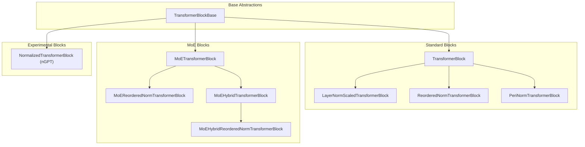
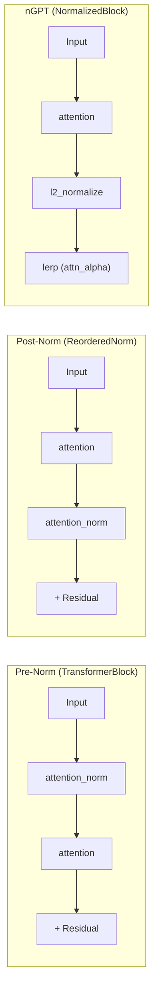
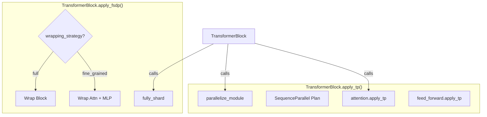

<!-- source: DeepWiki mcp.deepwiki.com · repo allenai/OLMo-core · page 2.2 Transformer Blocks · fetched 2026-10-26 -->

# Transformer Blocks

Relevant source files

The following files were used as context for generating this wiki page:

- [src/olmo_core/nn/feed_forward.py](src/olmo_core/nn/feed_forward.py)
- [src/olmo_core/nn/residual_stream.py](src/olmo_core/nn/residual_stream.py)
- [src/olmo_core/nn/transformer/__init__.py](src/olmo_core/nn/transformer/__init__.py)
- [src/olmo_core/nn/transformer/block.py](src/olmo_core/nn/transformer/block.py)
- [src/olmo_core/nn/transformer/config.py](src/olmo_core/nn/transformer/config.py)
- [src/olmo_core/nn/transformer/model.py](src/olmo_core/nn/transformer/model.py)
- [src/scripts/train/OLMoE2-large.py](src/scripts/train/OLMoE2-large.py)
- [src/test/nn/transformer/block_test.py](src/test/nn/transformer/block_test.py)
- [src/test/nn/transformer/model_test.py](src/test/nn/transformer/model_test.py)

This page documents the transformer block implementations in OLMo-core. Transformer blocks are the fundamental repeating units that compose transformer models, each containing sequence mixing (attention or recurrent) and feed-forward sub-layers with normalization and residual connections.

## Overview

OLMo-core provides a modular system for defining transformer blocks through the `TransformerBlockBase` class [src/olmo_core/nn/transformer/block.py:32-35](). Blocks are responsible for managing the data flow between normalization layers, sequence mixers, and feed-forward networks, while providing hooks for distributed training strategies like Tensor Parallelism (TP), Fully Sharded Data Parallelism (FSDP), and Context Parallelism (CP).

## Block Hierarchy

The following diagram illustrates the relationship between the base class and the various specialized block implementations.

### Class Relationship Diagram

**Sources:** [src/olmo_core/nn/transformer/block.py:32-912](), [src/olmo_core/nn/transformer/__init__.py:1-13]()

## Block Types and Configuration

The `TransformerBlockType` enum defines the available implementations [src/olmo_core/nn/transformer/config.py:98-148](). Blocks are constructed using `TransformerBlockConfig`, which abstracts the sub-module creation via the `build` method [src/olmo_core/nn/transformer/config.py:208-250]().

| Enum Value | Implementation Class | Normalization Strategy |
| :--- | :--- | :--- |
| `default` | `TransformerBlock` | Pre-norm (Llama-style) |
| `reordered_norm` | `ReorderedNormTransformerBlock` | Post-norm (OLMo2 style) |
| `peri_norm` | `PeriNormTransformerBlock` | Peri-norm (OLMo3 style) |
| `default_scaled` | `LayerNormScaledTransformerBlock` | Pre-norm with depth scaling |
| `normalized` | `NormalizedTransformerBlock` | nGPT (No LayerNorm, L2 weights) |
| `moe` | `MoETransformerBlock` | Sparse MoE Pre-norm |
| `moe_hybrid` | `MoEHybridTransformerBlock` | Mixed Dense/Sparse Pre-norm |

**Sources:** [src/olmo_core/nn/transformer/config.py:98-148](), [src/olmo_core/nn/transformer/config.py:150-250]()

## Normalization Strategies

OLMo-core supports several architectural variants that differ primarily in how `LayerNorm` (or `RMSNorm`) is positioned relative to the residual stream.

### 1. Pre-Norm (Standard)
In `TransformerBlock`, normalization is applied before the sub-layers.
*   **Data Flow:** `h = x + attention(norm(x))` then `out = h + mlp(norm(h))` [src/olmo_core/nn/transformer/block.py:152-153]().

### 2. Post-Norm (Reordered)
In `ReorderedNormTransformerBlock`, normalization is applied to the output of the sub-layer before the residual addition.
*   **Data Flow:** `x = x + norm(attention(x))` then `x = x + norm(mlp(x))` [src/olmo_core/nn/transformer/block.py:269-271]().

### 3. Peri-Norm
In `PeriNormTransformerBlock`, normalization occurs after the sequence mixer but before the residual addition, often paired with specific initialization schemes.
*   **Implementation:** [src/olmo_core/nn/transformer/block.py:273-305]().

### 4. nGPT (Normalized Transformer)
`NormalizedTransformerBlock` removes `LayerNorm` entirely. It uses `l2_normalize` on both weights and activations, employing a learnable interpolation (`lerp`) for residual connections via `attn_alpha` and `ff_alpha` [src/olmo_core/nn/transformer/block.py:387-398]().

### Normalization Logic Diagram

**Sources:** [src/olmo_core/nn/transformer/block.py:152-153](), [src/olmo_core/nn/transformer/block.py:269-271](), [src/olmo_core/nn/transformer/block.py:387-398]()

## Mixture of Experts (MoE) Blocks

MoE blocks replace or augment the standard `FeedForward` with a `MoEBase` module [src/olmo_core/nn/transformer/block.py:400-418]().

### MoETransformerBlock
A standard block where the MLP is replaced by a sparse expert layer. It routes tokens to a subset of experts defined in `feed_forward_moe` [src/olmo_core/nn/transformer/block.py:400-418]().

### Hybrid MoE Blocks
`MoEHybridTransformerBlock` contains both a dense `FeedForward` and a sparse `MoE` layer [src/olmo_core/nn/transformer/block.py:603-625]().
*   **Sequential Forward:** Sparse and dense paths are calculated and summed [src/olmo_core/nn/transformer/block.py:734-735]().
*   **Combined Forward:** Optimizes execution by overlapping the MoE communication (all-to-all) with the dense MLP computation [src/olmo_core/nn/transformer/block.py:698-726]().

**Sources:** [src/olmo_core/nn/transformer/block.py:400-418](), [src/olmo_core/nn/transformer/block.py:603-735]()

## Distributed Training Integration

Every block implementation must provide logic for distributed sharding by implementing the abstract methods in `TransformerBlockBase` [src/olmo_core/nn/transformer/block.py:60-93]().

### Key Methods
*   `apply_tp`: Configures Tensor Parallelism. It typically shards the sequence mixer and feed-forward modules while setting `SequenceParallel` plans for normalization layers [src/olmo_core/nn/transformer/block.py:155-200]().
*   `apply_fsdp`: Configures Fully Sharded Data Parallelism. It supports different `wrapping_strategy` options like `full` (wrapping the whole block) or `fine_grained` (wrapping sub-modules individually) [src/olmo_core/nn/transformer/block.py:221-255]().
*   `apply_cp`: Configures Context Parallelism (Ring Attention) by passing the `DeviceMesh` and parallel styles to the sequence mixer [src/olmo_core/nn/transformer/block.py:201-220]().

### Code Entity Space: Parallelism Implementation

**Sources:** [src/olmo_core/nn/transformer/block.py:155-255](), [src/olmo_core/nn/transformer/config.py:38-58]()

## Weight Initialization

Blocks are initialized via the `InitMethod` enum [src/olmo_core/nn/transformer/init.py:22]().
*   **Llama/Llama-depth:** Scales the output weights of the attention and feed-forward layers based on the total number of layers or the current block index to maintain variance [src/olmo_core/nn/transformer/model.py:240-270]().
*   **Fan-in:** Adapts initialization to specific layer dimensions [src/olmo_core/nn/transformer/config.py:29]().

**Sources:** [src/olmo_core/nn/transformer/init.py:1-22](), [src/olmo_core/nn/transformer/model.py:240-270]()

---

