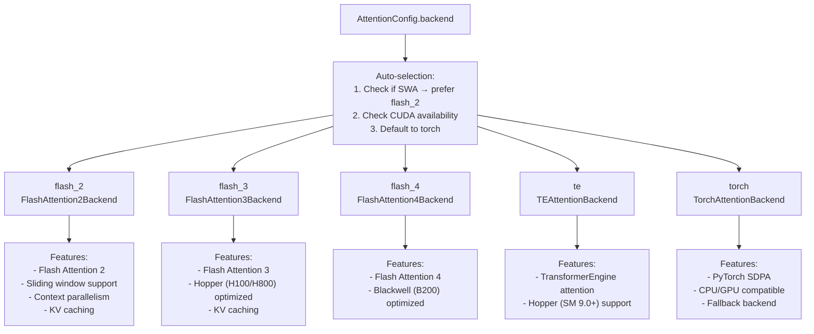
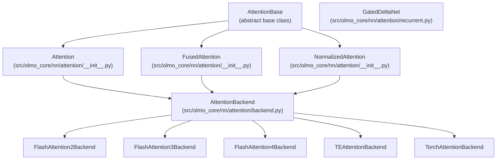
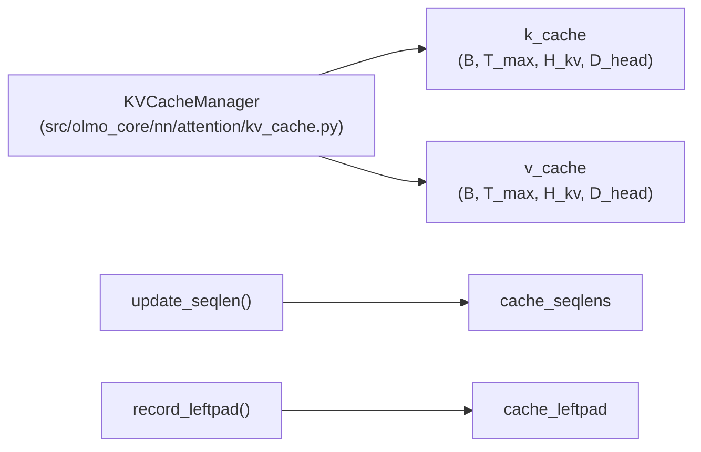

<!-- source: DeepWiki mcp.deepwiki.com · repo allenai/OLMo-core · page 2.3 Attention Mechanisms · fetched 2026-10-26 -->

# Attention Mechanisms

Relevant source files

The following files were used as context for generating this wiki page:

- [src/olmo_core/distributed/nn.py](src/olmo_core/distributed/nn.py)
- [src/olmo_core/distributed/parallel/context_parallel.py](src/olmo_core/distributed/parallel/context_parallel.py)
- [src/olmo_core/nn/attention/__init__.py](src/olmo_core/nn/attention/__init__.py)
- [src/olmo_core/nn/attention/backend.py](src/olmo_core/nn/attention/backend.py)
- [src/olmo_core/nn/attention/flash_attn_api.py](src/olmo_core/nn/attention/flash_attn_api.py)
- [src/olmo_core/nn/attention/flash_linear_attn_api.py](src/olmo_core/nn/attention/flash_linear_attn_api.py)
- [src/olmo_core/nn/attention/kv_cache.py](src/olmo_core/nn/attention/kv_cache.py)
- [src/olmo_core/nn/convolution.py](src/olmo_core/nn/convolution.py)
- [src/olmo_core/testing/__init__.py](src/olmo_core/testing/__init__.py)
- [src/olmo_core/testing/utils.py](src/olmo_core/testing/utils.py)
- [src/scripts/train/OLMo3/OLMo-3-190M.py](src/scripts/train/OLMo3/OLMo-3-190M.py)
- [src/test/distributed/parallel/context_parallel_test.py](src/test/distributed/parallel/context_parallel_test.py)
- [src/test/nn/attention/attention_test.py](src/test/nn/attention/attention_test.py)

## Overview

This document describes the attention mechanism implementations in OLMo-core. Attention is a core component of transformer models that computes scaled dot-product attention (SDPA) between queries, keys, and values. The system provides multiple attention implementations, configurable backends (including Flash Attention 2, 3, and 4), positional encoding strategies, and distributed execution modes.

**Key Components:**
- **Attention classes**: `Attention`, `FusedAttention`, `NormalizedAttention` [src/olmo_core/nn/attention/__init__.py:336-1062]()
- **Attention backends**: `TorchAttentionBackend`, `FlashAttention2Backend`, `FlashAttention3Backend`, `FlashAttention4Backend`, `TEAttentionBackend` [src/olmo_core/nn/attention/backend.py:43-130]()
- **RoPE implementations**: `RotaryEmbedding`, `FusedRotaryEmbedding`, `ComplexRotaryEmbedding` [src/olmo_core/nn/rope.py:398-795]()
- **Configuration**: `AttentionConfig`, `RoPEConfig`, `SlidingWindowAttentionConfig`, `GateConfig` [src/olmo_core/nn/attention/__init__.py:92-304]()
- **Recurrent Attention**: `GatedDeltaNet` implementation for linear attention [src/olmo_core/nn/attention/recurrent.py:12-117]()

See **Transformer Blocks (2.2)** for how attention is integrated into transformer blocks and **Parallelism Strategies (4.2)** for distributed execution.

**Sources:** [src/olmo_core/nn/attention/__init__.py:1-1062](), [src/olmo_core/nn/attention/backend.py:1-130](), [src/olmo_core/nn/rope.py:1-795](), [src/olmo_core/nn/attention/recurrent.py:12-117]()

## Attention Configuration

The `AttentionConfig` class provides a declarative interface for configuring attention mechanisms. It is embedded within transformer block configurations and controls attention computation, backend selection, and optional features.

**Configuration Parameters:**

| Parameter | Type | Default | Purpose |
|-----------|------|---------|---------|
| `name` | `AttentionType` | `"default"` | Attention implementation (`default`, `fused`, `normalized`) [src/olmo_core/nn/attention/__init__.py:158-174]() |
| `n_heads` | `int` | `16` | Number of attention heads |
| `n_kv_heads` | `Optional[int]` | `None` | Number of key/value heads for GQA/MQA |
| `bias` | `Optional[bool]` | `None` | Include bias in linear layers |
| `gate` | `Optional[GateConfig]` | `None` | Attention gating configuration (headwise or elementwise) [src/olmo_core/nn/attention/__init__.py:85-98]() |
| `rope` | `Optional[RoPEConfig]` | `None` | Rotary position embedding configuration |
| `clip_qkv` | `Optional[float]` | `None` | Clipping value for QKV projections |
| `qk_norm` | `Optional[LayerNormConfig]` | `None` | Layer norm applied to queries and keys |
| `use_head_qk_norm` | `Optional[bool]` | `None` | Apply QK norm per-head instead of globally [src/olmo_core/nn/attention/__init__.py:203-203]() |
| `dropout` | `Optional[float]` | `None` | Attention dropout probability |
| `backend` | `Optional[AttentionBackendName]` | `None` | Backend implementation (auto-selected if None) |
| `sliding_window` | `Optional[SlidingWindowAttentionConfig]` | `None` | Sliding window attention configuration [src/olmo_core/nn/attention/__init__.py:101-155]() |

**Sources:** [src/olmo_core/nn/attention/__init__.py:177-304]()

### Attention Backend Selection

**Diagram: Backend Selection and Features**

The backend is auto-selected at attention construction time [src/olmo_core/nn/attention/__init__.py:433-471](). `FlashAttention4Backend` is specifically targeted at Blackwell architectures [src/olmo_core/nn/attention/backend.py:65-69](). Backends are validated using `assert_supported()` before initialization [src/olmo_core/nn/attention/backend.py:162-169](). Hardware support for specific backends is verified via `flash_attn_api.py` [src/olmo_core/nn/attention/flash_attn_api.py:37-60]().

**Sources:** [src/olmo_core/nn/attention/__init__.py:433-481](), [src/olmo_core/nn/attention/backend.py:43-130](), [src/olmo_core/nn/attention/flash_attn_api.py:37-60]()

## Attention Implementations

### Multi-Head Attention Variants

OLMo-core supports three attention patterns based on the `n_kv_heads` configuration:

- **MHA**: `n_kv_heads` is `None` or equals `n_heads` (all heads independent).
- **GQA**: `1 < n_kv_heads < n_heads` (groups of heads share KV).
- **MQA**: `n_kv_heads = 1` (all heads share single KV).

**Sources:** [src/olmo_core/nn/attention/__init__.py:386-396]()

### Attention Class Hierarchy

**Diagram: Attention Classes and Code Entities**

| Class | Key Features | RoPE Support | Notes |
|-------|--------------|--------------|-------|
| `Attention` | Standard implementation | All RoPE types | Default choice [src/olmo_core/nn/attention/__init__.py:336-740]() |
| `FusedAttention` | Optimized for packed QKV | `FusedRotaryEmbedding` | Requires `flash_2` backend [src/olmo_core/nn/attention/__init__.py:742-906]() |
| `NormalizedAttention` | nGPT architecture | All RoPE types | Special scaling, learnable `sq`, `sk` [src/olmo_core/nn/attention/__init__.py:908-1062]() |
| `GatedDeltaNet` | Linear Attention | N/A | Hybrid recurrent architecture support [src/olmo_core/nn/attention/recurrent.py:12-117]() |

**Sources:** [src/olmo_core/nn/attention/__init__.py:336-1062](), [src/olmo_core/nn/attention/recurrent.py:12-117]()

## Rotary Position Embeddings (RoPE)

RoPE applies rotary position embeddings to queries and keys.

### RoPE Scaling Strategies

OLMo-core supports multiple scaling strategies for extending context length [src/olmo_core/nn/rope.py:54-291]():

| Scaling Config | Method | Description |
|----------------|--------|-------------|
| `ABFRoPEScalingConfig` | Absolute Base Frequency | Uses a new base frequency parameter `new_theta` [src/olmo_core/nn/rope.py:73-90]() |
| `PIRoPEScalingConfig` | Position Interpolation | Linearly compresses position indices by `factor` [src/olmo_core/nn/rope.py:97-126]() |
| `StepwiseRoPEScalingConfig` | Llama-3.1 scaling | Interpolates between high- and low-frequency bands [src/olmo_core/nn/rope.py:133-210]() |
| `YaRNRoPEScalingConfig` | YaRN | Smoothly blends interpolation and extrapolation [src/olmo_core/nn/rope.py:213-291]() |

**Sources:** [src/olmo_core/nn/rope.py:54-291]()

## KV Caching for Inference

The `KVCacheManager` manages key and value tensors across autoregressive decoding steps.

**Diagram: KV Cache Data Flow**

The `KVCacheManager` is initialized with a `max_seq_len` and `batch_size` [src/olmo_core/nn/attention/kv_cache.py:12-52](). Optimized backends like `FlashAttention2Backend` and `FlashAttention3Backend` update these buffers in-place during the forward pass using specialized dispatch functions [src/olmo_core/nn/attention/backend.py:470-483](), [src/olmo_core/nn/attention/backend.py:606-620]().

**Sources:** [src/olmo_core/nn/attention/kv_cache.py:11-119](), [src/olmo_core/nn/attention/backend.py:470-620]()

## Sliding Window Attention (SWA)

SWA restricts the attention context to a fixed window size. The `SlidingWindowAttentionConfig` allows defining a `pattern` of window sizes (where `-1` is full attention) that repeats across layers [src/olmo_core/nn/attention/__init__.py:101-140](). The logic for calculating the effective window size for a given layer index is handled by `_get_window_size` [src/olmo_core/nn/attention/__init__.py:120-140]().

**Sources:** [src/olmo_core/nn/attention/__init__.py:101-155]()

## Distributed Attention

### Tensor Parallelism (TP)
`Attention.apply_tp()` configures the linear layers for tensor parallelism [src/olmo_core/nn/attention/__init__.py:634-685]():
- `w_q`, `w_k`, `w_v` are sharded column-wise.
- `w_out` is sharded row-wise.
- `q_norm` and `k_norm` use `SequenceParallel` wrappers [src/olmo_core/nn/attention/__init__.py:657-664]().

### Context Parallelism (CP)
`Attention.apply_cp()` enables ring attention or Ulysses styles [src/olmo_core/nn/attention/__init__.py:687-702](). This relies on the backend's ability to handle distributed sequence sharding, typically via `ring-flash-attn` [src/olmo_core/nn/attention/backend.py:118-122](). The communication primitives for CP, such as `all_to_all_single_cp2hp`, facilitate the transformation between context-parallel and head-parallel partitioning [src/olmo_core/distributed/parallel/context_parallel.py:22-64]().

**Sources:** [src/olmo_core/nn/attention/__init__.py:634-702](), [src/olmo_core/nn/attention/backend.py:118-122](), [src/olmo_core/distributed/parallel/context_parallel.py:22-64]()

---

