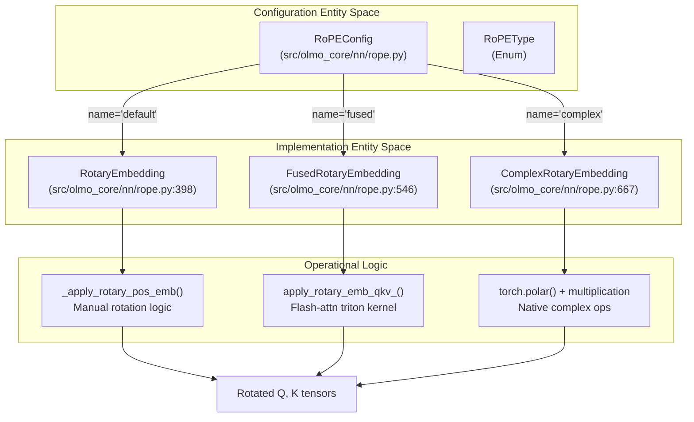
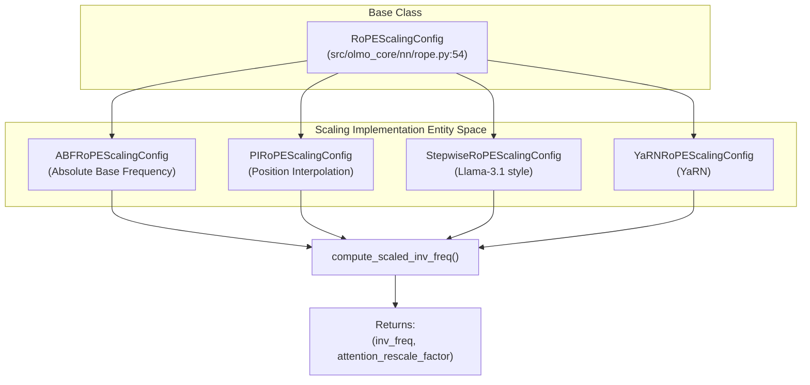
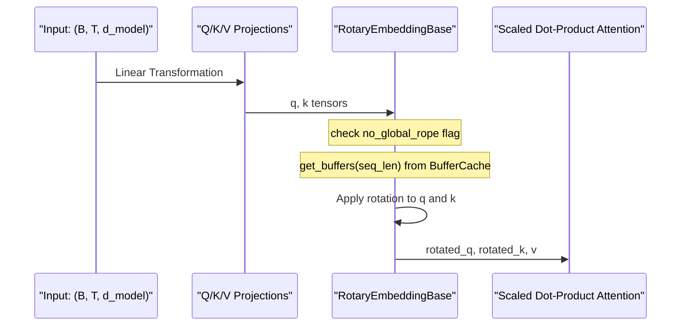

<!-- source: DeepWiki mcp.deepwiki.com · repo allenai/OLMo-core · page 2.4 Rotary Position Embeddings · fetched 2026-10-26 -->

# Rotary Position Embeddings

Relevant source files

The following files were used as context for generating this wiki page:

- [src/olmo_core/nn/layer_norm.py](src/olmo_core/nn/layer_norm.py)
- [src/olmo_core/nn/lm_head.py](src/olmo_core/nn/lm_head.py)
- [src/olmo_core/nn/rope.py](src/olmo_core/nn/rope.py)
- [src/test/nn/layer_norm_test.py](src/test/nn/layer_norm_test.py)
- [src/test/nn/lm_head_test.py](src/test/nn/lm_head_test.py)
- [src/test/nn/rope_test.py](src/test/nn/rope_test.py)

This page documents the Rotary Position Embeddings (RoPE) system in OLMo-core, including the three implementation variants, scaling strategies for context extension, GNoPE (Global-No-Position-Embedding), and integration with attention mechanisms.

For information about attention mechanisms that use RoPE, see [Attention Mechanisms](2.3). For transformer model architecture, see [Transformer Models](2.1).

## Overview

Rotary Position Embeddings (RoPE) encode positional information by rotating query and key vectors in complex space. Unlike absolute position embeddings, RoPE maintains relative positional relationships and supports extrapolation to longer sequences during inference.

The RoPE system in OLMo-core provides:
- Three implementation variants with different performance characteristics.
- Four scaling strategies for extending context windows beyond training length.
- Automatic buffer caching to avoid recomputation via `BufferCache`.
- Support for **GNoPE** (Global-No-Position-Embedding) to selectively disable RoPE on specific layers.

**Sources:** [src/olmo_core/nn/rope.py:1-26](), [src/olmo_core/nn/rope.py:293-346]()

## RoPE Implementation Variants

OLMo-core provides three RoPE implementations, selectable via the `RoPEConfig.name` field [src/olmo_core/nn/rope.py:302-313]().

### RoPE Implementation Architecture

**Sources:** [src/olmo_core/nn/rope.py:29-46](), [src/olmo_core/nn/rope.py:398-795]()

### RotaryEmbedding (Default)

The default implementation applies RoPE by manually rotating query and key tensors using precomputed sine and cosine buffers.

| Feature | Details |
|---------|---------|
| **Class** | `RotaryEmbedding` [src/olmo_core/nn/rope.py:398]() |
| **Compatibility** | Works with `Attention` and `NormalizedAttention` |
| **Buffer Format** | `pos_sin`, `pos_cos` of shape `(seq_len, head_dim)` |
| **Performance** | Standard PyTorch ops, best for cross-platform compatibility |

The rotation is performed using the formula: `(t * cos) + (rotate_half(t) * sin)`, where `rotate_half()` swaps and negates adjacent pairs of dimensions [src/olmo_core/nn/rope.py:461-470]().

**Sources:** [src/olmo_core/nn/rope.py:398-544]()

### FusedRotaryEmbedding

A Triton-based fused implementation that operates directly on packed QKV tensors for maximum performance on GPU.

| Feature | Details |
|---------|---------|
| **Class** | `FusedRotaryEmbedding` [src/olmo_core/nn/rope.py:546]() |
| **Compatibility** | Works with `FusedAttention` only |
| **Buffer Format** | `pos_sin`, `pos_cos` of shape `(seq_len, head_dim // 2)` |
| **Requirements** | Requires `flash-attn` package [src/olmo_core/nn/rope.py:643]() |
| **Performance** | ~2-3x faster than default on GPU |

This implementation uses `flash_attn.layers.rotary.apply_rotary_emb_qkv_()` to apply RoPE in-place on the packed QKV tensor [src/olmo_core/nn/rope.py:641-665]().

**Sources:** [src/olmo_core/nn/rope.py:546-665]()

### ComplexRotaryEmbedding

Implements RoPE as a rotation in complex space using native PyTorch complex number operations.

| Feature | Details |
|---------|---------|
| **Class** | `ComplexRotaryEmbedding` [src/olmo_core/nn/rope.py:667]() |
| **Compatibility** | Works with `Attention` and `NormalizedAttention` |
| **Buffer Format** | `freqs_cis` of shape `(seq_len, head_dim // 2)` as `complex64` |
| **Operation** | `torch.view_as_complex(x) * freqs_cis` [src/olmo_core/nn/rope.py:778]() |
| **Limitations** | Scaling strategies not currently supported in this variant |

**Sources:** [src/olmo_core/nn/rope.py:667-795]()

## RoPE Scaling Strategies

Scaling strategies extend the effective context window beyond the maximum sequence length used during training by modifying the inverse frequencies (`inv_freq`).

### Scaling Strategy Hierarchy

**Sources:** [src/olmo_core/nn/rope.py:54-291]()

### Available Strategies

| Strategy | Class | Logic |
|----------|-------|-------|
| **ABF** | `ABFRoPEScalingConfig` | Simply uses a new base frequency `new_theta` (default: 8M) [src/olmo_core/nn/rope.py:73-90](). |
| **PI** | `PIRoPEScalingConfig` | Linearly compresses position indices by a constant `factor` [src/olmo_core/nn/rope.py:97-126](). |
| **Stepwise** | `StepwiseRoPEScalingConfig` | Llama-3.1 style: interpolates between high- and low-frequency components [src/olmo_core/nn/rope.py:133-210](). |
| **YaRN** | `YaRNRoPEScalingConfig` | Blends interpolation/extrapolation with a linear ramp and m-scale rescaling [src/olmo_core/nn/rope.py:212-291](). |

## GNoPE (Global-No-Position-Embedding)

OLMo-core supports **GNoPE**, which stands for "global-no-rope". This is configured via the `no_global_rope` flag in `RoPEConfig` [src/olmo_core/nn/rope.py:311]().

In hybrid architectures (like those combining Attention with Recurrent layers), certain layers might be designated as "global". If `no_global_rope` is set to `True`, the RoPE implementation will return query and key tensors unchanged for layers identified as global, effectively disabling positional encoding for those specific blocks.

**Sources:** [src/olmo_core/nn/rope.py:302-313](), [src/olmo_core/nn/rope.py:488-490]()

## Integration with Attention

RoPE is integrated into the attention mechanism's forward pass. It is applied after Q/K projections and any optional normalization (like QK-Norm), but before the actual attention score calculation.

### Attention Data Flow with RoPE

**Sources:** [src/olmo_core/nn/rope.py:481-500](), [src/olmo_core/nn/rope.py:641-665]()

### Buffer Caching and Performance

To avoid recomputing trigonometric functions every forward pass, OLMo-core uses a `BufferCache`.

1. **Namespace Partitioning**: The cache is partitioned by `theta`, `head_size`, and `scaling` parameters to ensure buffers are never shared incorrectly [src/olmo_core/nn/rope.py:419-432]().
2. **Dynamic Expansion**: If the current `seq_len` exceeds the cached buffer size, the buffers are recomputed and updated in the cache [src/olmo_core/nn/rope.py:441-450]().
3. **Precision**: Buffers are typically computed in FP32 for numerical stability before being cast to the model's operating precision [src/olmo_core/nn/rope.py:456]().

**Sources:** [src/olmo_core/nn/rope.py:374-381](), [src/olmo_core/nn/rope.py:419-459]()

---

