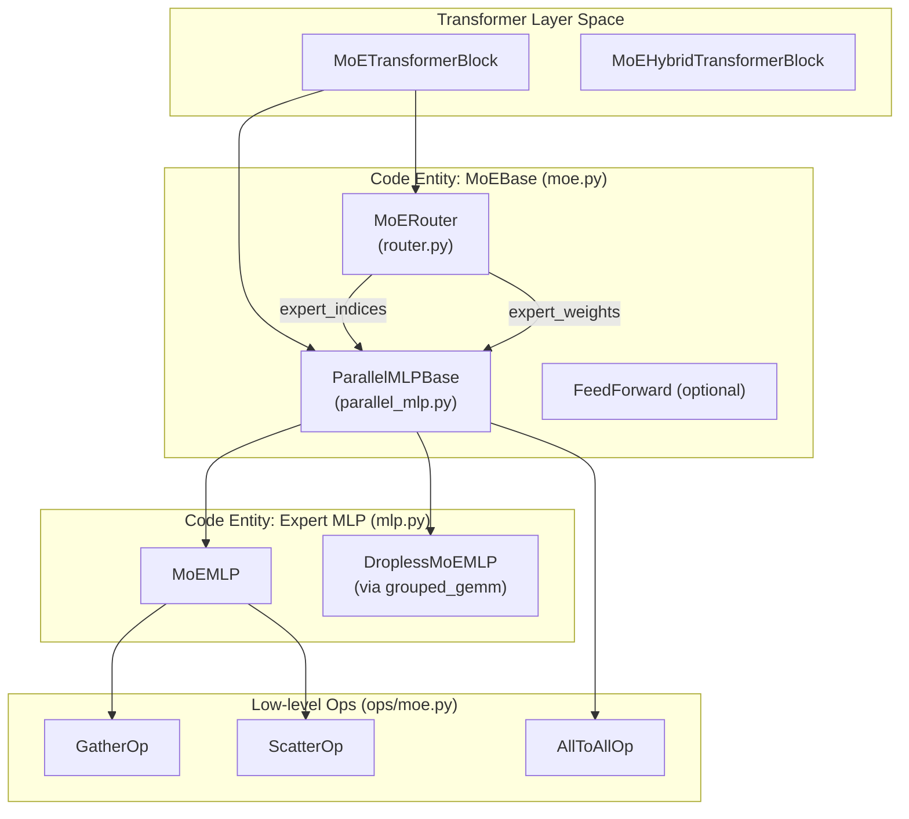
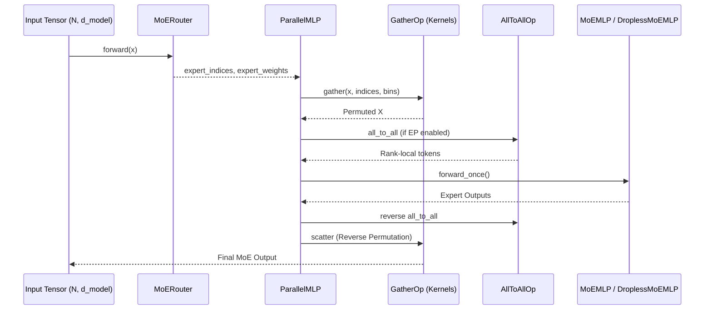

<!-- source: DeepWiki mcp.deepwiki.com · repo allenai/OLMo-core · page 2.5 Mixture of Experts · fetched 2026-10-26 -->

# Mixture of Experts

<details>
<summary>Relevant source files</summary>

The following files were used as context for generating this wiki page:

- [src/olmo_core/nn/moe/__init__.py](src/olmo_core/nn/moe/__init__.py)
- [src/olmo_core/nn/moe/loss.py](src/olmo_core/nn/moe/loss.py)
- [src/olmo_core/nn/moe/mlp.py](src/olmo_core/nn/moe/mlp.py)
- [src/olmo_core/nn/moe/moe.py](src/olmo_core/nn/moe/moe.py)
- [src/olmo_core/nn/moe/parallel_mlp.py](src/olmo_core/nn/moe/parallel_mlp.py)
- [src/olmo_core/nn/moe/router.py](src/olmo_core/nn/moe/router.py)
- [src/olmo_core/ops/moe.py](src/olmo_core/ops/moe.py)
- [src/scripts/train/private-olmo.py](src/scripts/train/private-olmo.py)
- [src/test/nn/cross_entropy_loss_test.py](src/test/nn/cross_entropy_loss_test.py)
- [src/test/nn/functional/cross_entropy_loss_test.py](src/test/nn/functional/cross_entropy_loss_test.py)
- [src/test/nn/moe/mlp_test.py](src/test/nn/moe/mlp_test.py)
- [src/test/nn/moe/moe_test.py](src/test/nn/moe/moe_test.py)
- [src/test/ops/moe_test.py](src/test/ops/moe_test.py)

</details>


This page documents the Mixture of Experts (MoE) architecture implementation in OLMo-core, including MoE transformer blocks, routing mechanisms, expert parallelism, and hybrid dense-sparse configurations.

For information about standard (dense) feed-forward layers, see [Feed-Forward Networks](#2.7). For general transformer architecture, see [Transformer Models](#2.1). For expert parallelism configuration, see [Parallelism Strategies](#4.2).

## Overview

The MoE implementation in OLMo-core replaces dense feed-forward layers with sparse expert networks, where each token is routed to a subset of expert networks. This enables scaling model capacity without proportionally scaling computation. The system supports:

- **Pure MoE blocks**: Sparse feed-forward only [src/olmo_core/nn/transformer/block.py:512-677]().
- **Hybrid blocks**: Combined dense and sparse feed-forward [src/olmo_core/nn/transformer/block.py:720-1077]().
- **Dropless routing**: Load-balanced expert assignment without token dropping via `DroplessMoE` [src/olmo_core/nn/moe/moe.py:52-55]().
- **Shared experts**: Common experts processed by all tokens [src/olmo_core/nn/moe/moe.py:68]().
- **Expert parallelism (EP)**: Distributed expert computation across devices using All-to-All primitives [src/olmo_core/nn/moe/parallel_mlp.py:34-101]().
- **Combined forward optimization**: Overlapping dense computation with EP communication in hybrid blocks [src/olmo_core/nn/transformer/block.py:899-989]().

**Sources**: [src/olmo_core/nn/moe/moe.py:1-122](), [src/olmo_core/nn/moe/router.py:79-153](), [src/olmo_core/nn/transformer/block.py:512-1077]()

## Architecture Overview

The following diagram illustrates the relationship between the high-level transformer blocks and the specialized MoE modules.

### MoE System Components


**Sources**: [src/olmo_core/nn/moe/moe.py:123-176](), [src/olmo_core/nn/moe/parallel_mlp.py:34-183](), [src/olmo_core/nn/moe/router.py:155-202]()

## Routing Mechanisms

The router is responsible for assigning tokens to experts and computing auxiliary losses to ensure balanced expert utilization.

### Router Implementations
- **MoELinearRouter**: The default implementation using a linear projection from `d_model` to `num_experts` [src/olmo_core/nn/moe/router.py:270-343]().
- **Gating Functions**: Supports `softmax` or `sigmoid` gating via `MoERouterGatingFunction` [src/olmo_core/nn/moe/router.py:74-77]().
- **Top-K Selection**: Selects the best `top_k` experts for each token [src/olmo_core/nn/moe/router.py:315-321]().
- **Auxiliary-Loss-Free Balancing**: Supports `bias_gamma` for adjusting expert scores following DeepSeek-v3 strategies [src/olmo_core/nn/moe/router.py:166-168]().

### Auxiliary Losses
Routing stability is maintained via specialized loss functions:
1. **Load Balancing Loss**: Encourages uniform token distribution across experts. It can be computed at `local_batch` or `instance` granularity [src/olmo_core/nn/moe/loss.py:29-112]().
2. **Router Z-Loss**: Penalizes large logit magnitudes to improve training stability [src/olmo_core/nn/moe/loss.py:114-139]().

**Sources**: [src/olmo_core/nn/moe/router.py:155-268](), [src/olmo_core/nn/moe/loss.py:1-139]()

## Expert Implementation

OLMo-core provides multiple expert MLP implementations tailored for different efficiency requirements and parallelism configurations.

| Implementation | Class | Key Feature |
| :--- | :--- | :--- |
| **Standard MoE** | `MoEMLP` | Uses standard PyTorch `bmm` (batch matrix multiplication) [src/olmo_core/nn/moe/mlp.py:123-195](). |
| **Dropless MoE** | `DroplessMoEMLP` | Uses `grouped_gemm` kernels to handle variable tokens per expert without padding [src/olmo_core/nn/moe/mlp.py:198-250](). |
| **Parallel Wrapper** | `ParallelMLP` | Orchestrates the data permutation and All-to-All communication [src/olmo_core/nn/moe/parallel_mlp.py:186-250](). |

### Data Flow: Permutation and Communication
Before expert computation, tokens must be rearranged so that tokens for the same expert are contiguous.



**Sources**: [src/olmo_core/nn/moe/parallel_mlp.py:102-183](), [src/olmo_core/ops/moe.py:26-123](), [src/olmo_core/nn/moe/router.py:302-343]()

## Parallelism Strategies

### Expert Parallelism (EP)
EP shards the expert parameters across a `DeviceMesh`. When a token is routed to an expert on a different rank, an All-to-All communication step is triggered.
- **Application**: Enabled via `moe.apply_ep(ep_mesh)` [src/olmo_core/nn/moe/moe.py:249-253]().
- **Sharding**: Experts are sharded along the expert dimension (dim 0) using `distribute_tensor` [src/olmo_core/nn/moe/mlp.py:71-85]().

### Tensor Parallelism (TP)
TP can be combined with MoE to shard the internal dimensions of the experts.
- **Application**: Enabled via `moe.apply_tp(tp_mesh)` [src/olmo_core/nn/moe/moe.py:255-259]().
- **Implementation**: Shards the MLP weights (`w1`, `w2`, `w3`) across the TP mesh [src/olmo_core/nn/moe/mlp.py:60-70]().

**Sources**: [src/olmo_core/nn/moe/parallel_mlp.py:76-89](), [src/olmo_core/nn/moe/mlp.py:50-86]()

## Hybrid Dense-Sparse Blocks

OLMo-core supports hybrid blocks where a standard dense MLP and a sparse MoE module coexist in the same transformer layer, as seen in architectures like DeepSeek or private OLMo variants.

- **MoEHybridTransformerBlock**: Tokens pass through both an attention layer and a dual FFN path (one dense `FeedForward`, one sparse `MoEBase`) [src/olmo_core/nn/transformer/block.py:720-896]().
- **Optimization**: The `optimized_forward` method overlaps the dense FFN computation with the EP All-to-All communication of the sparse MoE path to hide communication latency [src/olmo_core/nn/transformer/block.py:899-989]().

**Sources**: [src/olmo_core/nn/transformer/block.py:899-1077]()

## Configuration and Usage

### MoEConfig
The `MoEConfig` class defines the structure of the MoE layer [src/olmo_core/nn/moe/moe.py:58-76]():
- `num_experts`: Total number of experts.
- `hidden_size`: Intermediate size of the expert MLPs.
- `router`: A `MoERouterConfig` instance.
- `shared_mlp`: Configuration for an optional dense expert.
- `lb_loss_weight`: Weight for the load balancing loss (default 0.01).

### Example: Llama-like MoE
```python
# src/scripts/train/private-olmo.py:31-42
return TransformerConfig.llama_like_moe(
    vocab_size=common.tokenizer.padded_vocab_size(),
    d_model=d_model,
    n_layers=32,
    num_experts=8,
    top_k=1,
    expert_hidden_size=11008,
    lb_loss_weight=0.01,
    z_loss_weight=0.001,
)
```

**Sources**: [src/olmo_core/nn/moe/moe.py:58-121](), [src/scripts/train/private-olmo.py:28-53]()

## Technical Considerations

1. **Activation Checkpointing**: Standard MoE blocks cannot use full activation checkpointing easily because the routing decisions and communication buffers must be preserved [src/olmo_core/nn/transformer/model.py:726-757]().
2. **Grouped GEMM**: The `DroplessMoEMLP` implementation requires the `grouped_gemm` library for performance; otherwise, it falls back to padded operations [src/olmo_core/nn/moe/mlp.py:19-24]().
3. **FSDP Sharding**: When using Expert Parallelism, experts must be sharded over the correct DP dimension to avoid replication [src/olmo_core/nn/moe/mlp.py:87-113]().

**Sources**: [src/olmo_core/nn/moe/mlp.py:19-24](), [src/olmo_core/nn/transformer/model.py:726-757]()

---

