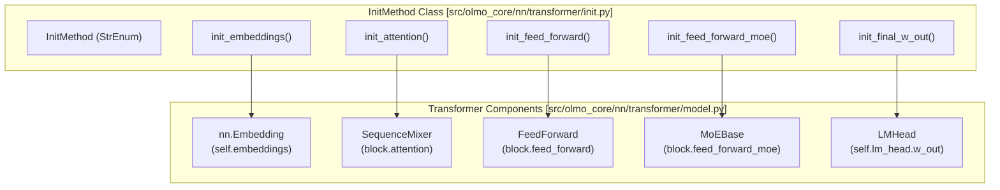
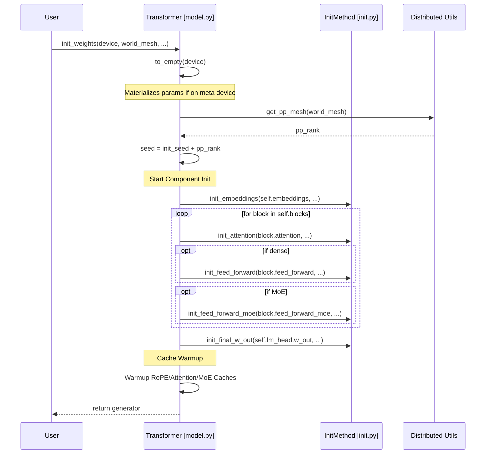

<!-- source: DeepWiki mcp.deepwiki.com · repo allenai/OLMo-core · page 2.6 Model Initialization · fetched 2026-10-26 -->

# Model Initialization

<details>
<summary>Relevant source files</summary>

The following files were used as context for generating this wiki page:

- [src/olmo_core/nn/attention/recurrent.py](src/olmo_core/nn/attention/recurrent.py)
- [src/olmo_core/nn/transformer/init.py](src/olmo_core/nn/transformer/init.py)
- [src/olmo_core/script_utils.py](src/olmo_core/script_utils.py)
- [src/olmo_core/train/callbacks/stability_monitor.py](src/olmo_core/train/callbacks/stability_monitor.py)
- [src/test/nn/attention/recurrent_test.py](src/test/nn/attention/recurrent_test.py)
- [src/test/nn/transformer/init_test.py](src/test/nn/transformer/init_test.py)

</details>


This page documents the weight initialization system in OLMo-core models. It covers the initialization methods, configuration parameters, and the step-by-step process of initializing model weights. For information about building model architectures, see [Transformer Models](2.1). For information about training modules that orchestrate the initialization process, see [TrainModule Abstraction](3.2).

## Overview

Model initialization in OLMo-core is a configurable process that sets the initial values of all trainable parameters in a transformer model. The system supports multiple initialization strategies and handles special requirements for distributed training, including proper seeding across pipeline parallel ranks and cache warmup for efficient training startup.

The initialization process is primarily executed through the `Transformer.init_weights()` method, which systematically initializes embeddings, transformer blocks (attention and feed-forward layers), and the language model head according to the specified `InitMethod`.

**Sources:** [src/olmo_core/nn/transformer/model.py:213-309]()

## Initialization Configuration

Model initialization is controlled by several configuration parameters defined in `TransformerConfig`:

| Parameter | Type | Default | Description |
|-----------|------|---------|-------------|
| `init_method` | `InitMethod` | `InitMethod.normal` | The initialization strategy to use (normal, llama, fan_in, etc.) |
| `init_seed` | `int` | `0` | Base random seed for initialization |
| `init_std` | `float` | `0.02` | Standard deviation for random initialization |
| `embedding_init_std` | `Optional[float]` | `None` | Specific std for embeddings (defaults to `init_std` if not set) |
| `init_device` | `str` | `"cpu"` | Device on which parameters are initially allocated |

These parameters are set during model construction and stored as instance attributes on the `Transformer` model.

**Sources:** [src/olmo_core/nn/transformer/model.py:112-116](), [src/olmo_core/nn/transformer/model.py:163-167]()

## The InitMethod Abstraction

The `InitMethod` enum in `olmo_core.nn.transformer.init` defines the logic for different initialization schemes. It provides methods that target specific architectural components, ensuring that initialization logic (like depth-scaling) is encapsulated.

### Supported Strategies

| Strategy | Description |
|----------|-------------|
| `normal` | Every linear and embedding layer is initialized from a truncated normal distribution with `std=0.02`. [src/olmo_core/nn/transformer/init.py:47-51]() |
| `llama` | "Output" layers (like `w3` in MLP) are scaled by `1/sqrt(2 * n_layers)`. [src/olmo_core/nn/transformer/init.py:58-62]() |
| `llama_depth` | Similar to `llama`, but scales "output" layers by the specific layer index: `1/sqrt(2 * (block_idx + 1))`. [src/olmo_core/nn/transformer/init.py:64-68]() |
| `fan_in` | Each weight matrix uses `std = 1/sqrt(d_in)`. Embeddings use `std=1.0`. [src/olmo_core/nn/transformer/init.py:70-77]() |
| `normalized` | Follows the nGPT initialization scheme, where embeddings use `std = d_model**-0.5`. [src/olmo_core/nn/transformer/init.py:53-56]() |

### Code Entity Mapping

The following diagram bridges the abstract initialization methods to the specific model components they modify.



**Sources:** [src/olmo_core/nn/transformer/init.py:79-224](), [src/olmo_core/nn/transformer/model.py:244-307]()

## The init_weights() Process

The `init_weights()` method orchestrates the complete model initialization. It is typically called after model construction and after applying tensor parallelism (TP) or pipeline parallelism (PP), but before final FSDP wrapping if initializing from meta device.



### Distributed Initialization Logic

OLMo-core uses a helper `_apply_init` to handle initialization of `DTensor` (Distributed Tensors) used in Tensor Parallelism. It ensures that the initialization is performed on the full logical shape before being partitioned to the local shards.

```python
# [src/olmo_core/nn/transformer/init.py:16-28]
def _apply_init(init_fun, x: torch.Tensor, *args, **kwargs):
    if not isinstance(x, DTensor):
        init_fun(x, *args, **kwargs)
        return

    # Initialize full version of x locally, then apply init to that.
    full_x = torch.zeros(x.shape, dtype=x.dtype, device=x.device)
    init_fun(full_x, *args, **kwargs)
    full_x = distribute_like(x, full_x)

    # Now copy over the corresponding shard of `full_x` into `x`.
    get_local_tensor(x).copy_(get_local_tensor(full_x))
```

**Sources:** [src/olmo_core/nn/transformer/init.py:16-28](), [src/olmo_core/nn/transformer/model.py:213-242]()

## Component-Specific Initialization

### Embeddings
Embeddings are initialized using `InitMethod.init_embeddings`. If `fan_in` is used, the standard deviation is `1.0 / embed_scale` (or `1.0`). For `normalized` (nGPT), it uses `d_model**-0.5`.

**Sources:** [src/olmo_core/nn/transformer/init.py:79-105]()

### Feed-Forward (MLP)
The MLP initialization handles three weights: `w1`, `w2`, and `w3`.
- `w1` and `w3` are the "up-projections".
- `w2` is the "down-projection".
- In `llama` mode, `w3` is scaled by `1/sqrt(2 * n_layers)`.
- In `fan_in` mode, each weight uses its own input dimension: `w1` uses `d_model`, `w2` uses `hidden_size`.

**Sources:** [src/olmo_core/nn/transformer/init.py:143-180]()

### Mixture of Experts (MoE)
MoE initialization involves initializing the `router` and the expert `MLP` weights.
- The `router` is initialized with `std = d_model**-0.5` in `fan_in` mode.
- Experts follow the same logic as standard Feed-Forward layers.

**Sources:** [src/olmo_core/nn/transformer/init.py:182-224]()

### Recurrent Layers (Gated Delta Net)
Special care is taken for recurrent layers like `GatedDeltaNet`. Currently, `InitMethod.fan_in` is not supported for `GatedDeltaNet` and will raise a `NotImplementedError`.

**Sources:** [src/test/nn/transformer/init_test.py:181-198]()

## Cache Warmup

A unique feature of the OLMo-core initialization process is the optional cache warmup. By providing `max_seq_len` or `max_local_microbatch_size` to `init_weights()`, the model pre-allocates memory for:
1. **RoPE Buffers**: Pre-computes sin/cos tables. [src/olmo_core/nn/transformer/model.py:282-283]()
2. **Attention Backends**: Pre-allocates backend-specific workspace. [src/olmo_core/nn/transformer/model.py:255-257]()
3. **MoE Routing Caches**: Pre-allocates tensors for expert routing to avoid fragmentation during the first step. [src/olmo_core/nn/transformer/model.py:295-299]()

## Testing Initialization

The initialization strategies are verified in `src/test/nn/transformer/init_test.py`. For example, `test_fan_in_init_dense` checks that the standard deviation of weights matches the expected `1/sqrt(fan_in)` for different layers.

**Sources:** [src/test/nn/transformer/init_test.py:34-83]()

---

