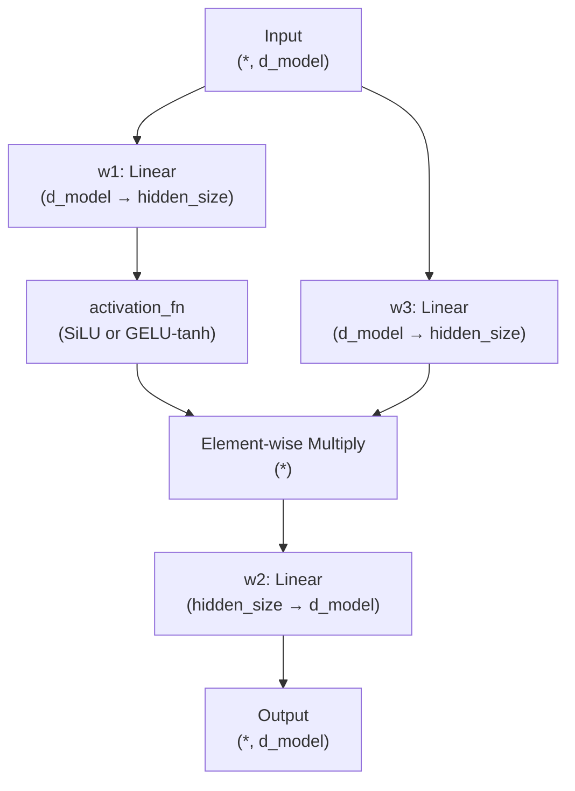
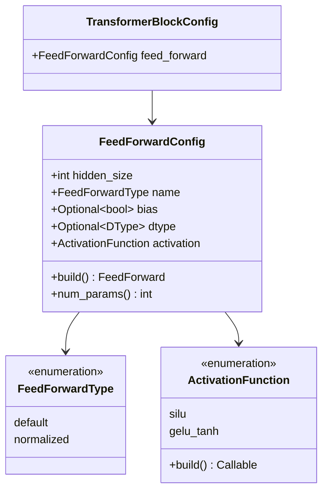
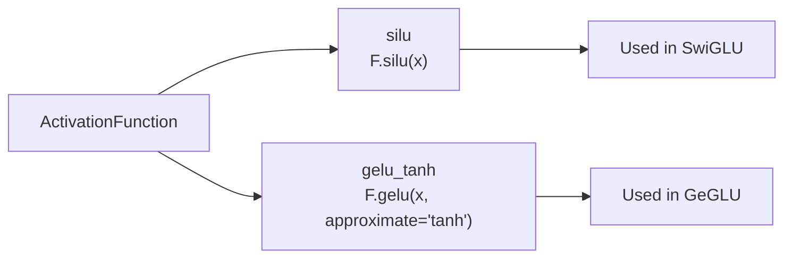
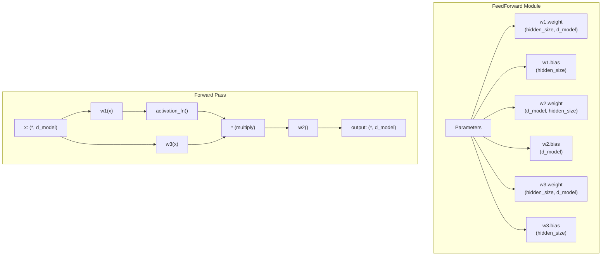
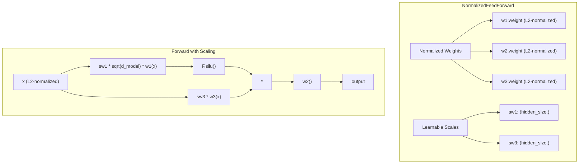
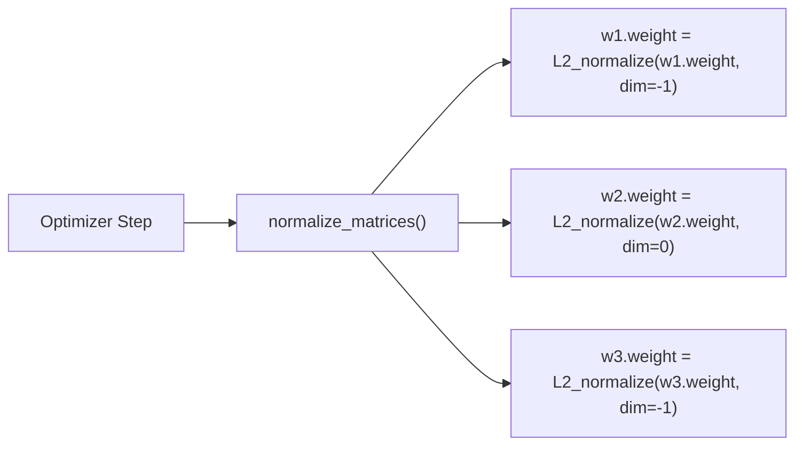
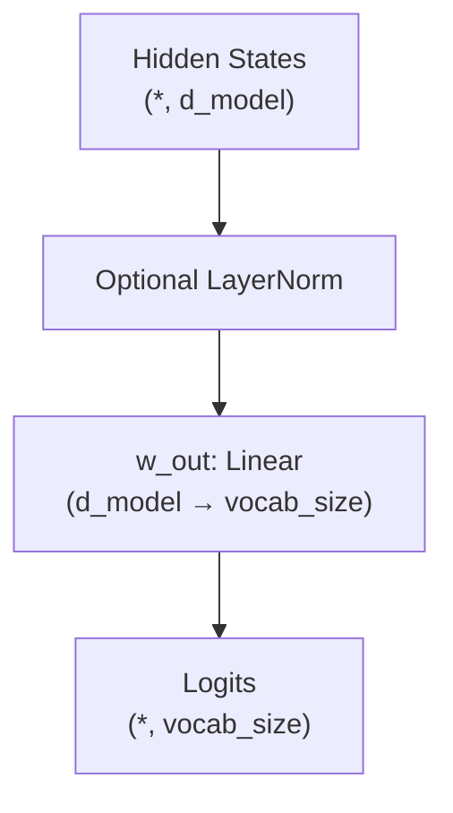

<!-- source: DeepWiki mcp.deepwiki.com · repo allenai/OLMo-core · page 2.7 Feed-Forward Networks · fetched 2026-10-26 -->

# Feed-Forward Networks

<details>
<summary>Relevant source files</summary>

The following files were used as context for generating this wiki page:

- [src/olmo_core/nn/feed_forward.py](src/olmo_core/nn/feed_forward.py)
- [src/olmo_core/nn/functional/cross_entropy_loss.py](src/olmo_core/nn/functional/cross_entropy_loss.py)
- [src/olmo_core/nn/layer_norm.py](src/olmo_core/nn/layer_norm.py)
- [src/olmo_core/nn/lm_head.py](src/olmo_core/nn/lm_head.py)
- [src/olmo_core/nn/rope.py](src/olmo_core/nn/rope.py)
- [src/olmo_core/nn/transformer/__init__.py](src/olmo_core/nn/transformer/__init__.py)
- [src/olmo_core/nn/transformer/block.py](src/olmo_core/nn/transformer/block.py)
- [src/olmo_core/nn/transformer/config.py](src/olmo_core/nn/transformer/config.py)
- [src/olmo_core/nn/transformer/model.py](src/olmo_core/nn/transformer/model.py)
- [src/olmo_core/ops/__init__.py](src/olmo_core/ops/__init__.py)
- [src/scripts/train/OLMoE2-large.py](src/scripts/train/OLMoE2-large.py)
- [src/test/nn/feed_forward_test.py](src/test/nn/feed_forward_test.py)
- [src/test/nn/layer_norm_test.py](src/test/nn/layer_norm_test.py)
- [src/test/nn/lm_head_test.py](src/test/nn/lm_head_test.py)
- [src/test/nn/transformer/model_test.py](src/test/nn/transformer/model_test.py)

</details>


Feed-forward networks (FFNs) are the multi-layer perceptron (MLP) components within transformer blocks. Each transformer block contains an FFN that processes the output of the sequence mixer (attention or recurrent mechanism), providing non-linear transformations and expanding the model's capacity.

For information about how FFNs integrate into transformer blocks, see [2.2](). For FFN initialization strategies, see [2.6]().

---

## Overview

Feed-forward networks in OLMo-core primarily implement gated activation functions, specifically:
- **SwiGLU**: Gated linear unit with SiLU (Swish) activation. [src/olmo_core/nn/feed_forward.py:34-37]()
- **GeGLU**: Gated linear unit with GELU activation (tanh approximation). [src/olmo_core/nn/feed_forward.py:39-42]()

The FFN transforms inputs from `d_model` dimensions to `hidden_size` (typically larger), applies gated activation, and projects back to `d_model`. This expansion-and-contraction pattern increases model expressiveness.

Sources: [src/olmo_core/nn/feed_forward.py:1-27](), [src/olmo_core/nn/transformer/block.py:96-143]()

---

## Architecture

The standard feed-forward module uses a three-layer gated architecture:



**Diagram: Gated Feed-Forward Architecture (SwiGLU/GeGLU)**

The forward computation is: `w2(activation(w1(x)) * w3(x))`. [src/olmo_core/nn/feed_forward.py:171-171]()

| Component | Shape | Purpose |
|-----------|-------|---------|
| `w1` | `(d_model, hidden_size)` | Gate projection (activation branch) |
| `w3` | `(d_model, hidden_size)` | Value projection (linear branch) |
| `w2` | `(hidden_size, d_model)` | Output projection back to model dimension |

Sources: [src/olmo_core/nn/feed_forward.py:142-171]()

---

## Configuration

Feed-forward networks are configured via `FeedForwardConfig`:



**Diagram: Feed-Forward Configuration Classes**

### Configuration Options

| Field | Type | Default | Description |
|-------|------|---------|-------------|
| `hidden_size` | `int` | Required | Intermediate dimension (typically 4×d_model or 8/3×d_model) |
| `name` | `FeedForwardType` | `default` | Implementation variant (`default` or `normalized`) |
| `bias` | `Optional[bool]` | `None` | Whether to use bias terms (default: True for standard, False for normalized) |
| `dtype` | `Optional[DType]` | `None` | Parameter data type |
| `activation` | `ActivationFunction` | `silu` | Activation function (SwiGLU or GeGLU) |

Sources: [src/olmo_core/nn/feed_forward.py:69-106](), [src/olmo_core/nn/transformer/config.py:149-192]()

---

## Activation Functions

The `ActivationFunction` enum defines available activation functions for gated MLPs:



**Diagram: Activation Functions**

### SiLU (Swish)
- Formula: `x * sigmoid(x)`
- Used in SwiGLU gating. [src/olmo_core/nn/feed_forward.py:34-37]()
- Default activation for most OLMo models. [src/olmo_core/nn/feed_forward.py:82-82]()

### GELU (Tanh Approximation)
- Formula: `0.5 * x * (1 + tanh(sqrt(2/π) * (x + 0.044715 * x^3)))`
- Used in GeGLU gating. [src/olmo_core/nn/feed_forward.py:39-42]()

Sources: [src/olmo_core/nn/feed_forward.py:29-51]()

---

## Standard Feed-Forward

The `FeedForward` class implements the gated MLP:



**Diagram: FeedForward Class Structure**

### Key Methods

| Method | Description |
|--------|-------------|
| `__init__()` | Initializes `w1`, `w2`, `w3` linear layers and activation function. [src/olmo_core/nn/feed_forward.py:147-163]() |
| `forward(x)` | Executes gated activation projection. [src/olmo_core/nn/feed_forward.py:165-171]() |
| `apply_tp()` | Applies tensor parallelism (column-parallel for `w1`/`w3`, row-parallel for `w2`). [src/olmo_core/nn/feed_forward.py:173-204]() |
| `num_flops_per_token()` | Computes FLOPS: `6 * sum(p.numel())`. [src/olmo_core/nn/feed_forward.py:206-209]() |

Sources: [src/olmo_core/nn/feed_forward.py:142-210]()

---

## Normalized Feed-Forward

The `NormalizedFeedForward` class is a specialized variant for nGPT-style models with normalized embeddings:



**Diagram: Normalized Feed-Forward Architecture**

### Differences from Standard FFN

| Aspect | Standard FFN | Normalized FFN |
|--------|-------------|----------------|
| Bias terms | Optional (default: True) | Always False. [src/olmo_core/nn/feed_forward.py:227-229]() |
| Weight normalization | None | L2-normalized after each optimizer step. [src/olmo_core/nn/feed_forward.py:269-284]() |
| Learnable scales | None | `sw1`, `sw3` parameters. [src/olmo_core/nn/feed_forward.py:237-242]() |
| Activation | SiLU or GELU | SiLU only. [src/olmo_core/nn/feed_forward.py:227-231]() |

### Weight Normalization

The `normalize_matrices()` method is called to re-normalize weights:



**Diagram: Weight Re-Normalization Flow**

Sources: [src/olmo_core/nn/feed_forward.py:212-284]()

---

## Language Modeling Head and Loss

The `LMHead` processes transformer outputs to produce logits and compute loss.

### LM Head Architecture



Sources: [src/olmo_core/nn/lm_head.py:154-180]()

### Loss Implementation

OLMo-core provides two main loss paths:
1. **Default**: Standard `torch.nn.functional.cross_entropy`. [src/olmo_core/nn/functional/cross_entropy_loss.py:36-36]()
2. **Fused Linear**: A low-memory Triton implementation from `liger-kernel` that fuses the linear projection with the loss computation to avoid materializing large logits tensors. [src/olmo_core/nn/lm_head.py:70-74](), [src/olmo_core/nn/functional/cross_entropy_loss.py:68-125]()

### Z-Loss Regularization

An optional auxiliary loss (z-loss) can be computed to stabilize training by penalizing the log-sum-exp of the logits:
`z_loss = z_loss_multiplier * (logsumexp(logits)^2)`. [src/olmo_core/nn/functional/cross_entropy_loss.py:41-50]()

Sources: [src/olmo_core/nn/lm_head.py:60-74](), [src/olmo_core/nn/functional/cross_entropy_loss.py:12-50]()

---

## Integration in Transformer Blocks

Feed-forward networks are integrated into transformer blocks using residual connections and normalization:

```python
# From TransformerBlock.forward
h = self.attention_residual_stream(x, self.attention(self.attention_norm(x), **kwargs))
return self.feed_forward_residual_stream(h, self.feed_forward(self.feed_forward_norm(h)))
```
[src/olmo_core/nn/transformer/block.py:152-153]()

| Block Type | FFN Placement | Normalization Strategy |
|------------|---------------|------------------------|
| `TransformerBlock` | Sequential | Pre-norm (norm before FFN). [src/olmo_core/nn/transformer/block.py:153-153]() |
| `MoETransformerBlock` | Sequential | Replaces FFN with MoE. [src/olmo_core/nn/transformer/block.py:42-43]() |
| `MoEHybridTransformerBlock` | Parallel | Dense FFN + MoE in parallel. [src/olmo_core/nn/transformer/block.py:4-5]() |

Sources: [src/olmo_core/nn/transformer/block.py:96-154]()

---

## Tensor Parallelism

Feed-forward networks support tensor parallelism by sharding weight matrices across TP ranks:

| Layer | Parallelization Type | Sharding Dimension |
|-------|---------------------|-------------------|
| `w1` | Column-parallel | Hidden dimension (output). [src/olmo_core/nn/feed_forward.py:198-198]() |
| `w3` | Column-parallel | Hidden dimension (output). [src/olmo_core/nn/feed_forward.py:202-202]() |
| `w2` | Row-parallel | Hidden dimension (input). [src/olmo_core/nn/feed_forward.py:199-201]() |

The `apply_tp()` method configures the module for `torch.distributed.tensor.parallel`:
1. Replicates input across the TP mesh. [src/olmo_core/nn/feed_forward.py:185-192]()
2. Shards `w1` and `w3` colwise. [src/olmo_core/nn/feed_forward.py:198-202]()
3. Shards `w2` rowwise, performing a partial reduction. [src/olmo_core/nn/feed_forward.py:199-201]()

Sources: [src/olmo_core/nn/feed_forward.py:173-204]()

---

