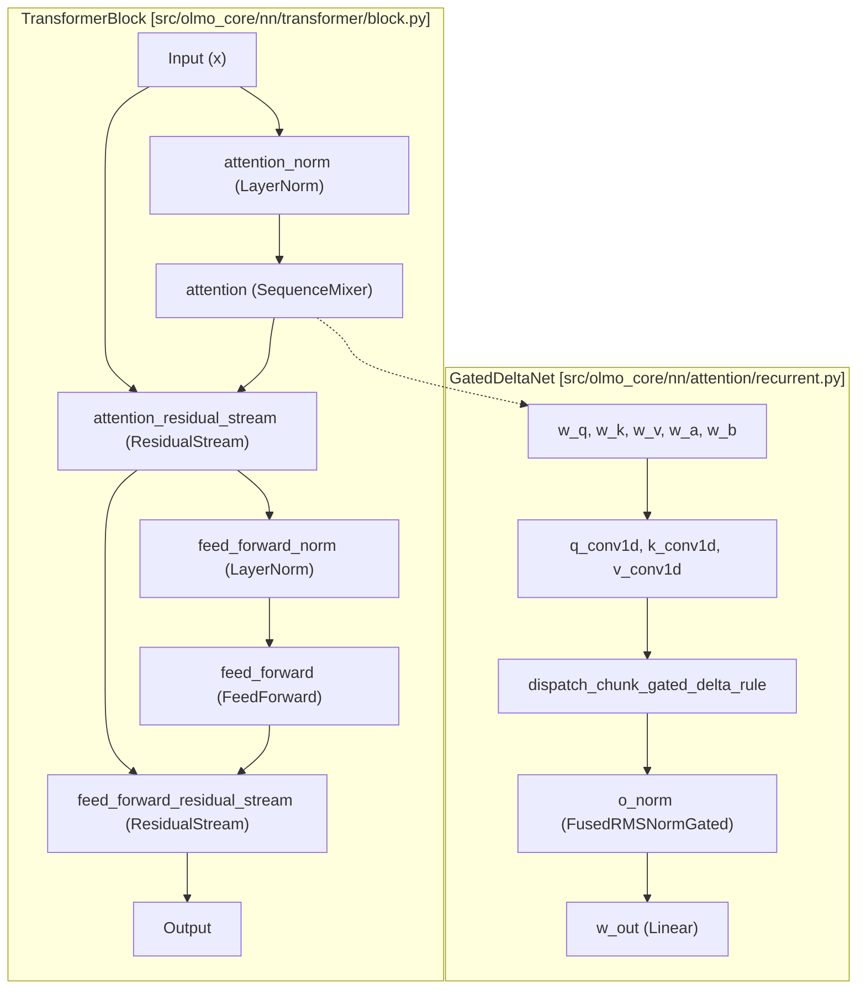
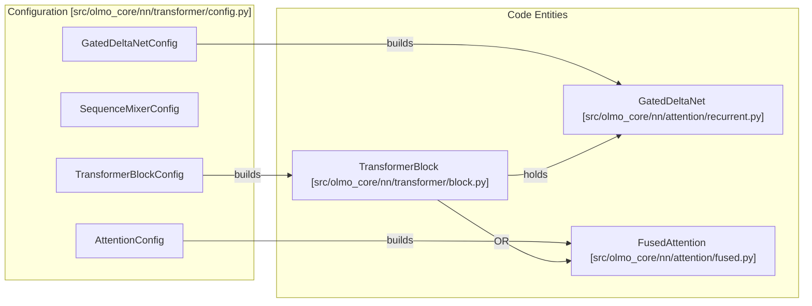

<!-- source: DeepWiki mcp.deepwiki.com · repo allenai/OLMo-core · page 2.8 Recurrent and Hybrid Architectures · fetched 2026-10-26 -->

# Recurrent and Hybrid Architectures

Relevant source files

The following files were used as context for generating this wiki page:

- [src/olmo_core/distributed/nn.py](src/olmo_core/distributed/nn.py)
- [src/olmo_core/distributed/parallel/context_parallel.py](src/olmo_core/distributed/parallel/context_parallel.py)
- [src/olmo_core/nn/attention/flash_linear_attn_api.py](src/olmo_core/nn/attention/flash_linear_attn_api.py)
- [src/olmo_core/nn/attention/recurrent.py](src/olmo_core/nn/attention/recurrent.py)
- [src/olmo_core/nn/convolution.py](src/olmo_core/nn/convolution.py)
- [src/olmo_core/nn/transformer/init.py](src/olmo_core/nn/transformer/init.py)
- [src/olmo_core/script_utils.py](src/olmo_core/script_utils.py)
- [src/olmo_core/train/callbacks/stability_monitor.py](src/olmo_core/train/callbacks/stability_monitor.py)
- [src/test/distributed/parallel/context_parallel_test.py](src/test/distributed/parallel/context_parallel_test.py)
- [src/test/nn/attention/recurrent_test.py](src/test/nn/attention/recurrent_test.py)

This section documents the support in `olmo_core` for non-attention sequence mixing mechanisms and hybrid models. While standard transformers rely on Softmax attention, `olmo_core` provides abstractions and implementations for recurrent layers (like Gated Delta Networks) and convolutions, allowing for models with $O(n)$ complexity or hybrid structures that mix different layer types.

## SequenceMixer Abstraction

The `SequenceMixer` class serves as the base interface for any module that performs mixing across the sequence dimension [src/olmo_core/nn/attention/base.py:17-17](). This abstraction allows the `TransformerBlock` to be agnostic to whether it is using standard multi-head attention, a linear recurrent rule, or a convolutional layer.

Key characteristics:
*   **Unified Interface**: All mixers implement a `forward` method accepting input `x` of shape `(batch_size, seq_len, d_model)` [src/olmo_core/nn/attention/recurrent.py:135-140]().
*   **Configuration**: Mixers are built via `SequenceMixerConfig` subclasses, which are passed to `TransformerBlockConfig` [src/olmo_core/nn/transformer/config.py:150-158]().
*   **Backwards Compatibility**: The `TransformerBlock` internal attribute is still named `self.attention` for checkpoint compatibility, even when a recurrent mixer is used [src/olmo_core/nn/transformer/block.py:128-133]().

### Sequence Mixer Data Flow

The following diagram illustrates how a `SequenceMixer` (specifically `GatedDeltaNet`) fits into the standard `TransformerBlock` pipeline.

**Sequence Mixer Integration Diagram**

Sources: [src/olmo_core/nn/transformer/block.py:96-153](), [src/olmo_core/nn/attention/recurrent.py:34-134]()

## Gated Delta Networks (GatedDeltaNet)

The `GatedDeltaNet` is a linear attention variant that implements the Gated Delta Rule for recurrent state updates [src/olmo_core/nn/attention/recurrent.py:34-41](). It provides efficient sequence modeling by replacing the $O(n^2)$ attention matrix with a recurrent state.

### Implementation Details
*   **Gated Projections**: It uses specialized linear layers `w_a` and `w_b` to compute gating signals and the `beta` parameter [src/olmo_core/nn/attention/recurrent.py:99-100]().
*   **Negative Eigenvalues**: Supports the "Unlocking State-Tracking" mechanism where `allow_neg_eigval=True` allows the model to track state more effectively by multiplying the `beta` gate [src/olmo_core/nn/attention/recurrent.py:49-51]().
*   **Short Convolutions**: Integrates `CausalConv1d` modules for `q`, `k`, and `v` to provide local context before the global recurrent update [src/olmo_core/nn/attention/recurrent.py:105-128]().
*   **Kernel Dispatch**: Utilizes `flash-linear-attention` (FLA) via `dispatch_chunk_gated_delta_rule` for high-performance execution [src/olmo_core/nn/attention/recurrent.py:18-21](), [src/olmo_core/nn/attention/flash_linear_attn_api.py:16-42]().
*   **Context Parallelism**: Supports Ulysses-style context parallelism by transforming tensors between context-parallel (sequence sharded) and head-parallel partitioning using `all_to_all_cp2hp` and `all_to_all_hp2cp` [src/olmo_core/nn/attention/recurrent.py:164-173](), [src/olmo_core/distributed/parallel/context_parallel.py:67-128]().

Sources: [src/olmo_core/nn/attention/recurrent.py:34-134](), [src/olmo_core/distributed/parallel/context_parallel.py:10-178]()

## Causal Convolutions (CausalConv1d)

`CausalConv1d` is a depthwise separable 1D convolution layer with causal padding [src/olmo_core/nn/convolution.py:12-16](). It is used within recurrent mixers to provide local shift-invariance.

*   **Implementation**: Inherits from `nn.Conv1d` but uses `dispatch_causal_conv1d` for execution, supporting both Triton and CUDA backends [src/olmo_core/nn/convolution.py:12-28](), [src/olmo_core/nn/attention/flash_linear_attn_api.py:45-63]().
*   **Context Parallelism**: Implements `apply_cp` for Ulysses-style parallelism. Instead of sharding weights, it slices full parameters to local `C/CP` channels during the forward pass to minimize communication [src/olmo_core/nn/convolution.py:85-103]().
*   **Activation**: Supports `silu` or `swish` activations integrated directly into the convolution kernel [src/olmo_core/nn/convolution.py:27-28]().

Sources: [src/olmo_core/nn/convolution.py:12-83](), [src/olmo_core/nn/attention/flash_linear_attn_api.py:45-63]()

## Hybrid Architectures (GNoPE)

Hybrid architectures combine different mixer types across layers. A common pattern is **GNoPE** (Gated Network with occasional Position Embeddings/Attention), where most layers are recurrent (like `GatedDeltaNet`) but some are standard `Attention`.

### Block Patterns
The `Transformer` class supports complex block patterns through the `block_pattern` and `block` (as a dict) arguments [src/olmo_core/nn/transformer/model.py:97-108]().

| Feature | Description |
| :--- | :--- |
| **Named Blocks** | Define a dictionary of named `TransformerBlockConfig` objects (e.g., `{"recurrent": gdn_config, "attention": attn_config}`) [src/olmo_core/nn/transformer/model.py:108-108](). |
| **Pattern Strings** | Use a list of keys to define the interleaving (e.g., `["recurrent", "recurrent", "attention"]`) [src/olmo_core/nn/transformer/model.py:118-118](). |
| **Resolving Logic** | The `resolve_block_configs` utility cycles through the pattern to populate all `n_layers` [src/olmo_core/nn/transformer/model.py:141-146](). |

### Configuration Example
In a hybrid model, the `TransformerBlockType.reordered_norm` is often used to ensure stability when mixing disparate layer types [src/olmo_core/nn/transformer/config.py:113-116]().

**Hybrid Entity Mapping**

Sources: [src/olmo_core/nn/transformer/config.py:150-238](), [src/olmo_core/nn/transformer/block.py:128-142]()

## Initialization and Weight Handling

Recurrent layers require specific initialization to maintain signal variance across long sequences.

*   **Linear Layers**: `init_linear` is used for the $W_q, W_k, W_v$ projections, applying truncated normal initialization [src/olmo_core/nn/transformer/init.py:30-44]().
*   **Recurrent Gates**: The `init_attention` method in `InitMethod` delegates to the mixer's own `init_weights` implementation [src/olmo_core/nn/transformer/init.py:124-141]().
*   **A_log and dt_bias**: Specialized parameters in `GatedDeltaNet` that control the decay and time-step of the recurrence [src/olmo_core/nn/attention/recurrent.py:102-103]().
*   **Distributed Initialization**: The `_apply_init` helper ensures that `DTensor` parameters are initialized correctly by initializing a full version locally and then distributing the shards [src/olmo_core/nn/transformer/init.py:16-28]().

Sources: [src/olmo_core/nn/transformer/init.py:16-141](), [src/olmo_core/nn/attention/recurrent.py:96-103]()

---

