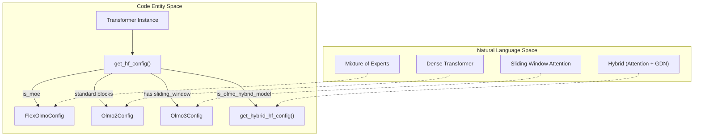
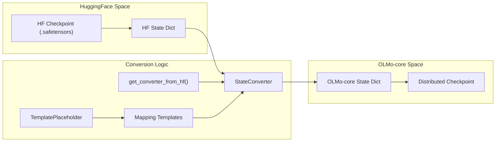

<!-- source: DeepWiki mcp.deepwiki.com · repo allenai/OLMo-core · page 2.9 HuggingFace Integration · fetched 2026-10-26 -->

# HuggingFace Integration

Relevant source files

The following files were used as context for generating this wiki page:

- [docs/source/nn/hf.rst](docs/source/nn/hf.rst)
- [src/examples/huggingface/convert_checkpoint_from_hf.py](src/examples/huggingface/convert_checkpoint_from_hf.py)
- [src/examples/huggingface/convert_checkpoint_to_hf.py](src/examples/huggingface/convert_checkpoint_to_hf.py)
- [src/examples/llama_lns/train.py](src/examples/llama_lns/train.py)
- [src/olmo_core/nn/conversion/state_converter.py](src/olmo_core/nn/conversion/state_converter.py)
- [src/olmo_core/nn/conversion/state_mapping.py](src/olmo_core/nn/conversion/state_mapping.py)
- [src/olmo_core/nn/hf/__init__.py](src/olmo_core/nn/hf/__init__.py)
- [src/olmo_core/nn/hf/checkpoint.py](src/olmo_core/nn/hf/checkpoint.py)
- [src/olmo_core/nn/hf/config.py](src/olmo_core/nn/hf/config.py)
- [src/olmo_core/nn/hf/convert.py](src/olmo_core/nn/hf/convert.py)
- [src/olmo_core/nn/hf/convert_checkpoint.py](src/olmo_core/nn/hf/convert_checkpoint.py)
- [src/olmo_core/train/callbacks/hf_converter.py](src/olmo_core/train/callbacks/hf_converter.py)
- [src/scripts/beaker/launch_test.py](src/scripts/beaker/launch_test.py)
- [src/scripts/train/OLMoE2-medium.py](src/scripts/train/OLMoE2-medium.py)
- [src/scripts/train/sft/README.md](src/scripts/train/sft/README.md)
- [src/test/examples/huggingface/convert_checkpoint_from_hf_test.py](src/test/examples/huggingface/convert_checkpoint_from_hf_test.py)
- [src/test/examples/huggingface/convert_checkpoint_to_hf_hybrid_test.py](src/test/examples/huggingface/convert_checkpoint_to_hf_hybrid_test.py)
- [src/test/examples/huggingface/convert_checkpoint_to_hf_test.py](src/test/examples/huggingface/convert_checkpoint_to_hf_test.py)
- [src/test/generate/generation_module/transformer/generation_module_test.py](src/test/generate/generation_module/transformer/generation_module_test.py)
- [src/test/nn/hf/config_test.py](src/test/nn/hf/config_test.py)
- [src/test/nn/transformer/config_test.py](src/test/nn/transformer/config_test.py)
- [src/test/train/callbacks/hf_converter_test.py](src/test/train/callbacks/hf_converter_test.py)

The `olmo_core.nn.hf` module provides the necessary utilities to bridge the gap between OLMo-core's high-performance training format and the HuggingFace (HF) Transformers ecosystem. This integration supports bidirectional conversion of model configurations and weights, enabling users to fine-tune HF models in OLMo-core or export trained models for deployment via the `transformers` library.

## Overview

The integration handles three primary tasks:
1.  **Configuration Mapping**: Translating `TransformerConfig` objects to `PretrainedConfig` subclasses (e.g., `Olmo2Config`, `Olmo3Config`, `FlexOlmoConfig`).
2.  **State Dict Conversion**: Mapping internal OLMo-core parameter names (e.g., `blocks.0.attention.w_q.weight`) to HF-standard names (e.g., `model.layers.0.self_attn.q_proj.weight`).
3.  **Checkpoint Loading/Saving**: Handling distributed `DTensor` sharding and un-sharding during the conversion process.

### Supported Model Types
*   **OLMo2**: Standard dense transformer models [src/olmo_core/nn/hf/config.py:35-57]().
*   **OLMo3**: Models utilizing sliding window attention (SWA) patterns [src/olmo_core/nn/hf/config.py:59-83]().
*   **FlexOlmo**: Mixture-of-Experts (MoE) architectures [src/olmo_core/nn/hf/config.py:126-155]().
*   **Hybrid Models**: Architectures combining Attention with recurrent layers like GatedDeltaNet (GDN) [src/olmo_core/nn/hf/config.py:157-180]().

Sources: `src/olmo_core/nn/hf/config.py:35-180`(), `src/olmo_core/nn/hf/convert.py:30-94`(), `src/examples/huggingface/convert_checkpoint_to_hf.py:1-15`()

---

## Configuration Mapping

OLMo-core uses a factory-based configuration system, while HuggingFace uses static `Config` classes. The `get_hf_config` function inspects the `Transformer` instance to determine the appropriate HF architecture.

### Logic Flow: OLMo-core to HF Config
The system automatically detects the model family based on the block types and attention mechanisms present in the model.

Title: Model Architecture to HF Config Mapping

Sources: `src/olmo_core/nn/hf/config.py:87-180`(), `src/olmo_core/nn/hf/config.py:35-83`(), `src/olmo_core/nn/hf/config.py:182-205`()

---

## State Dict Conversion

Weight conversion is managed by the `StateConverter` and defined via mapping templates. These templates use placeholders like `{LAYER}` and `{EXPERT}` to handle variable model depths and MoE routing.

### Mapping Constants
The core mappings are defined in `olmo_core.nn.hf.convert`:
*   `HF_TO_OLMO_CORE_WEIGHT_MAPPINGS`: One-to-one parameter name mappings [src/olmo_core/nn/hf/convert.py:30-54]().
*   `HF_TO_OLMO_CORE_MODULE_MAPPINGS`: One-to-one module name mappings [src/olmo_core/nn/hf/convert.py:65-94]().
*   `MODEL_TYPE_SPECIFIC_HF_TO_OLMO_CORE_WEIGHT_MAPPINGS`: Architecture-specific overrides (e.g., for Llama's specific layer norm naming) [src/olmo_core/nn/hf/convert.py:101-113]().

### Data Flow: Checkpoint Conversion
Title: State Dict Transformation Pipeline

Sources: `src/olmo_core/nn/hf/checkpoint.py:111-128`(), `src/olmo_core/nn/hf/convert.py:22-54`(), `src/examples/huggingface/convert_checkpoint_from_hf.py:110-122`(), `src/olmo_core/nn/conversion/state_mapping.py:10-25`()

---

## Key Functions and Implementation

### Checkpoint Loading
The `load_hf_model` function allows initializing an OLMo-core model from an HF Hub ID or local HF directory. It handles the download (using `AutoModelForCausalLM`), weight resizing for vocab mismatches, and the translation into the internal state dict format.

*   **File Handling**: Supports remote URLs and local paths [src/olmo_core/nn/hf/checkpoint.py:73-99]().
*   **Distributed Support**: Uses `barrier` and `get_fs_local_rank` to ensure only one process per node downloads weights [src/olmo_core/nn/hf/checkpoint.py:101-105]().
*   **DTensor Integration**: If the target state dict contains `DTensor`s, the converted weights are automatically distributed across the `device_mesh` using `distribute_tensor` [src/olmo_core/nn/hf/checkpoint.py:120-127]().

### Checkpoint Saving
The `save_hf_model` function performs the inverse operation. It gathers sharded parameters using `get_full_tensor` before converting them to the HF format.

*   **Hybrid Models**: For models with non-standard layers (like GDN), `save_hf_hybrid_model` is used to save raw `config.json` and `model.safetensors` when `save_pretrained()` is not applicable [src/olmo_core/nn/hf/checkpoint.py:186-218]().
*   **Contiguity**: HF's `save_pretrained` requires contiguous tensors; the converter ensures this before hand-off [src/olmo_core/nn/hf/checkpoint.py:171-172]().

### HFConverterCallback
During training, the `HFConverterCallback` can be used to automatically export checkpoints to HuggingFace format at specified intervals. This callback wraps `convert_checkpoint_to_hf` and is triggered during the `post_checkpoint_save` lifecycle hook.

Sources: `src/olmo_core/nn/hf/checkpoint.py:44-132`(), `src/olmo_core/nn/hf/checkpoint.py:134-184`(), `src/olmo_core/train/callbacks/hf_converter.py:21-45`()

---

## Practical Usage

OLMo-core provides example scripts for bulk conversion, which are often used at the end of a training run or before starting Supervised Fine-Tuning (SFT).

### Conversion Examples
| Script | Purpose | Key Arguments |
| :--- | :--- | :--- |
| `convert_checkpoint_to_hf.py` | Export for deployment | `-i` (input), `-o` (output), `--max-sequence-length` [src/examples/huggingface/convert_checkpoint_to_hf.py:31-46]() |
| `convert_checkpoint_from_hf.py` | Import for fine-tuning | `hf_checkpoint_path`, `output_path`, `transformer_config_dict` [src/examples/huggingface/convert_checkpoint_from_hf.py:110-122]() |

### SFT Workflow
As documented in the SFT README, the typical workflow involves:
1. Training a model in OLMo-core.
2. Converting the final `model_and_optim` checkpoint to HF format using `convert_checkpoint_to_hf.py` [src/scripts/train/sft/README.md:125-128]().
3. Running downstream evaluations using standard HF-compatible tools.

Sources: `src/examples/huggingface/convert_checkpoint_to_hf.py:51-66`(), `src/scripts/train/sft/README.md:116-129`()

---

