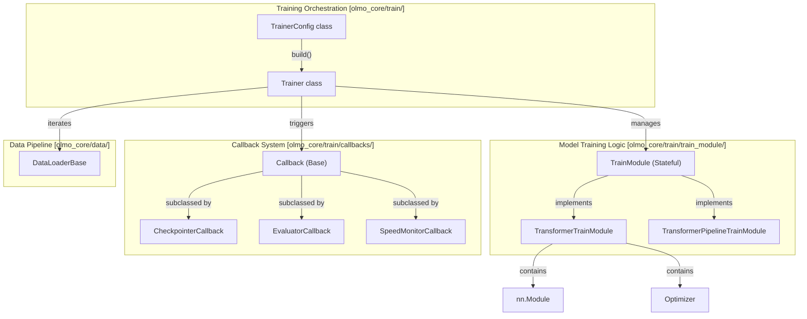
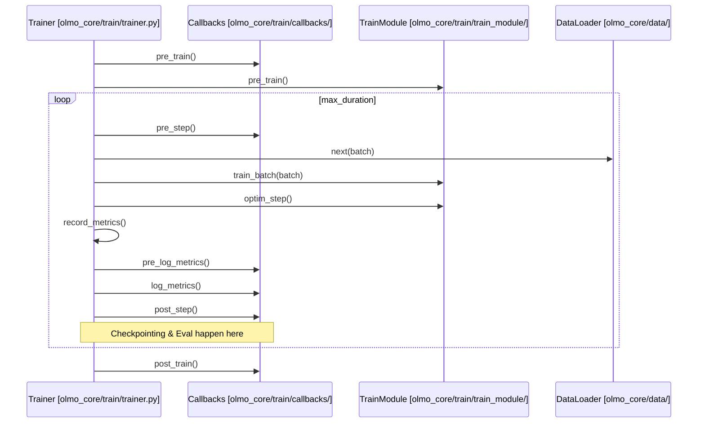

<!-- source: DeepWiki mcp.deepwiki.com · repo allenai/OLMo-core · page 3 Training System · fetched 2026-10-26 -->

# Training System

Relevant source files

The following files were used as context for generating this wiki page:

- [.github/workflows/pr_checks.yml](.github/workflows/pr_checks.yml)
- [CHANGELOG.md](CHANGELOG.md)
- [src/olmo_core/train/callbacks/__init__.py](src/olmo_core/train/callbacks/__init__.py)
- [src/olmo_core/train/callbacks/checkpointer.py](src/olmo_core/train/callbacks/checkpointer.py)
- [src/olmo_core/train/config.py](src/olmo_core/train/config.py)
- [src/olmo_core/train/trainer.py](src/olmo_core/train/trainer.py)
- [src/olmo_core/version.py](src/olmo_core/version.py)
- [src/test/conftest.py](src/test/conftest.py)

This document covers the core training orchestration system in OLMo-core v2.0.0+, including the `Trainer`-`TrainModule` pattern, the extensible callback architecture, and training lifecycle management. The training system coordinates model training, optimization, checkpointing, and monitoring across distributed environments.

## Architecture Overview

The OLMo-core training system follows a modular architecture centered around the `TrainModule` abstraction. This design separates training orchestration (`Trainer`) from model-specific training logic (`TrainModule`), enabling flexible experimentation and reusable components.

### Core Training Architecture

Sources: [src/olmo_core/train/trainer.py:100-157](), [src/olmo_core/train/config.py:26-54](), [src/olmo_core/train/callbacks/__init__.py:1-61]()

### Training System Components

| Component | Purpose | Key Entities |
|-----------|---------|-------------|
| **Trainer** | Orchestrates the training loop, manages callbacks, and handles metric reduction. | `Trainer` [src/olmo_core/train/trainer.py:100-168](), `TrainerConfig` [src/olmo_core/train/config.py:26-54]() |
| **TrainModule** | Encapsulates the model, optimizer, and the logic for `train_batch` and `optim_step`. | `TrainModule` [src/olmo_core/train/trainer.py:119-122](), `TransformerTrainModule` |
| **Callbacks** | Extensible hooks for monitoring, evaluation, and checkpointing. | `Callback` [src/olmo_core/train/callbacks/__init__.py:7-7](), `CheckpointerCallback` [src/olmo_core/train/callbacks/checkpointer.py:50-59]() |
| **Checkpointer** | Handles the low-level saving/loading of distributed state dicts. | `Checkpointer` [src/olmo_core/train/trainer.py:145-151]() |

## Trainer

The `Trainer` class is the central orchestrator. It is typically constructed using `TrainerConfig.build()` [src/olmo_core/train/config.py:142-157](). It maintains the `global_step`, `epoch`, and `global_train_tokens_seen` [src/olmo_core/train/trainer.py:226-245]().

### Trainer Responsibilities
- **Lifecycle Management**: The `fit()` method executes the main training loop, triggering callback hooks like `pre_train`, `pre_step`, and `post_step`.
- **Metric Collection**: Metrics are collected and reduced across ranks at intervals defined by `metrics_collect_interval` [src/olmo_core/train/trainer.py:200-217]().
- **Checkpointing Coordination**: Uses a `Checkpointer` to persist `TrainModule` and `Trainer` state [src/olmo_core/train/trainer.py:145-151]().

For details, see [Trainer](#3.1).

## TrainModule Abstraction

The `TrainModule` interface consolidates model and optimizer logic. This allows the `Trainer` to remain agnostic to specific training paradigms, such as standard FSDP or Pipeline Parallelism [src/olmo_core/train/trainer.py:119-122]().

### Key Features
- **Consolidated State**: Returns the combined state of the model and optimizer for checkpointing.
- **Unified Training Logic**: Provides standardized hooks for batch processing and optimization steps.
- **v2.5.0 Additions**: Support for `TrainModuleConfig` and specific implementations for hybrid architectures [CHANGELOG.md:35-35]().

For details, see [TrainModule Abstraction](#3.2).

## Callback System

The callback system provides a way to inject logic into the training loop without modifying the `Trainer` itself. Callbacks are ordered by `priority` [src/olmo_core/train/callbacks/checkpointer.py:61-61]().

### Common Callbacks
- **Monitoring**: `SpeedMonitorCallback` tracks throughput (TPS/BPS) and MFU [src/olmo_core/train/callbacks/__init__.py:28-28](). `StabilityMonitorCallback` detects training spikes [CHANGELOG.md:55-55]().
- **Evaluation**: `EvaluatorCallback` runs in-loop evaluations [src/olmo_core/train/callbacks/evaluator_callback.py:12-16](). v2.5.0 added `eval_on_finish` and `fixed_steps` options [CHANGELOG.md:64-64]().
- **Checkpointing**: `CheckpointerCallback` manages permanent and ephemeral checkpoints [src/olmo_core/train/callbacks/checkpointer.py:50-68]().

For details, see [Callback System](#3.3), [Monitoring Callbacks](#3.4), and [Evaluation Callbacks](#3.5).

## Checkpointing and Scheduling

The training system provides robust support for long-running experiments:
- **Checkpointing**: Supports asynchronous saving and automatic removal of ephemeral checkpoints. v2.5.0 introduced an `ephemeral` flag in metadata [CHANGELOG.md:67-68]().
- **Schedules**: Callbacks like `BatchSizeSchedulerCallback` and `SequenceLengthSchedulerCallback` allow for dynamic adjustments [src/olmo_core/train/callbacks/__init__.py:5-26]().
- **Weight Averaging**: `ModelMergeCallback` allows for merging model weights during or after training [src/olmo_core/train/callbacks/__init__.py:23-23]().

For details, see [Checkpointing System](#3.6) and [Training Schedule Callbacks](#3.7).

## Training Lifecycle Flow

Sources: [src/olmo_core/train/trainer.py:540-620](), [CHANGELOG.md:51-51](), [src/olmo_core/train/callbacks/checkpointer.py:199-201]()

---

