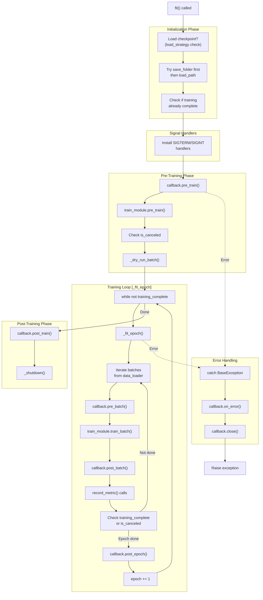

<!-- source: DeepWiki mcp.deepwiki.com · repo allenai/OLMo-core · page 3.1 Trainer · fetched 2026-10-26 -->

# Trainer

<details>
<summary>Relevant source files</summary>

The following files were used as context for generating this wiki page:

- [.github/workflows/pr_checks.yml](.github/workflows/pr_checks.yml)
- [CHANGELOG.md](CHANGELOG.md)
- [src/olmo_core/train/callbacks/__init__.py](src/olmo_core/train/callbacks/__init__.py)
- [src/olmo_core/train/callbacks/checkpointer.py](src/olmo_core/train/callbacks/checkpointer.py)
- [src/olmo_core/train/config.py](src/olmo_core/train/config.py)
- [src/olmo_core/train/trainer.py](src/olmo_core/train/trainer.py)
- [src/olmo_core/version.py](src/olmo_core/version.py)
- [src/test/conftest.py](src/test/conftest.py)

</details>


The `Trainer` class ([src/olmo_core/train/trainer.py:100-1476]()) is the central orchestrator for training language models in OLMo-core. It manages the main training loop, coordinates callbacks, handles checkpointing, tracks metrics, and manages distributed training state.

**Purpose**: This page documents the `Trainer` class architecture, its configuration via `TrainerConfig`, the training loop lifecycle, state management, and metric recording. For information about the model and optimizer encapsulation, see [TrainModule Abstraction](#3.2). For extensibility through callbacks, see [Callback System](#3.3).

---

## Configuration and Construction

The recommended way to construct a `Trainer` is through `TrainerConfig` ([src/olmo_core/train/config.py:26-202]()), which provides a declarative interface for specifying training parameters.

### TrainerConfig Fields

| Field Category | Key Fields | Description |
|----------------|-----------|-------------|
| **Checkpointing** | `save_folder`, `load_path`, `checkpointer` | Where to save/load checkpoints |
| **Training Duration** | `max_duration`, `hard_stop` | How long to train (steps/epochs/tokens) |
| **Loading Strategy** | `load_strategy`, `load_optim_state`, `load_trainer_state` | Checkpoint loading behavior |
| **Monitoring** | `metrics_collect_interval`, `cancel_check_interval` | Frequency of metric collection and cancellation checks |
| **Callbacks** | `callbacks` | Dictionary of named callbacks to extend behavior |
| **Performance** | `async_bookkeeping`, `bookkeeping_soft_timeout` | Async operations configuration |
| **Debugging** | `no_checkpoints`, `no_evals`, `steps_to_skip` | Benchmarking and debugging flags |

### Building a Trainer

```python
# Example construction pattern
trainer = TrainerConfig(
    save_folder="/path/to/checkpoints",
    max_duration=Duration.steps(100_000),
    callbacks={
        "wandb": WandBCallback(...),
        "checkpointer": CheckpointerCallback(...)
    }
).build(
    train_module=train_module,  # TrainModule instance
    data_loader=data_loader      # DataLoaderBase instance
)
```

The `build()` method ([src/olmo_core/train/config.py:142-201]()) performs the following:
1. Extracts configuration fields [src/olmo_core/train/config.py:158]().
2. Resolves `work_dir` (defaults to `save_folder` if local, otherwise a temp directory) [src/olmo_core/train/config.py:166-175]().
3. Builds the `Checkpointer` from `CheckpointerConfig` [src/olmo_core/train/config.py:176-183]().
4. Separates callback instances from `CallbackConfig` objects [src/olmo_core/train/config.py:185-189]().
5. Constructs the `Trainer` instance [src/olmo_core/train/config.py:191-201]().

**Sources**: [src/olmo_core/train/config.py:26-202](), [src/olmo_core/train/trainer.py:100-380]()

---

## Trainer Architecture and Components

Title: Trainer System Components

```mermaid
graph TB
    subgraph "Trainer Core [olmo_core.train.trainer]"
        Trainer["Trainer"]
        WorkDir["work_dir: Path<br/>Local temp files"]
        SaveFolder["save_folder: str<br/>Checkpoint location"]
        Device["device: torch.device<br/>Main training device"]
    end
    
    subgraph "Training Components"
        TrainModule["train_module: TrainModule<br/>(train_module.py)"]
        DataLoader["data_loader: DataLoaderBase<br/>(data/data_loader.py)"]
        Checkpointer["checkpointer: Checkpointer<br/>(checkpoint.py)"]
    end
    
    subgraph "Callback System [olmo_core.train.callbacks]"
        Callbacks["callbacks: Dict[str, Callback]<br/>Sorted by priority"]
        ConsoleLogger["ConsoleLoggerCallback"]
        CheckpointerCB["CheckpointerCallback"]
        SpeedMon["SpeedMonitorCallback"]
        GarbageCol["GarbageCollectorCallback"]
    end
    
    subgraph "State Tracking"
        GlobalStep["global_step: int<br/>Current step (1-based)"]
        GlobalTokens["global_train_tokens_seen: int<br/>Total tokens processed"]
        Epoch["epoch: int<br/>Current epoch (1-based)"]
        Metrics["_metrics: Dict[int, Dict]<br/>Per-step metrics buffer"]
    end
    
    subgraph "Process Groups [olmo_core.distributed]"
        DPGroup["dp_process_group<br/>Data parallel ranks"]
        BookkeepingPG["_bookkeeping_pg<br/>Async operations"]
    end
    
    Trainer --> WorkDir
    Trainer --> SaveFolder
    Trainer --> Device
    Trainer --> TrainModule
    Trainer --> DataLoader
    Trainer --> Checkpointer
    Trainer --> Callbacks
    Trainer --> GlobalStep
    Trainer --> GlobalTokens
    Trainer --> Epoch
    Trainer --> Metrics
    Trainer --> DPGroup
    Trainer --> BookkeepingPG
    
    Callbacks --> ConsoleLogger
    Callbacks --> CheckpointerCB
    Callbacks --> SpeedMon
    Callbacks --> GarbageCol
```


### Core Components

**TrainModule** ([src/olmo_core/train/trainer.py:119-122]()): Encapsulates the model and optimizer. The trainer delegates training batch execution to this component via `train_module.train_batch()`.

**DataLoader** ([src/olmo_core/train/trainer.py:124-127]()): Provides training batches. The trainer validates that the data loader's distributed configuration matches the training environment ([src/olmo_core/train/trainer.py:359-374]()).

**Checkpointer** ([src/olmo_core/train/trainer.py:145-151]()): Handles distributed checkpoint save/load operations. Wraps functionality from `olmo_core.distributed.checkpoint`.

**Callbacks** ([src/olmo_core/train/trainer.py:153-156]()): Extensible hooks into the training loop. The trainer ensures default callbacks are present ([src/olmo_core/train/trainer.py:321-332]()) and sorts them by priority ([src/olmo_core/train/trainer.py:338-342]()).

**Sources**: [src/olmo_core/train/trainer.py:100-380](), [src/olmo_core/train/config.py:142-201]()

---

## Training Loop Lifecycle

The `fit()` method ([src/olmo_core/train/trainer.py:628-726]()) orchestrates the entire training process.

Title: Training Lifecycle and fit() Data Flow


### Fit Method Flow

1. **Checkpoint Loading** ([src/olmo_core/train/trainer.py:637-669]()): 
   - Attempts to load from `save_folder` first (for resuming) [src/olmo_core/train/trainer.py:643]().
   - Falls back to `load_path` if provided [src/olmo_core/train/trainer.py:647]().
   - Respects `load_strategy` (never/if_available/always) [src/olmo_core/train/trainer.py:637]().

2. **Signal Installation** ([src/olmo_core/train/trainer.py:686-687]()): Installs handlers for SIGTERM and SIGINT to mark the run as canceled gracefully.

3. **Pre-Training Phase** ([src/olmo_core/train/trainer.py:690-702]()): 
   - Calls `callback.pre_train()` for each callback.
   - Calls `train_module.pre_train()`.
   - Runs a dry-run batch for compilation and OOM detection.

4. **Epoch Loop** ([src/olmo_core/train/trainer.py:705-706]()): Repeatedly calls `_fit_epoch()` until `training_complete` returns `True`.

5. **Post-Training Phase** ([src/olmo_core/train/trainer.py:720-725]()): 
   - Calls `callback.post_train()` for each callback.
   - Waits for bookkeeping operations via `_shutdown()`.

**Sources**: [src/olmo_core/train/trainer.py:628-739]()

---

## Training Epoch Implementation

The `_fit_epoch()` method ([src/olmo_core/train/trainer.py:1201-1343]()) implements a single epoch of training.

### Key Steps in _fit_epoch()

**Pre-epoch Hook** ([src/olmo_core/train/trainer.py:1204]()): Notifies all callbacks that a new epoch is starting.

**Batch Iteration** ([src/olmo_core/train/trainer.py:1206-1336]()): Iterates over batches from the data loader with these operations per batch:
- **Skip Check** ([src/olmo_core/train/trainer.py:1207-1210]()): Checks if the current step is in `steps_to_skip` ranges.
- **Pre-batch Hook** ([src/olmo_core/train/trainer.py:1213]()): Callbacks can inspect/modify the batch.
- **Train Batch** ([src/olmo_core/train/trainer.py:1215-1226]()): Delegates to `train_module.train_batch()` which performs forward pass, backward pass, and optimizer step.
- **Metric Recording** ([src/olmo_core/train/trainer.py:1229-1246]()): Records CE loss, perplexity, Z-loss (if present), and any custom metrics returned by the train module.
- **Post-batch Hook** ([src/olmo_core/train/trainer.py:1248]()): Callbacks can perform post-batch operations.
- **Evaluation** ([src/olmo_core/train/trainer.py:1251-1255]()): Calls `_eval_batch()` unless `no_evals=True`.
- **Completion Check** ([src/olmo_core/train/trainer.py:1257-1258]()): Exits if training is complete.

**Post-epoch Hook** ([src/olmo_core/train/trainer.py:1339]()): Notifies callbacks that the epoch is complete.

**Sources**: [src/olmo_core/train/trainer.py:1201-1343]()

---

## State Management and Checkpointing

The trainer manages three types of state: trainer state, model state (via TrainModule), and optimizer state (via TrainModule).

### State Dictionary Structure

The `state_dict()` method ([src/olmo_core/train/trainer.py:740-753]()) returns a `TrainerStateDict` ([src/olmo_core/train/trainer.py:87-96]()):

```python
class TrainerStateDict(TypedDict):
    global_step: int                      # Current step (1-based)
    global_train_tokens_seen: int         # Total tokens processed
    global_train_petaflops: float         # Total petaflops computed
    max_steps: Optional[int]              # Maximum steps for this run
    data_loader: Dict[str, Any]           # Data loader state
    epoch: int                            # Current epoch (1-based)
    world_size: int                       # Global world size
    rng: Dict[str, Any]                   # RNG states (Python, NumPy, PyTorch)
    callbacks: Dict[str, Dict[str, Any]]  # Per-callback state
```

### Checkpoint Loading

The `load_checkpoint()` method ([src/olmo_core/train/trainer.py:801-857]()) performs the following:

1. **Path Resolution** ([src/olmo_core/train/trainer.py:834-841]()): If the path is a directory (not a checkpoint), finds the latest checkpoint in it. This operation is done on rank 0 and scattered to avoid excessive client requests.
2. **Checkpointer.load()** ([src/olmo_core/train/trainer.py:843-849]()): Calls the checkpointer to load model, optimizer, and trainer state from the distributed checkpoint.
3. **State Restoration** ([src/olmo_core/train/trainer.py:850-851]()): Restores trainer state if present in the checkpoint.
4. **Callback Notification** ([src/olmo_core/train/trainer.py:853-854]()): Notifies all callbacks that a checkpoint was loaded.

**Sources**: [src/olmo_core/train/trainer.py:740-883](), [src/olmo_core/train/trainer.py:87-96]()

---

## Metric Recording and Logging

The trainer maintains a buffered metric recording system with async reduction and logging.

### record_metric() Method

The `record_metric()` method ([src/olmo_core/train/trainer.py:1019-1077]()) is the primary way to log metrics during training:

```python
def record_metric(
    self,
    name: str,
    value: Union[int, float, torch.Tensor],
    reduce_type: Optional[ReduceType] = None,
    namespace: Optional[str] = None,
)
```

**Behavior** ([src/olmo_core/train/trainer.py:1044-1077]()):
1. Converts value to a tensor.
2. Moves to `bookkeeping_device` (CPU if async bookkeeping is enabled) [src/olmo_core/train/trainer.py:1059]().
3. Stores in `_metrics[global_step][metric_name]` [src/olmo_core/train/trainer.py:1072]().
4. Triggers `_log_metrics()` every `metrics_collect_interval` steps [src/olmo_core/train/trainer.py:1076]().

### Built-in Metrics

The trainer automatically records these metrics during training:
- **TRAIN_CE_LOSS_METRIC** ([src/olmo_core/train/common.py:68]()): Cross-entropy loss.
- **TRAIN_PPL_METRIC** ([src/olmo_core/train/common.py:69]()): Perplexity (exp of CE loss).

**Sources**: [src/olmo_core/train/trainer.py:1019-1077](), [src/olmo_core/train/trainer.py:1382-1476](), [src/olmo_core/train/common.py:68-69]()

---

## Training Completion and Cancellation

### training_complete Property

The `training_complete` property ([src/olmo_core/train/trainer.py:398-417]()) determines when training should stop:

```python
@property
def training_complete(self) -> bool:
    # 1. Periodically check if canceled
    if (not self._canceled and 
        self.global_step > 0 and 
        self.global_step % self.cancel_check_interval == 0):
        self.check_if_canceled()
    
    # 2. Check cancellation or duration reached
    return self.is_canceled or self._duration_due(self.max_duration)
```

### Duration Tracking

The trainer supports tracking via the `Duration` class ([src/olmo_core/train/common.py:37-106]()):

| Unit | Description | Check Method |
|------|-------------|--------------|
| `DurationUnit.steps` | Number of training steps | Compare `global_step` to `duration.value` |
| `DurationUnit.tokens` | Number of tokens processed | Compare `global_train_tokens_seen` to `duration.value` |
| `DurationUnit.epochs` | Number of epochs | Compare `epoch` to `duration.value` |

**Sources**: [src/olmo_core/train/trainer.py:398-417](), [src/olmo_core/train/common.py:37-106]()

---

## Asynchronous Bookkeeping

The trainer supports running non-training operations asynchronously on a CPU-only backend to avoid blocking GPU training operations.

### Bookkeeping Operations

**run_bookkeeping_op()** ([src/olmo_core/train/trainer.py:971-1012]()): Submits a bookkeeping operation to run asynchronously.

**Key bookkeeping operations**:
- **Metric reduction** ([src/olmo_core/train/trainer.py:1433-1475]()): Reduces metrics across ranks and notifies callbacks.
- **Cancellation checks** ([src/olmo_core/train/trainer.py:1152-1191]()): Checks if any rank canceled the run.

### Requirements for Async Bookkeeping

Async bookkeeping requires ([src/olmo_core/train/trainer.py:348-357]()):
1. A separate CPU-only distributed backend (e.g., GLOO).
2. `async_bookkeeping=True` (defaults to `True` if CPU backend available).

**Sources**: [src/olmo_core/train/trainer.py:542-562](), [src/olmo_core/train/trainer.py:971-1012](), [src/olmo_core/train/trainer.py:348-357]()

---

