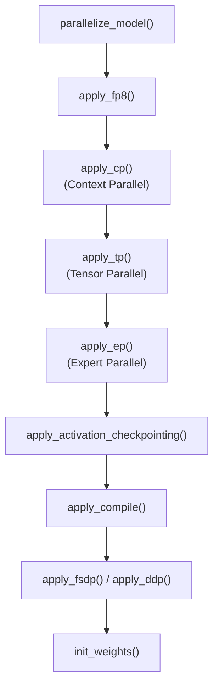

<!-- source: DeepWiki mcp.deepwiki.com · repo allenai/OLMo-core · page 3.2 TrainModule Abstraction · fetched 2026-10-26 -->

# TrainModule Abstraction

<details>
<summary>Relevant source files</summary>

The following files were used as context for generating this wiki page:

- [CHANGELOG.md](CHANGELOG.md)
- [src/olmo_core/train/train_module/__init__.py](src/olmo_core/train/train_module/__init__.py)
- [src/olmo_core/train/train_module/config.py](src/olmo_core/train/train_module/config.py)
- [src/olmo_core/train/train_module/train_module.py](src/olmo_core/train/train_module/train_module.py)
- [src/olmo_core/train/train_module/transformer/common.py](src/olmo_core/train/train_module/transformer/common.py)
- [src/olmo_core/train/train_module/transformer/config.py](src/olmo_core/train/train_module/transformer/config.py)
- [src/olmo_core/train/train_module/transformer/pipeline_train_module.py](src/olmo_core/train/train_module/transformer/pipeline_train_module.py)
- [src/olmo_core/train/train_module/transformer/train_module.py](src/olmo_core/train/train_module/transformer/train_module.py)
- [src/olmo_core/train/trainer.py](src/olmo_core/train/trainer.py)
- [src/olmo_core/version.py](src/olmo_core/version.py)
- [src/test/conftest.py](src/test/conftest.py)

</details>


## Purpose and Scope

This page documents the `TrainModule` abstraction introduced in OLMo-core v2.0.0, which encapsulates both model and optimizer logic into a single cohesive component. The `TrainModule` interface defines how models are trained, optimized, and managed throughout the training lifecycle. This consolidation simplifies the training API and enables better control over model-specific training logic, such as gradient clipping, loss computation, and distributed parallelism application.

**Sources:** [src/olmo_core/train/train_module/train_module.py:73-85](), [src/olmo_core/train/train_module/__init__.py:1-42]()

## Overview and Motivation

The `TrainModule` abstraction serves as a bridge between the high-level `Trainer` and the low-level `nn.Module` and `Optimizer` entities. It centralizes training-specific logic that was previously scattered across multiple callbacks.

**Key Responsibilities:**
- **Encapsulation**: Combines the model and optimizer into a single unit [src/olmo_core/train/train_module/train_module.py:75-77]().
- **Standardized Execution**: Provides a unified API for `train_batch()`, `eval_batch()`, and `optim_step()` [src/olmo_core/train/train_module/train_module.py:169-187]().
- **State Management**: Implements the `Stateful` protocol for distributed checkpointing of both model weights and optimizer states [src/olmo_core/train/train_module/train_module.py:73-73]().
- **Parallelism Orchestration**: Handles the complex ordering of applying FSDP, Tensor Parallelism (TP), Context Parallelism (CP), and Activation Checkpointing (AC) [src/olmo_core/train/train_module/transformer/common.py:34-49]().

**Sources:** [src/olmo_core/train/train_module/train_module.py:73-195](), [src/olmo_core/train/train_module/transformer/common.py:34-156]()

## Architecture Overview

The following diagram maps the Natural Language concepts of the training system to the specific Code Entities in OLMo-core.

```mermaid
graph TB
    subgraph "Natural Language Space"
        ConceptConfig["Configuration"]
        ConceptInterface["Training Interface"]
        ConceptStandard["Standard Training"]
        ConceptPipeline["Pipeline Parallel Training"]
    end

    subgraph "Code Entity Space"
        TMConfig["TrainModuleConfig<br/>(Abstract Base)"]
        TM["TrainModule<br/>(Stateful Interface)"]
        
        TransTM["TransformerTrainModule"]
        TransConfig["TransformerTrainModuleConfig"]
        
        PipeTM["TransformerPipelineTrainModule"]
        PipeConfig["TransformerPipelineTrainModuleConfig"]
        
        TMConfig -.->|"builds"| TM
        TransConfig -->|"builds"| TransTM
        PipeConfig -->|"builds"| PipeTM
        
        TransTM --|> TM
        PipeTM --|> TM
    end
    
    ConceptConfig --- TMConfig
    ConceptInterface --- TM
    ConceptStandard --- TransTM
    ConceptPipeline --- PipeTM
```

**Diagram: Mapping Concepts to Code Entities**

**Sources:** [src/olmo_core/train/train_module/train_module.py:73-73](), [src/olmo_core/train/train_module/transformer/train_module.py:65-65](), [src/olmo_core/train/train_module/transformer/pipeline_train_module.py:68-68](), [src/olmo_core/train/train_module/config.py:11-16]()

## TrainModule Interface

The `TrainModule` abstract base class defines the contract for training components. It inherits from `torch.distributed.checkpoint.stateful.Stateful` to facilitate distributed saving and loading [src/olmo_core/train/train_module/train_module.py:73-73]().

### Core Abstract Methods

| Method | Purpose | Implementation Detail |
|--------|---------|-----------------------|
| `train_batch()` | Forward + backward pass | Responsible for recording metrics via `record_metric()` [src/olmo_core/train/train_module/train_module.py:169-173](). |
| `eval_batch()` | Forward pass only | Used by `EvaluatorCallback` for in-loop metrics [src/olmo_core/train/train_module/train_module.py:176-180](). |
| `optim_step()` | Step optimizer/scheduler | Executes the actual parameter updates [src/olmo_core/train/train_module/train_module.py:183-187](). |
| `zero_grads()` | Clear gradients | Prepares model for next microbatch/step [src/olmo_core/train/train_module/train_module.py:190-194](). |
| `state_dict()` | Export state | Consolidates model and optimizer into one dict [src/olmo_core/train/train_module/train_module.py:131-138](). |

### Evaluation Specification
Each `TrainModule` must provide an `EvalBatchSpec` which tells the data loaders how to size batches for evaluation (e.g., by token count or instance count) [src/olmo_core/train/train_module/train_module.py:43-64]().

**Sources:** [src/olmo_core/train/train_module/train_module.py:27-71](), [src/olmo_core/train/train_module/train_module.py:131-211]()

## TransformerTrainModule

`TransformerTrainModule` is the standard implementation for training `Transformer` models. It manages the lifecycle of the model from initialization to optimization.

### Parallelism and Initialization Flow
The module uses `parallelize_model` to apply distributed strategies in a strict order to ensure compatibility [src/olmo_core/train/train_module/transformer/common.py:34-49]().



**Diagram: Internal Initialization Sequence in parallelize_model**

**Sources:** [src/olmo_core/train/train_module/transformer/common.py:59-156](), [src/olmo_core/train/train_module/transformer/train_module.py:162-175]()

### Key Features
- **Microbatching**: Handles `rank_microbatch_size` and ensures it is divisible by `max_sequence_length` [src/olmo_core/train/train_module/transformer/train_module.py:128-132]().
- **Loss Computation**: Integrates `z_loss_multiplier` and `label_ignore_index` for standard LM training [src/olmo_core/train/train_module/transformer/train_module.py:115-124]().
- **State Dict Overrides**: Allows mapping keys via `load_key_mapping` to support loading checkpoints with different parameter names [src/olmo_core/train/train_module/transformer/train_module.py:98-100]().

**Sources:** [src/olmo_core/train/train_module/transformer/train_module.py:102-124]()

## TransformerPipelineTrainModule

The `TransformerPipelineTrainModule` provides a specialized implementation for Pipeline Parallelism (PP). It splits the model into stages and manages a `PipelineSchedule` [src/olmo_core/train/train_module/transformer/pipeline_train_module.py:68-104]().

### Model Splitting
The module uses `TransformerPipelineParallelConfig` to determine `split_points`. If not provided, it automatically calculates splits based on the number of layers and the PP degree [src/olmo_core/train/train_module/transformer/config.py:61-90]().

1. **Stage Construction**: `split_model` creates deep copies of the base model but removes layers not belonging to the specific rank's assigned stage [src/olmo_core/train/train_module/transformer/config.py:92-129]().
2. **Rank Assignment**: Each rank builds the stages it is responsible for based on its position in the `pp_mesh` [src/olmo_core/train/train_module/transformer/config.py:136-151]().

### Pipeline Execution
Unlike the standard module, `train_batch` in the pipeline module delegates execution to a `PipelineSchedule` (e.g., 1F1B or GPipe), which handles the interleaved forward and backward passes across microbatches [src/olmo_core/train/train_module/transformer/pipeline_train_module.py:150-158]().

**Sources:** [src/olmo_core/train/train_module/transformer/pipeline_train_module.py:141-165](), [src/olmo_core/train/train_module/transformer/config.py:45-153]()

## State Dictionary Management

The `TrainModule` provides advanced state dict handling to support topology-agnostic loading and pruning.

- **Pruning**: `prune_state_dict` is used to remove optimizer state when only model weights are needed [src/olmo_core/train/train_module/transformer/train_module.py:22-22]().
- **Merging**: `merge_state_dicts` combines model and optimizer states into a single structure for the `Stateful` checkpointing API [src/olmo_core/train/train_module/transformer/train_module.py:21-21]().
- **Metadata Awareness**: `state_dict_to_load` uses `Metadata` to prepare the correct sharded tensor structures before the actual data is streamed from storage [src/olmo_core/train/train_module/train_module.py:149-159]().

**Sources:** [src/olmo_core/train/train_module/train_module.py:131-166](), [src/olmo_core/train/train_module/transformer/train_module.py:20-24]()

---

