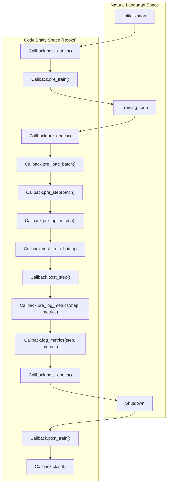
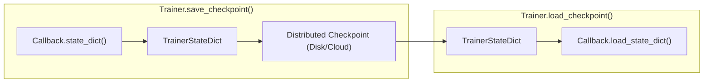

<!-- source: DeepWiki mcp.deepwiki.com · repo allenai/OLMo-core · page 3.3 Callback System · fetched 2026-10-26 -->

# Callback System

Relevant source files

The following files were used as context for generating this wiki page:

- [.github/workflows/pr_checks.yml](.github/workflows/pr_checks.yml)
- [src/integration_tests/__init__.py](src/integration_tests/__init__.py)
- [src/integration_tests/test_train_small_model.py](src/integration_tests/test_train_small_model.py)
- [src/olmo_core/train/callbacks/__init__.py](src/olmo_core/train/callbacks/__init__.py)
- [src/olmo_core/train/callbacks/callback.py](src/olmo_core/train/callbacks/callback.py)
- [src/olmo_core/train/callbacks/checkpointer.py](src/olmo_core/train/callbacks/checkpointer.py)
- [src/olmo_core/train/callbacks/config_saver.py](src/olmo_core/train/callbacks/config_saver.py)
- [src/olmo_core/train/callbacks/garbage_collector.py](src/olmo_core/train/callbacks/garbage_collector.py)
- [src/olmo_core/train/callbacks/model_merger.py](src/olmo_core/train/callbacks/model_merger.py)
- [src/olmo_core/train/config.py](src/olmo_core/train/config.py)
- [src/scripts/train/ladder/olmo3_model_merging_ladder.py](src/scripts/train/ladder/olmo3_model_merging_ladder.py)
- [src/test/train/callbacks/model_merger_test.py](src/test/train/callbacks/model_merger_test.py)

## Purpose and Scope

The callback system in OLMo-core provides extensibility hooks throughout the training lifecycle, allowing custom behavior to be injected at specific points without modifying the core training loop. Callbacks enable features such as logging, checkpointing, evaluation, and monitoring to be implemented as modular, composable components.

This system was significantly refactored in v2.0.0 to support the `TrainModule` abstraction and more robust state management.

**Sources:** [src/olmo_core/train/trainer.py:50-57](), [src/olmo_core/train/trainer.py:145-148]()

---

## Callback Base Class

All callbacks inherit from the `Callback` base class [src/olmo_core/train/callbacks/callback.py:14-22](), which implements the `Stateful` interface from PyTorch Distributed Checkpoint [src/olmo_core/train/callbacks/callback.py:15-15]().

### Registration and Attachment

Callbacks are typically defined via `TrainerConfig` [src/olmo_core/train/config.py:49-49](). When the `Trainer` is built, it receives a dictionary of callbacks [src/olmo_core/train/trainer.py:145-148]().

The trainer assigns itself to each callback via the `trainer` setter [src/olmo_core/train/callbacks/callback.py:39-41](). After attachment, the `post_attach()` hook is triggered [src/olmo_core/train/callbacks/callback.py:71-75]().

### Priority and Execution Order

Execution order is determined by the `priority` class variable [src/olmo_core/train/callbacks/callback.py:24-28](). Higher values execute earlier.

| Callback Type | Default Priority | Purpose |
| :--- | :--- | :--- |
| `ModelMergeCallback` | 2 | Must run before checkpointer to block ephemeral saves during merge windows [src/olmo_core/train/callbacks/model_merger.py:37-37]() |
| `CheckpointerCallback` | 1 | Ensures checkpoints are saved before other post-step logic [src/olmo_core/train/callbacks/checkpointer.py:61-61]() |
| Base `Callback` | 0 | Default for monitors and loggers [src/olmo_core/train/callbacks/callback.py:24-24]() |

The trainer sorts callbacks using `(priority, -registration_index)` to ensure deterministic behavior across ranks [src/olmo_core/train/trainer.py:348-352]().

**Sources:** [src/olmo_core/train/trainer.py:348-352](), [src/olmo_core/train/callbacks/callback.py:24-28]()

---

## Lifecycle Hooks

The following diagram maps the training phases to the specific hooks triggered in `Trainer.fit()`.

### Training Lifecycle Flow

**Sources:** [src/olmo_core/train/callbacks/callback.py:71-171]()

### Hook Reference Table

| Hook | Description |
| :--- | :--- |
| `pre_train` | Runs before the loop starts, after checkpoint loading [src/olmo_core/train/callbacks/callback.py:85-89](). |
| `pre_step` | Receives the raw `batch` dictionary before the forward pass [src/olmo_core/train/callbacks/callback.py:103-108](). |
| `pre_optim_step` | Called after backward pass but before `optimizer.step()` [src/olmo_core/train/callbacks/callback.py:109-113](). |
| `post_step` | Primary hook for checkpointing and evaluation triggers [src/olmo_core/train/callbacks/callback.py:121-125](). |
| `pre_log_metrics` | Allows in-place modification of metrics before they are logged [src/olmo_core/train/callbacks/callback.py:135-141](). |
| `log_metrics` | Receives reduced metrics for a specific step [src/olmo_core/train/callbacks/callback.py:143-147](). |
| `on_error` | Triggered if an exception occurs during `Trainer.fit()` [src/olmo_core/train/callbacks/callback.py:161-165](). |

---

## State Management and Persistence

Callbacks are `Stateful` objects. Their state is captured in the trainer's checkpoint via `state_dict()` and restored via `load_state_dict()`.

### Callback State Flow

**Sources:** [src/olmo_core/train/trainer.py:779-793](), [src/olmo_core/train/callbacks/callback.py:47-58]()

---

## Available Callbacks Catalog

OLMo-core includes a comprehensive set of built-in callbacks:

### Monitoring & Logging
- `ConsoleLoggerCallback`: Standard output logging of metrics.
- `SpeedMonitorCallback`: Calculates TPS, MFU, and throughput [src/olmo_core/train/callbacks/__init__.py:28-28]().
- `GPUMemoryMonitorCallback`: Tracks allocated and reserved CUDA memory [src/olmo_core/train/callbacks/__init__.py:19-19]().
- `WandBCallback` / `CometCallback`: Integration with experiment tracking platforms [src/olmo_core/train/callbacks/__init__.py:9-30]().
- `GAPMonitorCallback`: Tracks Gradients, Activations, and Parameters statistics [src/olmo_core/train/callbacks/__init__.py:17-17]().
- `StabilityMonitorCallback`: Monitors training stability and detects spikes [src/olmo_core/train/callbacks/__init__.py:29-29]().

### Checkpointing & Maintenance
- `CheckpointerCallback`: Manages periodic permanent and ephemeral checkpoints [src/olmo_core/train/callbacks/checkpointer.py:50-59]().
- `GarbageCollectorCallback`: Disables automatic GC and runs it on a schedule to prevent synchronization pauses [src/olmo_core/train/callbacks/garbage_collector.py:13-22]().
- `ModelMergeCallback`: Implements weight averaging over a window of steps (e.g., for pre-decay checkpoints) [src/olmo_core/train/callbacks/model_merger.py:21-34]().
- `ConfigSaverCallback`: Saves the experiment configuration to every checkpoint directory [src/olmo_core/train/callbacks/config_saver.py:21-29]().

### Evaluation & Conversion
- `EvaluatorCallback`: Base for in-loop evaluation [src/olmo_core/train/callbacks/evaluator_callback.py:14-14]().
- `LMEvaluatorCallbackConfig`: Configures perplexity calculation on validation sets [src/olmo_core/train/config.py:128-139]().
- `DownstreamEvaluatorCallbackConfig`: Configures `olmo-eval` integration for zero-shot tasks [src/olmo_core/train/config.py:119-126]().
- `HFConverterCallback`: Handles conversion of checkpoints to HuggingFace format during training [src/olmo_core/train/callbacks/__init__.py:20-20]().

### Utilities
- `MonkeyPatcherCallback`: Allows runtime patching of model or trainer components [src/olmo_core/train/callbacks/__init__.py:24-24]().
- `BeakerCallback`: Integration for running on the AI2 Beaker platform [src/olmo_core/train/callbacks/__init__.py:6-6]().

**Sources:** [src/olmo_core/train/callbacks/__init__.py:5-61](), [src/olmo_core/train/config.py:92-140]()

---

## Advanced Feature: Ephemeral Checkpoint Blocking

Callbacks can block the removal of ephemeral checkpoints. This is critical for operations that span multiple steps and require a consistent starting point if the job is preempted.

- `block_ephemeral_checkpoints()`: Registers the callback as blocking ephemeral saves [src/olmo_core/train/callbacks/callback.py:59-63]().
- `unblock_ephemeral_checkpoints()`: Unregisters the block [src/olmo_core/train/callbacks/callback.py:65-69]().

This is notably used by `ModelMergeCallback` to ensure the full weight accumulation window is re-accumulated on resume [src/olmo_core/train/callbacks/model_merger.py:26-28]().

**Sources:** [src/olmo_core/train/callbacks/callback.py:59-70](), [src/olmo_core/train/callbacks/model_merger.py:21-37]()

---

