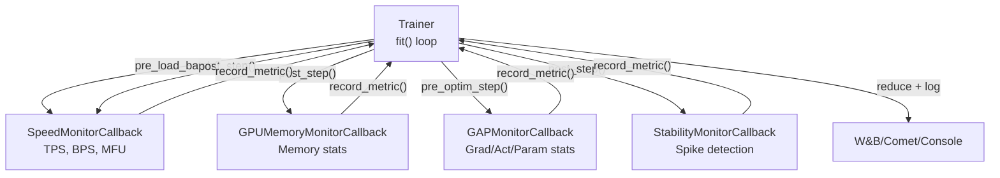
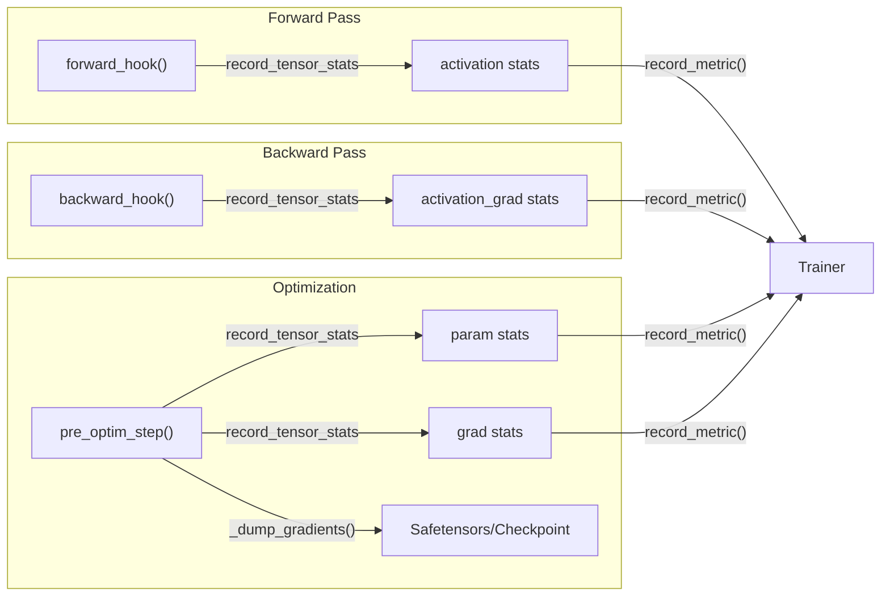

<!-- source: DeepWiki mcp.deepwiki.com · repo allenai/OLMo-core · page 3.4 Monitoring Callbacks · fetched 2026-10-26 -->

# Monitoring Callbacks

Relevant source files

The following files were used as context for generating this wiki page:

- [src/examples/llama_lns/__init__.py](src/examples/llama_lns/__init__.py)
- [src/examples/llm/train.py](src/examples/llm/train.py)
- [src/olmo_core/distributed/utils.py](src/olmo_core/distributed/utils.py)
- [src/olmo_core/model_ladder/utils.py](src/olmo_core/model_ladder/utils.py)
- [src/olmo_core/nn/attention/recurrent.py](src/olmo_core/nn/attention/recurrent.py)
- [src/olmo_core/nn/transformer/init.py](src/olmo_core/nn/transformer/init.py)
- [src/olmo_core/script_utils.py](src/olmo_core/script_utils.py)
- [src/olmo_core/train/__init__.py](src/olmo_core/train/__init__.py)
- [src/olmo_core/train/callbacks/gap_monitor.py](src/olmo_core/train/callbacks/gap_monitor.py)
- [src/olmo_core/train/callbacks/gpu_memory_monitor.py](src/olmo_core/train/callbacks/gpu_memory_monitor.py)
- [src/olmo_core/train/callbacks/speed_monitor.py](src/olmo_core/train/callbacks/speed_monitor.py)
- [src/olmo_core/train/callbacks/stability_monitor.py](src/olmo_core/train/callbacks/stability_monitor.py)
- [src/olmo_core/train/common.py](src/olmo_core/train/common.py)
- [src/olmo_core/train/utils.py](src/olmo_core/train/utils.py)
- [src/scripts/inspect_tensor.py](src/scripts/inspect_tensor.py)
- [src/test/nn/attention/recurrent_test.py](src/test/nn/attention/recurrent_test.py)
- [src/test/train/utils_test.py](src/test/train/utils_test.py)

This page documents the monitoring callbacks in OLMo-core that track training performance, resource utilization, and system metrics. These callbacks automatically collect and log metrics such as throughput (TPS, BPS), model FLOPS utilization (MFU), GPU memory usage, gradient/activation statistics, and stability indicators.

## Overview

Monitoring callbacks observe the training process and record metrics without modifying training behavior. They implement callback lifecycle hooks to measure timing, compute statistics, and report metrics to the trainer. The trainer then aggregates these metrics across distributed processes and logs them to configured outputs (W&B, Comet, console, etc.).

**Sources:** [src/olmo_core/train/callbacks/speed_monitor.py:19-171](), [src/olmo_core/train/callbacks/gpu_memory_monitor.py:13-71](), [src/olmo_core/train/callbacks/gap_monitor.py:25-151]()

## SpeedMonitorCallback

The `SpeedMonitorCallback` measures training throughput and efficiency. It is automatically added to the trainer if not explicitly configured [src/olmo_core/train/callbacks/speed_monitor.py:23-26]().

### Key Metrics

| Metric | Description | Units |
|--------|-------------|-------|
| `throughput/device/TPS` | Tokens processed per second (instantaneous) | tokens/sec |
| `throughput/device/TPS (actual avg)` | Average tokens per second since training start | tokens/sec |
| `throughput/device/BPS` | Batches processed per second (instantaneous) | batches/sec |
| `throughput/device/flopsPS` | Floating point operations per second | FLOPS |
| `throughput/device/MFU` | Model FLOPS utilization (instantaneous) | percentage |
| `throughput/device/data loading (s)` | Time spent loading the current batch | seconds |
| `throughput/chinchilla multiple` | Tokens seen divided by (20 * params) | multiple |

**Sources:** [src/olmo_core/train/callbacks/speed_monitor.py:144-194]()

### MFU and FLOPs Calculation

Model FLOPS Utilization (MFU) measures hardware efficiency. The callback automatically detects peak FLOPS for H100 (SXM/NVL/PCIe), B200, and A100 GPUs [src/olmo_core/train/callbacks/speed_monitor.py:92-113](). For `TransformerTrainModule`, it queries `num_flops_per_token()` to compute architecture-specific FLOPs [src/olmo_core/train/callbacks/speed_monitor.py:69-72]().

It accounts for parallelism by calculating a `_parallel_degree` [src/olmo_core/train/callbacks/speed_monitor.py:77-80](), ensuring per-device metrics are accurate when using Tensor or Pipeline parallelism.

**Sources:** [src/olmo_core/train/callbacks/speed_monitor.py:77-113]()

## GAPMonitorCallback

The `GAPMonitorCallback` monitors **G**radients, **A**ctivations, and **P**arameters. It provides fine-grained statistics (max, mean, variance) for every layer in the model [src/olmo_core/train/callbacks/gap_monitor.py:25-34](). It only works with `TransformerTrainModule` [src/olmo_core/train/callbacks/gap_monitor.py:109-110]().

### Implementation via Hooks

The callback uses PyTorch hooks to capture data during the forward and backward passes:
- **Forward Hooks**: Capture activations via `forward_hook()` [src/olmo_core/train/callbacks/gap_monitor.py:124-125]().
- **Backward Pre-Hooks**: Capture gradients with respect to activations via `backward_hook()` [src/olmo_core/train/callbacks/gap_monitor.py:127-128]().
- **Optimizer Step Hook**: `pre_optim_step()` captures parameter values and parameter gradients [src/olmo_core/train/callbacks/gap_monitor.py:144-147]().

### Gradient Dumping
Setting `dump_gradients=True` allows raw gradient tensors to be dumped to disk for offline analysis [src/olmo_core/train/callbacks/gap_monitor.py:46-48](). It supports saving full distributed gradients or gathering a subset (`dump_gradients_save_first_n`) to rank 0 [src/olmo_core/train/callbacks/gap_monitor.py:59-62]().

### Data Flow

**Sources:** [src/olmo_core/train/callbacks/gap_monitor.py:112-176]()

## GPUMemoryMonitorCallback

The `GPUMemoryMonitorCallback` tracks peak GPU memory usage per step [src/olmo_core/train/callbacks/gpu_memory_monitor.py:13-16]().

### Memory Statistics
It records metrics for both **Active** (currently used by tensors) and **Reserved** (cached by the allocator) memory [src/olmo_core/train/callbacks/gpu_memory_monitor.py:50-60](). It also monitors and logs warnings for:
- `num_alloc_retries`: Indicates memory pressure where the allocator had to search/defragment [src/olmo_core/train/callbacks/gpu_memory_monitor.py:62-65]().
- `num_ooms`: Total count of out-of-memory exceptions thrown [src/olmo_core/train/callbacks/gpu_memory_monitor.py:67-69]().

**Sources:** [src/olmo_core/train/callbacks/gpu_memory_monitor.py:47-71]()

## StabilityMonitorCallback

The `StabilityMonitorCallback` is designed to detect training instabilities, specifically "spikes" in the loss or gradient norms. It maintains a moving average of metrics and triggers alerts or logs when a value deviates significantly from the historical trend.

**Sources:** [src/olmo_core/train/callbacks/stability_monitor.py]()

## GarbageCollectorCallback

The `GarbageCollectorCallback` manages Python's cyclic garbage collector (GC). In distributed training, frequent automatic GC can cause synchronization timeouts if ranks trigger GC at different times.

### GC Strategy
1. **`pre_train`**: Disables automatic GC (`gc.disable()`).
2. **`post_step`**: Manually triggers a generation 1 collection (`gc.collect(1)`) every `gc_interval` steps.
3. **`post_checkpoint_saved`**: Triggers a full collection after saving a checkpoint to clean up temporary state.

**Sources:** [src/olmo_core/train/callbacks/garbage_collector.py]()

## Callback Priorities

Monitoring callbacks use specific priorities to ensure they measure the state of the system at the correct time:

| Callback | Priority | Logic |
|----------|----------|-------|
| `SpeedMonitorCallback` | -2 | Runs late to include the time taken by other callbacks in throughput calcs [src/olmo_core/train/callbacks/speed_monitor.py:28](). |
| `GPUMemoryMonitorCallback` | -1 | Runs late to capture the peak memory used by the entire step [src/olmo_core/train/callbacks/gpu_memory_monitor.py:18](). |

**Sources:** [src/olmo_core/train/callbacks/speed_monitor.py:28](), [src/olmo_core/train/callbacks/gpu_memory_monitor.py:18]()

---

