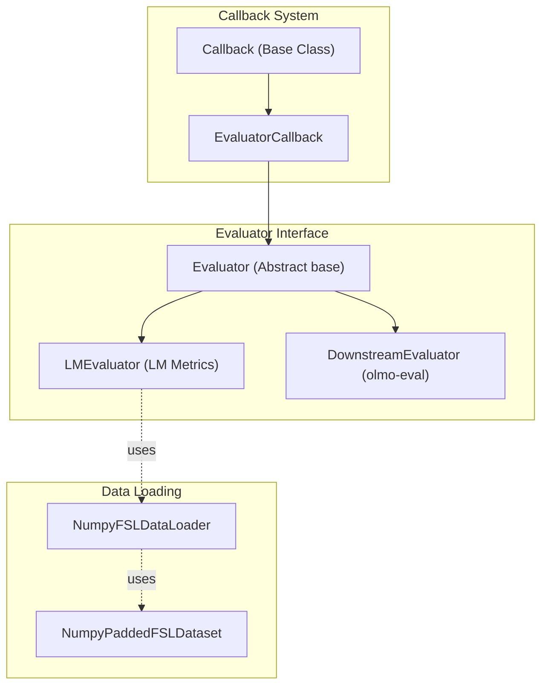
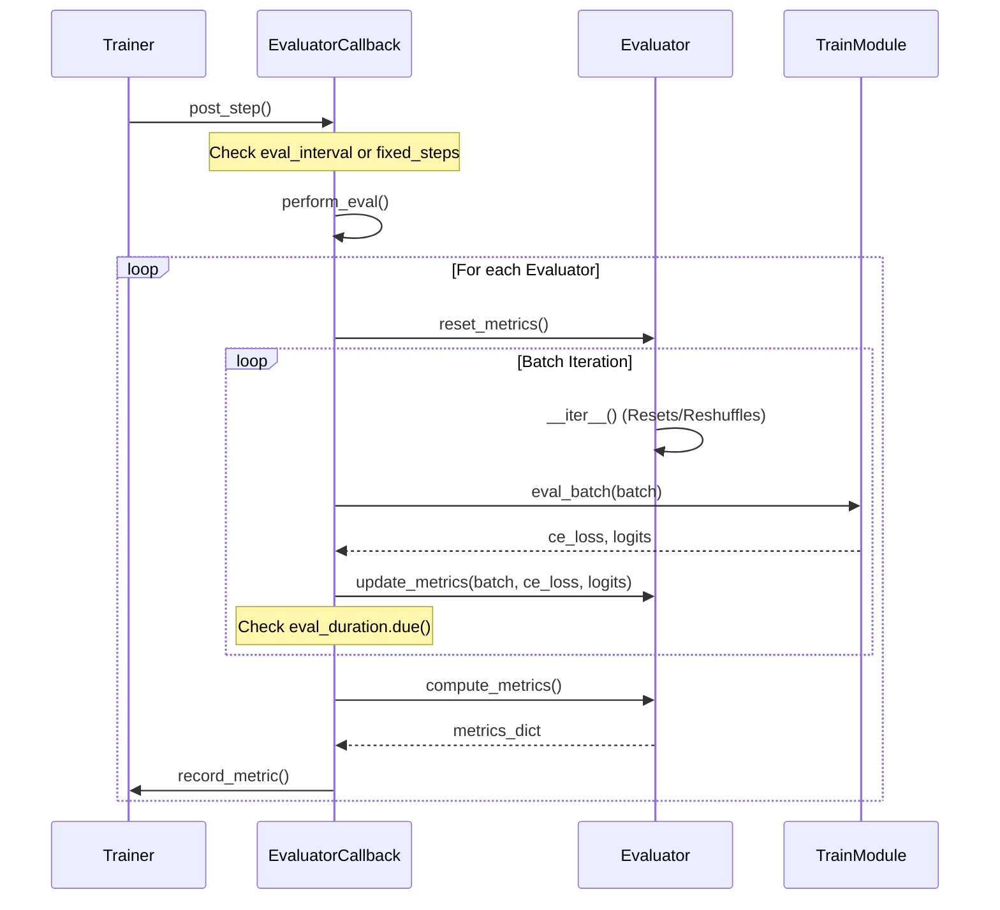

<!-- source: DeepWiki mcp.deepwiki.com · repo allenai/OLMo-core · page 3.5 Evaluation Callbacks · fetched 2026-10-26 -->

# Evaluation Callbacks

Relevant source files

The following files were used as context for generating this wiki page:

- [src/olmo_core/eval/evaluator.py](src/olmo_core/eval/evaluator.py)
- [src/olmo_core/eval/lm_evaluator.py](src/olmo_core/eval/lm_evaluator.py)
- [src/olmo_core/eval/task_groups.py](src/olmo_core/eval/task_groups.py)
- [src/olmo_core/train/callbacks/evaluator_callback.py](src/olmo_core/train/callbacks/evaluator_callback.py)
- [src/test/eval/__init__.py](src/test/eval/__init__.py)
- [src/test/eval/lm_evaluator_test.py](src/test/eval/lm_evaluator_test.py)

This document covers the evaluation callback system in OLMo-core, which enables periodic in-loop evaluation during training. Evaluation callbacks run language modeling evaluations (perplexity) and downstream task evaluations (zero-shot/few-shot benchmarks) at configured intervals without interrupting the training loop.

For information about the general callback system and lifecycle hooks, see [Callback System](#3.3). For monitoring callbacks that track training metrics like throughput, see [Monitoring Callbacks](#3.4).

---

## Overview

The evaluation callback system is built around the `EvaluatorCallback` class, which orchestrates one or more `Evaluator` instances during training. Evaluators compute metrics on validation or test data by running the model in evaluation mode, recording results to the trainer's metric system.

The system supports two primary evaluation types:

- **Language Model Evaluation**: Measures perplexity and cross-entropy loss on held-out text data using the `LMEvaluator` [src/olmo_core/eval/lm_evaluator.py:14-123]().
- **Downstream Task Evaluation**: Runs zero-shot or few-shot evaluations on standardized benchmarks using the `olmo-eval` library via `DownstreamEvaluator` [src/olmo_core/train/callbacks/evaluator_callback.py:298-465]().

**Key Features:**

| Feature | Description |
|---------|-------------|
| Periodic Evaluation | Run evaluations at regular step intervals or at fixed steps [src/olmo_core/train/callbacks/evaluator_callback.py:56-64]() |
| Startup/Finish Evaluation | Optionally evaluate before training starts or after completion [src/olmo_core/train/callbacks/evaluator_callback.py:66-74]() |
| Duration Control | Limit evaluation to a specific number of steps, tokens, or epochs [src/olmo_core/train/callbacks/evaluator_callback.py:83-86]() |
| Deterministic Option | Resets and reshuffles data loaders with a pinned epoch for reproducible truncated evals [src/olmo_core/eval/evaluator.py:23-31]() |
| Distributed Support | Automatically shard evaluation data across data-parallel ranks [src/olmo_core/train/callbacks/evaluator_callback.py:127-141]() |

**Sources:** [src/olmo_core/train/callbacks/evaluator_callback.py:44-523](), [src/olmo_core/eval/evaluator.py:9-102]()

---

## Evaluator Architecture

The system uses an abstract `Evaluator` base class to define the interface for metric updates and computation.

### System Components

**Sources:** [src/olmo_core/train/callbacks/evaluator_callback.py:44-54](), [src/olmo_core/eval/evaluator.py:9-42](), [src/olmo_core/eval/lm_evaluator.py:14-17]()

### EvaluatorCallback Lifecycle

The `EvaluatorCallback` hooks into the `Trainer` lifecycle to trigger evaluation loops.

**Sources:** [src/olmo_core/train/callbacks/evaluator_callback.py:107-171](), [src/olmo_core/eval/evaluator.py:57-75](), [src/olmo_core/train/train_module/transformer/train_module.py:408-418]()

---

## Language Model Evaluation

### LMEvaluator

The `LMEvaluator` computes cross-entropy loss and perplexity. It supports multiple datasets within a single evaluator by routing losses based on a `label` field in the batch metadata [src/olmo_core/eval/lm_evaluator.py:14-26]().

- **Deterministic Evaluation**: When `deterministic=True` (default), the underlying data loader is reset and reshuffled with `epoch=1` before every pass, ensuring that truncated evaluations (via `eval_duration`) see the same samples in the same order [src/olmo_core/eval/evaluator.py:23-31](), [src/olmo_core/eval/evaluator.py:68-69]().
- **Metric Routing**: The `update_metrics` method uses the `label` from `batch["metadata"]` to update the corresponding `MeanMetric` [src/olmo_core/eval/lm_evaluator.py:103-104]().
- **Context Parallelism (CP) Support**: `update_metrics` can function with `logits=None`, as only `ce_loss` is strictly required for perplexity calculations [src/olmo_core/eval/lm_evaluator.py:97-101]().

**Sources:** [src/olmo_core/eval/lm_evaluator.py:14-123](), [src/olmo_core/eval/evaluator.py:57-75]()

---

## Downstream Task Evaluation

### DownstreamEvaluator and olmo-eval

The `DownstreamEvaluator` provides a bridge to the `olmo-eval` library for benchmark tasks like MMLU or ARC.

- **Lazy Initialization**: It supports lazy loading of tasks and datasets to prevent memory overhead at startup [src/olmo_core/train/callbacks/evaluator_callback.py:343-345]().
- **Memory Management**: It uses `EvalBatchSpec` to calculate the appropriate `rank_batch_size_instances` to avoid OOM during evaluation [src/olmo_core/train/callbacks/evaluator_callback.py:404-428]().
- **Integration**: It builds tasks via `olmo_eval.build_task()` and tracks results using `olmo_eval.ICLMetric` [src/olmo_core/train/callbacks/evaluator_callback.py:388-396]().

**Sources:** [src/olmo_core/train/callbacks/evaluator_callback.py:298-465]()

---

## Task Groups

OLMo-core organizes benchmark tasks into groups within `olmo_core.eval.task_groups` to simplify configuration for different model scales and compute budgets.

| Group Name | Description | Key Tasks |
|:---|:---|:---|
| `full__small_compute` | For models where multiple-choice (MC) acquisition isn't expected (e.g., 1B scale) [src/olmo_core/eval/task_groups.py:4-77]() | ARC (RC), HellaSwag, MMLU (RC), Coding (BPB) |
| `full__large_compute` | For larger models expected to acquire MC ability [src/olmo_core/eval/task_groups.py:80-125]() | ARC (MC), CSQA (MC), MMLU (MC), GSM8K |
| `fast` | A subset of tasks that is 2-3x faster than the full suite [src/olmo_core/eval/task_groups.py:131-162]() | ARC BPB/MC, HellaSwag BPB, Basic Skills |
| `full` | The union of small and large compute tasks [src/olmo_core/eval/task_groups.py:168]() | All supported tasks |

**Sources:** [src/olmo_core/eval/task_groups.py:1-171]()

---

## Implementation Details: Code Entity Mapping

The following diagram maps the logical data flow from the training loop to the specific code entities involved in the evaluation process.

```mermaid
graph LR
    subgraph "Training Logic"
        Trainer_fit["Trainer.fit()"]
        EC_post_step["EvaluatorCallback.post_step()"]
    end

    subgraph "Model Interface"
        TM_eval_batch["TransformerTrainModule.eval_batch()"]
    end

    subgraph "Metric Aggregation"
        LME_update["LMEvaluator.update_metrics()"]
        MeanMetric_update["MeanMetric.update()"]
        LME_compute["LMEvaluator.compute_metrics()"]
    end

    subgraph "Storage"
        Trainer_record["Trainer.record_metric()"]
    end

    Trainer_fit --> EC_post_step
    EC_post_step -- "Calls" --> TM_eval_batch
    TM_eval_batch -- "Returns CE/Logits" --> LME_update
    LME_update -- "Uses label" --> MeanMetric_update
    MeanMetric_update -- "Finalize" --> LME_compute
    LME_compute -- "Log to W&B/Console" --> Trainer_record
```

**Sources:** [src/olmo_core/train/callbacks/evaluator_callback.py:107-171](), [src/olmo_core/eval/lm_evaluator.py:94-122](), [src/olmo_core/train/train_module/transformer/train_module.py:408-418]()

---

