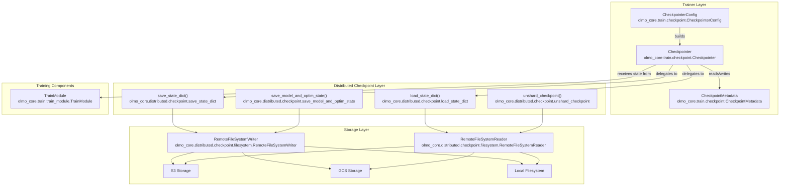
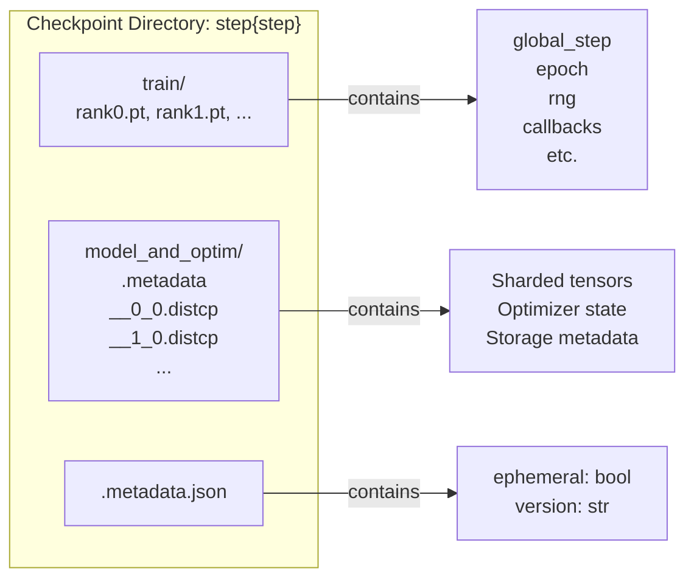
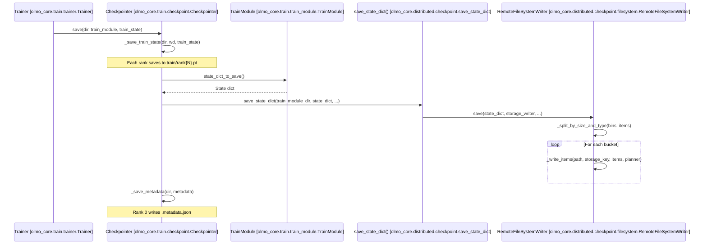

<!-- source: DeepWiki mcp.deepwiki.com · repo allenai/OLMo-core · page 3.6 Checkpointing System · fetched 2026-10-26 -->

# Checkpointing System

Relevant source files

The following files were used as context for generating this wiki page:

- [.github/workflows/pr_checks.yml](.github/workflows/pr_checks.yml)
- [src/olmo_core/distributed/checkpoint/__init__.py](src/olmo_core/distributed/checkpoint/__init__.py)
- [src/olmo_core/distributed/checkpoint/filesystem.py](src/olmo_core/distributed/checkpoint/filesystem.py)
- [src/olmo_core/fs_cache.py](src/olmo_core/fs_cache.py)
- [src/olmo_core/optim/__init__.py](src/olmo_core/optim/__init__.py)
- [src/olmo_core/optim/scheduler.py](src/olmo_core/optim/scheduler.py)
- [src/olmo_core/train/callbacks/__init__.py](src/olmo_core/train/callbacks/__init__.py)
- [src/olmo_core/train/callbacks/checkpointer.py](src/olmo_core/train/callbacks/checkpointer.py)
- [src/olmo_core/train/callbacks/list_checkpointer.py](src/olmo_core/train/callbacks/list_checkpointer.py)
- [src/olmo_core/train/checkpoint.py](src/olmo_core/train/checkpoint.py)
- [src/olmo_core/train/config.py](src/olmo_core/train/config.py)
- [src/test/distributed/checkpoint/filesystem_test.py](src/test/distributed/checkpoint/filesystem_test.py)
- [src/test/optim/scheduler_test.py](src/test/optim/scheduler_test.py)

This document describes the checkpointing system in OLMo-core, which handles saving and loading model, optimizer, and training state during distributed training. The system supports both synchronous and asynchronous checkpointing, can write to local filesystems or remote object stores (S3, GCS), and enables topology-agnostic loading where checkpoints saved with one distributed configuration can be loaded with a different configuration.

For information about the callback that triggers checkpointing during training, see [3.3 Callback System](). For distributed parallelism strategies that affect checkpoint sharding, see [4. Distributed Training]().

---

## Architecture Overview

The checkpointing system consists of three layers: the trainer-facing `Checkpointer` class, the distributed checkpoint module that handles state dict operations, and the storage layer that abstracts local and remote I/O.

**Natural Language to Code Entity Space: Checkpointing Components**

**Sources**: [src/olmo_core/train/checkpoint.py:50-181](), [src/olmo_core/distributed/checkpoint/__init__.py:72-201](), [src/olmo_core/distributed/checkpoint/filesystem.py:187-473]()

---

## Checkpoint Structure

A complete checkpoint directory contains three main components: trainer state files (per-rank), distributed model/optimizer state, and metadata.

| Component | Location | Content | Per-Rank? |
|-----------|----------|---------|-----------|
| **Trainer State** | `train/rank{N}.pt` | Training progress, epoch, step counts, RNG states [src/olmo_core/train/checkpoint.py:202-207]() | Yes |
| **Model/Optim State** | `model_and_optim/*.distcp` | Sharded model parameters and optimizer state [src/olmo_core/distributed/checkpoint/__init__.py:189-201]() | No (distributed) |
| **Checkpoint Metadata** | `.metadata.json` | Ephemeral flag, version info [src/olmo_core/train/checkpoint.py:73-76]() | No |

**Sources**: [src/olmo_core/train/checkpoint.py:73-86](), [src/olmo_core/distributed/checkpoint/__init__.py:189-201]()

---

## Save Operation Flow

The synchronous save operation coordinates per-rank state and distributed model state.

**Natural Language to Code Entity Space: Save Sequence**

### Synchronous Save

The `Checkpointer.save()` method coordinates the save operation:

**Key Steps:**
1. **Prepare environment**: Uses a temporary working directory via `_temporary_wd` context manager [src/olmo_core/train/checkpoint.py:115-132]().
2. **Save trainer state**: Each rank writes its own trainer state to `train/rank{N}.pt` [src/olmo_core/train/checkpoint.py:117]().
3. **Save distributed state**: Call `save_state_dict()` with the model and optimizer state returned by `train_module.state_dict_to_save()` [src/olmo_core/train/checkpoint.py:121-132]().
4. **Finalize**: Write `.metadata.json` containing the `ephemeral` flag and version [src/olmo_core/train/checkpoint.py:134]().

**Sources**: [src/olmo_core/train/checkpoint.py:102-135](), [src/olmo_core/distributed/checkpoint/__init__.py:72-118]()

---

## Async Checkpointing

Asynchronous checkpointing moves the I/O-intensive save operation to a background thread, allowing training to continue immediately.

**Implementation Details:**

The `save_async()` method [src/olmo_core/train/checkpoint.py:136-181]() follows this pattern:

1. **Synchronously save trainer state**: Per-rank files are written immediately to ensure RNG and step states are captured [src/olmo_core/train/checkpoint.py:157]().
2. **De-stage model/optimizer state**: Call `async_save_state_dict()` which copies tensors to CPU memory [src/olmo_core/distributed/checkpoint/__init__.py:122-155]().
3. **Return immediately**: Training continues while a background thread writes the de-staged data to storage.
4. **Callback on completion**: Metadata is saved once the `Future` returned by the distributed saver completes [src/olmo_core/train/checkpoint.py:174-179]().

**Process Group Requirement**: Async checkpointing requires a process group in distributed settings [src/olmo_core/train/checkpoint.py:146-149]() to coordinate the background write across ranks.

**Sources**: [src/olmo_core/train/checkpoint.py:136-181](), [src/olmo_core/distributed/checkpoint/__init__.py:122-155]()

---

## Load Operation Flow

Loading is topology-agnostic: checkpoints saved with one distributed configuration (e.g., 8-way FSDP) can be loaded with a different configuration.

### Topology-Agnostic Loading

The `Checkpointer.load()` method manages the restoration process:

1. **Load trainer state**: Ranks try to load their specific `train/rank{N}.pt`. If missing (e.g., world size changed), they fall back to `train/rank0.pt` [src/olmo_core/train/checkpoint.py:202-207]().
2. **Prepare state dict**: The `TrainModule` provides the target state dict structure [src/olmo_core/train/checkpoint.py:223]().
3. **Distributed load**: `load_state_dict()` uses the `RemoteFileSystemReader` to fetch only the necessary byte ranges for the current rank's sharded tensors [src/olmo_core/distributed/checkpoint/__init__.py:159-186]().

**Sources**: [src/olmo_core/train/checkpoint.py:183-242](), [src/olmo_core/distributed/checkpoint/__init__.py:159-186]()

---

## Storage Layer

The storage layer abstracts local and remote I/O through `RemoteFileSystemWriter` and `RemoteFileSystemReader`.

### RemoteFileSystemWriter

Partitions checkpoint data into buckets for parallel writing:

**Bucket Partitioning** [src/olmo_core/distributed/checkpoint/filesystem.py:81-102]():
- ByteIO items are distributed round-robin.
- Tensors are sorted by size (largest first) and assigned to the least-full bucket (greedy bin packing).

**Write Options**:
- `thread_count`: Number of parallel write threads [src/olmo_core/distributed/checkpoint/filesystem.py:205]().
- `process_count`: Use process pool instead of thread pool for CPU-intensive serialization [src/olmo_core/distributed/checkpoint/filesystem.py:206]().
- `throttle_uploads`: If `True`, only one rank per node uploads at a time to prevent bandwidth saturation [src/olmo_core/distributed/checkpoint/filesystem.py:208]().

**Sources**: [src/olmo_core/distributed/checkpoint/filesystem.py:187-336]()

### RemoteFileSystemReader

Reads checkpoint data efficiently:
- **Byte-range reads**: Fetches only the specific bytes needed for each tensor via `get_bytes_range()` [src/olmo_core/distributed/checkpoint/filesystem.py:363-368]().
- **Narrowing**: Uses `_narrow_tensor_by_index()` to extract the correct shard from a saved tensor if the loading topology differs from the saving topology [src/olmo_core/distributed/checkpoint/filesystem.py:171-184]().

**Sources**: [src/olmo_core/distributed/checkpoint/filesystem.py:338-473]()

---

## Checkpointer Callbacks

Training loops typically use `CheckpointerCallback` to automate checkpointing.

### CheckpointerCallback

This callback manages the `save_interval` and `ephemeral_save_interval` [src/olmo_core/train/callbacks/checkpointer.py:50-59]().

- **Permanent Checkpoints**: Saved every `save_interval` steps [src/olmo_core/train/callbacks/checkpointer.py:63-66]().
- **Ephemeral Checkpoints**: Saved every `ephemeral_save_interval` steps. These are intended for recovery from preemption and are removed as newer checkpoints are created [src/olmo_core/train/callbacks/checkpointer.py:68-74]().
- **Removal Strategy**: The `remove` field (type `CheckpointRemovalStrategy`) determines how old checkpoints are cleaned up [src/olmo_core/train/callbacks/checkpointer.py:87-90]().
- **Cooldown**: `ephemeral_cooldown` can be used to prevent saving ephemeral checkpoints too frequently [src/olmo_core/train/callbacks/checkpointer.py:92-95]().

### ListCheckpointerCallback

A specialized callback that saves checkpoints at specific steps defined in a list [src/olmo_core/train/callbacks/list_checkpointer.py:21]().

**Sources**: [src/olmo_core/train/callbacks/checkpointer.py:50-114](), [src/olmo_core/train/callbacks/list_checkpointer.py:21]()

---

## Checkpoint Metadata

The `CheckpointMetadata` class stores properties of a saved checkpoint [src/olmo_core/train/checkpoint.py:73-76]().

| Field | Type | Description |
|-------|------|-------------|
| `ephemeral` | `Optional[bool]` | Whether the checkpoint is temporary and subject to cleanup [src/olmo_core/train/checkpoint.py:74](). |
| `version` | `str` | The version of OLMo-core used to create the checkpoint [src/olmo_core/train/checkpoint.py:75](). |

The `Checkpointer` uses this metadata to filter checkpoints when searching for the latest valid state [src/olmo_core/train/checkpoint.py:329-339]().

**Sources**: [src/olmo_core/train/checkpoint.py:73-76](), [src/olmo_core/train/checkpoint.py:329-339]()

---

