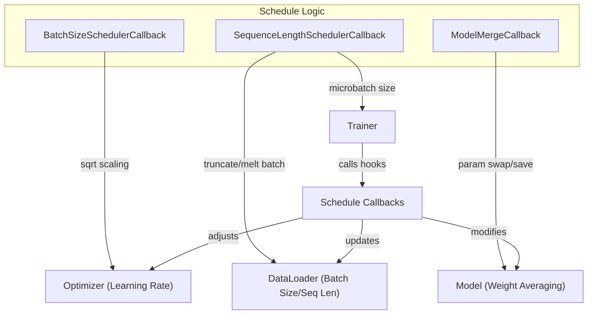
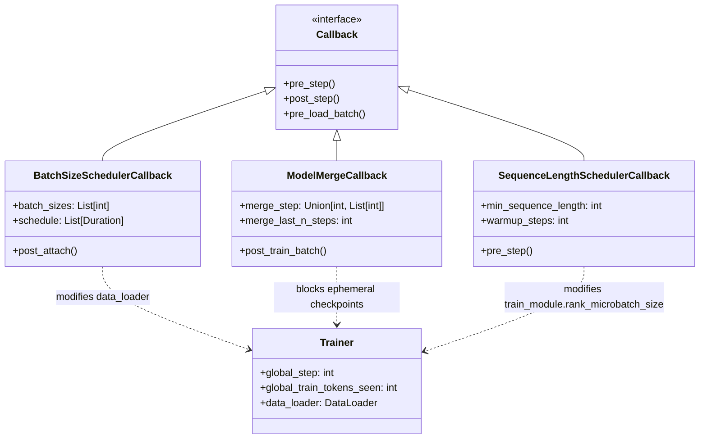

<!-- source: DeepWiki mcp.deepwiki.com · repo allenai/OLMo-core · page 3.7 Training Schedule Callbacks · fetched 2026-10-26 -->

# Training Schedule Callbacks

Relevant source files

The following files were used as context for generating this wiki page:

- [docs/source/conf.py](docs/source/conf.py)
- [docs/source/distributed/checkpoint.rst](docs/source/distributed/checkpoint.rst)
- [docs/source/exceptions.rst](docs/source/exceptions.rst)
- [docs/source/io.rst](docs/source/io.rst)
- [docs/source/utils.rst](docs/source/utils.rst)
- [src/integration_tests/__init__.py](src/integration_tests/__init__.py)
- [src/integration_tests/test_train_small_model.py](src/integration_tests/test_train_small_model.py)
- [src/olmo_core/train/callbacks/batch_size_scheduler.py](src/olmo_core/train/callbacks/batch_size_scheduler.py)
- [src/olmo_core/train/callbacks/callback.py](src/olmo_core/train/callbacks/callback.py)
- [src/olmo_core/train/callbacks/model_merger.py](src/olmo_core/train/callbacks/model_merger.py)
- [src/olmo_core/train/callbacks/sequence_length_scheduler.py](src/olmo_core/train/callbacks/sequence_length_scheduler.py)
- [src/scripts/train/ladder/olmo3_model_merging_ladder.py](src/scripts/train/ladder/olmo3_model_merging_ladder.py)
- [src/test/train/callbacks/model_merger_test.py](src/test/train/callbacks/model_merger_test.py)

Training schedule callbacks manage dynamic changes to the training environment and model state over time. These include adjusting hyper-parameters like batch size and sequence length, as well as performing weight averaging (model merging) to improve stability and final performance.

## Batch Size Scheduling

The `BatchSizeSchedulerCallback` dynamically adjusts the global batch size during training based on a predefined schedule. This is often used in a "curriculum" fashion where training starts with smaller batches to stabilize early optimization and scales up to larger batches for throughput and convergence.

### Implementation Details
The callback monitors the trainer's progress (steps, tokens, or epochs) and updates the `DataLoader`'s `global_batch_size`.

*   **LR Adjustment**: When the batch size changes, the callback automatically adjusts the learning rate of `TransformerTrainModule` or `TransformerPipelineTrainModule` by a factor of $\sqrt{new\_batch\_size / current\_batch\_size}$ `[src/olmo_core/train/callbacks/batch_size_scheduler.py:156-157]()`.
*   **Validation**: It ensures that batch size changes are always by an integer factor (multiples or divisors) to maintain data loader consistency `[src/olmo_core/train/callbacks/batch_size_scheduler.py:65-74]()`.
*   **Safety**: If an LR scheduler is used, the callback requires the scheduler to use `tokens` as units or have a fixed `t_max` to prevent discontinuous scheduling behavior when the total number of steps changes due to batch size scaling `[src/olmo_core/train/callbacks/batch_size_scheduler.py:103-113]()`.

### Data Flow for Batch Size Updates

| Trigger Hook | Action | File Reference |
| :--- | :--- | :--- |
| `post_attach` | Initial check and potential update before training starts. | `[src/olmo_core/train/callbacks/batch_size_scheduler.py:87-115]()` |
| `pre_load_batch` | Checks the schedule before every batch fetch to see if a resize is due. | `[src/olmo_core/train/callbacks/batch_size_scheduler.py:124-125]()` |
| `post_step` | Records the current global batch size to metrics. | `[src/olmo_core/train/callbacks/batch_size_scheduler.py:127-128]()` |

**Sources:** `[src/olmo_core/train/callbacks/batch_size_scheduler.py:22-158]()`

---

## Model Merging (Weight Averaging)

The `ModelMergeCallback` implements weight averaging by maintaining a running average of model parameters over a "merge window" and saving the result as a merged checkpoint `[src/olmo_core/train/callbacks/model_merger.py:21-24]()`.

### Merge Mechanics
Instead of averaging at the very end of training, this callback performs merges at specific steps or intervals.

1.  **Merge Windows**: A merge window is defined by `merge_last_n_steps`. If `merge_step=1000` and `merge_last_n_steps=100`, the callback accumulates weights from step 901 to 1000 `[src/olmo_core/train/callbacks/model_merger.py:98-99]()`.
2.  **Accumulation**: During the window, the callback captures local tensors of model parameters and adds them to an accumulator `[src/olmo_core/train/callbacks/model_merger.py:225-236]()`.
3.  **Completion**: At the `merge_step`, the accumulated weights are divided by the step count to produce an average, which is then saved using `save_state_dict` `[src/olmo_core/train/callbacks/model_merger.py:241-267]()`.
4.  **Checkpoint Blocking**: To ensure consistency, the callback blocks "ephemeral" checkpoints (temporary saves) during an active merge window `[src/olmo_core/train/callbacks/model_merger.py:207-210]()`.

### Configuration Options
*   `merge_step`: A specific step or list of steps where a merge should be finalized `[src/olmo_core/train/callbacks/model_merger.py:39-40]()`.
*   `merge_interval`: A recurring interval (e.g., every 5000 steps) to perform merges `[src/olmo_core/train/callbacks/model_merger.py:42-43]()`.
*   `merge_last_n_steps`: The duration of the averaging window leading up to the merge point `[src/olmo_core/train/callbacks/model_merger.py:45-46]()`.

**Sources:** `[src/olmo_core/train/callbacks/model_merger.py:21-100]()`, `[src/test/train/callbacks/model_merger_test.py:1-188]()`

---

## Sequence Length Scheduling

The `SequenceLengthSchedulerCallback` introduces a linear sequence-length warm-up schedule. It starts from `min_sequence_length` and ramps up to the configured dataset sequence length over `warmup_steps` `[src/olmo_core/train/callbacks/sequence_length_scheduler.py:18-23]()`.

### Scheduling Strategies
The callback supports two methods for adjusting length:
1.  **Splitting (`truncate=False`)**: Splits existing instances into multiple shorter instances. This maintains the total number of tokens per batch by increasing the `rank_microbatch_size` proportionally `[src/olmo_core/train/callbacks/sequence_length_scheduler.py:127-133]()`.
2.  **Truncation (`truncate=True`)**: Simply cuts instances to the current scheduled length, throwing away extra tokens `[src/olmo_core/train/callbacks/sequence_length_scheduler.py:108-112]()`.

### Compatibility and Efficiency
*   **Requirements**: Only compatible with `NumpyFSLDataLoader` and `TransformerTrainModule` `[src/olmo_core/train/callbacks/sequence_length_scheduler.py:57-66]()`.
*   **Memory Management**: Calls `gc_cuda()` (emptying the CUDA cache) whenever the sequence length changes, as tensor shapes in the model will change `[src/olmo_core/train/callbacks/sequence_length_scheduler.py:135-139]()`.

**Sources:** `[src/olmo_core/train/callbacks/sequence_length_scheduler.py:18-148]()`

---

## Architecture Overview

The following diagrams illustrate how schedule callbacks interact with the `Trainer` and the `TrainModule` (which encapsulates the model and optimizer).

### Schedule Callback Interaction
Title: Schedule Callback Data Flow

**Sources:** `[src/olmo_core/train/callbacks/batch_size_scheduler.py:153-170]()`, `[src/olmo_core/train/callbacks/sequence_length_scheduler.py:130-133]()`, `[src/olmo_core/train/callbacks/model_merger.py:255-265]()`

### Entity Relationship Diagram
Title: Schedule Entity Mapping

**Sources:** `[src/olmo_core/train/callbacks/callback.py:15-28]()`, `[src/olmo_core/train/callbacks/batch_size_scheduler.py:22-37]()`, `[src/olmo_core/train/callbacks/model_merger.py:21-57]()`, `[src/olmo_core/train/callbacks/sequence_length_scheduler.py:18-51]()`

---

## Metric and Checkpoint Management

Training schedules often involve saving specific snapshots or tracking dynamic metadata.

### Metric Preservation
The `MetricSaverCallback` (referenced in training scripts) is used to ensure that important metrics generated during these transitions are persisted. This is particularly useful for tracking the "global batch size" or "sequence length" alongside standard loss metrics `[src/olmo_core/train/callbacks/batch_size_scheduler.py:127-128]()`.

### Checkpointing Merged Models
When `ModelMergeCallback` completes a merge, it does not overwrite the standard training checkpoint. Instead, it creates a new directory with the suffix `-merged` (e.g., `step1000-merged`) containing only the averaged model weights `[src/olmo_core/train/callbacks/model_merger.py:110-111]()`. This allows training to continue from the original "sharp" weights while providing a "smooth" averaged model for evaluation.

**Sources:** `[src/olmo_core/train/callbacks/model_merger.py:110-111]()`, `[src/olmo_core/train/callbacks/batch_size_scheduler.py:127-128]()`

---

