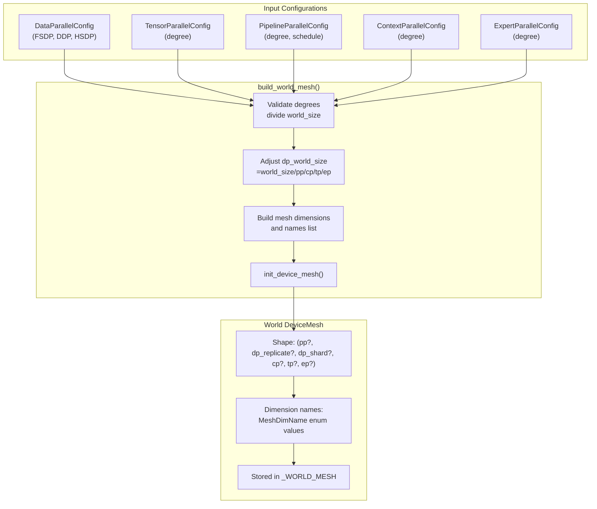
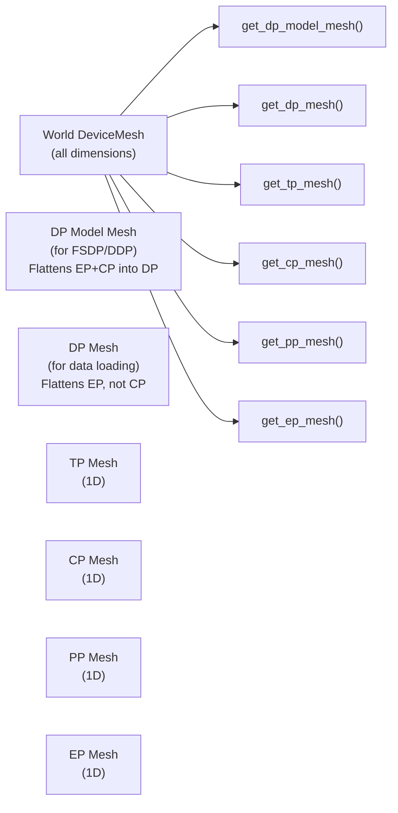
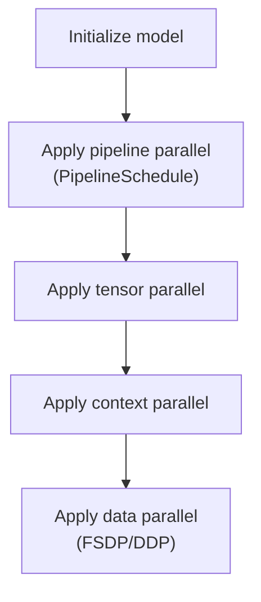

<!-- source: DeepWiki mcp.deepwiki.com · repo allenai/OLMo-core · page 4 Distributed Training · fetched 2026-10-26 -->

# Distributed Training

<details>
<summary>Relevant source files</summary>

The following files were used as context for generating this wiki page:

- [src/olmo_core/distributed/parallel/__init__.py](src/olmo_core/distributed/parallel/__init__.py)
- [src/olmo_core/distributed/parallel/pipeline_parallel.py](src/olmo_core/distributed/parallel/pipeline_parallel.py)
- [src/olmo_core/distributed/utils.py](src/olmo_core/distributed/utils.py)
- [src/olmo_core/model_ladder/utils.py](src/olmo_core/model_ladder/utils.py)
- [src/olmo_core/optim/adamw.py](src/olmo_core/optim/adamw.py)
- [src/olmo_core/optim/config.py](src/olmo_core/optim/config.py)
- [src/olmo_core/train/__init__.py](src/olmo_core/train/__init__.py)
- [src/olmo_core/train/callbacks/speed_monitor.py](src/olmo_core/train/callbacks/speed_monitor.py)
- [src/olmo_core/train/common.py](src/olmo_core/train/common.py)
- [src/olmo_core/train/utils.py](src/olmo_core/train/utils.py)
- [src/test/optim/adamw_test.py](src/test/optim/adamw_test.py)
- [src/test/optim/lion_test.py](src/test/optim/lion_test.py)
- [src/test/optim/skip_step_optimizer_test.py](src/test/optim/skip_step_optimizer_test.py)
- [src/test/train/utils_test.py](src/test/train/utils_test.py)

</details>


## Purpose and Scope

This document describes OLMo-core's distributed training architecture, which enables training large language models across multiple GPUs and nodes through coordinated parallelism strategies. The system is built around PyTorch's `DeviceMesh` abstraction and provides a unified interface for composing Data Parallel (DP), Tensor Parallel (TP), Pipeline Parallel (PP), Context Parallel (CP), and Expert Parallel (EP) strategies.

For details on how distributed training is initialized and configured in the process environment, see [Distributed Initialization](#4.1). For specific parallelism strategy configurations and their application to models, see [Parallelism Strategies](#4.2). For distributed checkpoint save/load mechanics, see [Distributed Checkpointing](#4.3). For low-level communication utilities, see [Communication Primitives](#4.4).

**Sources:** [src/olmo_core/distributed/utils.py:1-45](), [src/olmo_core/train/__init__.py:1-41]()

## DeviceMesh Architecture

The foundation of the distributed training system is the `DeviceMesh`, which represents the topology of all distributed processes and their assignments to parallelism dimensions. The mesh is constructed once per training run via `build_world_mesh()` [src/olmo_core/distributed/parallel/__init__.py:110-118]() and stored in a global variable `_WORLD_MESH` [src/olmo_core/distributed/parallel/__init__.py:99-107]().

### Mesh Construction



**Sources:** [src/olmo_core/distributed/parallel/__init__.py:110-218](), [src/olmo_core/distributed/parallel/__init__.py:51-98]()

The `build_world_mesh()` function takes individual parallelism configurations and constructs a multi-dimensional `DeviceMesh` where each dimension represents one parallelism strategy. The dimensions are ordered based on communication patterns (e.g., PP first, then DP, CP, TP/EP) [src/olmo_core/distributed/parallel/__init__.py:203-218]().

| Mesh Dimension | Enum Value | Purpose |
|----------------|------------|---------|
| Pipeline Parallel | `MeshDimName.pp` | Splits model layers across stages [src/olmo_core/distributed/parallel/__init__.py:82-85]() |
| DP Replicate | `MeshDimName.dp_replicate` | HSDP inter-node replication [src/olmo_core/distributed/parallel/__init__.py:61-65]() |
| DP Shard | `MeshDimName.dp_shard` | HSDP intra-node sharding [src/olmo_core/distributed/parallel/__init__.py:67-70]() |
| Data Parallel | `MeshDimName.dp` | Simple FSDP or DDP [src/olmo_core/distributed/parallel/__init__.py:57-60]() |
| Context Parallel | `MeshDimName.cp` | Splits sequence dimension [src/olmo_core/distributed/parallel/__init__.py:77-80]() |
| Tensor Parallel | `MeshDimName.tp` | Shards weight matrices [src/olmo_core/distributed/parallel/__init__.py:72-75]() |
| Expert Parallel | `MeshDimName.ep` | Distributes MoE experts [src/olmo_core/distributed/parallel/__init__.py:87-90]() |

### Sub-Mesh Extraction

Specialized sub-meshes are extracted for different purposes using getter functions. These functions handle dimension flattening to create the appropriate topology for each use case [src/olmo_core/distributed/parallel/__init__.py:123-132]().



Key distinction: `get_dp_model_mesh()` returns the mesh for model wrappers (e.g., FSDP), where EP and CP are flattened into DP for gradient synchronization. `get_dp_mesh()` returns the mesh for data loaders where CP ranks must receive identical data segments [src/olmo_core/distributed/parallel/__init__.py:123-132]().

## Parallelism Strategy Composition

### Strategy Overview

OLMo-core supports five primary parallelism strategies that can be composed together:

| Strategy | Abbreviation | What It Shards | Compatibility Notes |
|----------|--------------|----------------|---------------------|
| Data Parallel | DP | Parameters/optimizer state | Always required if other strategies are set [src/olmo_core/distributed/parallel/__init__.py:160-163]() |
| Tensor Parallel | TP | Weight matrices | Mutually exclusive with EP [src/olmo_core/distributed/parallel/__init__.py:189-192]() |
| Pipeline Parallel | PP | Layers across stages | Configures `PipelineSchedule` [src/olmo_core/distributed/parallel/pipeline_parallel.py:137-155]() |
| Context Parallel | CP | Sequence dimension | Requires `ContextParallelConfig` [src/olmo_core/distributed/parallel/context_parallel.py:11-13]() |
| Expert Parallel | EP | MoE experts | Currently requires HSDP [src/olmo_core/distributed/parallel/__init__.py:193-200]() |

## Integration with Training

### Application Order

Parallelism strategies are applied in a specific sequence to the model (typically within a `TrainModule`).



### Monitoring Throughput

The `SpeedMonitorCallback` calculates performance metrics including Tokens Per Second (TPS) and Model FLOPs Utilization (MFU) [src/olmo_core/train/callbacks/speed_monitor.py:19-26](). It calculates `_parallel_degree` to adjust token counts per device based on the DP process group [src/olmo_core/train/callbacks/speed_monitor.py:77-80]().

```python
# TPS Calculation logic in SpeedMonitorCallback
if self._step_tokens and self._total_tokens:
    tps = self._step_tokens / step_time
    tps_avg = self._total_tokens / total_time
    self.trainer.record_metric("throughput/device/TPS", tps)
```
**Sources:** [src/olmo_core/train/callbacks/speed_monitor.py:163-168]()

### Distributed Initialization

The environment is prepared using `prepare_training_environment()`, which invokes `init_distributed()` [src/olmo_core/train/__init__.py:85-133](). This handles hardware-specific NCCL environment variables for AI2 clusters:
- **Jupiter**: Bonded interface configuration (`mlx5_bond_0`) [src/olmo_core/distributed/utils.py:63-67]().
- **Pluto**: Specific HCA mapping (`mlx5_1,mlx5_2`) [src/olmo_core/distributed/utils.py:68-69]().
- **Augusta (GCP)**: Comprehensive TCPXo and Fastrak configuration [src/olmo_core/distributed/utils.py:70-117]().

### Metric Reduction

Metrics recorded by the `Trainer` are reduced across ranks using `reduce_metrics()` [src/olmo_core/train/utils.py:203-205](). Supported types include `mean`, `sum`, `max`, and `l2_norm` [src/olmo_core/train/common.py:131-157]().

**Sources:** [src/olmo_core/distributed/utils.py:30-118](), [src/olmo_core/train/__init__.py:85-150](), [src/olmo_core/train/utils.py:203-240]()

---

