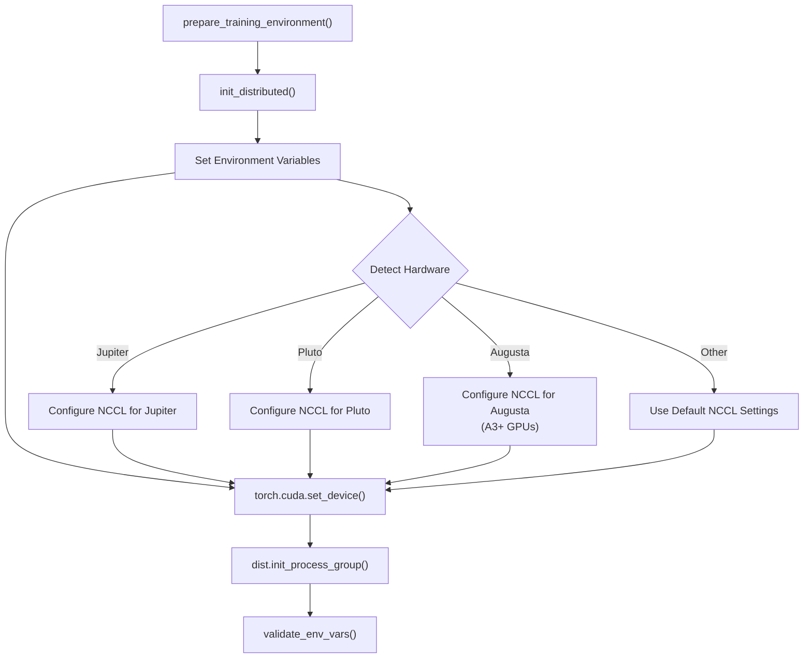
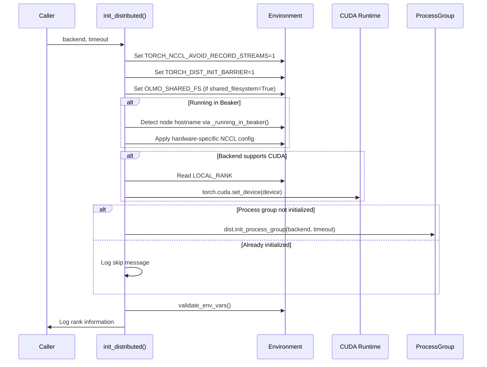
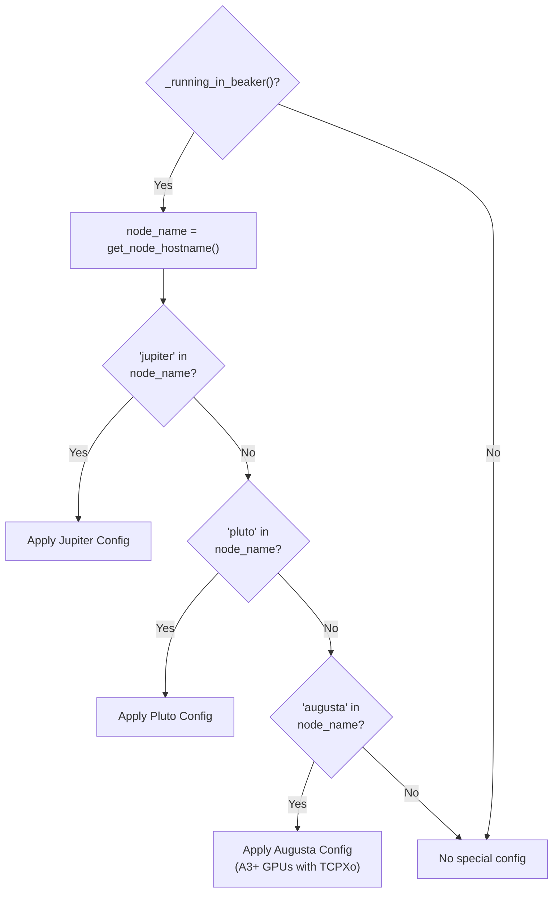
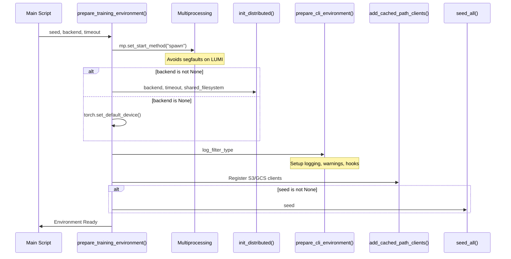

<!-- source: DeepWiki mcp.deepwiki.com · repo allenai/OLMo-core · page 4.1 Distributed Initialization · fetched 2026-10-26 -->

# Distributed Initialization

<details>
<summary>Relevant source files</summary>

The following files were used as context for generating this wiki page:

- [src/olmo_core/distributed/utils.py](src/olmo_core/distributed/utils.py)
- [src/olmo_core/model_ladder/utils.py](src/olmo_core/model_ladder/utils.py)
- [src/olmo_core/train/__init__.py](src/olmo_core/train/__init__.py)
- [src/olmo_core/train/callbacks/speed_monitor.py](src/olmo_core/train/callbacks/speed_monitor.py)
- [src/olmo_core/train/common.py](src/olmo_core/train/common.py)
- [src/olmo_core/train/utils.py](src/olmo_core/train/utils.py)
- [src/test/distributed/utils_test.py](src/test/distributed/utils_test.py)
- [src/test/train/utils_test.py](src/test/train/utils_test.py)

</details>


## Purpose and Scope

This document covers the distributed initialization system in OLMo-core, which sets up PyTorch's distributed process groups and configures NCCL communication backends for multi-GPU training. The initialization process handles environment variable validation, hardware-specific optimizations, and device assignment.

For information about building device meshes and applying parallelism strategies after initialization, see [Parallelism Strategies](#4.2). For distributed communication primitives, see [Communication Primitives](#4.4).

**Sources:** [src/olmo_core/distributed/utils.py:1-45]()

## Overview

Distributed initialization occurs early in the training lifecycle, typically through `prepare_training_environment()`, which orchestrates environment setup before the trainer is constructed. The process initializes PyTorch's distributed backend, validates required environment variables, sets CUDA devices, and applies hardware-specific NCCL optimizations.

### System Initialization Flow



**Sources:** [src/olmo_core/distributed/utils.py:30-147](), [src/olmo_core/train/__init__.py:85-149]()

## Environment Variables

The initialization process relies on several environment variables to determine distributed configuration. These variables are typically set by the job launcher (e.g., `torchrun`, Beaker) or must be provided manually.

### Required Environment Variables

| Variable | Purpose | Set By | Notes |
|----------|---------|--------|-------|
| `LOCAL_RANK` | Rank within the current node | Launcher | Used to assign CUDA devices [src/olmo_core/distributed/utils.py:21]() |
| `NUM_NODES` or `LOCAL_WORLD_SIZE` | Total nodes or processes per node | Launcher | At least one must be set [src/olmo_core/distributed/utils.py:22-23]() |

### Optional Environment Variables

| Variable | Purpose | Default | Notes |
|----------|---------|---------|-------|
| `OLMO_SHARED_FS` | Indicates shared filesystem across nodes | Unset | Set to "1" if using NFS or similar [src/olmo_core/distributed/utils.py:19]() |
| `FS_LOCAL_RANK` | Filesystem-local rank | `LOCAL_RANK` or `RANK` | Used for I/O operations to avoid conflicts [src/olmo_core/distributed/utils.py:20]() |
| `BEAKER_NODE_HOSTNAME` | Hostname in Beaker environment | Unset | Enables hardware-specific NCCL config [src/olmo_core/distributed/utils.py:24]() |

### Automatically Set Variables

The `init_distributed()` function automatically sets several PyTorch and NCCL environment variables to optimize performance:

| Variable | Value | Purpose |
|----------|-------|---------|
| `TORCH_NCCL_AVOID_RECORD_STREAMS` | "1" | Mitigates memory issues with async collectives [src/olmo_core/distributed/utils.py:48]() |
| `TORCH_DIST_INIT_BARRIER` | "1" | Forces process synchronization during initialization [src/olmo_core/distributed/utils.py:51]() |

**Sources:** [src/olmo_core/distributed/utils.py:19-24, 46-54, 149-171]()

## Initialization Function

The core initialization is performed by `init_distributed()`, which accepts the following parameters:

```python
def init_distributed(
    backend: str = "nccl",
    timeout: timedelta = timedelta(minutes=30),
    shared_filesytem: Optional[bool] = True,
    **kwargs,
)
```

### Parameters

- **`backend`**: Distributed backend to use. Common values:
  - `"nccl"` - NVIDIA Collective Communications Library (GPU-only)
  - `"cpu:gloo,cuda:nccl"` - Composite backend (Gloo for CPU, NCCL for CUDA)
  - `"gloo"` - General-purpose backend (CPU and GPU)

- **`timeout`**: Maximum time to wait for process group initialization. Defaults to 30 minutes for robustness in large-scale deployments [src/olmo_core/distributed/utils.py:32]().

- **`shared_filesytem`**: Whether ranks share a filesystem. Affects how `get_fs_local_rank()` behaves for I/O operations [src/olmo_core/distributed/utils.py:33]().

- **`**kwargs`**: Additional arguments passed to `torch.distributed.init_process_group()`.

### Initialization Sequence



**Sources:** [src/olmo_core/distributed/utils.py:30-147]()

## Hardware-Specific NCCL Configuration

OLMo-core automatically detects and configures NCCL settings for different hardware platforms used at AI2. Configuration is triggered when the `BEAKER_NODE_HOSTNAME` environment variable is set.

### Detection Logic



### Jupiter Cluster Configuration

Jupiter nodes use InfiniBand networking with specific HCA (Host Channel Adapter) requirements [src/olmo_core/distributed/utils.py:63-67]().

| Setting | Value | Purpose |
|---------|-------|---------|
| `NCCL_IB_HCA` | `^=mlx5_bond_0` | Exclude bonded interface |
| `NCCL_SOCKET_IFNAME` | `ib` | Use InfiniBand interface (multi-node only) |

### Pluto Cluster Configuration

Pluto nodes exclude specific InfiniBand adapters from NCCL communication [src/olmo_core/distributed/utils.py:68-69]().

| Setting | Value | Purpose |
|---------|-------|---------|
| `NCCL_IB_HCA` | `^=mlx5_1,mlx5_2` | Exclude specific adapters |

### Augusta Cluster Configuration (GCP / A3+ GPUs)

Augusta nodes feature NVIDIA A3+ GPUs requiring TCPXo backend and specific NCCL tuning for optimal performance. This configuration includes the use of Snap and LLCM modes [src/olmo_core/distributed/utils.py:70-117]().

**Key Settings:**

| Category | Setting | Value | Purpose |
|----------|---------|-------|---------|
| **Network** | `NCCL_PROTO` | `Simple,LL128` | Enable specific protocols |
| | `NCCL_MIN_NCHANNELS` | `4` | Minimum communication channels |
| **FastRAK / TCPXo**| `NCCL_FASTRAK_NUM_FLOWS` | `2` | Number of FastRAK flows |
| | `NCCL_FASTRAK_USE_SNAP` | `1` | Enable SNAP acceleration |
| | `NCCL_FASTRAK_USE_LLCM` | `1` | Enable low-latency mode |
| | `NCCL_FASTRAK_IFNAME` | `enp6s0,enp7s0,...` | Network interfaces |
| **Tuning** | `NCCL_TUNER_PLUGIN` | `libnccl-tuner.so` | NCCL tuner plugin |
| | `NCCL_TUNER_CONFIG_PATH` | `/var/lib/tcpxo/lib64/...` | Tuner configuration |

**Sources:** [src/olmo_core/distributed/utils.py:70-117]()

## Device Assignment

For backends that support CUDA (e.g., NCCL), `init_distributed()` automatically sets the appropriate CUDA device for each process based on its local rank.

```python
# From init_distributed()
if backend_supports_cuda(backend):
    device = torch.device(f"cuda:{int(os.environ[OLMO_LOCAL_RANK_ENV_VAR])}")
    torch.cuda.set_device(device)
```

This ensures each process uses a distinct GPU within the node and that CUDA operations default to the correct device. The device is set **before** calling `dist.init_process_group()` to prevent NCCL hangs [src/olmo_core/distributed/utils.py:119-124]().

**Sources:** [src/olmo_core/distributed/utils.py:119-125]()

## Integration with Training Environment

The `prepare_training_environment()` function in the training module orchestrates the complete environment setup, including distributed initialization [src/olmo_core/train/__init__.py:85-149]().

### Call Sequence



**Sources:** [src/olmo_core/train/__init__.py:85-149, 151-156]()

## Rank Information Functions

Utility functions provide information about the distributed context:

| Function | Returns | Purpose |
|----------|---------|---------|
| `is_distributed()` | `bool` | Whether distributed training is active [src/olmo_core/distributed/utils.py:173]() |
| `get_rank(group)` | `int` | Global rank in process group [src/olmo_core/distributed/utils.py:190]() |
| `get_local_rank()` | `int` | Rank within the current node [src/olmo_core/distributed/utils.py:226]() |
| `get_fs_local_rank(group)` | `int` | Rank for filesystem operations [src/olmo_core/distributed/utils.py:238]() |
| `get_world_size(group)` | `int` | Total number of ranks [src/olmo_core/distributed/utils.py:204]() |

### Filesystem Local Rank

The `get_fs_local_rank()` function determines which rank should perform I/O operations:
- **Shared filesystem (`OLMO_SHARED_FS=1`)**: Returns global rank (only rank 0 does I/O) [src/olmo_core/distributed/utils.py:238-245]().
- **Non-shared filesystem**: Returns local rank (rank 0 on each node does I/O) [src/olmo_core/distributed/utils.py:246-248]().

**Sources:** [src/olmo_core/distributed/utils.py:190-310]()

## Backend Support Detection

The system provides functions to check backend capabilities:

- `backend_supports_cuda(backend)`: Checks if the backend supports CUDA tensors (e.g., NCCL) [src/olmo_core/distributed/utils.py:421-432]().
- `backend_supports_cpu(backend)`: Checks if the backend supports CPU tensors (e.g., Gloo) [src/olmo_core/distributed/utils.py:435-446]().

**Sources:** [src/olmo_core/distributed/utils.py:421-446]()

---

