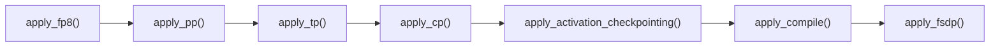
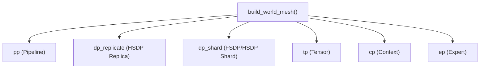
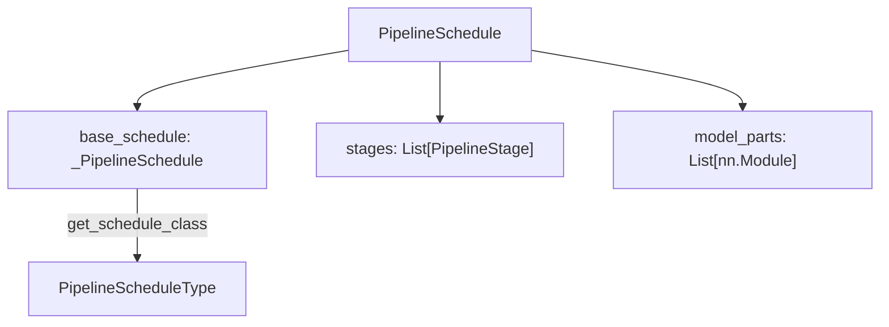
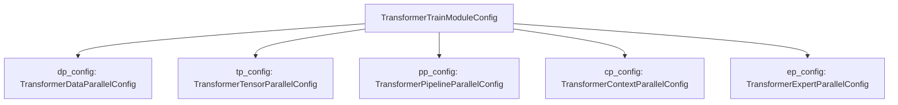

<!-- source: DeepWiki mcp.deepwiki.com · repo allenai/OLMo-core · page 4.2 Parallelism Strategies · fetched 2026-10-26 -->

# Parallelism Strategies

Relevant source files

The following files were used as context for generating this wiki page:

- [src/olmo_core/distributed/nn.py](src/olmo_core/distributed/nn.py)
- [src/olmo_core/distributed/parallel/__init__.py](src/olmo_core/distributed/parallel/__init__.py)
- [src/olmo_core/distributed/parallel/context_parallel.py](src/olmo_core/distributed/parallel/context_parallel.py)
- [src/olmo_core/distributed/parallel/pipeline_parallel.py](src/olmo_core/distributed/parallel/pipeline_parallel.py)
- [src/olmo_core/nn/attention/flash_linear_attn_api.py](src/olmo_core/nn/attention/flash_linear_attn_api.py)
- [src/olmo_core/nn/convolution.py](src/olmo_core/nn/convolution.py)
- [src/olmo_core/nn/feed_forward.py](src/olmo_core/nn/feed_forward.py)
- [src/olmo_core/nn/transformer/__init__.py](src/olmo_core/nn/transformer/__init__.py)
- [src/olmo_core/nn/transformer/block.py](src/olmo_core/nn/transformer/block.py)
- [src/olmo_core/nn/transformer/config.py](src/olmo_core/nn/transformer/config.py)
- [src/olmo_core/nn/transformer/model.py](src/olmo_core/nn/transformer/model.py)
- [src/olmo_core/optim/adamw.py](src/olmo_core/optim/adamw.py)
- [src/olmo_core/optim/config.py](src/olmo_core/optim/config.py)
- [src/scripts/train/OLMoE2-large.py](src/scripts/train/OLMoE2-large.py)
- [src/test/distributed/parallel/context_parallel_test.py](src/test/distributed/parallel/context_parallel_test.py)
- [src/test/nn/transformer/model_test.py](src/test/nn/transformer/model_test.py)
- [src/test/optim/adamw_test.py](src/test/optim/adamw_test.py)
- [src/test/optim/lion_test.py](src/test/optim/lion_test.py)
- [src/test/optim/skip_step_optimizer_test.py](src/test/optim/skip_step_optimizer_test.py)

This page documents the parallelism strategies available in OLMo-core for scaling transformer model training across multiple GPUs and nodes. These strategies partition the model, data, or computation in different ways to enable efficient large-scale training. The strategies are applied to the `Transformer` model through a series of `apply_*()` methods that must be called in a specific order.

## Application Order and Methods

Parallelism strategies must be applied in the correct order to ensure compatibility. The typical application sequence is:

Title: Parallelism Application Order

Each method configures the `Transformer` [src/olmo_core/nn/transformer/model.py:82]() for a specific parallelism strategy:

| Method | Purpose | Key Parameters |
|--------|---------|----------------|
| `apply_fp8()` | Enable float8 quantization | `float8_config: Float8Config` |
| `apply_pp()` | Configure pipeline parallelism | `pp_mesh: DeviceMesh` |
| `apply_tp()` | Configure tensor parallelism | `tp_mesh: DeviceMesh` |
| `apply_cp()` | Configure context parallelism | `cp_mesh: DeviceMesh`, `load_balancer` |
| `apply_activation_checkpointing()` | Enable activation checkpointing | `mode`, `block_interval`, `modules` |
| `apply_compile()` | Apply `torch.compile()` | None |
| `apply_fsdp()` | Configure FSDP data parallelism | `dp_mesh: DeviceMesh`, `param_dtype`, etc. |
| `apply_ddp()` | Configure DDP data parallelism | `dp_mesh: DeviceMesh`, `param_dtype` |

**Sources:** [src/olmo_core/nn/transformer/model.py:527-820]()

## Device Mesh Construction

The foundation of OLMo-core's parallelism is the `DeviceMesh`. The `build_world_mesh()` function [src/olmo_core/distributed/parallel/__init__.py:110]() constructs a multi-dimensional mesh based on the desired degrees of parallelism. It validates that the product of all degrees divides evenly into the total world size [src/olmo_core/distributed/parallel/__init__.py:167-183]().

Title: World Mesh Dimension Hierarchy

The mesh is flattened or sliced using helper functions like `get_tp_mesh()`, `get_dp_mesh()`, and `get_pp_mesh()` to provide the correct process groups to the various `apply_*` methods. For instance, `get_pp_mesh()` extracts the 1D mesh for pipeline stages [src/olmo_core/distributed/parallel/__init__.py:31]().

**Sources:** [src/olmo_core/distributed/parallel/__init__.py:51-220]()

## Tensor Parallelism (TP)

Tensor parallelism partitions individual weight tensors and activations across multiple devices within a layer.

### Application
The `apply_tp()` method [src/olmo_core/nn/transformer/model.py:555]() is called on the model. It:
1. Shards embeddings using `RowwiseParallel` [src/olmo_core/nn/transformer/model.py:561]().
2. Iterates through all blocks and calls `block.apply_tp()` [src/olmo_core/nn/transformer/model.py:576]().
3. Parallelizes the `LMHead` [src/olmo_core/nn/transformer/model.py:581]().

In `TransformerBlock.apply_tp`, the module is parallelized with a plan that shards input along the sequence dimension (`Shard(1)`) [src/olmo_core/nn/transformer/block.py:162-164]().

**Sources:** [src/olmo_core/nn/transformer/model.py:555-590](), [src/olmo_core/nn/transformer/block.py:155-199]()

## Pipeline Parallelism (PP)

Pipeline parallelism splits the model layers across different devices, creating a pipeline where different devices process different stages sequentially.

### Configuration and Schedules
The `PipelineParallelConfig` [src/olmo_core/distributed/parallel/pipeline_parallel.py:64]() defines the degree, schedule type (e.g., `interleaved_1F1B`, `GPipe`), and split style (`loop` or `v`). The `PipelineSchedule` class wraps PyTorch's native pipeline schedules [src/olmo_core/distributed/parallel/pipeline_parallel.py:137]().

Title: Pipeline Schedule Logic

**Sources:** [src/olmo_core/distributed/parallel/pipeline_parallel.py:25-187](), [src/olmo_core/nn/transformer/model.py:545-554]()

## Context Parallelism (CP)

Context parallelism distributes long sequences across multiple devices while maintaining correct attention computation.

### Ring and Ulysses Styles
OLMo-core supports both **Ring Attention** and **DeepSpeed Ulysses** styles via `RingContextParallelStyle` and `UlyssesContextParallelStyle` [src/olmo_core/nn/transformer/model.py:34-37]().
- **Ring Style**: Communication happens within the attention layer via a ring of KV-shards.
- **Ulysses Style**: Uses `AlltoAll` collectives to transform between sequence-parallel and head-parallel layouts.

Title: Context Parallel Layout Transformation

**Sources:** [src/olmo_core/nn/transformer/model.py:591-610](), [src/olmo_core/nn/transformer/block.py:201-210]()

## Expert Parallelism (EP)

Expert parallelism is designed specifically for Mixture of Experts (MoE) models, distributing expert modules across different devices.

### Application
EP is typically applied within MoE blocks. In `MoETransformerBlock`, `apply_ep()` [src/olmo_core/nn/transformer/block.py:82]() ensures that the `MoEBase` module is sharded across the `ep` dimension of the device mesh. For HSDP, OLMo-core can reuse the `dp_shard` dimension for expert sharding [src/olmo_core/distributed/parallel/__init__.py:193-195]().

**Sources:** [src/olmo_core/nn/transformer/block.py:82-89](), [src/scripts/train/OLMoE2-large.py:73](), [src/olmo_core/distributed/parallel/__init__.py:184-200]()

## Data Parallelism (FSDP)

OLMo-core utilizes PyTorch's FSDP for sharding parameters, gradients, and optimizer states.

### Wrapping Strategies
The `TransformerDataParallelWrappingStrategy` [src/olmo_core/nn/transformer/config.py:38]() defines the granularity:
- `full`: Wrap each block and the LM head [src/olmo_core/nn/transformer/config.py:43]().
- `blocks`: Wrap only the blocks [src/olmo_core/nn/transformer/config.py:48]().
- `fine_grained`: Wrap specific modules within each block (e.g., attention or feed-forward separately) [src/olmo_core/nn/transformer/config.py:53]().

**Sources:** [src/olmo_core/nn/transformer/model.py:727-802](), [src/olmo_core/nn/transformer/config.py:38-57]()

## Summary of Configuration

The `TransformerTrainModuleConfig` [src/scripts/train/OLMoE2-large.py:51]() consolidates these strategies into a single configuration object for the training loop.

Title: Parallelism Strategy Composition

**Sources:** [src/scripts/train/OLMoE2-large.py:51-78](), [src/olmo_core/distributed/parallel/__init__.py:51-98]()

---

