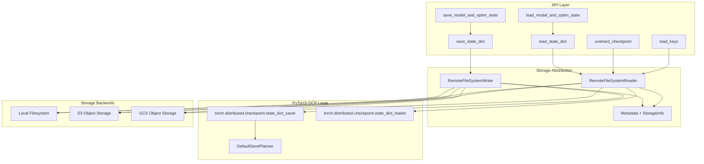
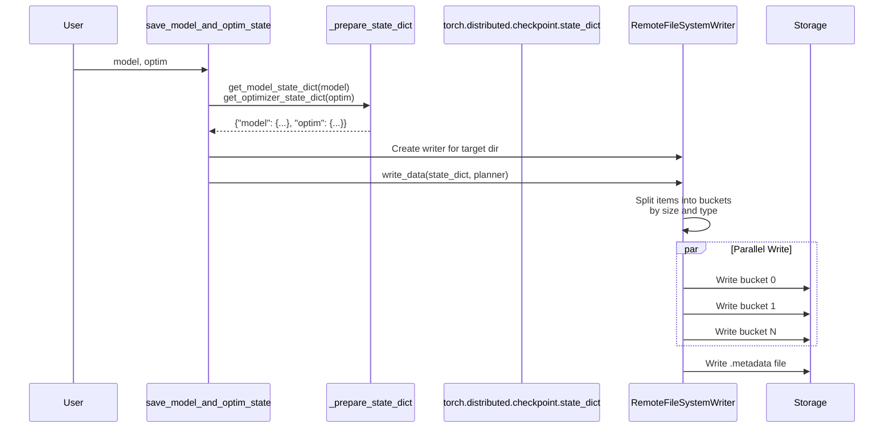
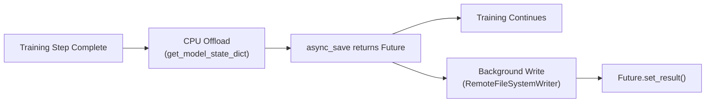
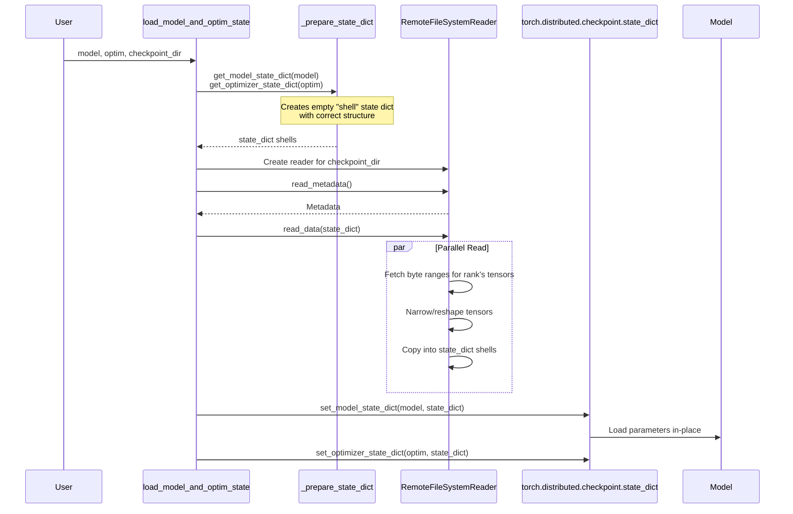
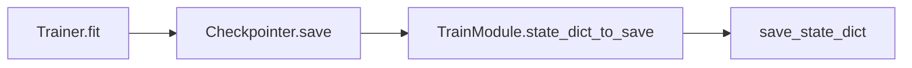

<!-- source: DeepWiki mcp.deepwiki.com · repo allenai/OLMo-core · page 4.3 Distributed Checkpointing · fetched 2026-10-26 -->

# Distributed Checkpointing

<details>
<summary>Relevant source files</summary>

The following files were used as context for generating this wiki page:

- [src/olmo_core/distributed/checkpoint/__init__.py](src/olmo_core/distributed/checkpoint/__init__.py)
- [src/olmo_core/distributed/checkpoint/filesystem.py](src/olmo_core/distributed/checkpoint/filesystem.py)
- [src/olmo_core/fs_cache.py](src/olmo_core/fs_cache.py)
- [src/olmo_core/train/checkpoint.py](src/olmo_core/train/checkpoint.py)
- [src/olmo_core/utils.py](src/olmo_core/utils.py)
- [src/test/distributed/checkpoint/filesystem_test.py](src/test/distributed/checkpoint/filesystem_test.py)
- [src/test/distributed/checkpoint_test.py](src/test/distributed/checkpoint_test.py)
- [src/test/fs_cache_test.py](src/test/fs_cache_test.py)

</details>


This page documents OLMo-core's distributed checkpointing system, which provides low-level primitives for saving and loading model and optimizer state across distributed training configurations. For the higher-level trainer checkpointing system, see [Checkpointing System](#3.6).

The distributed checkpointing module enables:
- **Topology-agnostic loading**: Save with one distributed configuration (e.g., 8-way FSDP) and load with a different configuration (e.g., 4-way FSDP + 2-way TP) [src/olmo_core/distributed/checkpoint/__init__.py:8-12]().
- **Remote storage**: Direct save/load to/from S3, GCS, or local filesystem [src/olmo_core/distributed/checkpoint/__init__.py:10-12]().
- **Efficient remote loading**: Each rank downloads only the fraction of data it needs for its local sharded tensors [src/olmo_core/distributed/checkpoint/__init__.py:10-12]().
- **Async checkpointing**: Non-blocking checkpoint saves with CPU offloading [src/olmo_core/distributed/checkpoint/__init__.py:137-138]().
- **Unsharding utilities**: Convert distributed checkpoints to standard PyTorch format [src/olmo_core/distributed/checkpoint/__init__.py:20-21]().

**Sources**: [src/olmo_core/distributed/checkpoint/__init__.py:1-24]()

---

## Architecture Overview

The distributed checkpointing system is built on three layers:

### System Component Diagram


**Sources**: [src/olmo_core/distributed/checkpoint/__init__.py:51-66](), [src/olmo_core/distributed/checkpoint/filesystem.py:187-210](), [src/olmo_core/distributed/checkpoint/filesystem.py:338-360]()

---

## Checkpoint File Structure

Distributed checkpoints are stored in a directory with the following structure:

```
checkpoint_dir/
├── .metadata              # Pickled Metadata object
├── __0_0.distcp          # Rank 0 data bucket 0
├── __0_1.distcp          # Rank 0 data bucket 1
├── __1_0.distcp          # Rank 1 data bucket 0
├── __1_1.distcp          # Rank 1 data bucket 1
└── ...
```

Each `.distcp` file contains multiple tensors or byte streams, with offsets stored in the metadata. The `RemoteFileSystemWriter` partitions checkpoint items into buckets by size and type to enable parallel writing [src/olmo_core/distributed/checkpoint/filesystem.py:81-102]().

**Sources**: [src/olmo_core/distributed/checkpoint/filesystem.py:105-152](), [src/olmo_core/distributed/checkpoint/filesystem.py:286-291]()

---

## Saving Checkpoints

### Basic Save Operation

The primary API for saving model and optimizer state:

### Save Flow Sequence


The save process uses `torch.distributed.checkpoint.state_dict.get_model_state_dict()` and `get_optimizer_state_dict()` to extract state with FSDP/DDP awareness, then writes it using `RemoteFileSystemWriter` [src/olmo_core/distributed/checkpoint/__init__.py:189-256]().

**Key functions**:
- `save_model_and_optim_state()` [src/olmo_core/distributed/checkpoint/__init__.py:189-256]()
- `async_save_model_and_optim_state()` [src/olmo_core/distributed/checkpoint/__init__.py:259-298]()
- `_prepare_state_dict()` [src/olmo_core/distributed/checkpoint/__init__.py:702-721]()

**Sources**: [src/olmo_core/distributed/checkpoint/__init__.py:189-298](), [src/olmo_core/distributed/checkpoint/__init__.py:702-721]()

### Bucketing Strategy

The `RemoteFileSystemWriter` partitions checkpoint items into buckets for parallel writing [src/olmo_core/distributed/checkpoint/filesystem.py:260-280]():

| Bucket Strategy | Description |
|----------------|-------------|
| **By Size** | Large tensors distributed across buckets using a greedy bin-packing algorithm [src/olmo_core/distributed/checkpoint/filesystem.py:91-100](). |
| **By Type** | Byte I/O items and tensor items separated, then round-robin distributed [src/olmo_core/distributed/checkpoint/filesystem.py:85-86](). |
| **Count** | Number of buckets equals `thread_count` or `process_count` parameter [src/olmo_core/distributed/checkpoint/filesystem.py:263-264](). |

**Sources**: [src/olmo_core/distributed/checkpoint/filesystem.py:81-102](), [src/olmo_core/distributed/checkpoint/filesystem.py:260-280]()

### Async Checkpointing

Async checkpoint saving enables training to continue while checkpoint data is written:



The `async_save_model_and_optim_state()` function [src/olmo_core/distributed/checkpoint/__init__.py:259-298]() uses PyTorch's `async_save()` API to de-stage state to CPU, then write in a background thread [src/olmo_core/distributed/checkpoint/__init__.py:137-138]().

**Sources**: [src/olmo_core/distributed/checkpoint/__init__.py:122-155](), [src/olmo_core/distributed/checkpoint/__init__.py:259-298]()

---

## Loading Checkpoints

### Basic Load Operation

### Load Flow Sequence


The load process creates empty "shell" tensors with the correct shapes for the current distributed topology, then fills them by reading only the necessary byte ranges from storage [src/olmo_core/distributed/checkpoint/__init__.py:302-394]().

**Key functions**:
- `load_model_and_optim_state()` [src/olmo_core/distributed/checkpoint/__init__.py:302-394]()
- `RemoteFileSystemReader.read_data()` [src/olmo_core/distributed/checkpoint/filesystem.py:387-430]()

**Sources**: [src/olmo_core/distributed/checkpoint/__init__.py:302-394](), [src/olmo_core/distributed/checkpoint/filesystem.py:387-430]()

### Byte-Range Reading and fs_cache

For remote checkpoints, the `RemoteFileSystemReader` fetches only the byte ranges needed for each rank's local tensors using `get_bytes_range()` [src/olmo_core/distributed/checkpoint/filesystem.py:404]().

OLMo-core includes a filesystem cache system (`fs_cache`) to avoid redundant remote requests for metadata like file sizes:
- `get_file_size()` is wrapped with `@maybe_cache(condition=is_url)` [src/olmo_core/io.py:106-107]().
- If `OLMO_CORE_FS_CACHE_DIR` is set, results are persisted as pickle files [src/olmo_core/fs_cache.py:17-44]().

**Sources**: [src/olmo_core/distributed/checkpoint/filesystem.py:363-379](), [src/olmo_core/io.py:106-134](), [src/olmo_core/fs_cache.py:23-85]()

---

## Topology-Agnostic Loading

A key feature of the distributed checkpointing system is the ability to load checkpoints saved with one distributed configuration into a model with a different configuration [src/olmo_core/distributed/checkpoint/__init__.py:8-9]().

### Supported Topology Changes

| Save Configuration | Load Configuration | Status |
|-------------------|-------------------|--------|
| 8-way FSDP | 4-way FSDP | ✓ Supported |
| Unsharded | 2-way TP | ✓ Supported |
| 4-way FSDP + 2-way TP | 8-way FSDP | ✓ Supported |
| 2-way TP | Unsharded | ✓ Supported |

### How It Works

The PyTorch DCP layer handles the resharding logic by:
1. Reading metadata to determine where each parameter is stored.
2. Computing which byte ranges the current rank needs.
3. Fetching and narrowing tensors to the correct shape using `_narrow_tensor_by_index()` [src/olmo_core/distributed/checkpoint/filesystem.py:171-184]().
4. Copying into the local state dict in-place [src/olmo_core/distributed/checkpoint/filesystem.py:417-419]().

**Sources**: [src/olmo_core/distributed/checkpoint/filesystem.py:171-184](), [src/olmo_core/distributed/checkpoint/filesystem.py:409-419]()

---

## Unsharding Checkpoints

The `unshard_checkpoint()` function converts distributed checkpoints to standard PyTorch format [src/olmo_core/distributed/checkpoint/__init__.py:465-619]().

### Unsharding Strategies

The `UnshardStrategy` class [src/olmo_core/distributed/checkpoint/__init__.py:421-463]() defines three strategies:

| Strategy | Use Case | Output |
|----------|----------|--------|
| **one_file** | Small-medium models | Single `model.pt` and `optim.pt` [src/olmo_core/distributed/checkpoint/__init__.py:429-432](). |
| **one_file_per_tensor** | Large models, need granular access | One file per parameter [src/olmo_core/distributed/checkpoint/__init__.py:434-437](). |
| **chunks** | Very large models, memory-efficient | Multiple chunk files, bounded size [src/olmo_core/distributed/checkpoint/__init__.py:439-442](). |

**Sources**: [src/olmo_core/distributed/checkpoint/__init__.py:396-463](), [src/olmo_core/distributed/checkpoint/__init__.py:465-619]()

---

## Integration with Trainer

The trainer-level `Checkpointer` class uses these distributed checkpointing primitives:

### Trainer Checkpoint Logic


**Implementation Details**:
- `Checkpointer.save()` [src/olmo_core/train/checkpoint.py:102-134]() calls `save_state_dict()`.
- `Checkpointer.save_async()` [src/olmo_core/train/checkpoint.py:136-181]() calls `async_save_state_dict()`.
- `Checkpointer.load()` [src/olmo_core/train/checkpoint.py:183-242]() calls `load_state_dict()`.

**Sources**: [src/olmo_core/train/checkpoint.py:102-242]()

---

