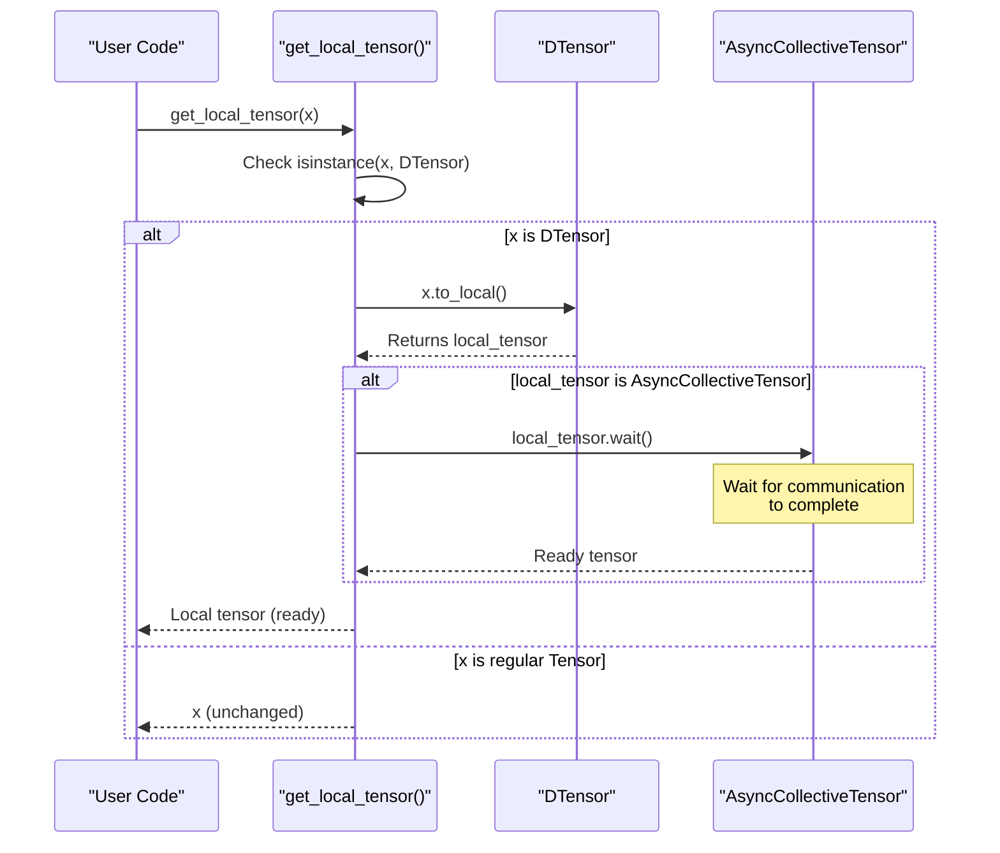
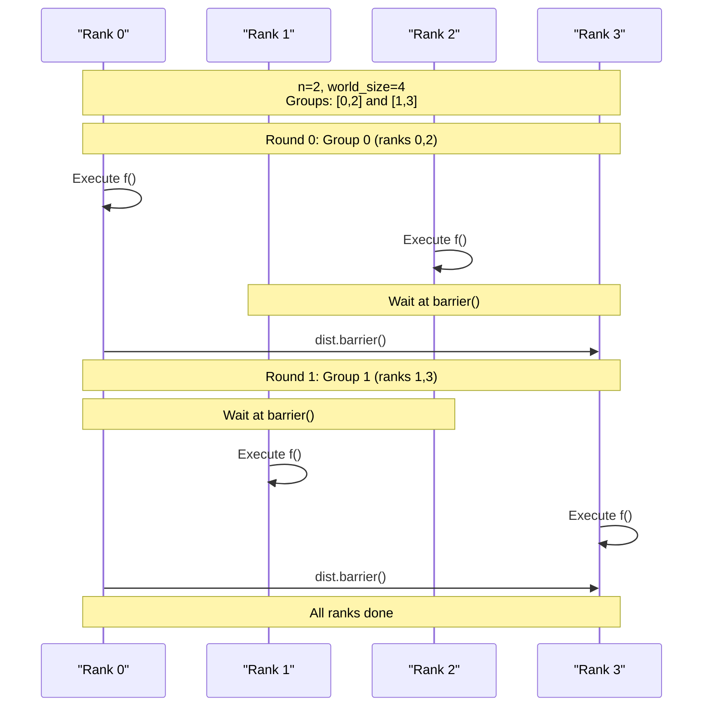

<!-- source: DeepWiki mcp.deepwiki.com · repo allenai/OLMo-core · page 4.4 Communication Primitives · fetched 2026-10-26 -->

# Communication Primitives

<details>
<summary>Relevant source files</summary>

The following files were used as context for generating this wiki page:

- [src/olmo_core/distributed/__init__.py](src/olmo_core/distributed/__init__.py)
- [src/olmo_core/distributed/utils.py](src/olmo_core/distributed/utils.py)
- [src/olmo_core/model_ladder/utils.py](src/olmo_core/model_ladder/utils.py)
- [src/olmo_core/train/__init__.py](src/olmo_core/train/__init__.py)
- [src/olmo_core/train/callbacks/speed_monitor.py](src/olmo_core/train/callbacks/speed_monitor.py)
- [src/olmo_core/train/common.py](src/olmo_core/train/common.py)
- [src/olmo_core/train/utils.py](src/olmo_core/train/utils.py)
- [src/test/train/utils_test.py](src/test/train/utils_test.py)

</details>


This page documents the collective communication operations and utilities used in distributed training. These primitives enable coordination and data exchange across ranks in a process group, including operations like `all_reduce`, `all_gather`, `broadcast`, and specialized utilities for DTensor manipulation and concurrency control.

For information about process group initialization and configuration, see [Distributed Initialization (4.1)](). For how these primitives are used in different parallelism strategies, see [Parallelism Strategies (4.2)]().

## Overview

OLMo-core provides a comprehensive set of communication primitives in [src/olmo_core/distributed/utils.py]() that wrap PyTorch's distributed operations with additional convenience features:

- Automatic handling of non-distributed contexts (graceful no-ops when not distributed).
- Type-safe wrappers for common value synchronization patterns.
- DTensor utilities for working with distributed tensors.
- Concurrency control patterns for rate-limiting operations across ranks.

These primitives are used throughout the training system for gradient synchronization, metric aggregation, checkpoint coordination, and bookkeeping operations.

**Communication Primitives Taxonomy**

```mermaid
graph TB
    subgraph "Core Collectives"
        [barrier] --> ["dist.barrier()"]
        [broadcast_object] --> ["dist.broadcast_object_list()"]
        [all_gather] --> ["dist.all_gather()"]
        [all_gather_object] --> ["dist.all_gather_object()"]
    end
    
    subgraph "Value Synchronization"
        [synchronize_value] --> [broadcast_object]
        [synchronize_flag] --> [synchronize_value]
        [all_reduce_value] --> ["dist.all_reduce()"]
    end
    
    subgraph "DTensor Utilities"
        [get_local_tensor] --> ["DTensor.to_local()"]
        [get_full_tensor] --> ["DTensor.full_tensor()"]
        [distribute_like] --> ["distribute_tensor()"]
    end
    
    subgraph "Concurrency Control"
        [do_n_at_a_time] --> [barrier]
        [hide_from_torch] --> [_HiddenTensor]
        [unhide_from_torch] --> [torch.Tensor]
    end
    
    subgraph "High-Level Operations"
        [reduce_metrics] --> [all_gather_object]
        [reduce_metrics] --> ["dist.all_reduce()"]
        [move_metrics] --> [get_local_tensor]
    end
    
    style [reduce_metrics] stroke-dasharray: 5 5
    style [do_n_at_a_time] stroke-dasharray: 5 5
```

Sources: [src/olmo_core/distributed/utils.py:1-529](), [src/olmo_core/train/utils.py:120-348]()

## Basic Collective Operations

These operations coordinate and exchange data across all ranks in a process group.

### Barrier

The `barrier()` function synchronizes all ranks in a process group. All ranks must reach the barrier before any can proceed.

```python
def barrier(group: Optional[dist.ProcessGroup] = None) -> None
```

Key features:
- No-op in non-distributed contexts [src/olmo_core/distributed/utils.py:183-184]().
- Blocks until all ranks reach the barrier using `dist.barrier()` [src/olmo_core/distributed/utils.py:187]().
- Useful for ensuring checkpoints are written before proceeding.

Sources: [src/olmo_core/distributed/utils.py:182-187]()

### Broadcast

The `broadcast_object()` function broadcasts a Python object from a source rank to all other ranks using pickle serialization.

```python
def broadcast_object(obj: T, src: int = 0, group: Optional[dist.ProcessGroup] = None) -> T
```

Implementation uses `dist.broadcast_object_list()` to handle the transfer [src/olmo_core/distributed/utils.py:358](). It is a no-op if not in a distributed environment [src/olmo_core/distributed/utils.py:352-353]().

Sources: [src/olmo_core/distributed/utils.py:350-359]()

### All-Gather

Two variants are provided: one for tensors and one for arbitrary objects.

**Tensor All-Gather**
The `all_gather()` function handles variable-sized tensors across ranks by first gathering shapes, then allocating buffers accordingly [src/olmo_core/distributed/utils.py:362-388]().

**Object All-Gather**
The `all_gather_object()` function uses pickle serialization for arbitrary Python objects and returns a list with one object per rank [src/olmo_core/distributed/utils.py:391-403](). It is used extensively in metric reduction to gather metadata [src/olmo_core/train/utils.py:161-169]().

Sources: [src/olmo_core/distributed/utils.py:362-403](), [src/olmo_core/train/utils.py:161-169]()

## Value Synchronization

These utilities provide type-safe wrappers for synchronizing scalar values and flags across ranks.

### Synchronize Value

The `synchronize_value()` function broadcasts a value from a source rank to all other ranks with automatic device handling.

```python
def synchronize_value(
    value: V,  # bool, int, float, or torch.Tensor
    device: torch.device,
    src: int = 0,
    group: Optional[dist.ProcessGroup] = None
) -> V
```

Implementation details:
- Automatically converts scalar values to tensors [src/olmo_core/distributed/utils.py:312-316]().
- Moves tensors to the specified device [src/olmo_core/distributed/utils.py:317]().
- Preserves the original type in the return value [src/olmo_core/distributed/utils.py:322-326]().

The `synchronize_flag()` function is a specialized version for boolean values [src/olmo_core/distributed/utils.py:288-298]().

Sources: [src/olmo_core/distributed/utils.py:288-326]()

### All-Reduce Value

The `all_reduce_value()` function performs an all-reduce operation on a scalar or tensor value using `dist.all_reduce()` [src/olmo_core/distributed/utils.py:341]().

```python
def all_reduce_value(
    value: V,
    device: torch.device,
    op=dist.ReduceOp.SUM,
    group: Optional[dist.ProcessGroup] = None
) -> V
```

Common reduction operations supported include `SUM`, `MAX`, and `MIN` [src/olmo_core/distributed/utils.py:335]().

Sources: [src/olmo_core/distributed/utils.py:328-344]()

## DTensor Utilities

These utilities facilitate working with distributed tensors (`DTensor`), which are tensors sharded across multiple devices.

### Get Local Tensor

The `get_local_tensor()` function extracts the local shard from a `DTensor`. If the tensor is not a `DTensor`, it returns the tensor unchanged [src/olmo_core/distributed/utils.py:441-452]().

**DTensor Access Pattern**



Sources: [src/olmo_core/distributed/utils.py:441-452]()

### Get Full Tensor

The `get_full_tensor()` function reconstructs the full tensor from a `DTensor` by gathering all shards via `x.full_tensor()` [src/olmo_core/distributed/utils.py:458](). For regular tensors, it returns them unchanged [src/olmo_core/distributed/utils.py:456]().

Sources: [src/olmo_core/distributed/utils.py:455-459]()

### Distribute Like

The `distribute_like()` function redistributes the `target` tensor to match the sharding strategy of the `source` tensor using `distribute_tensor()` [src/olmo_core/distributed/utils.py:470]().

Sources: [src/olmo_core/distributed/utils.py:462-472]()

## Concurrency Control

### The `do_n_at_a_time` Pattern

This function implements a concurrency control pattern where at most `n` ranks execute a function at once, with all ranks eventually calling the function exactly once [src/olmo_core/distributed/utils.py:475-505]().

**Execution Flow**



Sources: [src/olmo_core/distributed/utils.py:475-505]()

### Hidden Tensors

The `hide_from_torch()` and `unhide_from_torch()` utilities wrap tensors in a `_HiddenTensor` class to hide them from PyTorch's automatic device movement operations (like `nn.Module.to()`) [src/olmo_core/distributed/utils.py:508-528]().

Sources: [src/olmo_core/distributed/utils.py:508-528]()

## Metric Reduction

The `reduce_metrics()` function in [src/olmo_core/train/utils.py]() implements a sophisticated metric aggregation system that combines multiple communication primitives for efficient distributed metric collection.

### Reduction Types

The `ReduceType` enum defines how metrics are aggregated [src/olmo_core/train/common.py:131-155]():

| Reduction Type | Operation | Use Case |
|----------------|-----------|----------|
| `mean` | Average across ranks | Loss values, accuracies |
| `sum` | Sum across ranks | Token counts, batch sizes |
| `max` | Maximum across ranks | Peak memory, worst-case timings |
| `l2_norm` | L2 norm (sqrt of sum of squares) | Gradient norms |
| `None` | No reduction (rank-local) | Rank-specific debugging info |

### Metric Reduction Pipeline

```mermaid
graph TB
    subgraph "Input"
        [metrics] --> [move_metrics]
        [reduce_types] --> [move_metrics]
    end
    
    subgraph "Phase 1: Move to Device"
        [move_metrics] --> [get_local_tensor]
    end
    
    subgraph "Phase 2: Metadata"
        [all_gather_object] --> [Check Consistency]
    end
    
    subgraph "Phase 3: Reduction"
        [all_reduce_SUM] --> [Sum/Mean/L2 Metrics]
        [all_reduce_MAX] --> [Max Metrics]
    end
    
    subgraph "Phase 4: Post-processing"
        [Post-process] --> [Mean Divisor]
        [Post-process] --> [L2 Sqrt]
    end
```

### Key Optimizations

1. **Batching**: Metrics are batched into single `all_reduce` operations to minimize overhead [src/olmo_core/train/utils.py:284-293]().
2. **Reduce Factor**: Uses `get_reduce_divide_factor()` to divide values before reduction to prevent overflow [src/olmo_core/train/utils.py:277-278]().
3. **Consistency Handling**: When metrics are inconsistent across ranks, `all_gather_object` is used to determine which ranks have which metrics [src/olmo_core/train/utils.py:161-169]().

Sources: [src/olmo_core/train/utils.py:120-348](), [src/olmo_core/train/common.py:131-155](), [src/olmo_core/distributed/utils.py:406-413]()

---

