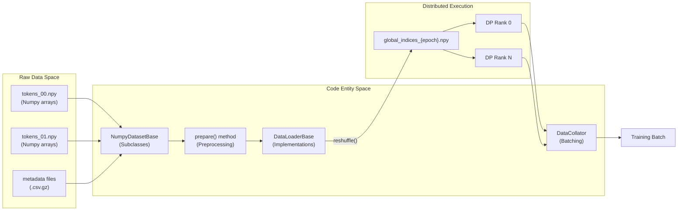
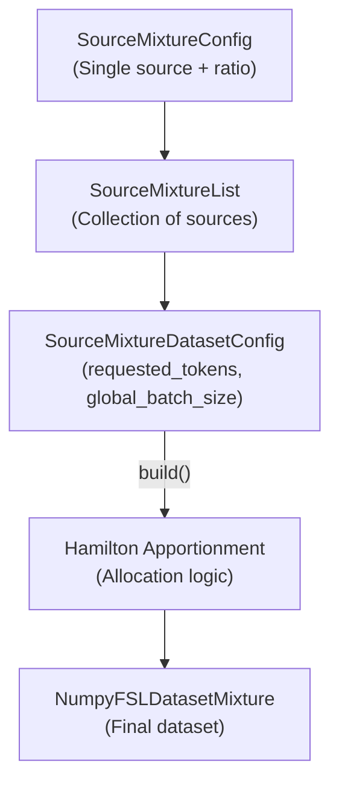
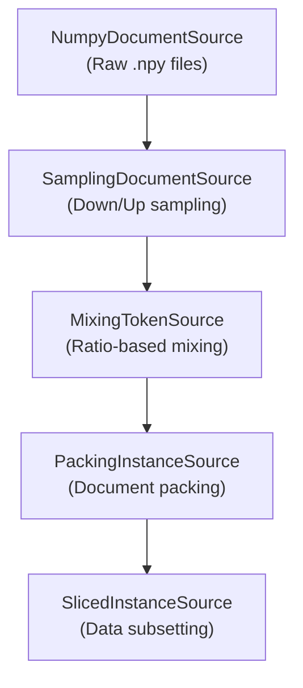

<!-- source: DeepWiki mcp.deepwiki.com · repo allenai/OLMo-core · page 5 Data Pipeline · fetched 2026-10-26 -->

# Data Pipeline

Relevant source files

The following files were used as context for generating this wiki page:

- [docs/source/index.rst](docs/source/index.rst)
- [src/olmo_core/data/__init__.py](src/olmo_core/data/__init__.py)
- [src/olmo_core/data/composable/mixing_token_source.py](src/olmo_core/data/composable/mixing_token_source.py)
- [src/olmo_core/data/composable/numpy_document_source.py](src/olmo_core/data/composable/numpy_document_source.py)
- [src/olmo_core/data/composable/sampling_document_source.py](src/olmo_core/data/composable/sampling_document_source.py)
- [src/olmo_core/data/composable/sampling_instance_source.py](src/olmo_core/data/composable/sampling_instance_source.py)
- [src/olmo_core/data/composable/sampling_token_source.py](src/olmo_core/data/composable/sampling_token_source.py)
- [src/olmo_core/data/data_loader.py](src/olmo_core/data/data_loader.py)
- [src/olmo_core/data/numpy_dataset.py](src/olmo_core/data/numpy_dataset.py)
- [src/test/data/composable/sampling_instance_source_test.py](src/test/data/composable/sampling_instance_source_test.py)
- [src/test/data/composable/sampling_token_source_test.py](src/test/data/composable/sampling_token_source_test.py)
- [src/test/data/data_loader_test.py](src/test/data/data_loader_test.py)

## Overview

The OLMo-core data pipeline loads pre-tokenized training data from memory-mapped NumPy arrays on disk and transforms them into batches for the training loop. The system is designed for large-scale distributed training and supports:

- **Multiple dataset types**: Fixed-sequence-length (FSL) and variable-sequence-length (VSL) datasets with various packing strategies [src/olmo_core/data/numpy_dataset.py:68-90]().
- **Data mixing**: Ratio-based mixing of multiple data sources with precise token allocation using Hamilton's Method [src/olmo_core/data/mixes.py:1-50]().
- **Distributed loading**: Multi-worker data loading with deterministic shuffling across distributed ranks [src/olmo_core/data/data_loader.py:1-49]().
- **Curriculum learning**: VSL datasets with configurable length curricula [src/olmo_core/data/numpy_dataset.py:1472-1550]().
- **Stateful checkpointing**: Exact resumption from any training step by tracking processed batches and tokens [src/olmo_core/data/data_loader.py:104-140]().

The pipeline expects tokenized data in NumPy `.npy` format, typically prepared using external tools like the [Dolma toolkit](https://allenai.github.io/dolma/) [src/olmo_core/data/__init__.py:7-14]().

**Sources:** [src/olmo_core/data/__init__.py:1-14](), [src/olmo_core/data/numpy_dataset.py:106-123](), [src/olmo_core/data/data_loader.py:54-82]()

## System Architecture

The data pipeline consists of layers working together to transform raw token arrays into training batches. It bridges the gap between raw data on disk and the training loop.

**Diagram: Data Pipeline Architecture**

**Sources:** [src/olmo_core/data/numpy_dataset.py:106-351](), [src/olmo_core/data/data_loader.py:54-258](), [src/olmo_core/data/collator.py:17-40]()

## Dataset Layer

The dataset layer implements the `NumpyDatasetBase` abstract class, which provides the interface for reading token arrays from disk. All datasets return dictionaries with at minimum an `input_ids` tensor [src/olmo_core/data/numpy_dataset.py:106-154]().

### Dataset Types

The choice of dataset type determines how raw token arrays are organized into training instances:

| Dataset Class | Description | Use Case | Details |
|---------------|-------------|----------|---------|
| `NumpyFSLDataset` | Concatenates all tokens and chunks into fixed-length sequences | Simple training, ignores boundaries | [Dataset Types](#5.1) |
| `NumpyPaddedFSLDataset` | One document per instance, padded to sequence length | Preserving document boundaries | [Dataset Types](#5.1) |
| `NumpyPackedFSLDataset` | OBFD packing of multiple documents per instance | Minimizing padding waste | [Dataset Types](#5.1), [Document Packing Strategies](#5.5) |
| `NumpyInterleavedFSLDataset` | Interleaves chunks from multiple documents | Multi-context training | [Dataset Types](#5.1) |
| `NumpyVSLDataset` | Variable-length instances with curriculum learning | Sequence length warm-up | [Dataset Types](#5.1), [Data Mixing and Curricula](#5.2) |

**Sources:** [src/olmo_core/data/numpy_dataset.py:366-449](), [src/olmo_core/data/numpy_dataset.py:643-700](), [src/olmo_core/data/numpy_dataset.py:982-1050](), [src/olmo_core/data/numpy_dataset.py:1652-1720]()

## Data Mixing and Curricula

OLMo-core supports combining multiple data sources with precise ratio control and implementing curriculum learning.

### Source Mixtures

The `SourceMixtureDatasetConfig` system enables ratio-based mixing of multiple data sources [src/olmo_core/data/source_mixture.py:29-61]().

**Diagram: Mixing Code Entities**

### VSL Curricula

For variable-sequence-length training, `NumpyVSLDataset` uses curriculum schedulers like `VSLNaturalCurriculum` or `VSLGrowP2Curriculum` to control bucket sampling [src/olmo_core/data/numpy_dataset.py:1472-1639]().

For complete details, see [Data Mixing and Curricula](#5.2).

**Sources:** [src/olmo_core/data/source_mixture.py:29-150](), [src/olmo_core/data/numpy_dataset.py:1472-1639]()

## Data Loader Layer

Data loaders wrap datasets to provide iterator-based batch generation with distributed sampling and stateful checkpointing [src/olmo_core/data/data_loader.py:54-92]().

### Core Functionality

- **Global index generation**: `reshuffle(epoch)` generates a global ordering of all instances, saved to `work_dir/global_indices_{epoch}.npy` [src/olmo_core/data/data_loader.py:325-360]().
- **Distributed sampling**: Each rank processes a disjoint subset of batches based on its `dp_rank` and `dp_world_size` [src/olmo_core/data/data_loader.py:99-102]().
- **Multi-worker loading**: Spawns worker processes to load instances in parallel when `num_workers > 0` [src/olmo_core/data/data_loader.py:325-335]().
- **Batch collation**: `DataCollator` assembles instances into tensors, handling padding and attention masks [src/olmo_core/data/collator.py:17-100]().

For complete details, see [Data Loaders](#5.3) and [Batch Processing and State Management](#5.4).

**Sources:** [src/olmo_core/data/data_loader.py:54-258](), [src/olmo_core/data/collator.py:17-100]()

## Composable Data Pipeline

The `olmo_core.data.composable` module provides a modern, functional approach to building pipelines by composing sources [src/olmo_core/data/__init__.py:16](). It allows for sophisticated data manipulation before instances are created.

### Composable Entities

**Diagram: Composable Pipeline Entities**

Key features include:
- **NumpyDocumentSource**: The primary entry point for raw tokenized data [src/olmo_core/data/composable/numpy_document_source.py:80-81]().
- **Sampling Sources**: `SamplingDocumentSource` and `SamplingTokenSource` allow for adjusting the effective size of a dataset via `max_tokens` or `factor` [src/olmo_core/data/composable/sampling_document_source.py:62-73]().
- **Mixing Sources**: `MixingTokenSource` enables mixing multiple streams with target ratios [src/olmo_core/data/composable/mixing_token_source.py:116-146]().
- **Handling Long Documents**: Configurable `LongDocStrategy` (truncate or fragment) for documents exceeding `max_document_length` [src/olmo_core/data/composable/numpy_document_source.py:46-55]().

For details, see [Composable Data Pipeline](#5.6).

**Sources:** [src/olmo_core/data/composable/numpy_document_source.py:32-81](), [src/olmo_core/data/composable/sampling_document_source.py:30-73](), [src/olmo_core/data/composable/mixing_token_source.py:61-146]()

## Document Packing Strategies

The `NumpyPackedFSLDataset` implements the Optimized Best-Fit Decreasing (OBFD) algorithm to pack multiple documents into fixed-length instances while minimizing padding waste [src/olmo_core/data/utils.py:689-855](). This involves the `SegmentTree` data structure for efficient bin selection [src/olmo_core/data/utils.py:1005-1080]().

For details, see [Document Packing Strategies](#5.5).

**Sources:** [src/olmo_core/data/numpy_dataset.py:982-1050](), [src/olmo_core/data/utils.py:689-855](), [src/olmo_core/data/utils.py:1005-1080]()

---

