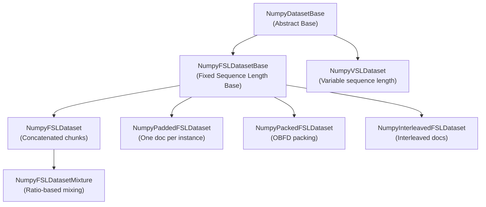
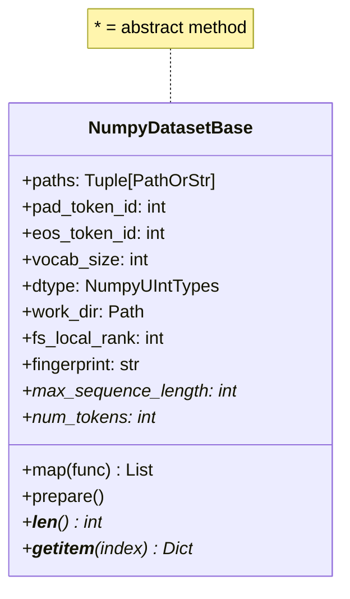
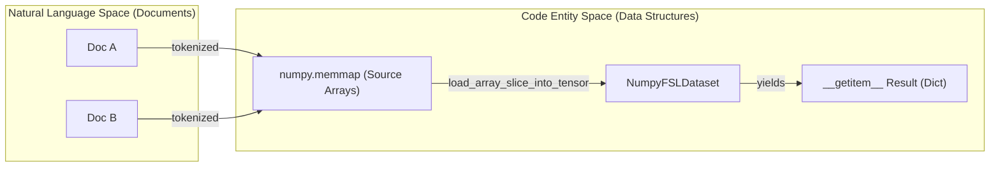
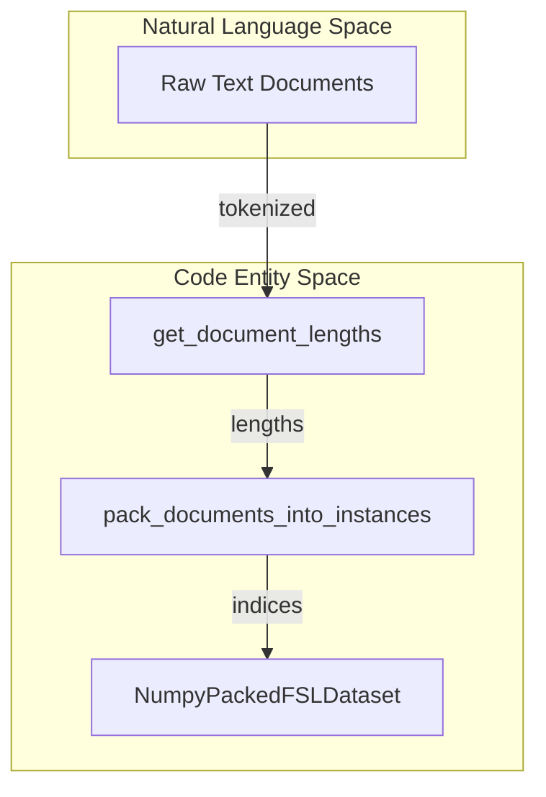

<!-- source: DeepWiki mcp.deepwiki.com · repo allenai/OLMo-core · page 5.1 Dataset Types · fetched 2026-10-26 -->

# Dataset Types

Relevant source files

The following files were used as context for generating this wiki page:

- [docs/source/guides/data_mixing.rst](docs/source/guides/data_mixing.rst)
- [docs/source/index.rst](docs/source/index.rst)
- [src/olmo_core/data/__init__.py](src/olmo_core/data/__init__.py)
- [src/olmo_core/data/data_loader.py](src/olmo_core/data/data_loader.py)
- [src/olmo_core/data/numpy_dataset.py](src/olmo_core/data/numpy_dataset.py)
- [src/olmo_core/data/source_mixture.py](src/olmo_core/data/source_mixture.py)
- [src/olmo_core/data/types.py](src/olmo_core/data/types.py)
- [src/test/data/data_loader_test.py](src/test/data/data_loader_test.py)
- [src/test/data/fixtures.py](src/test/data/fixtures.py)
- [src/test/data/numpy_dataset_test.py](src/test/data/numpy_dataset_test.py)
- [src/test/data/source_mixture_test.py](src/test/data/source_mixture_test.py)

This page documents the various dataset implementations in OLMo-core that load token IDs from numpy arrays on disk. These dataset classes form the foundation of the data pipeline and implement different strategies for organizing tokens into training instances.

For information about mixing multiple datasets together, see [Data Mixing and Curricula](#5.2). For information about data loaders that wrap these datasets, see [Data Loaders](#5.3). For detailed information about the document packing algorithm, see [Document Packing Strategies](#5.5).

## Overview

OLMo-core provides multiple dataset types optimized for different training scenarios. All dataset implementations extend from `NumpyDatasetBase` [src/olmo_core/data/numpy_dataset.py:106-123]() and read tokenized data from numpy `.npy` files produced by tools like the Dolma toolkit.

**Dataset Type Hierarchy**

Sources: [src/olmo_core/data/numpy_dataset.py:68-90](), [src/olmo_core/data/numpy_dataset.py:106-123]()

## Key Concepts

| Concept | Description |
|---------|-------------|
| **Instance** | A single training example containing `input_ids` (token IDs) and optional metadata. |
| **Sequence Length** | Number of tokens in each instance. |
| **FSL** | Fixed Sequence Length - all instances have the same length. |
| **VSL** | Variable Sequence Length - instances can have different lengths. |
| **Document** | A contiguous sequence of tokens from a single source, typically bounded by EOS tokens. |
| **Packing** | Combining multiple documents into a single instance to minimize padding. |

## Base Classes

### NumpyDatasetBase

`NumpyDatasetBase` is the abstract base class for all numpy-backed datasets [src/olmo_core/data/numpy_dataset.py:106-123](). It defines the common interface and provides utilities for working with multiple numpy array files.

**Core Responsibilities:**
- Managing paths to `.npy` token ID arrays [src/olmo_core/data/numpy_dataset.py:137]().
- Tracking vocabulary metadata (`vocab_size`, `pad_token_id`, `eos_token_id`, `bos_token_id`) [src/olmo_core/data/numpy_dataset.py:138-142]().
- Computing dataset fingerprints for reproducibility [src/olmo_core/data/numpy_dataset.py:212-223]().
- Providing parallel processing utilities via `map()` [src/olmo_core/data/numpy_dataset.py:302-315]().

**Key Properties and Methods:**

**Fingerprinting:**

The `fingerprint` property computes a SHA-256 hash of the dataset configuration and source files, used to verify dataset consistency when resuming training:

[src/olmo_core/data/numpy_dataset.py:212-223]()

Sources: [src/olmo_core/data/numpy_dataset.py:106-358]()

### NumpyFSLDatasetBase

`NumpyFSLDatasetBase` extends `NumpyDatasetBase` for fixed sequence length datasets [src/olmo_core/data/numpy_dataset.py:360-376](). All FSL datasets produce instances with exactly `sequence_length` tokens.

**Additional Fields:**

| Field | Type | Purpose |
|-------|------|---------|
| `sequence_length` | `int` | Number of tokens per instance [src/olmo_core/data/numpy_dataset.py:382](). |
| `metadata` | `Tuple[Dict[str, Any]]` | Per-source metadata attached to instances [src/olmo_core/data/numpy_dataset.py:383](). |
| `include_instance_metadata` | `bool` | Whether to include metadata in `__getitem__` output [src/olmo_core/data/numpy_dataset.py:384](). |
| `generate_doc_lengths` | `bool` | Whether to compute document length tensors [src/olmo_core/data/numpy_dataset.py:385](). |
| `instance_filter_config` | `Optional[InstanceFilterConfig]` | Config for filtering repetitive instances [src/olmo_core/data/numpy_dataset.py:386](). |
| `label_mask_paths` | `Optional[List[PathOrStr]]` | Paths to label mask arrays [src/olmo_core/data/numpy_dataset.py:387](). |

Sources: [src/olmo_core/data/numpy_dataset.py:360-443]()

## Fixed Sequence Length Datasets

### NumpyFSLDataset

The standard FSL dataset concatenates all tokens from source arrays and chunks them into contiguous blocks of `sequence_length` tokens [src/olmo_core/data/numpy_dataset.py:445-460](). Documents may be split across multiple instances.

**Data Flow Space to Code Entity Space:**

**Key Features:**
- **Simple and efficient**: No preprocessing overhead for basic usage.
- **Document boundaries ignored**: Documents can span multiple instances [src/olmo_core/data/numpy_dataset.py:445-455]().
- **No padding**: Uses all available tokens (except remainder) [src/olmo_core/data/numpy_dataset.py:535-540]().

Sources: [src/olmo_core/data/numpy_dataset.py:445-683](), [src/olmo_core/data/utils.py:60-66]()

### NumpyPaddedFSLDataset

Creates one instance per document, padding shorter documents to `sequence_length` [src/olmo_core/data/numpy_dataset.py:837-853](). Documents longer than `sequence_length` are either truncated or fragmented based on `long_doc_strategy`.

**Key Features:**
- **Document boundaries preserved**: Each instance contains tokens from a single document (or fragment) [src/olmo_core/data/numpy_dataset.py:837-845]().
- **Padding applied**: Shorter documents padded with `pad_token_id` [src/olmo_core/data/numpy_dataset.py:837-845]().
- **Configurable long document handling**: Truncate or fragment long documents via `LongDocStrategy` [src/olmo_core/data/types.py:10-24]().

Sources: [src/olmo_core/data/numpy_dataset.py:837-1027](), [src/olmo_core/data/types.py:10-24]()

### NumpyPackedFSLDataset

Uses the Optimized Best-Fit Decreasing (OBFD) bin packing algorithm to combine multiple documents into instances, minimizing padding waste [src/olmo_core/data/numpy_dataset.py:1029-1050]().

**Packing Logic Mapping:**

**Key Features:**
- **Maximum efficiency**: Minimizes total padding tokens [src/olmo_core/data/numpy_dataset.py:1029-1040]().
- **Multi-document instances**: Each instance contains 1+ complete documents.
- **OBFD algorithm**: Implemented via `pack_documents_into_instances` [src/olmo_core/data/utils.py:796-873]().

Sources: [src/olmo_core/data/numpy_dataset.py:1029-1538](), [src/olmo_core/data/utils.py:796-873]()

### NumpyInterleavedFSLDataset

Interleaves multiple documents within each instance [src/olmo_core/data/numpy_dataset.py:1540-1557](). Useful for long-context training where exposing the model to multiple documents per instance improves performance.

**Configuration:**

| Parameter | Purpose |
|-----------|---------|
| `num_documents_per_instance` | Target number of documents to interleave [src/olmo_core/data/numpy_dataset.py:1568](). |
| `num_interleaving_exempt_instances` | Number of instances that contain only one document [src/olmo_core/data/numpy_dataset.py:1569](). |

Sources: [src/olmo_core/data/numpy_dataset.py:1540-2032]()

### NumpyVSLDataset

Implements Variable Sequence Length (VSL) training [src/olmo_core/data/numpy_dataset.py:2034-2055](). Documents are bucketed by length and sampled according to a curriculum schedule.

**Curriculum Types:**

| Curriculum | Behavior |
|------------|----------|
| `VSLNaturalCurriculum` | Samples buckets according to their natural distribution [src/olmo_core/data/numpy_dataset.py:1865-1870](). |
| `VSLGrowthCurriculum` | Exponentially increases max bucket size over time [src/olmo_core/data/numpy_dataset.py:1882-1887](). |
| `VSLGrowP2Curriculum` | Grows in discrete power-of-2 stages [src/olmo_core/data/numpy_dataset.py:1924-1929](). |
| `VSLGrowLinearCurriculum` | Linearly increases max bucket size [src/olmo_core/data/numpy_dataset.py:1976-1981](). |

Sources: [src/olmo_core/data/numpy_dataset.py:1831-2032](), [src/olmo_core/data/numpy_dataset.py:2034-2401]()

## Configuration and Building

Each dataset type has a corresponding `Config` class that provides a builder pattern.

**Dataset Configuration Classes:**

| Config Class | Target Dataset |
|--------------|----------------|
| `NumpyFSLDatasetConfig` | `NumpyFSLDataset` [src/olmo_core/data/numpy_dataset.py:2616-2618]() |
| `NumpyPaddedFSLDatasetConfig` | `NumpyPaddedFSLDataset` [src/olmo_core/data/numpy_dataset.py:2796-2798]() |
| `NumpyPackedFSLDatasetConfig` | `NumpyPackedFSLDataset` [src/olmo_core/data/numpy_dataset.py:2898-2900]() |
| `NumpyInterleavedFSLDatasetConfig` | `NumpyInterleavedFSLDataset` [src/olmo_core/data/numpy_dataset.py:3134-3136]() |
| `NumpyVSLDatasetConfig` | `NumpyVSLDataset` [src/olmo_core/data/numpy_dataset.py:3266-3268]() |

**Building from Source Mixtures:**
`NumpyFSLDatasetConfig` and others provide a `from_src_mix` method to build a dataset configuration directly from a `SourceMixtureDatasetConfig` [src/olmo_core/data/numpy_dataset.py:2688-2701](). This integrates with the fine-grained ratio-based sampling system [src/olmo_core/data/source_mixture.py:30-61]().

Sources: [src/olmo_core/data/numpy_dataset.py:2403-3947](), [src/olmo_core/data/source_mixture.py:211-228]()

## Instance Filtering and Masking

### Repetition Filtering
The `InstanceFilterConfig` [src/olmo_core/data/numpy_dataset.py:99-104]() enables filtering out instances with excessive repetition. It uses `find_periodic_sequences` [src/olmo_core/data/utils.py:532-555]() to detect patterns based on `repetition_max_period` and `repetition_max_count`.

### Label Masking
All FSL datasets support optional label masking [src/olmo_core/data/numpy_dataset.py:378-380](). If `label_mask_paths` are provided, the dataset loads corresponding boolean masks to indicate which tokens should be included in loss calculations [src/olmo_core/data/numpy_dataset.py:599-603](). This is useful for supervised fine-tuning (SFT) or masking specific data types.

Sources: [src/olmo_core/data/numpy_dataset.py:99-104](), [src/olmo_core/data/numpy_dataset.py:378-413](), [src/olmo_core/data/utils.py:532-555]()

---

