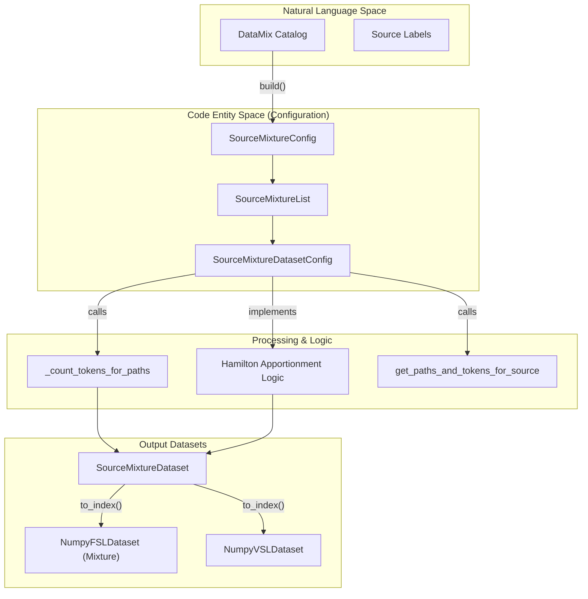
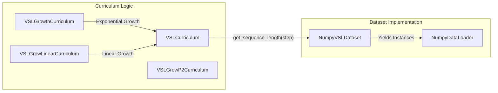

<!-- source: DeepWiki mcp.deepwiki.com · repo allenai/OLMo-core · page 5.2 Data Mixing and Curricula · fetched 2026-10-26 -->

# Data Mixing and Curricula

<details>
<summary>Relevant source files</summary>

The following files were used as context for generating this wiki page:

- [docs/source/guides/data_mixing.rst](docs/source/guides/data_mixing.rst)
- [src/olmo_core/data/misc/__init__.py](src/olmo_core/data/misc/__init__.py)
- [src/olmo_core/data/misc/code_fresh_export.py](src/olmo_core/data/misc/code_fresh_export.py)
- [src/olmo_core/data/mixes/__init__.py](src/olmo_core/data/mixes/__init__.py)
- [src/olmo_core/data/mixes/code-fresh-ppl-validation.txt](src/olmo_core/data/mixes/code-fresh-ppl-validation.txt)
- [src/olmo_core/data/source_mixture.py](src/olmo_core/data/source_mixture.py)
- [src/olmo_core/data/tokenizer.py](src/olmo_core/data/tokenizer.py)
- [src/olmo_core/data/types.py](src/olmo_core/data/types.py)
- [src/scripts/data/export_code_fresh_native_ppl.py](src/scripts/data/export_code_fresh_native_ppl.py)
- [src/scripts/train/ladder/gemma_like_ladder.py](src/scripts/train/ladder/gemma_like_ladder.py)
- [src/scripts/train/smoketests/code-fresh-ppl-eval-test.py](src/scripts/train/smoketests/code-fresh-ppl-eval-test.py)
- [src/test/data/fixtures.py](src/test/data/fixtures.py)
- [src/test/data/misc/code_fresh_export_test.py](src/test/data/misc/code_fresh_export_test.py)
- [src/test/data/mixes_test.py](src/test/data/mixes_test.py)
- [src/test/data/numpy_dataset_test.py](src/test/data/numpy_dataset_test.py)
- [src/test/data/source_mixture_test.py](src/test/data/source_mixture_test.py)

</details>


Data mixing provides fine-grained control over combining multiple tokenized data sources into a training dataset with precise ratio-based sampling. This system enables deterministic token budgets, upsampling via repetition, and transparent auditing of source proportions through Hamilton's Method apportionment. Additionally, the framework supports Variable Sequence Length (VSL) curricula to progressively increase sequence complexity during training.

---

## Overview

The data mixing system addresses the challenge of constructing training datasets from heterogeneous sources while maintaining specific target ratios. Unlike simple concatenation or uniform sampling, this approach:

- Guarantees exact token counts that align with training step boundaries.
- Enforces ratio constraints through Hamilton's Method apportionment scheme.
- Allows controlled repetition when sources lack sufficient unique tokens.
- Validates feasibility before materializing datasets.
- Supports curriculum learning via `VSLCurriculum` to manage sequence length growth.

Sources: [src/olmo_core/data/source_mixture.py:1-592](), [src/olmo_core/data/numpy_dataset.py:106-123]()

---

## Core Mixing Components



**Component Hierarchy and Data Flow**

Sources: [src/olmo_core/data/source_mixture.py:29-236](), [src/olmo_core/data/mixes/__init__.py:33-80]()

---

### SourceMixtureConfig

Defines a single data source within a mixture. Each instance specifies where token files reside and how aggressively that source should be sampled.

**Key Fields** [src/olmo_core/data/source_mixture.py:30-60]()

| Field | Type | Purpose |
|-------|------|---------|
| `source_name` | `str` | Identifier for the source. |
| `target_ratio` | `float` | Desired proportion of total tokens (must sum to 1.0 across all sources). |
| `paths` | `List[str]` | File paths or glob patterns to `.npy` token files. |
| `max_repetition_ratio` | `float` | Maximum upsampling factor (default 1.0, values >1.0 allow repetition). |
| `max_source_fraction` | `float` | Cap on source population usage (default 1.0). |

**Path Resolution**
The `resolved_paths` property [src/olmo_core/data/source_mixture.py:81-123]() expands glob patterns and validates file existence. For patterns matching `OLMo-mix-0625`, special error messages guide users to newer mixes if files are unavailable [src/olmo_core/data/source_mixture.py:95-106]().

Sources: [src/olmo_core/data/source_mixture.py:29-124]()

---

### DataMix Catalog

The `DataMix` enum provides a centralized catalog of predefined training mixtures used in official OLMo releases (e.g., `OLMo-mix-0925`, `dolma17`).

**Mixing Logic**
The `build()` method [src/olmo_core/data/mixes/__init__.py:80-126]() resolves these abstract names into lists of concrete paths and labels based on a `base_dir` and `tokenizer` identifier. It handles tokenizer-specific path mapping (e.g., mapping `dolma2` to `allenai/dolma3-tokenizer` for specific mid-training mixes [src/olmo_core/data/mixes/__init__.py:107-108]()).

Sources: [src/olmo_core/data/mixes/__init__.py:14-126]()

---

## Apportionment and Allocation

### Hamilton's Method Apportionment

To ensure the total instance count matches training requirements exactly without rounding errors causing mismatches, the framework implements Hamilton's Method [src/olmo_core/data/source_mixture.py:354-407]().

1. **Target Calculation**: Calculate `requested_instances = ceil(requested_tokens / global_batch_size) * (global_batch_size / sequence_length)` [src/olmo_core/data/source_mixture.py:354-356]().
2. **Base Allocation**: For each path, compute floor instances: `floor(target_tokens / sequence_length)`.
3. **Remainder Sorting**: Calculate the fractional remainder for each path.
4. **Distribution**: Sort paths by remainder (descending) and distribute additional single instances to the top candidates until the total `requested_instances` is met [src/olmo_core/data/source_mixture.py:393-407]().

Sources: [src/olmo_core/data/source_mixture.py:354-407]()

---

### Per-Path Token Distribution

The `get_paths_and_tokens_for_source()` method [src/olmo_core/data/source_mixture.py:457-509]() distributes tokens across paths within each source.

- **Repetition**: If `take_ratio > 1.0`, paths are duplicated in the output list to simulate upsampling [src/olmo_core/data/source_mixture.py:475-495]().
- **Sub-sampling**: If `take_ratio < 1.0`, each path's available tokens are scaled down, using `math.ceil` to ensure no data is lost to integer division prematurely [src/olmo_core/data/source_mixture.py:498-508]().

Sources: [src/olmo_core/data/source_mixture.py:457-509]()

---

## VSL Curriculum Learning

Variable Sequence Length (VSL) datasets allow the model to train on shorter sequences early in training and progressively increase to the maximum length.



### Curriculum Types

The framework provides several growth strategies:
- **VSLNaturalCurriculum**: Uses the sequence lengths as they naturally appear in the data [src/olmo_core/data/numpy_dataset.py:1019-1025]().
- **VSLGrowLinearCurriculum**: Increases sequence length linearly from a `start_size` to `max_sequence_length` over a fixed number of `steps` [src/olmo_core/data/numpy_dataset.py:1083-1110]().
- **VSLGrowP2Curriculum**: Increases sequence length by powers of 2 (e.g., 128 -> 256 -> 512) [src/olmo_core/data/numpy_dataset.py:1062-1081]().

### NumpyVSLDataset
The `NumpyVSLDataset` [src/olmo_core/data/numpy_dataset.py:1113-1149]() uses a `VSLCurriculum` to determine the window of tokens to return for a given global training step. This is often paired with `NumpyPackedFSLDataset` logic for efficient packing of multiple documents into those variable-length windows.

Sources: [src/olmo_core/data/numpy_dataset.py:1010-1149]()

---

## Integration with official Training Scripts

Data mixing and curricula are typically configured in "ladder" scripts like `gemma_like_ladder.py`.

**Example Mixture Configuration** [src/scripts/train/ladder/gemma_like_ladder.py:13-21]()
Training scripts use `DataMix` identifiers and `NumpyFSLDatasetConfig.from_src_mix()` to materialize the dataset:

```python
# From gemma_like_ladder.py
dataset_config = NumpyFSLDatasetConfig.from_src_mix(
    src_mix=SourceMixtureDatasetConfig(
        source_list=SourceMixtureList(...),
        requested_tokens=total_tokens,
    ),
    sequence_length=8192,
    tokenizer=tokenizer_config,
)
```

Sources: [src/scripts/train/ladder/gemma_like_ladder.py:1-120](), [src/test/data/fixtures.py:39-65]()

---

## Validation and Error Handling

### Fingerprint Mismatch
The `fingerprint` property [src/olmo_core/data/numpy_dataset.py:212-223]() uniquely identifies a dataset based on its source paths, sizes, and configuration (vocab size, dtype, etc.). If a user attempts to resume training with a modified mixture, the `NumpyDataLoader` will raise a fingerprint mismatch error unless `ignore_fingerprint_mismatch` is set [src/olmo_core/data/source_mixture.py:101-104]().

### Feasibility Checks
During `build()`, `SourceMixtureDatasetConfig` validates that the available tokens in a source (adjusted by `max_source_fraction` and `max_repetition_ratio`) are sufficient to meet the `target_ratio` [src/olmo_core/data/source_mixture.py:318-321]().

Sources: [src/olmo_core/data/source_mixture.py:318-321](), [src/olmo_core/data/numpy_dataset.py:212-223]()

---

