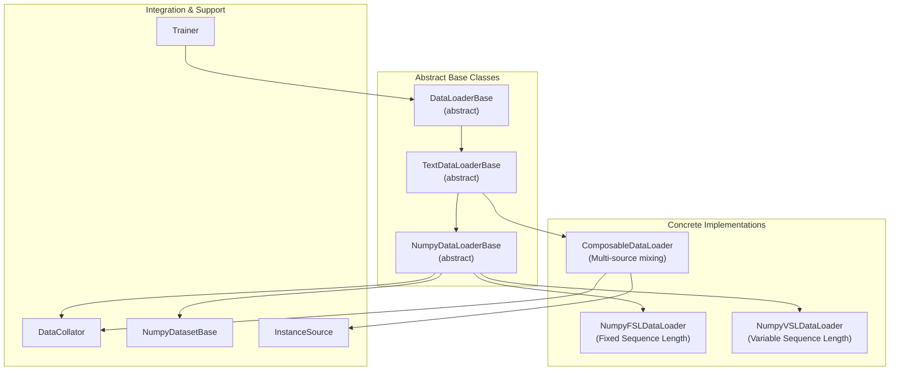
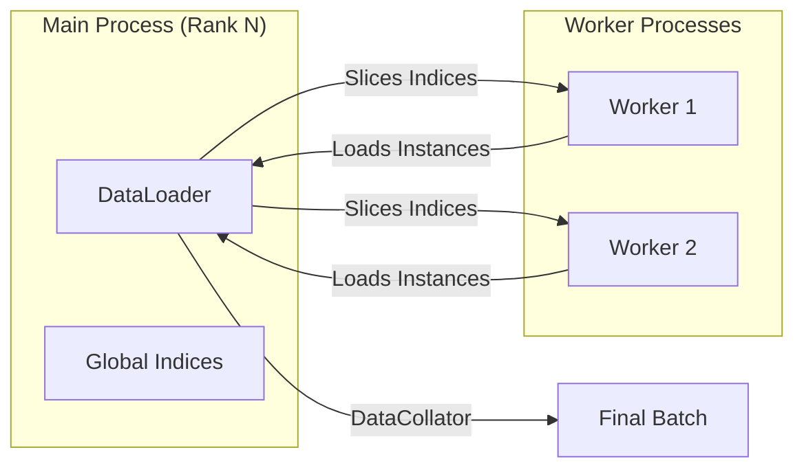

<!-- source: DeepWiki mcp.deepwiki.com · repo allenai/OLMo-core · page 5.3 Data Loaders · fetched 2026-10-26 -->

# Data Loaders

Relevant source files

The following files were used as context for generating this wiki page:

- [docs/source/fs_cache.rst](docs/source/fs_cache.rst)
- [docs/source/guides/data_loading.rst](docs/source/guides/data_loading.rst)
- [docs/source/index.rst](docs/source/index.rst)
- [src/olmo_core/data/__init__.py](src/olmo_core/data/__init__.py)
- [src/olmo_core/data/collator.py](src/olmo_core/data/collator.py)
- [src/olmo_core/data/composable/data_loader.py](src/olmo_core/data/composable/data_loader.py)
- [src/olmo_core/data/data_loader.py](src/olmo_core/data/data_loader.py)
- [src/olmo_core/data/numpy_dataset.py](src/olmo_core/data/numpy_dataset.py)
- [src/test/data/collator_test.py](src/test/data/collator_test.py)
- [src/test/data/custom_data_loader.py](src/test/data/custom_data_loader.py)
- [src/test/data/custom_data_loader_test.py](src/test/data/custom_data_loader_test.py)
- [src/test/data/data_loader_test.py](src/test/data/data_loader_test.py)

This document covers the data loading system in OLMo-core, which provides distributed, deterministic, and stateful data loaders for training large language models. Data loaders bridge the gap between prepared datasets and the training loop, handling batch construction, distributed sampling, and checkpoint resumption.

## System Overview

The data loading system is built around a hierarchy of abstract base classes that provide specialized functionality for different data types and training strategies. The core design emphasizes reproducibility and the ability to resume training exactly where it left off, even across different hardware topologies.

### Data Loader Architecture

**Data Loader Class Hierarchy**

Sources: [src/olmo_core/data/data_loader.py:54-249](), [src/olmo_core/data/data_loader.py:250-305](), [src/olmo_core/data/data_loader.py:307-590](), [src/olmo_core/data/composable/data_loader.py:166-200]()

## Base Classes

### DataLoaderBase

The `DataLoaderBase` class defines the core interface used by the `Trainer`. It manages the global batch size, distributed rank information, and epoch-level bookkeeping.

| Method | Purpose |
| --- | --- |
| `__iter__()` | Iterates over batches for the current epoch and increments `batches_processed`. |
| `state_dict()` | Returns checkpoint state (processed batches, seed, epoch). |
| `load_state_dict()` | Restores state from a dictionary. |
| `reshuffle()` | Prepares data ordering for a new epoch (must be called before `__iter__`). |
| `reset()` | Resets internal bookkeeping after an epoch is exhausted. |

Key properties:
- `global_batch_size`: The total number of tokens/instances across all ranks. [src/olmo_core/data/data_loader.py:112-114]()
- `rank_batch_size`: The local batch size for the current rank. [src/olmo_core/data/data_loader.py:201-203]()
- `batches_processed`: The number of batches completed in the current epoch. [src/olmo_core/data/data_loader.py:104-107]()

Sources: [src/olmo_core/data/data_loader.py:54-248]()

### TextDataLoaderBase

Extends `DataLoaderBase` to track `tokens_processed` and validate that every batch produced matches the expected `rank_batch_size`. It uses a `DataCollator` to aggregate individual instances into tensors.

Sources: [src/olmo_core/data/data_loader.py:250-305]()

### NumpyDataLoaderBase

The foundation for loading data from pre-tokenized NumPy arrays. It manages the generation and caching of global indices to ensure deterministic shuffling across the entire distributed world. It uses `fs_local_rank` (typically rank 0 on each node) to coordinate file-system operations like writing index files. [src/olmo_core/data/data_loader.py:307-590]()

## Concrete Implementations

### NumpyFSLDataLoader

Used for **Fixed Sequence Length (FSL)** training. It draws from a `NumpyFSLDatasetBase` where every instance is chunked to a specific length.

- **Chunking**: Supports `chunk_size` to group consecutive instances, useful for sequence length warmup. [src/olmo_core/data/data_loader.py:603-605]()
- **Deterministic Shuffling**: Shuffles the global set of instances based on the current `epoch` and base `seed`. [src/olmo_core/data/data_loader.py:660-665]()

Sources: [src/olmo_core/data/data_loader.py:592-744]()

### NumpyVSLDataLoader

Used for **Variable Sequence Length (VSL)** training. It organizes data into "buckets" of different sequence lengths and uses a `VSLCurriculum` to determine which bucket to sample from for each global batch. [src/olmo_core/data/data_loader.py:746-990]()

### ComposableDataLoader

A highly flexible loader that consumes one or more `InstanceSource` objects. It supports complex mixing strategies defined by `ShuffleStrategy`:
- `inter_source`: Global shuffle across all sources. [src/olmo_core/data/composable/data_loader.py:55-56]()
- `intra_source`: Shuffle within sources, then concatenate (useful for curricula). [src/olmo_core/data/composable/data_loader.py:57-61]()
- `interleaved_source`: Shuffle within sources and interleave. [src/olmo_core/data/composable/data_loader.py:62-65]()

Sources: [src/olmo_core/data/composable/data_loader.py:52-66](), [src/olmo_core/data/composable/data_loader.py:166-200]()

## Distributed Loading & Worker Processes

OLMo-core supports both multi-threaded and multi-process loading to saturate high-throughput training loops.

### Worker Coordination

**Distributed Batch Slicing**

1. **Global Indices**: A master list of instance indices is generated/loaded. [src/olmo_core/data/data_loader.py:461-464]()
2. **Rank Slicing**: Each DP rank selects its subset using `indices[dp_rank::dp_world_size]`. [src/olmo_core/data/data_loader.py:677-680]()
3. **Worker Slicing**: If `num_workers > 0`, indices are further sliced among workers to avoid redundant loading. [src/olmo_core/data/data_loader.py:710-711]()

Sources: [src/olmo_core/data/data_loader.py:670-714]()

## Data Collator

The `DataCollator` is responsible for taking a list of instances (dictionaries or tensors) and stacking them into a batch dictionary.

- **Padding**: Supports `left` or `right` padding using `pad_token_id`. [src/olmo_core/data/collator.py:14-22](), [src/olmo_core/data/collator.py:38]()
- **Masking**: Automatically pads `attention_mask`, `label_mask`, and `attention_bias`. [src/olmo_core/data/collator.py:83-124]()
- **Validation**: If `vocab_size` is provided, it validates that all token IDs are within range, preventing opaque CUDA errors during `torch.compile`. [src/olmo_core/data/collator.py:150-160]()
- **Document Metadata**: Collates `doc_lens` and `max_doc_lens` if available, supporting intra-document masking. [src/olmo_core/data/collator.py:137-142]()

Sources: [src/olmo_core/data/collator.py:24-178]()

## State Management and Dynamic Batching

### Checkpointing
The `state_dict` captures the exact progress within an epoch, including `batches_processed`, `seed`, and `epoch`. This allows training to resume and yield the same sequence of data as if it hadn't been interrupted.
Sources: [src/olmo_core/data/data_loader.py:425-456]()

### Dynamic Batch Size
The `global_batch_size` property includes logic to adjust `batches_processed` when the batch size is changed (e.g., doubled). This ensures that the underlying token pointers remain correct. It requires that the change occurs at a boundary divisible by the scaling factor to avoid data duplication or loss.
Sources: [src/olmo_core/data/data_loader.py:116-140]()

### Mock Batches
For dry-runs and memory profiling, loaders provide `get_mock_batch()`, which generates random data of the correct shape and type without performing disk I/O.
Sources: [src/olmo_core/data/data_loader.py:521-546]()

---

