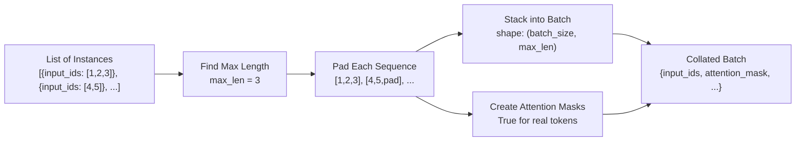
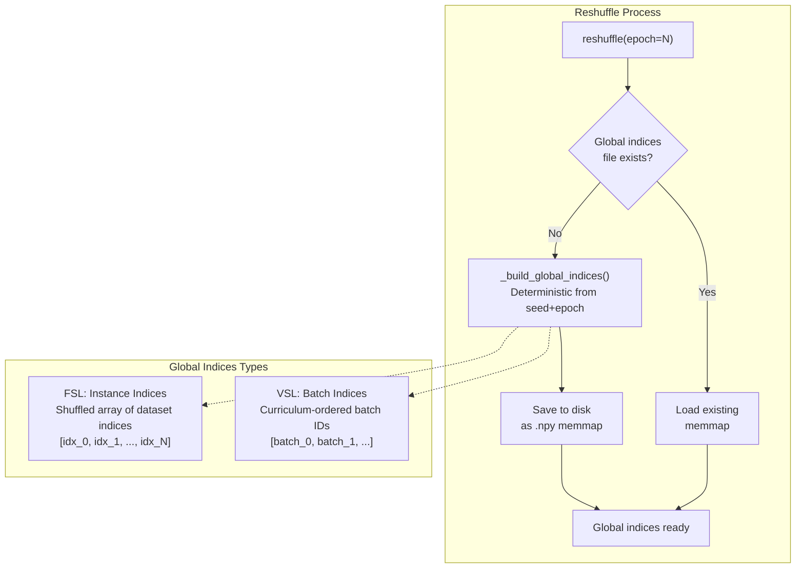
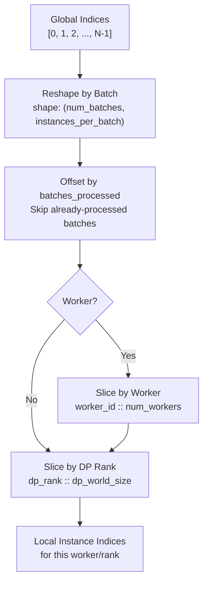
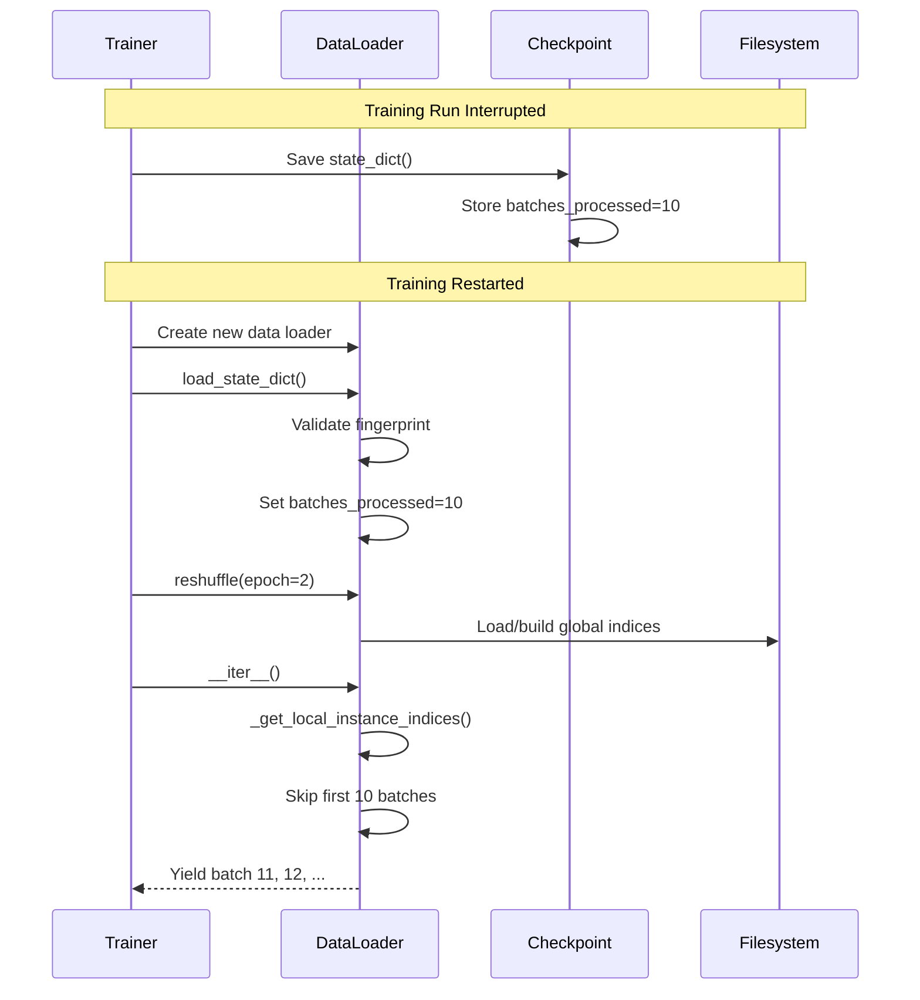

<!-- source: DeepWiki mcp.deepwiki.com · repo allenai/OLMo-core · page 5.4 Batch Processing and State Management · fetched 2026-10-26 -->

# Batch Processing and State Management

<details>
<summary>Relevant source files</summary>

The following files were used as context for generating this wiki page:

- [docs/source/index.rst](docs/source/index.rst)
- [src/olmo_core/data/__init__.py](src/olmo_core/data/__init__.py)
- [src/olmo_core/data/data_loader.py](src/olmo_core/data/data_loader.py)
- [src/olmo_core/data/numpy_dataset.py](src/olmo_core/data/numpy_dataset.py)
- [src/olmo_core/data/utils.py](src/olmo_core/data/utils.py)
- [src/test/data/data_loader_test.py](src/test/data/data_loader_test.py)
- [src/test/data/utils_test.py](src/test/data/utils_test.py)

</details>


This document explains how OLMo-core data loaders process instances into batches, manage data ordering through global indices, track training progress, and support deterministic checkpoint/resume functionality. This covers the mechanics of batch collation, the reshuffle system, state dictionaries, and distributed data distribution.

For information about dataset types and instance formation, see [Dataset Types](#5.1). For data loader configuration and initialization, see [Data Loaders](#5.3).

---

## Overview

The batch processing system in OLMo-core provides:
- **Deterministic data ordering**: Global indices define the exact order of instances/batches per epoch.
- **Stateful iteration**: Data loaders track progress (`batches_processed`, `tokens_processed`) for checkpoint/resume.
- **Distributed handling**: Automatic slicing of batches across data parallel ranks and worker processes.
- **Batch collation**: Conversion of variable-length instances into padded, uniform batches via `DataCollator`.

The key abstraction is `DataLoaderBase` [src/olmo_core/data/data_loader.py:54-266](), which defines the interface for stateful, distributed data loading used by the `Trainer`.

**Sources**: [src/olmo_core/data/data_loader.py:1-50]()

---

## Batch Collation Process

### DataCollator

The `DataCollator` [src/olmo_core/data/collator.py:24-41]() is responsible for converting a list of dataset instances (each with potentially different lengths) into a single batch tensor. The collation process:

1. **Receives instances**: List of dictionaries containing `input_ids` tensors.
2. **Determines max length**: Finds the longest sequence in the batch [src/olmo_core/data/collator.py:49-49]().
3. **Pads sequences**: Pads shorter sequences to match the max length using `pad_token_id` [src/olmo_core/data/collator.py:74-81]().
4. **Creates attention masks**: Generates boolean masks indicating real vs. padded tokens [src/olmo_core/data/collator.py:84-94]().
5. **Stacks tensors**: Creates batch-shaped tensors for all fields (e.g., `label_mask`, `doc_lens`) [src/olmo_core/data/collator.py:148-177]().



**Diagram: Batch Collation Flow**

The collator is invoked during batch iteration in `_iter_batches()` [src/olmo_core/data/data_loader.py:571-601]() through the PyTorch `DataLoader`. For FSL datasets, instances already have uniform length, but collation is still used to stack them into batch tensors. For VSL datasets, collation performs actual padding to the longest instance in each batch.

**Sources**: [src/olmo_core/data/data_loader.py:571-601](), [src/olmo_core/data/collator.py:1-178]()

---

## Global Indices and Reshuffle Mechanism

### Global Indices Concept

The data ordering for each epoch is determined by a **global indices array** that maps batch/instance positions to actual dataset indices. This array is:
- **Deterministic**: Generated from `seed + epoch`, ensuring reproducibility.
- **Shared**: All ranks use the same global ordering (stored on shared filesystem).
- **Pre-computed**: Built once per epoch and cached to disk as memory-mapped NumPy arrays.



**Diagram: Global Indices Generation and Storage**

### Fixed Sequence Length (FSL) Indices

For `NumpyFSLDataLoader` [src/olmo_core/data/data_loader.py:619-778](), global indices are **instance-level**:

1. **Sequence Generation**: Creates an array of indices `[0, 1, ..., len(dataset)-1]` [src/olmo_core/data/data_loader.py:667-667]().
2. **Deterministic Shuffling**: Shuffles indices using a generator seeded with `seed + epoch` [src/olmo_core/data/data_loader.py:672-673]().
3. **Chunking**: If `chunk_size > 1` (used for sequence length warmup), instances are shuffled in chunks to maintain cache locality [src/olmo_core/data/data_loader.py:681-688]().

### Variable Sequence Length (VSL) Indices

For `NumpyVSLDataLoader` [src/olmo_core/data/data_loader.py:780-999](), global indices are **batch-level** since different batches may contain different numbers of instances:

```python
# From _build_global_indices() [src/olmo_core/data/data_loader.py:908-915]
if shuffle:
    # Curriculum determines batch ordering
    batch_indices = curriculum.get_batch_indices(batches_per_bucket, seed + epoch)
else:
    batch_indices = np.arange(total_batches)
```

The curriculum determines the order in which buckets (sequence lengths) are visited and how batches within buckets are sampled.

### Reshuffle Method

The `reshuffle()` [src/olmo_core/data/data_loader.py:535-542]() method must be called before each epoch. The `build_and_save_global_indices()` [src/olmo_core/data/data_loader.py:510-533]() implementation:
1. **Rank 0 check**: Only `fs_local_rank == 0` builds indices to avoid race conditions [src/olmo_core/data/data_loader.py:514-514]().
2. **File check**: Reuses existing indices file if present (deterministic from epoch + seed).
3. **Build**: Calls `_build_global_indices()` to create the array.
4. **Save**: Writes to disk as memory-mapped NumPy array (`.npy` file) [src/olmo_core/data/data_loader.py:519-523]().
5. **Barrier**: All ranks wait for the file to be written [src/olmo_core/data/data_loader.py:530-530]().
6. **Access**: Other ranks memory-map the file in read-only mode.

**Sources**: [src/olmo_core/data/data_loader.py:510-542](), [src/olmo_core/data/data_loader.py:667-690](), [src/olmo_core/data/data_loader.py:908-915]()

---

## State Management and Checkpointing

### State Dictionary Contents

Data loaders implement `state_dict()` [src/olmo_core/data/data_loader.py:441-449]() and `load_state_dict()` [src/olmo_core/data/data_loader.py:451-478]() for checkpoint/resume.

| Field | Purpose |
|-------|---------|
| `dataset_fingerprint` | SHA256 hash of dataset contents and configuration [src/olmo_core/data/data_loader.py:444-444]() |
| `batches_processed` | Number of batches consumed in the current epoch [src/olmo_core/data/data_loader.py:445-445]() |
| `tokens_processed` | Total tokens consumed, enabling batch size changes [src/olmo_core/data/data_loader.py:446-446]() |
| `seed` | Random seed used for reproducibility [src/olmo_core/data/data_loader.py:447-447]() |
| `epoch` | Current epoch number [src/olmo_core/data/data_loader.py:448-448]() |

### Dataset Fingerprinting

The `fingerprint` property [src/olmo_core/data/numpy_dataset.py:212-223]() computes a deterministic hash of the dataset to detect data changes. It includes the class name, specific fields (e.g., `vocab_size`, `dtype`), and the basename and size of all data files [src/olmo_core/data/numpy_dataset.py:217-222]().

On `load_state_dict()`, fingerprints are compared. A mismatch raises a `RuntimeError` unless `ignore_fingerprint_mismatch=True` is set in the configuration [src/olmo_core/data/data_loader.py:461-468]().

### Progress Tracking

Two counters track progress through the epoch:
1. **`batches_processed`**: Incremented after each batch in `__iter__()` [src/olmo_core/data/data_loader.py:104]().
2. **`tokens_processed`**: Incremented by `global_batch_size` after each batch (for text data loaders) [src/olmo_core/data/data_loader.py:301]().

These enable resuming from a checkpoint by skipping already-processed batches in `_get_local_instance_indices()`.

**Sources**: [src/olmo_core/data/data_loader.py:441-478](), [src/olmo_core/data/numpy_dataset.py:212-223]()

---

## Distributed Batch Distribution

### Index Slicing Strategy

The `_get_local_instance_indices()` [src/olmo_core/data/data_loader.py:493-497]() method filters global indices down to the instances that the current worker/rank should process.



**Diagram: Distributed Index Slicing Pipeline**

### FSL Index Slicing

For `NumpyFSLDataLoader._get_local_instance_indices()` [src/olmo_core/data/data_loader.py:720-747]():
1. **Reshape**: The indices are reshaped into `(num_batches, instances_per_batch)` [src/olmo_core/data/data_loader.py:734-734]().
2. **Skip**: Already processed batches are removed via `indices[self.batches_processed:]` [src/olmo_core/data/data_loader.py:738-738]().
3. **Worker Slicing**: If multi-process loading is used, batches are sliced by `worker_id` [src/olmo_core/data/data_loader.py:741-742]().
4. **Rank Slicing**: Each batch is sliced across data parallel ranks using `self.dp_rank::self.dp_world_size` [src/olmo_core/data/data_loader.py:745-745]().

### Micro-batching and Batch Size Changes

When `global_batch_size` is modified, `batches_processed` is adjusted to maintain the correct token position [src/olmo_core/data/data_loader.py:117-140](). For example, if the batch size doubles, the number of processed batches is halved [src/olmo_core/data/data_loader.py:126-126]().

**Sources**: [src/olmo_core/data/data_loader.py:117-140](), [src/olmo_core/data/data_loader.py:720-747](), [src/olmo_core/data/data_loader.py:931-974]()

---

## Checkpoint Resume Mechanics

### Resume Workflow



**Diagram: Checkpoint Resume Sequence**

### Progress Resumption

When training resumes:
1. `load_state_dict()` restores `batches_processed` and `tokens_processed` [src/olmo_core/data/data_loader.py:474-475]().
2. `reshuffle()` ensures the correct global indices for the current epoch are loaded [src/olmo_core/data/data_loader.py:535-542]().
3. During iteration, `_get_local_instance_indices()` skips the indices corresponding to `batches_processed` [src/olmo_core/data/data_loader.py:738-738]().

**Sources**: [src/olmo_core/data/data_loader.py:441-478](), [src/olmo_core/data/data_loader.py:535-542](), [src/olmo_core/data/data_loader.py:720-747]()

---

## Batch Reshaping Utilities

The `olmo_core.data.utils` module provides functional primitives for manipulating batch shapes during processing:

- **`split_batch`**: Splits a collated batch into micro-batches for gradient accumulation [src/olmo_core/data/utils.py:43-71]().
- **`melt_batch`**: Increases the batch size by shortening sequence length (e.g., for curriculum learning) [src/olmo_core/data/utils.py:74-116]().
- **`truncate_batch`**: Reduces sequence length by cropping [src/olmo_core/data/utils.py:119-150]().

**Sources**: [src/olmo_core/data/utils.py:43-150]()

---

