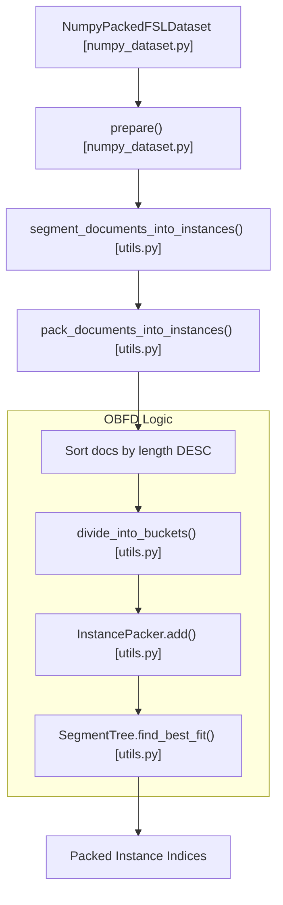
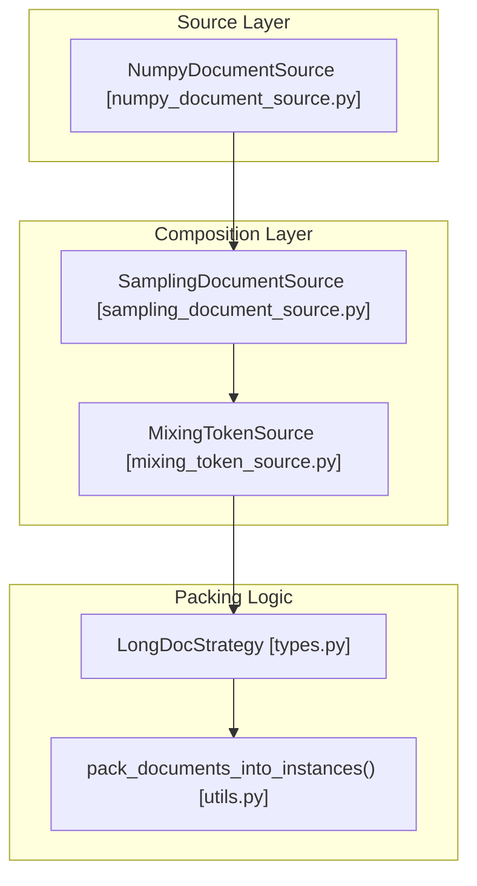

<!-- source: DeepWiki mcp.deepwiki.com · repo allenai/OLMo-core · page 5.5 Document Packing Strategies · fetched 2026-10-26 -->

# Document Packing Strategies

Relevant source files

The following files were used as context for generating this wiki page:

- [docs/source/guides/data_mixing.rst](docs/source/guides/data_mixing.rst)
- [docs/source/index.rst](docs/source/index.rst)
- [src/olmo_core/data/__init__.py](src/olmo_core/data/__init__.py)
- [src/olmo_core/data/data_loader.py](src/olmo_core/data/data_loader.py)
- [src/olmo_core/data/numpy_dataset.py](src/olmo_core/data/numpy_dataset.py)
- [src/olmo_core/data/source_mixture.py](src/olmo_core/data/source_mixture.py)
- [src/olmo_core/data/types.py](src/olmo_core/data/types.py)
- [src/test/data/data_loader_test.py](src/test/data/data_loader_test.py)
- [src/test/data/fixtures.py](src/test/data/fixtures.py)
- [src/test/data/numpy_dataset_test.py](src/test/data/numpy_dataset_test.py)
- [src/test/data/source_mixture_test.py](src/test/data/source_mixture_test.py)

## Purpose and Scope

This page documents the document packing strategies implemented in `olmo-core` for creating fixed-length training instances while minimizing padding tokens. Packing algorithms combine multiple documents into single training instances to improve token efficiency and training throughput.

The page covers the OBFD packing algorithm, the `SegmentTree` data structure used for efficient bin selection, interleaved packing, and strategies for handling documents that exceed the maximum sequence length.

---

## Overview

Document packing addresses the inefficiency of training on documents shorter than the model's sequence length. Without packing, these documents must be padded to the full sequence length, wasting compute. Packing algorithms concatenate multiple documents into single instances to maximize token utilization.

### Key Benefits

| Benefit | Description |
|---------|-------------|
| **Reduced Padding** | Minimize wasted computation on padding tokens. |
| **Increased Throughput** | More actual tokens per training step. |
| **Better Data Efficiency** | Train on more unique tokens per epoch. |

### Available Strategies

The codebase provides several packing implementations and strategies:

- **OBFD Packing** ([`NumpyPackedFSLDataset`](src/olmo_core/data/numpy_dataset.py:1016-1021) / [`pack_documents_into_instances`](src/olmo_core/data/utils.py:656-664)) - Uses the Optimized Best-Fit Decreasing algorithm for near-optimal packing.
- **Interleaved Packing** ([`NumpyInterleavedFSLDataset`](src/olmo_core/data/numpy_dataset.py:1269-1273)) - Deterministically interleaves documents in document order.
- **Long Document Strategies** ([`LongDocStrategy`](src/olmo_core/data/types.py:10-25)) - Defines how to handle documents exceeding `max_sequence_length` (truncate vs. fragment).

**Sources:** [src/olmo_core/data/numpy_dataset.py:1016-1021](), [src/olmo_core/data/utils.py:656-664](), [src/olmo_core/data/types.py:10-25]()

---

## OBFD Packing Algorithm

The Optimized Best-Fit Decreasing (OBFD) algorithm provides near-optimal document packing by sorting documents by length and using a best-fit heuristic to combine them into instances.

### Algorithm Flow

**Sources:** [src/olmo_core/data/numpy_dataset.py:1065-1133](), [src/olmo_core/data/utils.py:656-743](), [src/olmo_core/data/utils.py:581-584]()

### Implementation: SegmentTree and InstancePacker

The core of the OBFD implementation relies on the `SegmentTree` and `InstancePacker` classes.

- **`SegmentTree`**: A data structure that allows finding the "best fit" bin in $O(\log N)$ time [src/olmo_core/data/utils.py:746-817](). It tracks the maximum available space in subtrees to quickly prune the search for a bin that can accommodate a document of a specific size.
- **`InstancePacker`**: Manages a collection of bins (instances) [src/olmo_core/data/utils.py:820-889](). It uses the `SegmentTree` to find the bin with the smallest remaining space that is still large enough to fit the incoming document via `find_best_fit` [src/olmo_core/data/utils.py:863-875]().

### Document Segmentation

Before packing, documents are processed by `segment_documents_into_instances()` [src/olmo_core/data/utils.py:581-653](). This function:
1. Identifies document boundaries using the `eos_token_id`.
2. Splits documents that are longer than the `max_sequence_length` according to the `LongDocStrategy`.
3. Returns a list of segments that can be fit into instances.

**Sources:** [src/olmo_core/data/utils.py:581-889]()

---

## Interleaved Packing

The `NumpyInterleavedFSLDataset` [src/olmo_core/data/numpy_dataset.py:1269-1488]() provides a strategy that maintains document order by interleaving documents sequentially into instances rather than sorting them by length.

### Implementation Details

1. **Segmentation**: Similar to OBFD, it first segments documents at EOS boundaries via `_write_segment_indices()` [src/olmo_core/data/numpy_dataset.py:1395-1437]().
2. **Bucketing**: It divides segments into buckets to manage parallel processing and approximate length grouping [src/olmo_core/data/numpy_dataset.py:1443-1444]().
3. **Sequential Packing**: Within buckets, it packs segments sequentially until the `max_sequence_length` is reached, then starts a new instance.

**Sources:** [src/olmo_core/data/numpy_dataset.py:1269-1488]()

---

## Long Document Handling

When documents exceed the configured `max_sequence_length`, the system applies a `LongDocStrategy` [src/olmo_core/data/types.py:10-25]().

### Strategy Variants

| Strategy | Enum Value | Description |
|----------|------------|-------------|
| **Truncate** | `truncate` | Discards tokens beyond the `max_sequence_length` [src/olmo_core/data/types.py:15-18](). |
| **Fragment** | `fragment` | Splits the long document into multiple smaller documents (fragments) so no tokens are lost [src/olmo_core/data/types.py:20-24](). |

These strategies are utilized in the composable data pipeline, specifically when defining a `NumpyDocumentSource` [src/olmo_core/data/composable/numpy_document_source.py:32-78]() or during sampling.

**Sources:** [src/olmo_core/data/types.py:10-25](), [src/olmo_core/data/composable/numpy_document_source.py:52-55]()

---

## Composable Data Pipeline Integration

The `olmo_core.data.composable` module allows for complex document sources that incorporate packing and sampling.

### Sampling and Mixing

- **`SamplingDocumentSource`**: Samples whole documents from underlying sources to reach a target `num_tokens` [src/olmo_core/data/composable/sampling_document_source.py:62-76](). It preserves document integrity by only sampling at document boundaries.
- **`MixingTokenSource`**: Mixes different token sources according to specified ratios [src/olmo_core/data/composable/mixing_token_source.py:116-146](). It determines how many tokens to take from each source while respecting `max_repetition_factor`.

### Data Flow Diagram

**Sources:** [src/olmo_core/data/composable/sampling_document_source.py:62-205](), [src/olmo_core/data/composable/mixing_token_source.py:116-196]()

---

## Performance and Implementation Details

### Caching and Fingerprinting
Packed datasets rely on a caching mechanism to avoid re-calculating indices. The `fingerprint` property [src/olmo_core/data/numpy_dataset.py:212-223]() ensures that if the source data or packing parameters change, the cache is invalidated.

### Distributed Preparation
The `prepare()` method [src/olmo_core/data/numpy_dataset.py:1065-1133]() uses a `barrier()` [src/olmo_core/distributed/utils.py:39]() to synchronize processes. Only the `fs_local_rank == 0` process performs the actual packing and writes the cache, while other processes wait.

### Memory Efficiency
The packing algorithm is designed to be memory-efficient by using `np.memmap` for large token arrays and only loading document indices/lengths into memory during the packing phase via `get_document_lengths` [src/olmo_core/data/utils.py:539-578]().

**Sources:** [src/olmo_core/data/numpy_dataset.py:1065-1133](), [src/olmo_core/data/utils.py:656-743](), [src/olmo_core/data/utils.py:539-578]()

---

