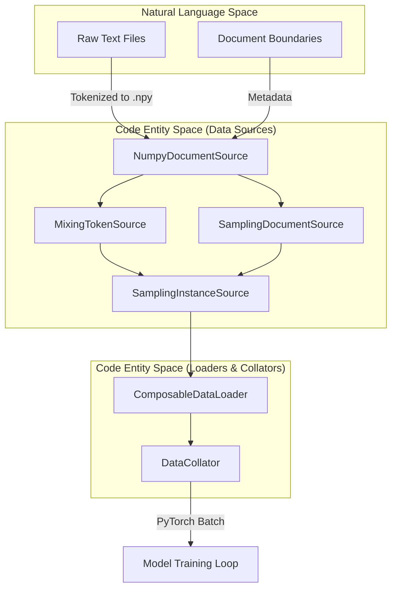
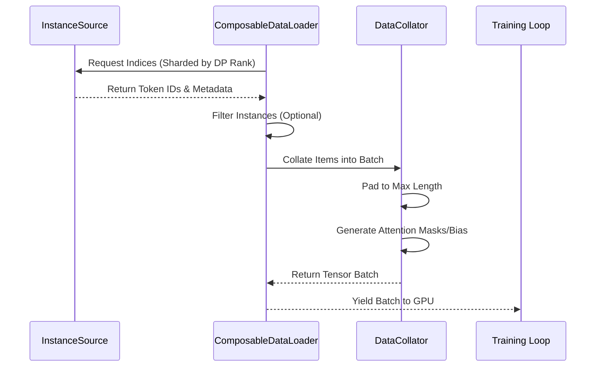

<!-- source: DeepWiki mcp.deepwiki.com · repo allenai/OLMo-core · page 5.6 Composable Data Pipeline · fetched 2026-10-26 -->

# Composable Data Pipeline

Relevant source files

The following files were used as context for generating this wiki page:

- [docs/source/fs_cache.rst](docs/source/fs_cache.rst)
- [src/olmo_core/data/collator.py](src/olmo_core/data/collator.py)
- [src/olmo_core/data/composable/data_loader.py](src/olmo_core/data/composable/data_loader.py)
- [src/olmo_core/data/composable/mixing_token_source.py](src/olmo_core/data/composable/mixing_token_source.py)
- [src/olmo_core/data/composable/numpy_document_source.py](src/olmo_core/data/composable/numpy_document_source.py)
- [src/olmo_core/data/composable/sampling_document_source.py](src/olmo_core/data/composable/sampling_document_source.py)
- [src/olmo_core/data/composable/sampling_instance_source.py](src/olmo_core/data/composable/sampling_instance_source.py)
- [src/olmo_core/data/composable/sampling_token_source.py](src/olmo_core/data/composable/sampling_token_source.py)
- [src/test/data/collator_test.py](src/test/data/collator_test.py)
- [src/test/data/composable/sampling_instance_source_test.py](src/test/data/composable/sampling_instance_source_test.py)
- [src/test/data/composable/sampling_token_source_test.py](src/test/data/composable/sampling_token_source_test.py)

The composable data pipeline in OLMo-core provides a modular framework for building complex data streams by nesting and mixing different data sources. Unlike static datasets, the composable pipeline allows for dynamic sampling, mixing with arbitrary ratios, and sophisticated document handling strategies (truncation vs. fragmentation) at multiple levels of the data hierarchy.

### Data Hierarchy and Flow

The pipeline operates on three primary levels of abstraction, each with its own "Source" and "Config" classes:
1.  **TokenSource**: Operates on raw token IDs.
2.  **DocumentSource**: Operates on documents (sequences of tokens with boundaries).
3.  **InstanceSource**: Operates on fixed-length training instances (sequences ready for the model).

The following diagram illustrates the relationship between these entities and the classes that manage them:

**Data Entity Space to Code Entity Space**

Sources: [src/olmo_core/data/composable/numpy_document_source.py:80-88](), [src/olmo_core/data/composable/data_loader.py:166-175](), [src/olmo_core/data/collator.py:24-35]()

---

### Core Data Sources

#### NumpyDocumentSource
The `NumpyDocumentSource` is the entry point for tokenized data stored as NumPy arrays. It supports loading token IDs and optional label masks from local or cloud storage.

*   **Configuration**: Managed via `NumpyDocumentSourceConfig` [src/olmo_core/data/composable/numpy_document_source.py:80-88]().
*   **Glob Expansion**: The `from_source_groups` method allows for efficient, multi-threaded expansion of glob patterns across multiple source groups [src/olmo_core/data/composable/numpy_document_source.py:91-110]().
*   **DType Inference**: If not explicitly provided, the source automatically infers the required NumPy `dtype` (e.g., `uint16`, `uint32`) based on the tokenizer's vocabulary size [src/olmo_core/data/composable/numpy_document_source.py:62-76]().

#### Mixing and Sampling
OLMo-core provides specialized sources for creating data mixes and adjusting dataset sizes. These sources often "unwind" nested children to maintain accurate sampling ratios [src/olmo_core/data/composable/sampling_token_source.py:109-114]().

| Class | Purpose | Key Parameters |
| :--- | :--- | :--- |
| `MixingTokenSource` | Mixes multiple token sources with specific ratios. | `source_specs`, `num_tokens`, `seed` |
| `SamplingTokenSource` | Samples contiguous chunks of tokens without respecting boundaries. | `max_tokens`, `factor`, `seed` |
| `SamplingDocumentSource` | Samples whole documents to reach a target token count. | `max_tokens`, `factor`, `seed` |
| `SamplingInstanceSource` | Samples training instances from other instance sources. | `max_instances`, `max_tokens`, `factor` |

`MixingTokenSource` uses `calculate_sample_sizes` to determine how many tokens to draw from each child source to match target ratios while respecting a `max_repetition_factor` [src/olmo_core/data/composable/mixing_token_source.py:172-180](). `SamplingDocumentSource` ensures document integrity by sampling whole documents and caching the resulting indices in `.npy` files within the `work_dir` [src/olmo_core/data/composable/sampling_document_source.py:119-124]().

Sources: [src/olmo_core/data/composable/mixing_token_source.py:116-146](), [src/olmo_core/data/composable/sampling_token_source.py:55-73](), [src/olmo_core/data/composable/sampling_document_source.py:62-80](), [src/olmo_core/data/composable/sampling_instance_source.py:62-82]()

---

### Document Handling Strategies

When iterating over documents that exceed the model's maximum sequence length, the pipeline employs specific strategies defined in `NumpyDocumentSourceConfigBase` [src/olmo_core/data/composable/numpy_document_source.py:33-55]().

*   **`max_document_length`**: Constraints the length of documents processed from the source [src/olmo_core/data/composable/numpy_document_source.py:46-51]().
*   **`LongDocStrategy`**:
    *   `truncate`: Excess tokens beyond `max_document_length` are discarded [src/olmo_core/data/composable/numpy_document_source.py:52]().
    *   `fragment`: The document is split into multiple segments, each up to `max_document_length`.

Sources: [src/olmo_core/data/composable/numpy_document_source.py:46-55]()

---

### Composable Data Loader

The `ComposableDataLoader` orchestrates the flow from `InstanceSource` objects to training batches. It handles distributed data sharding, shuffling, and multi-threaded prefetching.

**Data Flow Architecture**

Sources: [src/olmo_core/data/composable/data_loader.py:140-163](), [src/olmo_core/data/collator.py:42-61]()

#### Key Features:
*   **Shuffle Strategies**: Supports `inter_source` (global shuffle), `intra_source` (shuffle within sources then concatenate), and `interleaved_source` (shuffle within then interleave) [src/olmo_core/data/composable/data_loader.py:52-65]().
*   **Instance Filtering**: Configurable via `InstanceFilterConfig` to remove sequences with excessive repetitions [src/olmo_core/data/composable/data_loader.py:44-50]().
*   **Global Batch Management**: Automatically calculates per-rank batch sizes based on `global_batch_size` and `dp_world_size` [src/olmo_core/data/composable/data_loader.py:134-150]().

Sources: [src/olmo_core/data/composable/data_loader.py:44-65](), [src/olmo_core/data/composable/data_loader.py:134-163]()

---

### Data Collation and Padding

The `DataCollator` class is responsible for transforming a list of individual instances into a dictionary of tensors ready for the model [src/olmo_core/data/collator.py:24-41]().

*   **Padding**: Supports `left` or `right` padding using `pad_token_id` [src/olmo_core/data/collator.py:37-38]().
*   **Attention Bias**: Automatically pads and reshapes attention biases to `(batch, 1, seq_len, seq_len)` [src/olmo_core/data/collator.py:97-111]().
*   **Validation**: If `vocab_size` is provided, the collator validates that all token IDs are within the valid range `[0, vocab_size)`, preventing opaque CUDA errors during `torch.compile` [src/olmo_core/data/collator.py:150-159]().
*   **Metadata**: Propagates `doc_lens`, `max_doc_lens`, and custom `metadata` through the batch [src/olmo_core/data/collator.py:171-176]().

Sources: [src/olmo_core/data/collator.py:24-41](), [src/olmo_core/data/collator.py:97-111](), [src/olmo_core/data/collator.py:150-176]()

---

