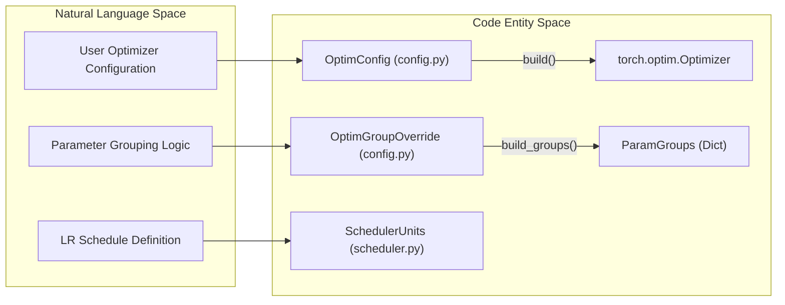
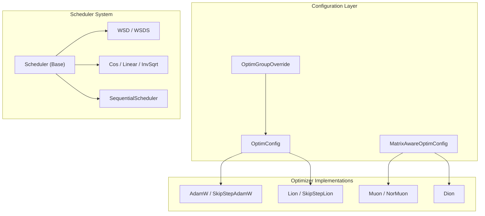
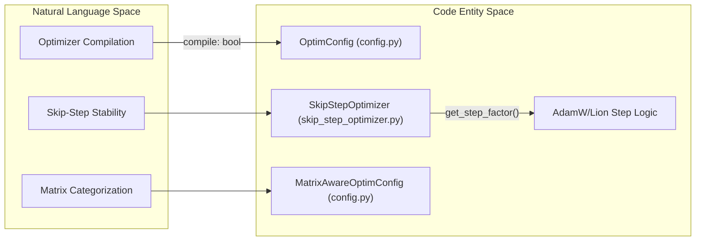

<!-- source: DeepWiki mcp.deepwiki.com · repo allenai/OLMo-core · page 6 Optimization · fetched 2026-10-26 -->

# Optimization

Relevant source files

The following files were used as context for generating this wiki page:

- [src/olmo_core/distributed/parallel/__init__.py](src/olmo_core/distributed/parallel/__init__.py)
- [src/olmo_core/distributed/parallel/pipeline_parallel.py](src/olmo_core/distributed/parallel/pipeline_parallel.py)
- [src/olmo_core/optim/__init__.py](src/olmo_core/optim/__init__.py)
- [src/olmo_core/optim/adamw.py](src/olmo_core/optim/adamw.py)
- [src/olmo_core/optim/config.py](src/olmo_core/optim/config.py)
- [src/olmo_core/optim/scheduler.py](src/olmo_core/optim/scheduler.py)
- [src/olmo_core/train/callbacks/list_checkpointer.py](src/olmo_core/train/callbacks/list_checkpointer.py)
- [src/test/optim/adamw_test.py](src/test/optim/adamw_test.py)
- [src/test/optim/lion_test.py](src/test/optim/lion_test.py)
- [src/test/optim/scheduler_test.py](src/test/optim/scheduler_test.py)
- [src/test/optim/skip_step_optimizer_test.py](src/test/optim/skip_step_optimizer_test.py)

The optimization system in OLMo-core provides a high-level configuration framework for training large language models. It includes a variety of optimizer implementations (from standard AdamW to advanced matrix-aware optimizers like Muon), a flexible learning rate scheduling system, and specialized stability features like skip-step logic and optimizer compilation.

For information about the core training orchestration that uses these optimization components, see [Training System](#3). For details about distributed training coordination, see [Distributed Training](#4).

## System Overview

The optimization system bridges the gap between high-level configuration and low-level PyTorch optimizer logic. It manages parameter grouping (e.g., applying different settings to embeddings vs. weights), learning rate schedules based on steps or tokens, and hardware-specific optimizations like `foreach` kernels or `torch.compile`.

**Natural Language to Code Entity Space: Configuration Mapping**

Sources: [src/olmo_core/optim/config.py:43-62](), [src/olmo_core/optim/config.py:120-154](), [src/olmo_core/optim/scheduler.py:21-24]()

**Optimization System Architecture**

Sources: [src/olmo_core/optim/config.py:57-82](), [src/olmo_core/optim/__init__.py:1-28](), [src/olmo_core/optim/scheduler.py:26-35]()

## Optimizer Configuration System

The configuration system uses the `OptimConfig` base class to handle the mapping of model parameters to optimizer groups.

### Core Configuration Classes
*   **`OptimConfig`**: The base class for all optimizer configurations. It provides the `build()` method which instantiates the actual `torch.optim.Optimizer` [src/olmo_core/optim/config.py:57-60]().
*   **`OptimGroupOverride`**: Allows users to specify different hyperparameters (like `weight_decay`) for specific sets of parameters using glob patterns (e.g., `"*.wte.*"`) [src/olmo_core/optim/config.py:43-53]().
*   **`MatrixAwareOptimConfig`**: A specialized base class for optimizers like Muon and Dion that need to categorize parameters into "matrix", "vector", and "embedding" groups to apply different optimization algorithms to each [src/olmo_core/optim/config.py:221-228]().

For details, see [Optimizer Configuration](#6.1).

Sources: [src/olmo_core/optim/config.py:43-154](), [src/olmo_core/optim/config.py:221-228]()

## Optimizer Implementations

OLMo-core provides a suite of optimizers tailored for LLM training:

| Optimizer | Class | Key Features |
|-----------|-------|--------------|
| **AdamW** | `AdamWConfig` | Standard AdamW with `foreach` and `fused` support [src/olmo_core/optim/adamw.py:12-63](). |
| **Lion** | `LionConfig` | Sign-based momentum optimizer for memory efficiency [src/olmo_core/optim/lion.py:11-11](). |
| **Muon** | `MuonConfig` | Orthogonalization-based optimizer for hidden layers [src/olmo_core/optim/muon.py:12-12](). |
| **Dion** | `DionConfig` | Scalable Muon variant designed for DP/TP sharding [src/olmo_core/optim/dion.py:10-10](). |
| **SkipStep** | `SkipStepOptimizer` | Base class for optimizers that can skip updates if gradients are unstable [src/olmo_core/optim/skip_step_optimizer.py:29-29](). |

For details, see [Optimizer Implementations](#6.2).

Sources: [src/olmo_core/optim/adamw.py:105-136](), [src/olmo_core/optim/lion.py:11-11](), [src/olmo_core/optim/muon.py:12-12](), [src/olmo_core/optim/dion.py:10-10]()

## Learning Rate Schedulers

The scheduler system supports both step-based and token-based units via `SchedulerUnits` [src/olmo_core/optim/scheduler.py:21-24]().

**Common Schedulers:**
*   **`CosWithWarmup`**: Standard cosine decay with a linear warmup phase [src/olmo_core/optim/scheduler.py:277-285]().
*   **`WSD` / `WSDS`**: Warmup-Stable-Decay schedulers often used in continuous pre-training or multi-stage training [src/olmo_core/optim/scheduler.py:160-173](), [src/olmo_core/optim/scheduler.py:461-470]().
*   **`SequentialScheduler`**: Allows chaining multiple schedulers together [src/olmo_core/optim/scheduler.py:429-435]().

For details, see [Learning Rate Schedulers](#6.3).

Sources: [src/olmo_core/optim/scheduler.py:21-24](), [src/olmo_core/optim/scheduler.py:277-285](), [src/olmo_core/optim/scheduler.py:429-435]()

## Advanced Optimization Features

OLMo-core includes several advanced features to improve training throughput and stability:

*   **Optimizer Compilation**: The `compile=True` flag in `OptimConfig` wraps the optimizer step in `torch.compile` [src/olmo_core/optim/config.py:67-76]().
*   **Skip-Step Logic**: Detects gradient spikes and skips the weight update to prevent model divergence, maintaining a rolling average of gradient norms [src/olmo_core/optim/adamw.py:158-183](), [src/test/optim/skip_step_optimizer_test.py:24-43]().
*   **Mixed Precision State**: Support for `bfloat16` optimizer states to save memory [src/olmo_core/optim/adamw.py:119-134]().
*   **Milestone Checkpointing**: Integration with `ListCheckpointerCallback` to save checkpoints at scheduler boundaries (e.g., at the end of WSDS periods) [src/olmo_core/train/callbacks/list_checkpointer.py:11-25]().

**Natural Language to Code Entity Space: Advanced Logic**

Sources: [src/olmo_core/optim/config.py:67-76](), [src/olmo_core/optim/skip_step_optimizer.py:29-29](), [src/olmo_core/optim/adamw.py:158-160]()

For details, see [Advanced Optimization Features](#6.4).

Sources: [src/olmo_core/optim/config.py:67-76](), [src/olmo_core/optim/adamw.py:158-183](), [src/olmo_core/train/callbacks/list_checkpointer.py:11-25]()

---

