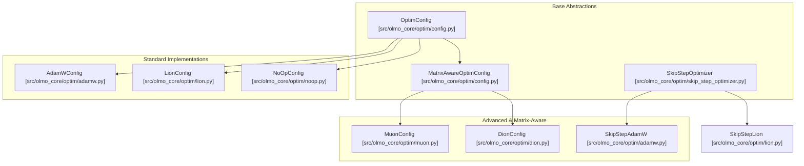
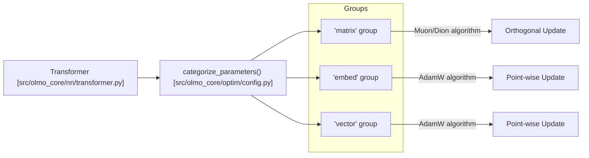

<!-- source: DeepWiki mcp.deepwiki.com · repo allenai/OLMo-core · page 6.2 Optimizer Implementations · fetched 2026-10-26 -->

# Optimizer Implementations

Relevant source files

The following files were used as context for generating this wiki page:

- [src/olmo_core/distributed/parallel/__init__.py](src/olmo_core/distributed/parallel/__init__.py)
- [src/olmo_core/distributed/parallel/pipeline_parallel.py](src/olmo_core/distributed/parallel/pipeline_parallel.py)
- [src/olmo_core/optim/adam.py](src/olmo_core/optim/adam.py)
- [src/olmo_core/optim/adamw.py](src/olmo_core/optim/adamw.py)
- [src/olmo_core/optim/config.py](src/olmo_core/optim/config.py)
- [src/olmo_core/optim/dion.py](src/olmo_core/optim/dion.py)
- [src/olmo_core/optim/lion.py](src/olmo_core/optim/lion.py)
- [src/olmo_core/optim/muon.py](src/olmo_core/optim/muon.py)
- [src/olmo_core/optim/noop.py](src/olmo_core/optim/noop.py)
- [src/olmo_core/optim/skip_step_optimizer.py](src/olmo_core/optim/skip_step_optimizer.py)
- [src/scripts/reshard_core_checkpoint.py](src/scripts/reshard_core_checkpoint.py)
- [src/test/optim/adamw_test.py](src/test/optim/adamw_test.py)
- [src/test/optim/lion_test.py](src/test/optim/lion_test.py)
- [src/test/optim/skip_step_optimizer_test.py](src/test/optim/skip_step_optimizer_test.py)
- [src/test/scripts/reshard_core_checkpoint_test.py](src/test/scripts/reshard_core_checkpoint_test.py)

## Purpose and Scope

This page documents the optimizer implementations available in `olmo-core`, including standard wrappers, memory-efficient algorithms like Lion, and specialized matrix-aware optimizers like Muon and Dion. It also covers the "Skip-Step" logic used to handle training instability without host-device synchronization.

For information about configuring parameter groups and overrides, see [Optimizer Configuration](6.1). For learning rate scheduling, see [Learning Rate Schedulers](6.3).

## Optimizer Class Hierarchy

OLMo-core provides a structured hierarchy for optimizers, separating standard point-wise optimizers from matrix-aware ones that require specialized distributed handling.

### Natural Language to Code Entity Mapping: Optimizers
The diagram below maps conceptual optimizer categories to their specific implementation classes in the codebase.

Title: Optimizer Class Architecture

**Sources:** [src/olmo_core/optim/config.py:57-60](), [src/olmo_core/optim/skip_step_optimizer.py:12-31](), [src/olmo_core/optim/muon.py:44-47](), [src/olmo_core/optim/dion.py:37-40]()

---

## AdamW and Skip-Step Logic

The `AdamW` implementation in OLMo-core is primarily delivered through `SkipStepAdamW`, which provides enhanced stability for large-scale training.

### Skip-Step Mechanism
A `SkipStepOptimizer` can skip updates when the loss or gradient norm exceeds a threshold of standard deviations calculated over a rolling interval [src/olmo_core/optim/skip_step_optimizer.py:13-16](). To avoid expensive host-device synchronizations, the optimizer calculates a `step_factor` (1.0 or 0.0) on the device and multiplies updates by this factor [src/olmo_core/optim/skip_step_optimizer.py:86-93]().

### AdamW Implementation Details
- **`adamw_step`**: A functional implementation of the AdamW update, including a `step_increment_bugfix` to ensure the internal step counter tracks the `step_factor` correctly [src/olmo_core/optim/adamw.py:12-48]().
- **Foreach Support**: `foreach_adamw_step` uses multi-tensor kernels (`torch._foreach_*`) to apply updates to all parameters in a group simultaneously, significantly reducing kernel launch overhead [src/olmo_core/optim/adamw.py:50-103]().
- **State Precision**: Supports storing `exp_avg` and `exp_avg_sq` in specific dtypes (e.g., `bfloat16`) via the `dtype` argument in `SkipStepAdamWConfig` [src/olmo_core/optim/adamw.py:119-122]().

**Sources:** [src/olmo_core/optim/adamw.py:12-103](), [src/olmo_core/optim/skip_step_optimizer.py:86-110]()

---

## Lion Optimizer

`Lion` (EvoLved Sign Momentum) is a memory-efficient alternative to AdamW. It tracks only the first moment (momentum) and uses the `sign` operation for updates [src/olmo_core/optim/lion.py:12-37]().

- **Memory Efficiency**: Since it lacks a second-moment buffer, it uses ~50% less optimizer state memory than AdamW [src/olmo_core/optim/lion.py:68-70]().
- **`SkipStepLion`**: Inherits from `SkipStepOptimizer` to provide the same stability benefits as `SkipStepAdamW` [src/olmo_core/optim/lion.py:82-104]().

**Sources:** [src/olmo_core/optim/lion.py:12-104]()

---

## Muon and Dion (Matrix-Aware Optimizers)

These optimizers are designed for "Matrix-Aware" optimization, where different layers (embeddings, heads, hidden weights) are treated with different algorithms.

### Muon
`Muon` performs standard SGD-momentum followed by an orthogonalization post-processing step (Newton-Schulz iteration) for 2D parameters [src/olmo_core/optim/muon.py:49-52]().
- **Grouping**: Hidden weights use Muon, while embeddings and biases typically use AdamW [src/olmo_core/optim/muon.py:53-54]().
- **Parallelism**: Requires a 1D `DeviceMesh`. It supports FSDP (using the DP mesh) and HSDP (using the DP shard mesh) [src/olmo_core/optim/muon.py:162-174]().

### Dion
`Dion` is a scalable version of Muon designed for complex parallelism strategies including TP (Tensor Parallelism) [src/olmo_core/optim/dion.py:42-43]().
- **Mesh Support**: Explicitly handles `replicate_mesh`, `outer_shard_mesh`, and `inner_shard_mesh` to support HSDP + TP combinations [src/olmo_core/optim/dion.py:115-120]().
- **LR Scaling**: Automatically scales the learning rate for the `lm_head` by `1/sqrt(model_dim)` as suggested in the Dion paper [src/olmo_core/optim/dion.py:95-99]().

### Data Flow: Matrix-Aware Optimization
Title: Muon/Dion Parameter Categorization and Data Flow

**Sources:** [src/olmo_core/optim/muon.py:99-119](), [src/olmo_core/optim/dion.py:77-101](), [src/olmo_core/optim/config.py:120-154]()

---

## Utility Optimizers

### NoOpOptimizer
The `NoOpOptimizer` is a placeholder that performs no updates. It is used for debugging data pipelines or benchmarking forward/backward passes without the overhead of parameter updates [src/olmo_core/optim/noop.py:11-13]().

### Feature Matrix

| Feature | AdamW | Lion | Muon | Dion |
| :--- | :--- | :--- | :--- | :--- |
| **Foreach Support** | Yes [src/olmo_core/optim/adamw.py:50]() | No | No | No |
| **Skip-Step Logic** | Yes [src/olmo_core/optim/adamw.py:105]() | Yes [src/olmo_core/optim/lion.py:82]() | No | No |
| **Matrix-Aware** | No | No | Yes [src/olmo_core/optim/muon.py:45]() | Yes [src/olmo_core/optim/dion.py:38]() |
| **TP Support** | Yes | Yes | No [src/olmo_core/optim/muon.py:189]() | Yes [src/olmo_core/optim/dion.py:140]() |

**Sources:** [src/olmo_core/optim/adamw.py:105-136](), [src/olmo_core/optim/muon.py:188-189](), [src/olmo_core/optim/dion.py:140-142]()

---

